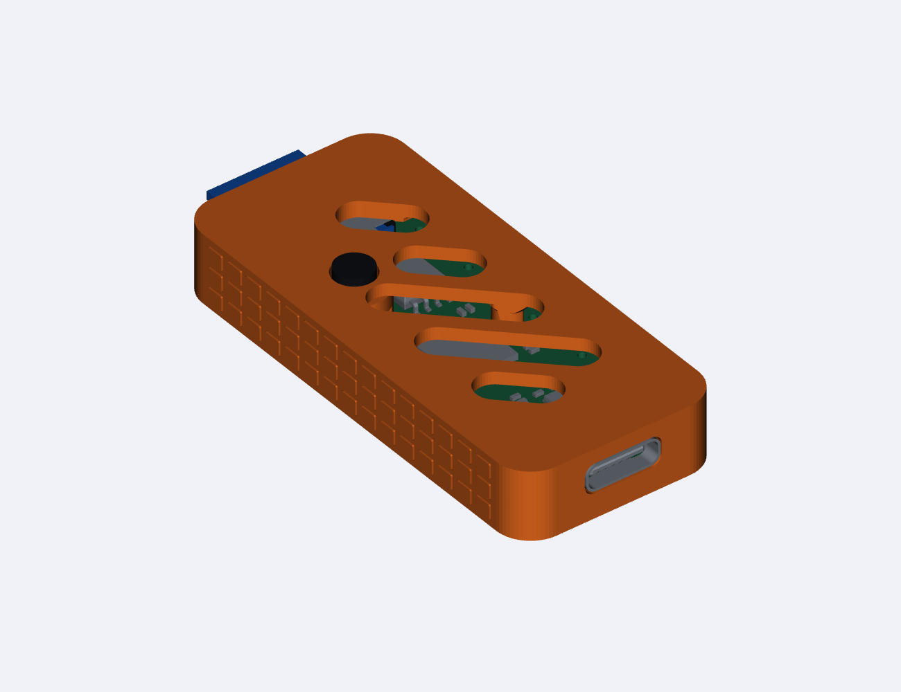
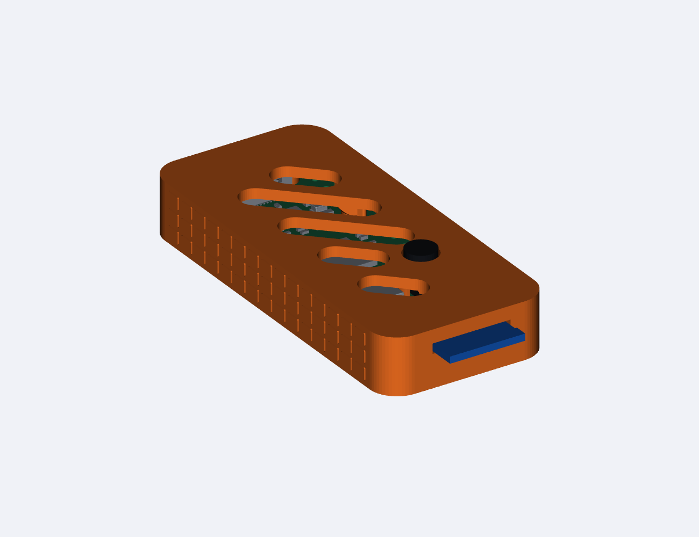
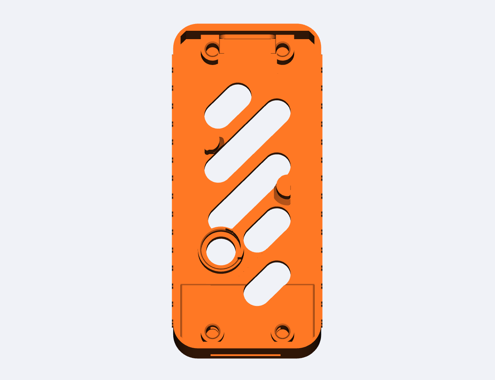
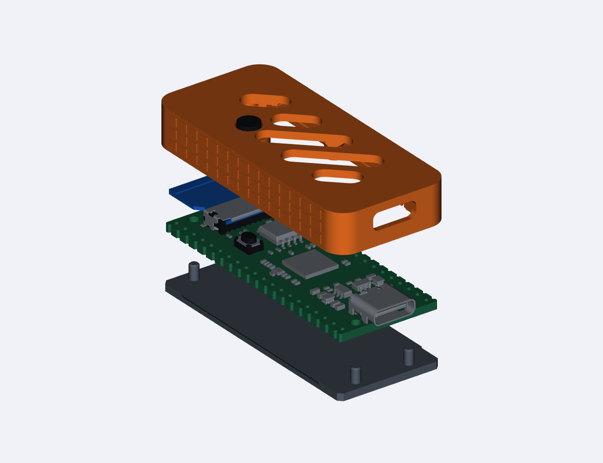
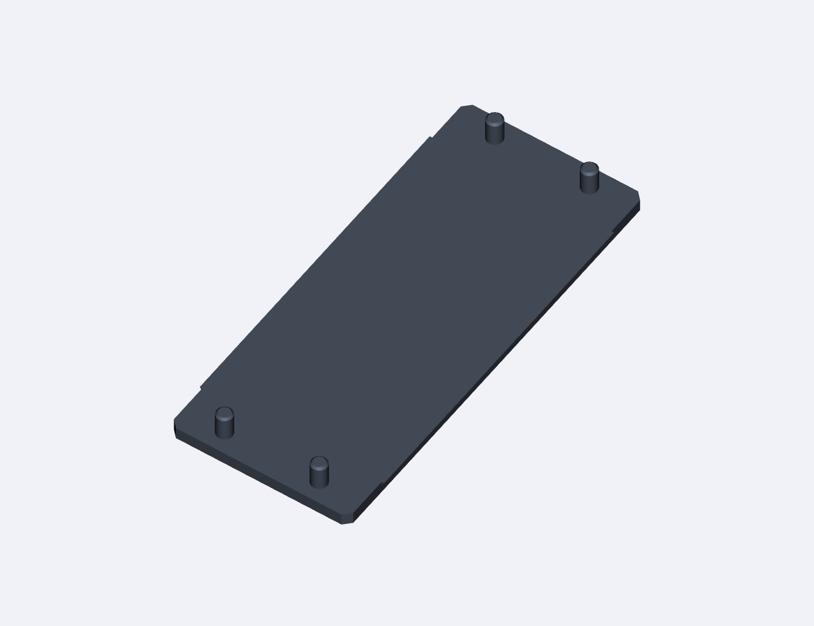
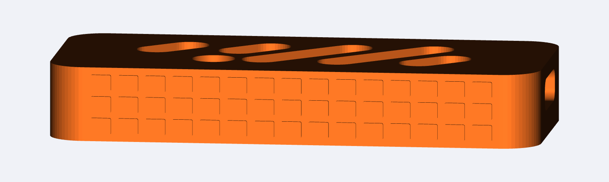

[Yuzuki Neko Case](YuzukiNeko_case.3mf), adapted from dj.santos' Pico case (BY-NC-SA).

This is the enclosure for the core board on its own. The YuzukiCube-M base board uses a different enclosure, [`3DShell_PCB2.zip`](../04_BaseBoard/V1.0/04_3D/3DShell_PCB2.zip). Documentation for both: <https://yuzukihd.github.io/YuzukiNeko/shell/>.

