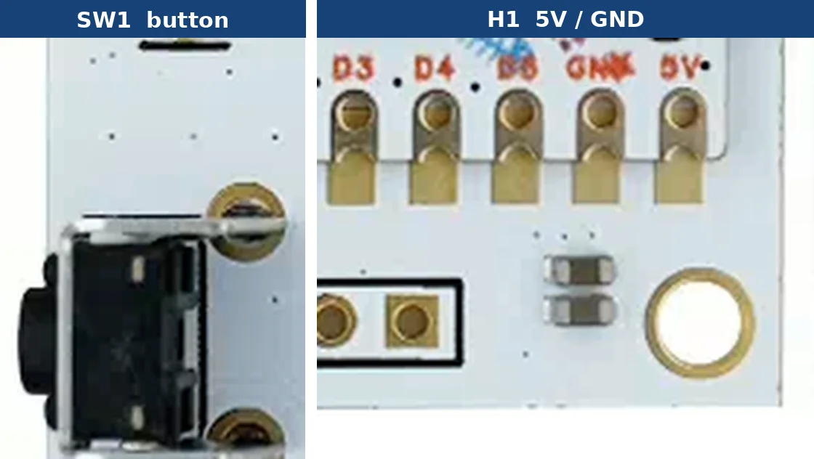

The base board (YuzukiCube-M) brings the core board signals out to the display, audio, antenna, button and serial connectors. It contains no SoC; the core board is surface-mount soldered to it as `U1`. Disconnect USB before wiring and confirm connector orientation before inserting anything.

| Base board photo | Base board schematic |
| --- | --- |
|  |  |

In the photo, `FPC1` is at the top centre, `CN1` CAN at the top left, `CN3` speaker at the top right, `CN2` serial on the right, `H1` 5 V header at the bottom right and `SW1` button at the bottom left. For designators, power rails, signal mapping and pin conflicts, see the [YuzukiCube-M base board](../baseboard.md); for common peripheral pin groups, see [Peripheral pin groups](../hardware/groups.md).

## Wiring rules

- Disconnect USB before connecting or disconnecting anything.
- Check the orientation, notch and gold contacts; do not insert at an angle.
- If a connector will not go in, stop and check the orientation; do not use force.
- FPC cables and 1.25 mm connectors are thin; do not pull on the cable when inserting or removing.
- See [Hardware downloads](../hardware/download.md) for the schematic.

## Display: FPC1

`FPC1` is a 40-pin, 0.5 mm FPC connector. One cable carries MIPI DSI, backlight and capacitive touch.

1. Disconnect USB.
2. Locate the long `FPC1` connector and open its latch according to the connector design.
3. Align the cable's gold contacts with the connector contacts and insert fully in the notch direction.
4. Close the latch and tug the cable gently to confirm it is secure.
5. Do not fold the cable or touch the gold contacts.
6. Power up and check the display and touch.

| FPC1 photo | FPC1 schematic |
| --- | --- |
|  |  |

If the display stays dark, check these in order:

| Check | Description |
| --- | --- |
| Cable orientation | Gold contacts face the socket contacts; follow the notch |
| Latch | Fully closed and the cable is not loose |
| Backlight | Backlight without a picture indicates a DSI signal or firmware problem |
| Firmware | Confirm that the firmware supports this display and resolution |
| Power | Check 5 V, 3.3 V and the backlight boost |

## Serial: CN2

`CN2` is a 5-pin, 1.25 mm connector that brings out UART1 and UART4. The console uses the three UART1 wires.

| Pin | Signal | Connection | Description |
| --- | --- | --- | --- |
| 1 | `UART1-RX` | Adapter `TX` | Board receives |
| 2 | `UART1-TX` | Adapter `RX` | Board transmits |
| 3 | `UART4-RX` | Leave unconnected | Second serial port |
| 4 | `UART4-TX` | Leave unconnected | Second serial port |
| 5 | `GND` | Adapter `GND` | Signal ground |

Use a 3.3 V USB-to-TTL adapter only; leave the adapter's `3V3`/`5V` unconnected. The board is powered by USB, so the adapter connects only `TX`, `RX` and `GND`. Serial parameters are 115200 baud, 8N1, no flow control; use the silkscreen and schematic for pin numbering.

| CN2 photo | CN2 schematic |
| --- | --- |
|  |  |

## CAN: CN1

`CN1` is the 1.25 mm CAN connector. It connects to the CANH / CANL pins of the `U5` TJA1051T/3 transceiver. The CAN controller signals go from core board `PB2` / `PB3` to `U5`, then out through `CN1`.

| Pin | Signal | Description |
| --- | --- | --- |
| 1 | `CANH` | CAN high |
| 2 | `CANL` | CAN low |
| 3/4 | `GND` | Shield/ground |

`U5` is powered from `VSYS-5V`, with `VIO` connected to `VSYS-3V3`. Terminate both ends of the bus with 120 Ω resistors; do not connect CANH or CANL to power or ground; disconnect USB before wiring.

| CN1 photo | CN1 schematic |
| --- | --- |
|  |  |

## Audio: CN3

`HPOUT` goes from the core board through `C10` (100 nF) to the `U2` `+IN` input, and `U2` drives `SPKR+` / `SPKR-` to `CN3`. `HPOUT` is an on-board net; there is no external audio input connector.

1. Disconnect USB.
2. Connect the speaker to `CN3`, observing the `SPKR+` / `SPKR-` marking.
3. Check plug orientation and polarity; do not connect to power or ground.
4. After power-up, enable the `PD4` amplifier in software.

| CN3 photo | CN3 schematic |
| --- | --- |
|  |  |

## Antenna, button and 5 V

`RF1` is an IPEX / u.FL antenna connector. Align the plug with the connector and press straight down until seated; hold the connector body when inserting or removing, not just the cable; connect the antenna before using Wi-Fi/Bluetooth.

`SW1` is a tactile button connected to `PD5` / `DOWN`, the same pin as the UF2 loader button. It is not a reset button; holding it during power-up enters UF2 download mode when the corresponding firmware is installed.

`H1` is a 2.54 mm 2-pin female header that brings out `VSYS-5V` and `GND`. It only exposes USB 5 V; do not power the base board from it, and do not connect motors, relays or other high-current loads.

## Power-up and power-down

1. Disconnect USB.
2. Connect the display cable.
3. Connect the antenna.
4. Connect the speaker.
5. Connect the serial port (optional).
6. Check against the list below.
7. Connect USB last.
8. After power-up, check the display, serial, audio and wireless functions in that order.

Before power-up, confirm: USB is disconnected and all wiring was done with the power off; the cable is fully inserted and the latch is closed; the antenna is seated and its cable is not under tension; `CN3` has the speaker and `CN1` is connected only to CAN; the serial adapter is 3.3 V and only `TX`, `RX` and `GND` are connected; no loose wire ends touch other pins; the board is not touching metal; no external power source is connected to `H1`.

| After power-up | Description | Action |
| --- | --- | --- |
| Display lights up or shows a picture | Cable and backlight are working | Check touch and display orientation |
| Serial output appears | `TX`/`RX`/`GND` are correct | Continue with the boot log |
| Backlight only, no picture | DSI signal or firmware problem | Check cable orientation and display support |
| Display dark and serial silent | Firmware does not support the display, the board is in FEL, or power is abnormal | Return to [core board wiring](core-board.md) and check |
| Strange smell or heat | Short circuit, reversed power or excessive peripheral current | Disconnect USB immediately and inspect |

To power down, disconnect USB first and wait for the system to stop; then remove the 1.25 mm audio, serial and header connections; remove the FPC cable and antenna last. Do not connect or remove any peripheral while powered.

## Common problems

| Symptom | Likely cause | Action |
| --- | --- | --- |
| Display shows nothing | Cable reversed, latch not closed, firmware unsupported | Power off, reseat the cable, confirm firmware and display model |
| Touch does not respond | Touch cable not seated, TWI configuration wrong | Check `FPC1` and the firmware touch driver |
| No serial output | `TX`/`RX` not crossed, no ground, wrong baud rate | Check each item in the `CN2` table |
| Speaker silent | `CN3` not connected, amplifier not enabled, volume low | Check `PD4`, the audio file and volume |
| Wi-Fi has no signal | Antenna missing, driver not loaded, power abnormal | Check `RF1`, `PE10` and the firmware |
| CAN does not communicate | `CN1` not connected, termination missing, `U5` unpowered | Check `CN1`, CANH/CANL and the termination resistors |

## References

- Base board devices, power and pin conflicts: [YuzukiCube-M base board](../baseboard.md)
- Pin groups for display, audio, Wi-Fi and CAN: [Peripheral pin groups](../hardware/groups.md)
- Schematics and hardware files: [Hardware downloads](../hardware/download.md)
- Base board enclosure: [3D-printed enclosures](../shell.md)
- Revision differences and known issues: [Errata and revision differences](../hardware/errata.md)

---

Next page: [Install xfel](xfel.md)
