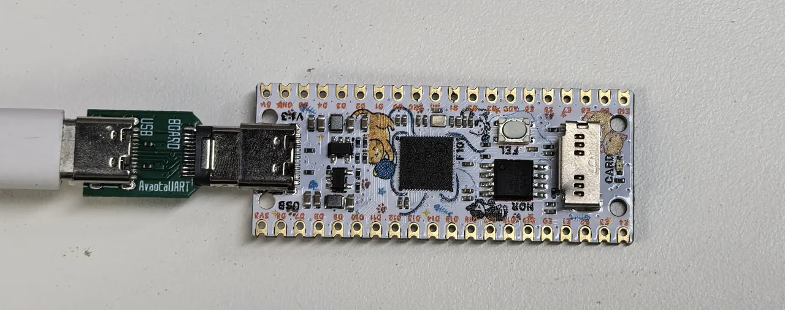

The core board can be used on its own for power, FEL download and flashing, without the base board or a display. Add a 3.3 V USB-to-TTL adapter only when boot logs are needed. The steps below cover minimum wiring, host detection, microSD, serial, headers and the pre-power check.

## Wiring options

| Goal | Connections required | Not required |
| --- | --- | --- |
| Flash an image only | USB-C data cable, host | Base board, display, serial, microSD |
| Flash and view boot logs | The above plus a 3.3 V USB-to-TTL adapter | Base board, display |
| Use base board peripherals | Core board soldered to the base board; base board peripherals connected | Header serial can use base board `CN2` instead |

## USB-C port roles

| Role | Description | Limit |
| --- | --- | --- |
| Power | Draws 5 V from the host VBUS | Single-port power; do not connect an external supply at the same time |
| FEL download | Enumerates as a USB device and waits for xfel commands | Cannot be used as a USB peripheral at the same time |
| USB device/host | Determined by the running firmware | Not available while flashing |

Only one role is active at a time. In FEL, the USB-C port is used for download; after reset, the firmware decides whether it acts as a USB device or host.

## Minimum wiring


The core board has one USB-C port. Power, USB data and FEL download share this connector; no additional power supply is needed. The host detects the FEL device through this port, and xfel reads and writes NOR Flash through it.

## USB cable and host port

| Cable or port | Requirement | Description |
| --- | --- | --- |
| USB-C data cable | Supports data transfer | FEL download requires the data channel |
| Charge-only cable | Not suitable | The host will not detect the FEL device |
| Host USB port | Direct connection; rear ports preferred on a desktop | Hubs and docks may cause power or enumeration problems |
| Board USB-C port | Shared by power, data and FEL | It cannot act as a USB peripheral at the same time as FEL download |

To check whether a cable carries data, use it to transfer files between a phone and a host; a charge-only cable cannot be used for FEL download.

## Host port checks

| Check | Method |
| --- | --- |
| Port power | Connect another USB device to confirm the port works |
| Data connection | Use the same cable to transfer files from a phone |
| Port type | Avoid charge-only ports and front-panel extensions |
| Hub | Connect directly to the host, not through a hub |

## USB cable test steps

1. Connect the phone and the host with the cable under test.
2. Select "File transfer" or "MTP" on the phone.
3. Confirm that the host can see the phone storage.
4. If not, replace the cable or USB port and retry.

A charge-only cable will not appear as storage on the host and cannot be used for FEL download.

## Connection steps

1. Disconnect all cables from the board.
2. Confirm that the cable is a USB-C data cable.
3. Connect the USB-C end to the core board and the other end to a host USB port.
4. On a desktop, prefer a port on the rear of the case; do not use a USB hub or dock.
5. Check whether the host reports a new USB device. FEL mode does not create a disk or open a window.
6. If the host does not respond, replace the cable and USB port and retry.
7. If serial is needed, disconnect USB first, then wire the adapter according to the table below.
8. After wiring, power up again and confirm the device as described in [Install xfel](xfel.md).

:::tip
If the host does not respond, try another data cable and USB port first, then check whether the board entered FEL mode. Many detection failures come from charge-only cables or front-panel USB ports with insufficient power.
:::

## Host detection and FEL/Boot state

| State | Trigger | Host sees | xfel detects it |
| --- | --- | --- | --- |
| FEL mode | Power up while holding `FEL`, or the Flash boot area is empty | A new USB device; no disk or window | Yes |
| Boot mode | Normal power-up with a valid bootloader in Flash | May enumerate as a USB device or serial port | No |

If the Flash boot area is empty, the BROM enters FEL on every power-up. If Flash contains a valid bootloader, the board boots directly and FEL is only entered by powering up while holding `FEL`. See [FEL download mode and tools](../boot/fel.md) for details.

## microSD card (optional)

- Flashing does not require a microSD card, so it can be skipped.
- Disconnect USB before inserting a card, and push it in along the socket direction without force.
- The socket is push-push; the card should click into place. Push once more to release it.
- Card detection may be unstable on V1.4 and earlier; if the card is not detected, leave it out for now. See [Errata and revision differences](../hardware/errata.md).

## Serial connection (optional)

The serial port is used for boot logs and console output and does not participate in FEL download. Flashing does not require it, but it is useful when debugging boot problems.

:::caution
Use a **3.3 V** USB-to-TTL adapter only. A 5 V adapter must not be connected directly. Disconnect USB before wiring.
:::

| Adapter type | Level | Connection | Suitable for |
| --- | --- | --- | --- |
| Generic USB-to-TTL | 3.3 V | `PB0`, `PB1`, `GND` header pins | Requires Dupont wires; general solution |
| Yuzuki AvaotaUART | 3.3 V | Plugs directly into the core board USB-C port | Serial carried on the USB-C SBU pins |
| 5 V USB-to-TTL | 5 V | Do not connect | May damage GPIO |

| Core board pin | Position | Connect to adapter | Description |
| --- | --- | --- | --- |
| `PB0` | Right header row 10 | `RX` | UART1 TX, board transmits |
| `PB1` | Right header row 11 | `TX` | UART1 RX, board receives |
| `GND` | Right header row 2 | `GND` | Signal ground, required |
| Adapter `3V3` / `5V` | — | Leave unconnected | The board is powered by USB |

UART `TX` and `RX` must be crossed: the board's `TX` goes to the adapter's `RX`, and the board's `RX` goes to the adapter's `TX`. Connect only the signal wires and ground; do not power the board from the adapter.

A Yuzuki AvaotaUART can be connected directly to the core board's USB-C port; the serial signals are carried on the USB-C SBU pins. A normal USB-C cable does not provide this function. See [RustSBI + Asterinas](../dev/asterinas/rustsbi-asterinas.md) for the full wiring.



Serial parameters are **115200 baud, 8N1, no flow control**. With PuTTY on Windows:

1. Open PuTTY and set Connection type to Serial.
2. Select the adapter's COM port in Serial line.
3. Set Speed to 115200.
4. Open the connection, then power up the board.

On Linux, use `picocom`:

```sh
picocom -b 115200 /dev/ttyUSB0
```

Use the port shown by `dmesg | tail`; it may also be `ttyACM0`. Exit `picocom` with `Ctrl+A`, then `Ctrl+X`.

| Symptom | Check |
| --- | --- |
| No serial output | `TX`/`RX` crossing, `GND`, baud rate 115200, selected port |
| Garbled output | Baud rate, ground, adapter level is 3.3 V |
| Receive only, cannot send | Board `RX` connected to adapter `TX` |
| Port does not exist | Adapter driver, USB cable, replug |
| Linux permission denied | User in `dialout` group, or udev rule configured |

## Serial wiring steps

1. Disconnect the board's USB.
2. Connect the adapter's `GND` to the core board `GND`.
3. Connect the adapter's `RX` to the core board `PB0`.
4. Connect the adapter's `TX` to the core board `PB1`.
5. Leave the adapter's `3V3` and `5V` unconnected.
6. Reconnect USB and open the serial terminal.

## Serial log uses

- View output from BROM, SyterKit and RustSBI boot stages.
- Determine whether the board reached the kernel and user space.
- View the login prompt or shell prompt.
- Record error messages for comparison with firmware documentation and common issues.

## Headers and power

| Header pin | Voltage | Direction | Use | Note |
| --- | --- | --- | --- | --- |
| `3V3` | 3.3 V | Output | External 3.3 V reference | Do not feed power into this pin |
| `5V` | 5 V | Power | External 5 V loads | Power only; do not connect a signal |
| `GND` | 0 V | Ground | Common ground with external devices | Required |
| GPIO | 3.3 V | Input or output | Digital signals | Do not connect 5 V signals |
| `GPADC` | Analog | Input | Analog sampling | Input range and reference are in the SoC documentation |

- The headers accept **3.3 V** signals only.
- `5V` is a power pin, not a signal pin; do not power the board from the headers and do not connect power backwards.
- Use female Dupont wires and disconnect USB before wiring.
- See [Pinout](../hardware/pinout.md) for pin definitions.

## Common header functions

| Function | Pins | Description |
| --- | --- | --- |
| UART1 console | `PB0` / `PB1` | 115200 8N1 |
| I²C / TWI0 | `PE2` / `PE3` | External sensors |
| SPI1 | `PD0`–`PD6` | External SPI devices |
| PWM0 | `PB0`–`PB3`, `PD6`–`PD9`, etc. | PWM outputs |
| CAN0 | `PE0` / `PE1` | Requires an external transceiver |
| `GPADC` | `GPADC` | Analog input |

See [Pinout](../hardware/pinout.md) for the complete multiplexing tables; a pin cannot use two functions at the same time.

## First power-up

- If Flash is empty, the BROM enters FEL on every power-up. There is no display output, and `xfel` can identify the device.
- If Flash contains a valid bootloader, the board boots directly and may produce display or serial output. Without holding `FEL`, `xfel` cannot see the device.
- With no display and no serial port connected, no visible output is normal.
- The board has no power switch. Disconnect USB to power it off in normal use, after the system is idle and not writing. Do not disconnect while flashing.
- If the board gets hot, smells strange or draws abnormal current, disconnect USB immediately and inspect the wiring.

## First power-up symptoms and actions

| Symptom | Likely cause | Action |
| --- | --- | --- |
| Host shows no reaction | Charge-only cable, insufficient USB power, damaged cable | Replace the data cable and USB port |
| Host reports an unknown USB device | Driver not installed | Install WinUSB with Zadig on Windows |
| `xfel` cannot find the device | Not in FEL | Power up while holding FEL |
| No serial output | `TX`/`RX`, `GND`, baud rate or port wrong | Check against the serial wiring table |
| Board gets hot or current is abnormal | Reversed power, short circuit, excessive peripheral current | Disconnect USB immediately and inspect |

## Check before power-up

- The USB-C cable is a data cable, not a charge-only cable.
- The host USB port is a direct connection, not a hub or dock.
- The board is on a table and not touching a metal surface.
- No loose wire ends touch other pins.
- The serial adapter is 3.3 V, and `3V3`/`5V` are not connected.
- `TX`/`RX` are crossed and `GND` is connected.
- USB was disconnected during wiring.
- No 5 V signal or external power source is connected to the headers.

## Common problems

| Symptom | Likely cause | Action |
| --- | --- | --- |
| Host shows no reaction at all | Charge-only cable, insufficient front-panel power, damaged cable | Replace the data cable and USB port |
| `xfel` cannot find the device | Not in FEL, driver missing, cable does not carry data | Power up while holding FEL, install WinUSB, replace the cable |
| No serial output | `TX`/`RX` reversed, no common ground, wrong baud rate or port | Check each item in the table above |
| microSD not detected | Revision card-detect issue, poor socket contact | Leave the card out; check `R11` and the socket if needed |
| Board gets hot or smells | Reversed power, short circuit, excessive peripheral current | Disconnect USB immediately and inspect the wiring |
| Host reports an unknown USB device | Driver missing or descriptor problem | Install WinUSB with Zadig on Windows; replace the cable |

---

Next page: [Base board wiring](base-board.md)
