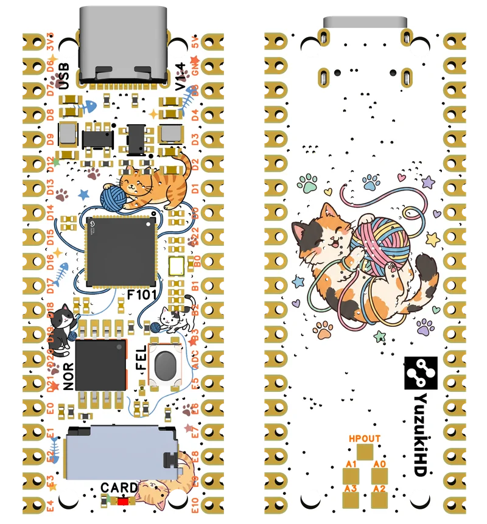
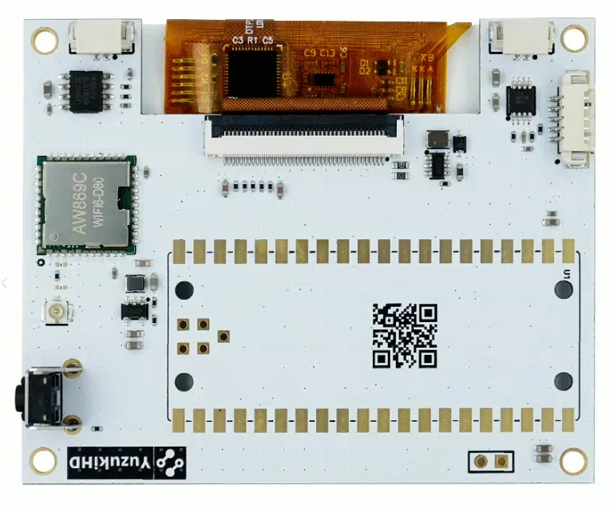

YuzukiNeko has two hardware levels: the core board and the base board. The core board is a complete SoC module that can be powered and flashed on its own; the base board is the YuzukiCube-M carrier, which carries the soldered core board and brings out display, audio, wireless and serial connectors. Identify both before wiring, and confirm the board revision.

## How the core board and base board relate

The core board uses the Pico 2×20 form factor and carries the F101 SoC, PSRAM, NOR Flash, USB-C, `FEL` button, microSD socket and headers. It can be connected to a host on its own for FEL download and flashing; the base board is not required.

The base board carries the core board as `U1` and adds the Wi-Fi/Bluetooth module, audio amplifier, CAN transceiver, display FPC connector, button and sockets. The base board has no battery or charging circuit; power still comes from the core board's USB-C port.

:::caution
The core board on the base board is surface-mount soldered and cannot be removed. The core board can be used on its own; the base board only brings out peripheral connectors.
:::

The bare parts include 49 pads that require reflow or a rework station, not a normal soldering iron. Buy the assembled version if you do not want to solder.

## Core board parts

| Part | Location | Identification | Function |
| --- | --- | --- | --- |
| USB-C port | One end of the board | Oval connector | Power, USB data and FEL download share it |
| `FEL` button | Between the NOR chip and the microSD socket | Small round button labelled `FEL` | Hold during power-up to enter FEL download mode |
| F101 SoC | Centre of the board | QFN68 package, 7 mm × 7 mm | CPU, memory controller and peripheral controllers |
| NOR Flash | Beside the SoC | Black package labelled `NOR` | 16 MiB SPI NOR holding the bootloader and system |
| PSRAM | Same package as the SoC (SiP) | Not visible on the board surface | 16 MiB run-time memory; some V1.5 boards have 32 MiB |
| microSD socket | Other end of the board | Metal socket labelled `CARD` | microSD card interface, optional |
| 2×20 headers | Both sides | 20 pins per side | Bring out GPIO, 3.3 V, 5 V and GND |
| GPIO | Signal pins on the headers | Silkscreen `PDx`, `PBx`, `PEx` | 3.3 V logic input or output |

## Core board headers

The headers use the Pico 2×20 layout. With the component side up and USB-C at the top, row 1 has `3V3` on the left and `5V` on the right, and row 2 has `GND` on the right. See [Pinout](../hardware/pinout.md) for the complete pin table.

| Pin | Position | Function | Note |
| --- | --- | --- | --- |
| `3V3` | Row 1, left | On-board 3.3 V regulator output | Do not feed power into this pin |
| `5V` | Row 1, right | USB VBUS 5 V | Power only; do not connect a 5 V signal |
| `GND` | Row 2, right | Signal ground | Share ground with external devices |
| GPIO | Remaining pins | 3.3 V logic input or output | Do not connect 5 V signals or power the board from the headers |

## Base board

| Base board photo | Base board schematic |
| --- | --- |
|  |  |

The base board adds Wi-Fi/Bluetooth, an audio amplifier, a CAN transceiver, a display FPC connector, a button and sockets. For designators, connector pinouts, power rails and pin conflicts, see the [YuzukiCube-M base board](../baseboard.md); for common peripheral pin groups, see [Peripheral pin groups](../hardware/groups.md).

## Revision identification

Look for the `V1.3`, `V1.4` or `V1.5` silkscreen near the edge of the board. Revision differences mainly affect header silkscreen and microSD detection; USB power and FEL flashing are not affected.

| Revision | Main difference | Impact on wiring and flashing |
| --- | --- | --- |
| V1.3 | From `PD10` onwards, silkscreen is 2 lower than the actual GPIO; `R11` is 10 kΩ | Convert pin names before using the headers; microSD detection may be unstable; USB flashing is unaffected |
| V1.4 | PD silkscreen corrected; `R11` remains 10 kΩ | microSD detection may be unstable |
| V1.5 | PD silkscreen corrected; `R11` changed to 1 kΩ; dedicated PSRAM LDO added | microSD detection improved; some versions have 32 MiB PSRAM |

See [Errata and revision differences](../hardware/errata.md) when converting pin names.

## Power-up order and limits

Connect the display, antenna, audio and serial first, then plug in USB. Do not insert or remove FPC cables, 1.25 mm connectors or the antenna while powered; do not cut power during flashing.

- The core board on the base board is not removable; do not pry it up or resolder it.
- `PE0`–`PE5` are occupied by Wi-Fi SDIO, so I2S0 is not available on the base board.
- `PD0`–`PD3` are used for capacitive touch, `PD5` for the button, and `PD6`–`PD9` for UART4, Bluetooth reset and DSI reset.
- `H1` only exposes USB 5 V; do not use it as a base board power input, and do not connect motors, relays or other high-current loads.
- The CAN controller only exposes logic-level signals; `U5` is the transceiver. A real bus still requires CANH/CANL wiring and termination resistors.
- All header pins use 3.3 V logic and must not be connected directly to 5 V signals.

## References

- Pinout and pin multiplexing: [Pinout](../hardware/pinout.md)
- Schematics and hardware files: [Hardware files](../hardware/files.md)
- Base board devices and power: [YuzukiCube-M base board](../baseboard.md)
- Revision differences and known issues: [Errata and revision differences](../hardware/errata.md)

---

Next page: [Core board wiring](core-board.md)
