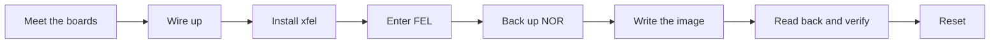

This chapter takes someone using YuzukiNeko for the first time from identifying the board to a verified NOR image: wire it up, enter FEL, back up the flash, write the image, and read it back.

## What you need

- A YuzukiNeko core board, or a YuzukiCube-M base board with the core board already soldered.
- A USB-C data cable. A charge-only cable will not work.
- A Windows, Linux or macOS host.
- xfel or rfel; see [install xfel](xfel.md).
- Optional: a 3.3 V USB-to-TTL serial adapter for boot logs.

## Reading order

1. [Meet the boards](hardware.md): core board, base board, connectors and revisions.
2. [Core board wiring](core-board.md): USB-C power, microSD, serial and headers.
3. [Base board wiring](base-board.md): display, audio, antenna, button and serial. Skip it if you have no base board.
4. [Install xfel](xfel.md): Windows/Linux installation, driver, FEL and commands.
5. [Flashing NOR](nor-flash.md): backup, write, read-back, verify and restore.

## The whole flow

## Done when

- The host sees the board's USB device, and `xfel version` finds the F101.
- You can hold `FEL` while powering on and enter FEL mode.
- You have a 16,777,216-byte backup of the whole NOR flash.
- You have written the 7,143,424-byte `yuzukineko-rustsbi-asterinas.img`.
- A 0x6d0000-byte read-back matches the official SHA-256.
- You can restore the backup when needed.

## If something goes wrong

- The host does not see a USB device: start with [core board wiring](core-board.md), then [install xfel](xfel.md).
- No serial output: check TX/RX and ground in [core board wiring](core-board.md).
- The display stays dark: see [base board wiring](base-board.md).
- xfel reports an error: see the common errors in [install xfel](xfel.md).
- The board does not boot after writing: see [flashing NOR](nor-flash.md) and the [FAQ](../faq.md).

---

Next: [Meet the boards](hardware.md)
