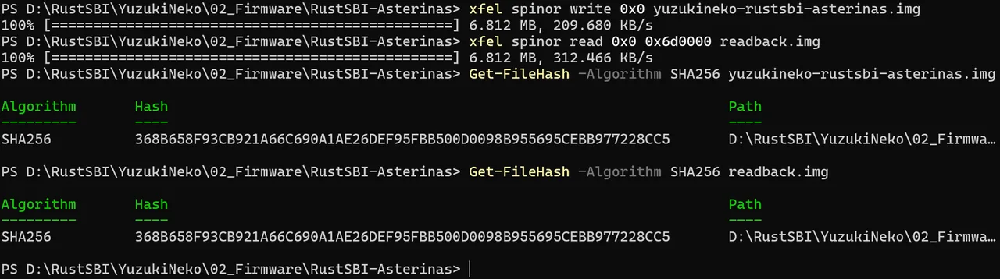

This page backs up, writes, reads back and restores a complete image. Before starting, finish [install xfel](xfel.md), confirm that `xfel version` sees the F101, and have the image ready. NOR Flash holds the system; back it up before writing.

## Layout and lengths

The NOR Flash is 16 MiB, addresses `0x000000`–`0xFFFFFF`. The RustSBI + Asterinas image used in this guide has this layout:

| Content | NOR offset | Reserved size | Description |
| --- | --- | --- | --- |
| SyterKit | `0x000000` | 64 KiB | Bootloader, runs first on power-up |
| Devicetree | `0x010000` | 256 KiB | Describes the board hardware |
| RustSBI | `0x050000` | 512 KiB | SBI firmware |
| Asterinas | `0x0d0000` | 5 MiB | Operating system kernel |
| initramfs | `0x5d0000` | 1 MiB | BusyBox root filesystem |

The complete image occupies `0x000000`–`0x6d0000`, 7,143,424 bytes. `0x6d0000`–`0x1000000` is outside the write range and keeps its previous contents.

This layout is not compatible with a full-chip Linux image or a Zephyr XIP/UF2 image. The Linux image covers all 16 MiB; Zephyr XIP/UF2 keeps a boot area or sampling parameters, so the full-chip steps here do not apply.

## Preparation

- Download `yuzukineko-rustsbi-asterinas.img` from the [image file](https://github.com/YuzukiHD/YuzukiNeko/blob/main/02_Firmware/RustSBI-Asterinas/yuzukineko-rustsbi-asterinas.img) with “Download raw file”.
- The file must be 7,143,424 bytes. Check the file properties on Windows, or run `stat -c %s` on Linux.
- Create a directory without spaces or non-ASCII characters, such as `D:\neko` or `~/neko`, and put `xfel.exe`, the DLLs and the image in it.
- Power the host, and connect the board directly to a host USB port without a hub or dock.
- Do not rename, extract or convert the `.img`.

| File | Size | Description |
| --- | --- | --- |
| `yuzukineko-rustsbi-asterinas.img` | 7,143,424 bytes | Image to write |
| `neko-backup.bin` | 16,777,216 bytes | Full NOR backup taken before writing |
| `readback.img` | 7,143,424 bytes | File read back after writing |

## Step 1: Enter FEL

1. Disconnect USB.
2. Hold the `FEL` button.
3. Connect the USB data cable.
4. Release the `FEL` button.
5. Confirm that the host sees a new USB device.

When the flash has a valid bootloader, the board boots directly; hold `FEL` while powering on to enter download mode. When the flash boot area is empty, every power-up enters FEL.

## Step 2: Confirm the connection

```sh
xfel version
xfel spinor
```

Without PATH on Windows, use `.\xfel.exe version` and `.\xfel.exe spinor`.

| Command | Expected |
| --- | --- |
| `xfel version` | `AWUSBFEX ID=0x00193700(F101)` and `scratchpad=0x00020000` |
| `xfel spinor` | `16777216 bytes`, a 16 MiB NOR flash |

If the chip ID is not `0x00193700`, or the capacity is not 16 MiB, stop and confirm that the correct board is connected.

## Step 3: Back up the whole NOR

This step cannot be skipped:

```sh
xfel spinor read 0x0 0x1000000 neko-backup.bin
```

`0x0` is the start address, `0x1000000` is the whole 16 MiB, and `neko-backup.bin` is the backup file in the current directory. Wait for 100%, confirm the file is 16,777,216 bytes, then copy it to another directory or storage device without overwriting it.

Compute and keep the backup's SHA-256. On Windows PowerShell:

```powershell
Get-FileHash -Algorithm SHA256 .\neko-backup.bin
```

On Linux:

```sh
sha256sum neko-backup.bin
```

Put a date in the backup file name and keep at least two copies; do not open or edit the file in a text editor.

## Step 4: Write the image

After the backup is complete and copied:

```sh
xfel spinor write 0x0 yuzukineko-rustsbi-asterinas.img
```

`xfel spinor write` erases the required sectors automatically; no manual erase is needed. Wait for 100% and for the prompt to return. If the progress pauses briefly, wait; do not disconnect.

:::caution
Do not touch the cables, disconnect USB, shut down the host or cut host power during the write.
:::

## Step 5: Read back and verify

After writing, read back the same region:

```sh
xfel spinor read 0x0 0x6d0000 readback.img
```

`0x6d0000` equals 7,143,424; do not change it. The read-back file must be 7,143,424 bytes. Compare the SHA-256 of both files. On Windows:

```powershell
Get-FileHash -Algorithm SHA256 .\yuzukineko-rustsbi-asterinas.img
Get-FileHash -Algorithm SHA256 .\readback.img
```

On Linux:

```sh
sha256sum yuzukineko-rustsbi-asterinas.img readback.img
```

The two SHA-256 values must match, and must match the official value:

```text
368b658f93cb921a66c690a1ae26def95fbb500d0098b955695cebb977228cc5
```

Case does not matter, but all 64 characters must match.



:::caution
Some xfel errors still return exit code 0. Do not judge success by the command ending; check the output and compare the read-back SHA-256. If they differ, do not reset; write again. If they still differ, stop and inspect.
:::

## Reset and verify

After the check passes:

```sh
xfel reset
```

The board reboots into the written system and the FEL connection drops. With serial connected at 115200 baud, 8N1, no flow control on UART1 `PB0`/`PB1`, the `neko:~#` prompt should appear.


Without serial, a matching SHA-256 in step 5 is enough to confirm the write.

## Restore and failure handling

To restore the pre-flash state:

1. Enter FEL again.
2. Run `xfel spinor write 0x0 neko-backup.bin`.
3. Read back the same length and compare SHA-256, for example `xfel spinor read 0x0 0x1000000 backup-readback.bin`, then compare both files.
4. Run `xfel reset`.

```sh
xfel spinor write 0x0 neko-backup.bin
```

If the backup is lost, the original contents cannot be restored; only a known complete image can be written.

| Situation | Recovery |
| --- | --- |
| Write interrupted | Hold FEL while powering on and write again |
| SHA-256 mismatch | Do not reset; write again and check file size and cables |
| Boot area damaged | Hold FEL while powering on; download mode is still available |
| Backup available | Write `neko-backup.bin`, verify the read-back and reset |
| Backup lost | The original contents are gone; write a known complete image |

| Symptom | Likely cause | Action |
| --- | --- | --- |
| Device suddenly disappears | Loose cable, weak power, FEL button touched | Hold FEL while powering on, replace the cable or USB port |
| `unsupported chip` | xfel is too old | Use v1.4.0 or newer |
| Error during the write | Unstable cable or USB port | Do not reset; enter FEL again and rewrite |
| SHA-256 mismatch | Write, read-back or file problem | Do not reset; rewrite and check file size and cables |
| Read-back file size is wrong | Wrong read length or file path | Check `0x6d0000` and the file name |
| No output after reset | Incomplete image or serial not connected | Enter FEL again and verify the read-back; connect serial for logs |
| Enters FEL again | Boot area empty or the image was not written at `0x0` | Check the write address and read the start of the flash |
| Backup file lost | Not copied elsewhere | The original contents are gone; write a known complete image |

## References

- Shortest path: [Quick start](../quickstart.md)
- Linux prebuilt image: [Linux prebuilt image](../dev/linux/linux-prebuilt.md)
- `.uf2` drag-and-drop flashing: [UF2 drag-and-drop flashing](../dev/zephyr/zephyr-uf2.md)
- Troubleshooting: [FAQ](../faq.md)
- Full NOR layout and backup strategy: [SPI NOR layout and backup](../boot/flash-layout.md)

---

Back to: [Beginner's guide](index.md)
