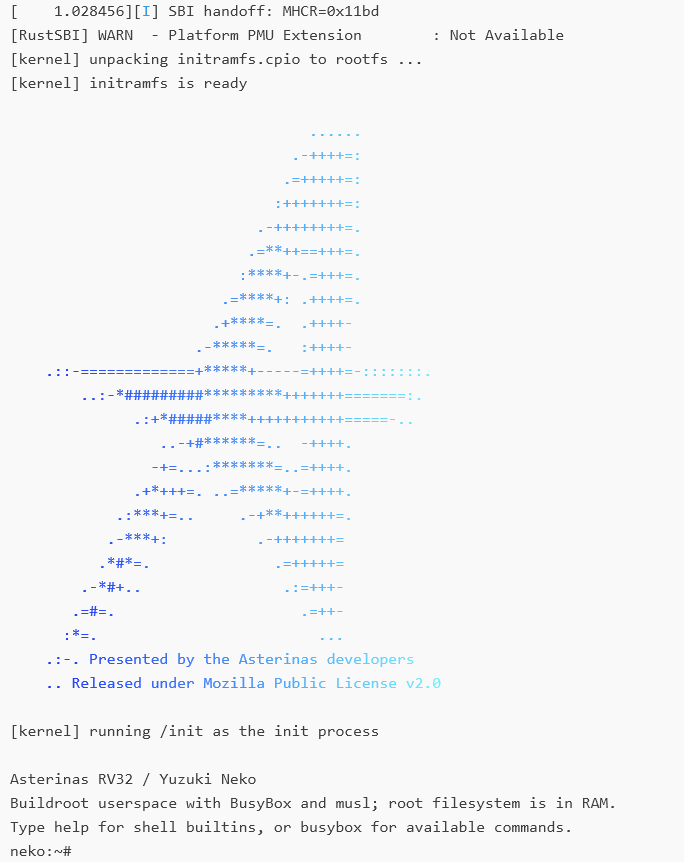

The steps below cover backing up, writing, reading back and restoring a full image. Before starting, complete [Install xfel](xfel.md), confirm that `xfel version` detects the F101, and prepare the image file. NOR Flash is a system resource; back it up before writing.

## NOR Flash and image layout

NOR Flash is 16 MiB, with addresses `0x000000`–`0xFFFFFF`. The bootloader, devicetree, kernel and root filesystem are stored at fixed offsets. The RustSBI + Asterinas image used in this guide has the following layout:

| Content | NOR offset | Reserved size | Description |
| --- | --- | --- | --- |
| SyterKit | `0x000000` | 64 KiB | Bootloader, the first code run after power-up |
| Devicetree | `0x010000` | 256 KiB | Describes the board hardware |
| RustSBI | `0x050000` | 512 KiB | SBI firmware |
| Asterinas | `0x0d0000` | 5 MiB | Operating system kernel |
| initramfs | `0x5d0000` | 1 MiB | BusyBox root filesystem |

The full image writes `0x000000`–`0x6d0000`, 7,143,424 bytes in total. `0x6d0000`–`0x1000000` is outside this write and is not overwritten.

## Address and length quick reference

| Name | Value | Purpose |
| --- | --- | --- |
| NOR start | `0x0` | Read/write start |
| Whole-flash length | `0x1000000` | Backup and restore |
| Image length | `0x6d0000` | Write and read-back |
| Image end | `0x6d0000` (exclusive) | End address of the write range |

## Image types

| Image | Size | Write range | Use case |
| --- | --- | --- | --- |
| `yuzukineko-rustsbi-asterinas.img` | 7,143,424 bytes | `0x000000`–`0x6d0000` | This guide; first evaluation |
| Linux + Buildroot image | 16,777,216 bytes | All 16 MiB | Writable root filesystem and persistent changes |
| Zephyr XIP / UF2 | Varies | Specific layout | Zephyr development; see the corresponding chapters |

The layouts are mutually incompatible. Do not mix Linux, RustSBI and Zephyr images on the same Flash. Zephyr XIP and UF2 flows also reserve a boot area or sampling parameters and cannot use the whole-flash write steps on this page.

## Backup, write and read-back comparison

| Stage | Command | Length | Output file |
| --- | --- | --- | --- |
| Backup | `xfel spinor read` | `0x1000000` | `neko-backup.bin` |
| Write | `xfel spinor write` | Image size | — |
| Read-back | `xfel spinor read` | `0x6d0000` | `readback.img` |
| Restore | `xfel spinor write` | Backup size | — |

Backup and restore use the whole-flash length `0x1000000`; write and read-back use the image length `0x6d0000`. Do not confuse the two lengths.

## Write risk and backup

Writing an image replaces the existing NOR contents. A wrong image, a wrong offset, or a power loss during writing can prevent the board from booting. In most cases the board can be recovered by powering up while holding `FEL` and rewriting, but the original contents may be lost.

:::danger
Do not disconnect USB, shut down the host or cut power to the board while writing. Back up the whole NOR Flash before starting and copy the backup to another location.
:::

## Requirements

1. Back up the whole NOR and confirm that the backup is 16,777,216 bytes.
2. Copy the backup to another directory or storage device; do not overwrite it.
3. Write only an image that matches the board; do not mix images from different systems.
4. Read back the same length after writing and compare the SHA-256.

## Prepare the files

- Create a directory without Chinese characters or spaces: `D:\neko` on Windows, `~/neko` on Linux.
- Place `xfel.exe` (Windows), all DLLs and the `.img` to write in that directory.
- Connect the host to power; connect the board directly to a host USB port, not through a dock or USB hub.
- Download the image: open <https://github.com/YuzukiHD/YuzukiNeko/blob/main/02_Firmware/RustSBI-Asterinas/yuzukineko-rustsbi-asterinas.img> and click "Download raw file"; or download the repository ZIP and find it under `02_Firmware/RustSBI-Asterinas/`.
- The file size should be **7,143,424 bytes**. Check the file properties on Windows, or use `stat -c %s` on Linux.
- Do not rename the file, and do not unpack or convert the `.img`. If Windows hides extensions, the file may appear as `yuzukineko-rustsbi-asterinas`; check the size and do not add or change the suffix manually.

| File | Size | Purpose |
| --- | --- | --- |
| `yuzukineko-rustsbi-asterinas.img` | 7,143,424 bytes | Image to write |
| `neko-backup.bin` | 16,777,216 bytes | Whole NOR backup taken before flashing |
| `readback.img` | 7,143,424 bytes | File read back after writing |

## Image download steps

1. Open <https://github.com/YuzukiHD/YuzukiNeko/blob/main/02_Firmware/RustSBI-Asterinas/yuzukineko-rustsbi-asterinas.img>.
2. Click "Download raw file".
3. Save it to `D:\neko` or `~/neko`, in the same directory as xfel.
4. Check that the file is 7,143,424 bytes.
5. Do not rename, unpack or convert it.

## Step 1: Enter FEL

1. Disconnect the board's USB cable.
2. Hold the `FEL` button.
3. Connect the USB data cable.
4. Release the `FEL` button.
5. Confirm that the host reports a new USB device.

If Flash contains a valid boot program, the board does not enter FEL automatically; power it up while holding `FEL`. If the Flash boot area is empty, the board enters FEL on every power-up.

## Step 2: Confirm the connection

In the terminal, run:

```sh
xfel version
xfel spinor
```

Without PATH on Windows, use `.\xfel.exe version` and `.\xfel.exe spinor`.

| Command | Expected output |
| --- | --- |
| `xfel version` | `AWUSBFEX ID=0x00193700(F101)` and `scratchpad=0x00020000` |
| `xfel spinor` | `16777216 bytes`, identifying a 16 MiB NOR Flash |

If the chip ID is not `0x00193700`, or the capacity is not 16 MiB, stop and confirm that the correct board is connected.

## Step 3: Back up the whole NOR

This step cannot be skipped. In the terminal, run:

```sh
xfel spinor read 0x0 0x1000000 neko-backup.bin
```

Arguments:

- `0x0`: start at the beginning of NOR.
- `0x1000000`: read 16 MiB, the whole Flash.
- `neko-backup.bin`: backup file in the current directory.

Wait for the progress to reach 100%. The backup file should be **16,777,216 bytes**. Copy `neko-backup.bin` to another directory or storage location; do not overwrite it. The backup is a binary image; do not open or modify it with a text editor.

Compute the backup's SHA-256 and save the result. Windows PowerShell:

```powershell
Get-FileHash -Algorithm SHA256 .\neko-backup.bin
```

Linux:

```sh
sha256sum neko-backup.bin
```

## Backup file management

- Include the date and image version in the file name, for example `neko-backup-20261122.bin`.
- Keep at least two copies in different directories or storage devices.
- Do not overwrite the previous backup.
- Record the backup file's SHA-256.
- Do not open or modify the backup with a text editor.

## Step 4: Write the image

After confirming and copying the backup, run:

```sh
xfel spinor write 0x0 yuzukineko-rustsbi-asterinas.img
```

`xfel spinor write` erases the required sectors automatically; no manual erase is needed. Wait for the progress to reach 100% and for the prompt to return before continuing.

:::caution
While writing, do not touch the cables, disconnect USB, shut down the host or let the host lose power. If the progress bar pauses, wait before disconnecting anything.
:::

## Step 5: Read back and verify

After writing, read back the same area:

```sh
xfel spinor read 0x0 0x6d0000 readback.img
```

`0x6d0000` equals the image size, 7,143,424 bytes. Do not change the hexadecimal values in the command. The read-back file should be 7,143,424 bytes.

Compare the SHA-256 of both files. Windows PowerShell:

```powershell
Get-FileHash -Algorithm SHA256 .\yuzukineko-rustsbi-asterinas.img
Get-FileHash -Algorithm SHA256 .\readback.img
```

Linux:

```sh
sha256sum yuzukineko-rustsbi-asterinas.img readback.img
```

Both SHA-256 values must match each other and the official value:

```text
368b658f93cb921a66c690a1ae26def95fbb500d0098b955695cebb977228cc5
```

Letter case does not affect the comparison, but all 64 characters must match. The screenshot below shows a normal result on Windows:


:::caution
Some xfel errors still return exit code 0. Do not judge success by the command ending alone; check the output and compare the read-back SHA-256. If the fingerprints differ, do not reset; write again. If they still differ, stop and inspect the setup.
:::

## Step 6: Reset

After verification passes, run:

```sh
xfel reset
```

The board reboots and runs the written system. The FEL connection drops after reset, and `xfel` can no longer detect the device.

## Step 7: Verify boot (optional)

With a serial port connected at **115200 baud, 8N1, no flow control** to UART1 `PB0`/`PB1`, the BusyBox prompt `neko:~#` should appear.



Without a serial adapter, matching SHA-256 values in step 5 are sufficient to confirm a successful write; serial can be connected later.

## Restore the backup

Restore the state before flashing:

1. Enter FEL again.
2. Run `xfel spinor write 0x0 neko-backup.bin`.
3. Read back the same length and compare the SHA-256. You can use `xfel spinor read 0x0 0x1000000 backup-readback.bin`, then compare the SHA-256 of `neko-backup.bin` and `backup-readback.bin`.
4. Run `xfel reset`.

```sh
xfel spinor write 0x0 neko-backup.bin
```

If the backup file has been lost, the original contents cannot be restored; only a known full image can be written.

## Recovery paths after a failure

| Situation | Recovery |
| --- | --- |
| Write interrupted | Power up while holding FEL and run the write again |
| SHA-256 mismatch | Do not reset; rewrite and check the file size and cable |
| Boot area damaged | Power up while holding FEL; download mode is still available |
| Backup available | Write `neko-backup.bin`, read back and verify, then reset |
| Backup lost | The original contents cannot be restored; only a known full image can be written |

## Write time and progress

- Write time depends on USB speed, image size and host load.
- The progress bar may pause briefly; this does not mean failure.
- Wait for 100% and for the prompt to return.
- Do not disconnect or reset early based on the percentage alone.

## Common problems

| Symptom | Likely cause | Action |
| --- | --- | --- |
| Device disappears | Loose cable, insufficient power, or FEL was touched | Power up while holding FEL; replace the cable or USB port |
| `unsupported chip` | xfel is too old | Use v1.4.0 or newer |
| Write fails midway | Unstable cable or USB port | Do not reset; enter FEL again and rewrite |
| SHA-256 mismatch | Write, read-back or file problem | Do not reset; rewrite and check the file size and cable |
| Read-back file has the wrong size | Wrong read length or file path | Check `0x6d0000` and the file name |
| No output after reset | Incomplete image, or serial not connected | Enter FEL, read back and verify, then connect serial to view the log |
| Board enters FEL again | Boot area is empty, or the image was not written at `0x0` | Check the write address and read back the beginning |
| Backup file lost | Not copied to another location | Original contents cannot be restored; only a known image can be written |

## Check before flashing

- `xfel version` detects the F101, and `xfel spinor` detects 16 MiB.
- The image is 7,143,424 bytes and the file name was not changed.
- The whole-NOR backup `neko-backup.bin` is complete and is 16,777,216 bytes.
- The backup has been copied to another location.
- The host is connected to power, and the board is connected directly to a host USB port.
- No other program is using the USB device.
- No high-current peripherals are connected to the board.
- The board and cables will not move during writing.

## Check after flashing

- The write reached 100% and the command ended normally.
- The read-back file is 7,143,424 bytes.
- The read-back file and the original image have the same SHA-256.
- The official SHA-256 also matches.
- `xfel reset` has been run.
- The backup file still exists and was not overwritten.
- The board boots normally, or the serial port shows the expected log.

## Verification record

| Item | Record |
| --- | --- |
| Image SHA-256 | — |
| Backup SHA-256 | — |
| Read-back SHA-256 | — |
| Result | — |

## Further reading

- Repeat the shortest procedure: [Quickstart](../quickstart.md)
- Switch to Linux: [Prebuilt Linux images](../dev/linux/linux-prebuilt.md)
- Use `.uf2` drag-and-drop flashing: [UF2 drag-and-drop flashing](../dev/zephyr/zephyr-uf2.md)
- Troubleshoot: [FAQ](../faq.md)
- Learn about the full NOR layout and backup strategy: [SPI NOR layout and backup](../boot/flash-layout.md)

---

Back to: [Beginner's guide](index.md)
