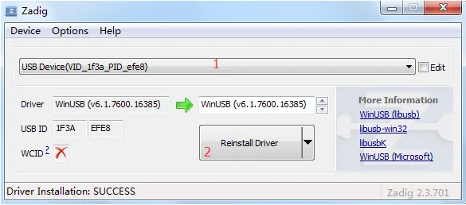
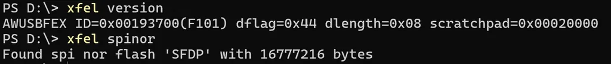

xfel is the host-side FEL download tool. It communicates with the F101 BROM FEL mode over USB. The steps below cover xfel installation, driver configuration, entering FEL and confirming the connection. Run the commands in a host terminal: PowerShell on Windows (search for PowerShell in the Start menu) or the system terminal on Linux (usually `Ctrl+Alt+T`).

## Tools and files

| File or tool | Purpose | Source | When needed |
| --- | --- | --- | --- |
| xfel (Windows) | FEL download | `xfel-windows-v1.4.0.7z` from the GitHub v1.4.0 release | Windows host |
| xfel (Linux) | FEL download | Build from source | Linux host |
| 7-Zip | Extract `.7z` | <https://www.7-zip.org/> | When Windows cannot open `.7z` directly |
| Zadig | Install the WinUSB driver | <https://zadig.akeo.ie/> | When Windows cannot open the FEL device |
| Image | Data to write to NOR | See [Flashing NOR (special topic)](nor-flash.md) | When flashing |

## Pre-installation checks

| Check | Requirement |
| --- | --- |
| Host | Windows, Linux or macOS; this page uses Windows and Linux as examples |
| USB cable | Data cable, not charge-only |
| Disk space | Enough for xfel, the DLLs and the image |
| Network | Access to GitHub, or the installer and image already downloaded |

## Install xfel on Windows

1. Open <https://github.com/xboot/xfel/releases/tag/v1.4.0>.
2. Download `xfel-windows-v1.4.0.7z`. This version includes F101 support.
3. If the system cannot open `.7z`, install 7-Zip. Right-click the archive, choose 7-Zip and extract it into the current folder.
4. Extract the complete archive. The DLL files next to `xfel.exe` must remain in the same directory.
5. Create a directory without Chinese characters or spaces, for example `D:\neko`.
6. Place `xfel.exe`, all DLLs and the `.img` used later in that directory. The layout should look like:

```text
D:\neko\
  xfel.exe
  *.dll
  yuzukineko-rustsbi-asterinas.img
```

7. Hold `Shift` and right-click in an empty area of that directory, then choose "Open PowerShell window here" or "Open in Terminal".
8. Run:

```powershell
.\xfel.exe version
```

PowerShell does not search the current directory for executables automatically. Without PATH configured, use `.\xfel.exe`. The xfel directory can also be added to PATH so that `xfel` works directly; see [FEL download mode and tools](../boot/fel.md).

:::tip
If PATH is not configured, always run `.\xfel.exe ...` from the directory containing `xfel.exe`. After changing directories, reopen PowerShell or `cd` back to that directory.
:::

## Windows installation checks

| Check | Expected result |
| --- | --- |
| `xfel.exe` | Present in the tool directory, such as `D:\neko` |
| DLLs | In the same directory as `xfel.exe` |
| Current directory | `pwd` shows the tool directory |
| Command | `.\xfel.exe version` does not report "not recognized" |

## PATH configuration (optional)

1. Open System Properties → Advanced → Environment Variables.
2. Select `Path` under User variables and click Edit.
3. Add the xfel directory, for example `D:\neko`.
4. Confirm and close all PowerShell windows.
5. Reopen PowerShell and run `xfel version`.

With PATH configured, `xfel` can be used directly instead of `.\xfel.exe`. Already-open terminals do not pick up the change; reopen them.

## Windows driver (Zadig)

Windows may require the WinUSB driver for the FEL device. Install it only when xfel reports that the device is missing or cannot be opened.

1. Put the board into FEL mode and keep USB connected.
2. Download and open [Zadig](https://zadig.akeo.ie/).
3. Select the FEL device with **VID `1f3a`, PID `efe8`** in the device list.
4. Select **WinUSB** as the target driver and install it.
5. Replug the board and run `xfel version` again.

:::caution
Check the VID/PID before installing. Do not change the driver of the USB serial adapter, keyboard, mouse or any other USB device; doing so may stop that device from working.
:::



## Install xfel on Linux

On Linux, xfel is normally built from source. The example below uses Debian / Ubuntu; install the dependencies first:

| Package | Purpose |
| --- | --- |
| `git` | Fetch the xfel source |
| `build-essential` | Compiler toolchain |
| `pkg-config` | Find libusb |
| `libusb-1.0-0-dev` | USB access library |

```sh
sudo apt update
sudo apt install git build-essential pkg-config libusb-1.0-0-dev
git clone https://github.com/xboot/xfel.git
cd xfel
make
sudo make install
sudo udevadm control --reload-rules
```

Replug the board after installation so the udev rules take effect.

:::note
`sudo` asks for the current user's password. The terminal does not echo characters while you type; press Enter when done.
:::

If xfel reports a permission error, create `/etc/udev/rules.d/70-allwinner-fel.rules` with the following contents:

```text
SUBSYSTEM=="usb", ATTR{idVendor}=="1f3a", ATTR{idProduct}=="efe8", TAG+="uaccess"
```

Then reload the rules and replug the board:

```sh
sudo udevadm control --reload-rules
```

## Linux installation checks

| Check | Command or method |
| --- | --- |
| xfel on PATH | `which xfel` |
| Help output | `xfel --help` |
| udev rule | `/etc/udev/rules.d/70-allwinner-fel.rules` exists |
| USB device | `1f3a:efe8` appears in `lsusb` or the system USB device list |

## Enter FEL

1. Disconnect the board's USB cable.
2. Hold the `FEL` button.
3. Connect the USB data cable.
4. Release the `FEL` button.
5. Check whether the host reports a new USB device.

If Flash contains a valid boot program, the board does not enter FEL automatically; power it up while holding `FEL`. If the Flash boot area is empty, the board enters FEL on every power-up. Use the same sequence in both cases.

| Mode | Board state | xfel detects it |
| --- | --- | --- |
| FEL mode | Waiting for host commands | Yes |
| Boot mode | Running the system in NOR | No |

## Confirm the connection

With the board in FEL, run:

```sh
xfel version
xfel spinor
```

Without PATH on Windows, replace `xfel` with `.\xfel.exe`, for example `.\xfel.exe version`.

Normal output:

```text
AWUSBFEX ID=0x00193700(F101) dflag=0x44 dlength=0x08 scratchpad=0x00020000
Found spi nor flash 'SFDP' with 16777216 bytes
```

| Command | Key output |
| --- | --- |
| `xfel version` | `AWUSBFEX ID=0x00193700(F101)`, identifying the F101 |
| `xfel spinor` | `16777216 bytes`, identifying a 16 MiB NOR Flash |

The first line also includes `scratchpad=0x00020000`. If the chip ID or capacity does not match, stop and check whether the wrong device is connected.



## Output field descriptions

| Field | Meaning |
| --- | --- |
| `AWUSBFEX` | The FEL USB device has enumerated |
| `ID=0x00193700` | F101 chip ID |
| `scratchpad=0x00020000` | F101 FEL scratchpad |
| `16777216 bytes` | NOR capacity is 16 MiB |

## Command reference

| Command | Purpose | Used for flashing |
| --- | --- | --- |
| `xfel version` | Show the chip and confirm the FEL connection | Yes, pre-check |
| `xfel spinor` | Show the NOR Flash and its size | Yes, pre-check |
| `xfel spinor read <addr> <len> <file>` | Read Flash | Yes, backup and read-back |
| `xfel spinor write <addr> <file>` | Write Flash, erasing the required sectors automatically | Yes, writing the image |
| `xfel reset` | Reset the board | Yes, after writing |
| `xfel ddr` | Initialize PSRAM and UART clocks | No; used by the download-to-RAM flow |

Writing NOR Flash does not require `xfel ddr`. `ddr` is used by the download-to-RAM flow and is a different path from `spinor write`.

## Command execution order

| Order | Command | Purpose |
| --- | --- | --- |
| 1 | `xfel version` | Confirm the FEL connection and chip ID |
| 2 | `xfel spinor` | Confirm the NOR capacity |
| 3 | `xfel spinor read` | Back up the whole NOR |
| 4 | `xfel spinor write` | Write the image |
| 5 | `xfel reset` | Reset and boot the system |

## Terminal operations

- `cd` changes directory; `pwd` shows the current directory.
- Windows uses `dir` to list files; Linux uses `ls`.
- Copy and paste: Windows right-click or `Ctrl+V`; Linux `Ctrl+Shift+V`.
- `Ctrl+C` terminates the current command.
- Linux commands are case-sensitive; quote paths that contain spaces.
- After a command runs, read the last few lines first; the cause of an error is usually there.

| Operation | Windows PowerShell | Linux |
| --- | --- | --- |
| Enter a directory | `cd D:\neko` | `cd ~/neko` |
| Show the current directory | `pwd` | `pwd` |
| List files | `dir` | `ls` |
| Run xfel | `.\xfel.exe version` | `xfel version` |

## Common errors

| Output or symptom | Likely cause | Action |
| --- | --- | --- |
| Device not found | Not in FEL, charge-only cable, or driver missing | Power up while holding FEL, replace the data cable, install WinUSB on Windows |
| `unsupported chip` | xfel is too old | Use v1.4.0 or newer |
| Permission denied | Linux udev rules are missing | Add the rule above and replug |
| `xfel` is not recognized | PATH is not configured | Use `.\xfel.exe` in the xfel directory |
| `No such file` | Wrong directory or file name | Use `dir`/`ls` to check the current directory |
| `usb bulk send/recv error` | USB link dropped or the device reset | Power up while holding FEL again and check the cable |
| Device appears intermittently | Poor cable contact or insufficient USB port power | Replace the cable and use a rear USB port |
| Still cannot open after Zadig | Wrong device selected or driver not active | Check VID/PID and replug before retrying |

## FEL entry troubleshooting

| Symptom | Check |
| --- | --- |
| Host reports no new device | Cable carries data, USB port works, FEL held during power-up |
| Device appears but xfel cannot open it | Windows driver, Linux udev permissions, device busy |
| xfel detects the wrong chip | Multiple boards connected, wrong device selected |
| Board boots directly after power-up | FEL was not held during power-up |
| Device disconnects repeatedly | Insufficient USB power, poor cable contact, shorted peripheral |

## macOS

macOS is also supported and does not need WinUSB or udev rules. See [FEL download mode and tools](../boot/fel.md) for installation commands, or use:

```sh
xcode-select --install
brew install libusb pkg-config
git clone https://github.com/xboot/xfel.git
cd xfel
make
sudo install -m 755 xfel /usr/local/bin/xfel
```

---

Next page: [Flashing NOR (special topic)](nor-flash.md)
