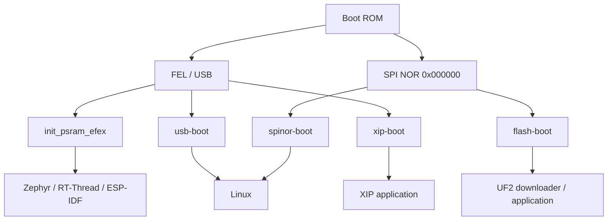

After power-up, F101 runs the Boot ROM first, then a SyterKit bootloader from FEL or NOR takes over. Different systems need different boot paths: RAM images need the eFEX helper to initialize PSRAM first, Linux needs `usb-boot` or `spinor-boot`, XIP applications need `xip-boot`, and the UF2 flow needs `flash-boot`. This page gives the configuration and commands per system; SyterKit internals are in [SyterKit](../dev/linux/components/syterkit.md).

## Boot chain



The Boot ROM checks whether NOR offset `0x000000` holds a valid eGON image and either enters FEL or boots from NOR. The FEL path writes nothing to NOR; every image goes to SRAM or PSRAM over USB. The NOR path has `spinor-boot` or `flash-boot` read fixed regions.

## Choosing a boot path

| System or image | Boot path | Image location |
| --- | --- | --- |
| Zephyr RAM application | `init_psram_efex` + `xfel` | PSRAM `0x40000000` |
| RT-Thread RAM application | `init_psram_efex` + `xfel` | PSRAM `0x40000000` |
| ESP-IDF RAM application | `init_psram_efex` + `xfel` | PSRAM `0x40000000` |
| Linux / Buildroot | `usb-boot` (FEL) or `spinor-boot` (NOR) | Fixed PSRAM addresses |
| RustSBI + Asterinas | Prebuilt full image, NOR `0x000000` | First 7 MiB of NOR |
| Zephyr XIP application | `xip-boot` | NOR `0x80000`, window `0x0e000000` |
| UF2 downloader | `flash-boot` | System `0x30000`, application `0x200000` |

S3 and S4 use different PSRAM parameters. RAM paths must first build the eFEX helper for the board as described in [PSRAM initialization and RAM boot](psram-init.md).

## Building SyterKit

SyterKit uses the XuanTie elf-newlib toolchain. `yuzukineko_rv32_sram_defconfig` builds every RV32 boot application in one pass. Run this from the workspace root that contains `SyterKit/`, `toolchains/` and `out/`:

```sh
cd SyterKit
make O=../out/syterkit-yuzukineko yuzukineko_rv32_sram_defconfig
make O=../out/syterkit-yuzukineko CROSS_COMPILE="../toolchains/Xuantie-900-gcc-elf-newlib-x86_64-V3.2.0/bin/riscv64-unknown-elf-" -j8
```

Common outputs:

| File | Purpose |
| --- | --- |
| `spinor-boot/spinor-boot_spi.bin` | Write to NOR `0x000000` to boot Linux from NOR |
| `usb-boot/usb-boot_fel.bin` | FEL write to `0x20000` to boot Linux already staged in PSRAM |
| `flash-boot/flash-boot_fel.bin` | FEL write to `0x20000`, copies an application from NOR to PSRAM |
| `xip-boot/xip-boot_fel.bin` | FEL write to `0x20000`, maps the NOR window and jumps |
| `spinor-boot-rv64i/spinor-boot-rv64i_spi.bin` | Boot RV64 Linux from NOR |

`_fel.bin` is a raw payload for `xfel write`; `_spi.bin` carries the eGON checksum and is meant for NOR offset zero. Never write `_fel.bin` to NOR offset zero.

## Booting a Zephyr RAM image

Run the PSRAM helper that matches the board, then write the Zephyr image:

```sh
xfel write 0x20000 init_psram_efex_s3.bin
xfel exec 0x20000
xfel write 0x40000000 build/hello/zephyr/zephyr.bin
xfel exec 0x40000000
```

On S4 replace the helper with `init_psram_efex_s4.bin`. `zephyr.bin` must be linked at `0x40000000`; an XIP configuration cannot use this path. The full flow is in [Zephyr building and running](../dev/zephyr/zephyr-build-run.md).

## Booting RT-Thread and ESP-IDF

RT-Thread's `rtt.bin` and ESP-IDF's `hello.bin` use the same RAM path as Zephyr, with a different image:

```sh
xfel write 0x20000 init_psram_efex_s3.bin
xfel exec 0x20000
xfel write 0x40000000 rtt.bin
xfel exec 0x40000000
```

For ESP-IDF, use `build/hello_f101.bin` instead of `rtt.bin`. Both require an image linked at `0x40000000` and a console matching the board. See [RT-Thread building and RAM boot](../dev/rt-thread/build-run.md) and [ESP-IDF building, loading and running](../dev/esp-idf/build-run.md).

## Booting Linux

Linux needs a DTB, the OpenSBI `fw_jump` and the kernel `Image`. On the FEL path, initialize PSRAM with the helper, write the three files to fixed addresses, then run `usb-boot`:

```sh
xfel write 0x20000 init_psram_efex_s3.bin
xfel exec 0x20000
xfel write 0x40f40000 yuzukineko.dtb
xfel write 0x40f80000 fw_jump.bin
xfel write 0x40000000 Image
xfel write 0x20000 usb-boot_fel.bin
xfel exec 0x20000
```

On S4, replace `init_psram_efex_s3.bin` with `init_psram_efex_s4.bin`.

On the NOR path, write `spinor-boot_spi.bin` at offset zero and place the payloads at the fixed layout: DTB `0x10000`, `fw_jump` `0x50000`, `Image` `0xd0000`, root filesystem `0x6d0000`. A prebuilt full image can be written directly:

```sh
xfel spinor write 0x0 linux-7.2-YuzukiNeko-sun252i-f101-buildroot-nor.img
xfel reset
```

Writing NOR changes power-on behaviour; back up the whole flash and read [SPI NOR layout and backup](flash-layout.md) first. See [Linux + Buildroot](../dev/linux/linux-buildroot.md) for the build.

## Booting RustSBI + Asterinas

The prebuilt Asterinas image targets F101-S3 and contains the chain SyterKit → RustSBI → Asterinas. Write it at NOR offset zero; it is 7,143,424 bytes:

```sh
xfel spinor write 0x0 yuzukineko-rustsbi-asterinas.img
xfel reset
```

A BusyBox prompt on UART1 at 115200 8N1 means the boot succeeded. Image sources and checksums are in [RustSBI + Asterinas](../dev/asterinas/rustsbi-asterinas.md).

## Booting XIP applications and UF2

An XIP application leaves its code in NOR; `xip-boot` maps the window and jumps. With the Zephyr XIP configuration:

```sh
xfel write 0x20000 xip-boot_fel.bin
xfel exec 0x20000
```

The application sits at NOR `0x80000`, the window is `0x0e000000` and its default length is 6 MiB. `CONFIG_DRIVER_MTD_SPIF_NOR_XIP_OFFSET` controls the image offset and defaults to `0x80000`; the sampling-training parameters live at `0x20000`. NekoBox, Bilibili and Miracast use this path; see [Zephyr UF2 and XIP](../dev/zephyr/zephyr-uf2.md).

The UF2 flow uses `flash-boot`: the system program is at NOR `0x30000`, the application at `0x200000`, and holding PD5 at power-up or an invalid application enters the UF2 downloader:

```sh
xfel write 0x20000 flash-boot_fel.bin
xfel exec 0x20000
```

## Recovering FEL

When NOR offset zero holds a valid boot image, the board no longer enters FEL automatically. Erase the 64 KiB boot region to recover:

```sh
xfel spinor erase 0x0 0x10000
xfel reset
```

Confirm the offset and length before erasing; touch only `0x000000`–`0x00ffff`, never the application or filesystem regions.
