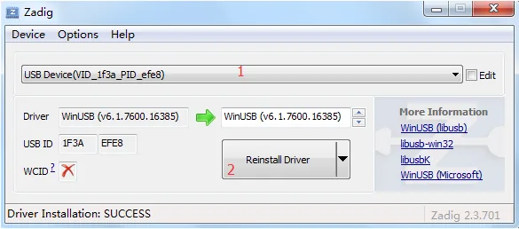

F101's BROM contains a USB download mode called <strong>FEL</strong>. Under FEL, the host can read and write SPI NOR over USB, and load a program into memory and run it. Every download method for this board (xfel, rfel, booting the UF2 loader from FEL) is based on it.

:::tip
<strong>xfel and rfel are the same kind of tool:</strong> both are download tools that talk to the board over FEL from the host, with identically named subcommands and the same functions. <strong>Install either one</strong>; you do not need both. The commands on this site use xfel as the example; with rfel, replace `xfel` with `rfel`.
:::

## Entering FEL

1. Hold down the <strong>FEL</strong> button on the board.
2. Connect the USB data cable (or reset while the board is already powered).
3. Release the FEL button.

Confirm with the tool:

```sh
xfel version
```

You should see output like `AWUSBFEX ID=0x00193700(F101)`. The USB device's VID/PID is `1f3a:efe8`.

:::caution
<strong>Once the board has already booted from Flash, it will not enter FEL on its own.</strong> As soon as a valid bootloader is present in SPI NOR, the board runs it directly on power-up, and you must hold the FEL button to enter download mode. Conversely, when the first sector of Flash is empty, the BROM falls into FEL on every power-up.
:::

## Installing xfel

xfel repository: <https://github.com/xboot/xfel>. Use <strong>v1.4.0</strong> or newer — v1.4.0 adds the F101 `xfel extra exec riscv64` command.

### Windows

Download `xfel-windows-v1.4.0.7z` from the repository's [v1.4.0 release page](https://github.com/xboot/xfel/releases/tag/v1.4.0), <strong>extract the whole archive</strong>, add the directory containing `xfel.exe` to `PATH`, and reopen PowerShell. The bundled DLLs must sit alongside `xfel.exe`. Without setting `PATH`, you can use `./xfel.exe` in the tool directory instead of `xfel`.

### Linux (Debian / Ubuntu example)

```sh
sudo apt update
sudo apt install git build-essential pkg-config libusb-1.0-0-dev
git clone https://github.com/xboot/xfel.git
cd xfel
make
sudo make install
sudo udevadm control --reload-rules
```

Replug the FEL device so the installed udev rule takes effect.

### macOS

```sh
xcode-select --install
brew install libusb pkg-config
git clone https://github.com/xboot/xfel.git
cd xfel
make
sudo install -m 755 xfel /usr/local/bin/xfel
```

If `/usr/local/bin` does not exist, run `sudo mkdir -p /usr/local/bin` first and make sure it is in `PATH`. macOS does not use udev rules.

## Installing rfel

rfel is part of [rustsbi/allwinner-hal](https://github.com/rustsbi/allwinner-hal/tree/main/rfel), written in Rust, with the same commands on all three platforms. It requires [Rust and Cargo](https://www.rust-lang.org/tools/install) and Git. Windows also needs the C++ toolchain from Visual Studio Build Tools; Linux needs a C compiler and linker (`build-essential` on Debian / Ubuntu); macOS needs the Xcode Command Line Tools.

```sh
git clone https://github.com/rustsbi/allwinner-hal.git
cd allwinner-hal
rustup update stable
cargo +stable install --path rfel
rfel --help
```

The source must include commit `11544b3` (`feat(rfel): support F101 chip`) or newer F101 support. Update older checkouts before reinstalling. Cargo normally installs the executable to `%USERPROFILE%\.cargo\bin` on Windows or `~/.cargo/bin` on Linux / macOS; make sure it is in `PATH`.

`rfel version` queries the chip version of a connected device.

## USB driver and permissions

### Windows

If the tool cannot open the FEL device, use [Zadig](https://zadig.akeo.ie/) to install the <strong>WinUSB</strong> driver for the <strong>FEL USB device (VID `1f3a`, PID `efe8`)</strong>. Check the VID/PID before selecting the device, and <strong>do not change the driver of your USB serial adapter</strong>.



### Linux

When rfel reports insufficient USB permissions, you can run it with an absolute path and administrator privileges, or configure a udev rule. On a desktop system using systemd-logind, create `/etc/udev/rules.d/70-allwinner-fel.rules`:

```text
SUBSYSTEM=="usb", ATTR{idVendor}=="1f3a", ATTR{idProduct}=="efe8", TAG+="uaccess"
```

Then run `sudo udevadm control --reload-rules` and replug the device. On a system without a desktop session, configure USB permissions through the local user group.

### macOS

Neither WinUSB nor udev rules are needed.

## Common commands

| Command | Purpose |
| --- | --- |
| `xfel version` | Query the chip and confirm the FEL connection |
| `xfel spinor` | Identify the SPI NOR and its capacity |
| `xfel spinor read <addr> <len> <file>` | Read Flash |
| `xfel spinor write <addr> <file>` | Write Flash (erases the required sectors automatically) |
| `xfel reset` | Reset the board |

rfel's subcommands have the same names; just replace `xfel` with `rfel`.

:::caution
<strong>Limits of some commands</strong>: `xfel ddr f101-s3` (initialise RAM) plus `xfel write` + `xfel exec` can load a program directly into RAM and run it without going through Flash, a common workflow when developing bare-metal programs such as Zephyr; this workflow requires <strong>re-entering FEL on every power-up</strong>, because FEL is no longer available after `exec`. The Flash-writing workflow (flashing firmware on this site) <strong>does not</strong> need the `ddr` command.
:::

## Common errors

| Message | Cause and handling |
| --- | --- |
| `unsupported chip` | The tool version does not support F101; upgrade xfel / rfel |
| Device not found | Not in FEL; whether the cable carries data; whether WinUSB is installed on Windows |
| `usb bulk send/recv error` | If it happens after `exec`: the CPU has left the BROM and the program is running, which is normal |
| Insufficient permissions (Linux) | Configure a udev rule, see above |
