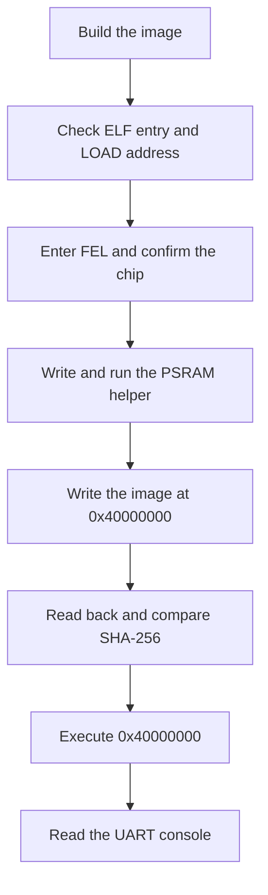

A coding agent can build, load and test firmware on this board without a programmer, a bootloader install or a flash erase: build the image, load it into PSRAM over FEL, read the console, change the code, repeat. This page describes that loop and the rules that keep it safe. It covers Zephyr, RT-Thread and ESP-IDF; the build command differs, the load path does not.

The loop is packaged as a Claude Code skill named `f101-ram-boot-test`. In the reference workspace it lives at `.claude/skills/f101-ram-boot-test/SKILL.md`. Claude Code loads it from the skill description when a task mentions flashing, RAM boot or firmware testing; `/f101-ram-boot-test` invokes it explicitly. The page repeats the contract so another agent, or a person, can follow it without the file.

:::danger
Test images go to PSRAM, never to SPI NOR. An agent must not run `xfel spinor write`, `xfel spinor erase`, `idf.py flash`, or a SyterKit flow that writes a loader or an XIP application. If a test needs firmware that survives a power cycle, the agent stops and asks.
:::

## The skill

The skill has one job: run a RAM test and return evidence. It checks the ELF before touching the board, requires the PSRAM helper that matches the board, and compares a readback hash before `exec`. It does not choose a board revision, install a bootloader, or recover NOR.

| Rule | What the skill does |
| --- | --- |
| Load address | Only `0x40000000`; an XIP image is refused |
| PSRAM helper | S3 or S4 table, never `xfel ddr` |
| SPI NOR | No write, no erase, no bootloader install |
| Stop conditions | XIP, UF2, Linux, Asterinas, unknown board, missing helper |
| Report | Image hash, serial evidence, explicit "NOR untouched" |

## Why RAM, not NOR

- A RAM test leaves NOR unchanged. A failed image cannot damage the boot path, a partition table or an installed Linux/Asterinas system.
- The image and its state disappear at power-off. The next run starts from the same point.
- The load path is identical for the three RTOSes; only the build output and the console configuration change.
- It works on a board whose NOR is blank, or holds a system unrelated to the test.
- It cannot run XIP images. NekoBox, Bilibili and the Miracast configuration execute from the SPIF window at `0x0e000000`; UF2, Linux and Asterinas images live in NOR. Testing those requires a NOR write and is outside the loop.

## The loop



Executing the application leaves FEL. The next test starts with a new power-up into FEL; the helper is not persistent.

## Check the image before loading

Build the application as usual. For the Zephyr RAM sample:

```sh
. ./env.sh
west build -b yuzukineko -d build/hello zephyr/samples/hello_world
```

The RT-Thread and ESP-IDF build products and their `objcopy` steps are in [RT-Thread building and RAM boot](../rt-thread/build-run.md) and [ESP-IDF building, loading and running](../esp-idf/build-run.md).

Inspect the ELF:

```sh
riscv64-unknown-elf-readelf -h build/hello/zephyr/zephyr.elf
riscv64-unknown-elf-readelf -l build/hello/zephyr/zephyr.elf
```

The entry point and the first `LOAD` address must both be `0x40000000`. The `.bin` starts at the lowest `LOAD` address, so `xfel write 0x40000000 image.bin` places the whole image correctly. ESP-IDF uses `riscv32-esp-elf-readelf`; its RAM image is linked at the same address.

A different entry point is a different image type. `0x0e000000`, or an overlay with `zephyr,flash = &xip_flash`, means the application executes from the NOR window: NekoBox, Bilibili and the Miracast configuration are built this way. Stop there; an XIP image must be written to NOR at `0x80000`, which this loop does not do.

Check the size against the board:

```sh
wc -c < build/hello/zephyr/zephyr.bin
```

The image must fit in the PSRAM: below 16 MiB on F101S3, below 32 MiB on F101S4. A larger image truncates or wraps.

## Match the PSRAM helper to the board

| Board | PSRAM | Helper |
| --- | --- | --- |
| V1.3 or V1.4, F101S3 | 16 MiB APS128M | `out/syterkit-efex-s3/init_psram_efex.bin` |
| V1.5, F101S4 | 32 MiB W958 | `out/syterkit-efex-s4/init_psram_efex.bin` |

These are the paths in the reference workspace. If the helper was built somewhere else, use that file. Read the revision from the silkscreen or ask. The two `dram_para` tables differ in clock, type, ZQ, capacity and the W958 RDQ window; a wrong helper either fails or initializes only 16 MiB. The tables, the source edit and the `efex-param.py` patch procedure are in [PSRAM initialization and RAM boot](../../boot/psram-init.md).

`xfel ddr f101-s3` is not a substitute. It carries one fixed S3 table and cannot initialize the 32 MiB part.

ESP-IDF images must also set `CONFIG_ESP_F101_PSRAM_MB` to the same capacity (16 on S3, 32 on S4); it controls the linker RAM length and the heap end. The ELF entry point alone does not prove the setting.

The helper's console defaults to UART1, PB00/PB01, 115200 8N1. The application console follows the board: UART1 on `yuzukineko`, UART3 PE08/PE09 on `f101_evb`.

## Enter FEL

Hold the FEL button, connect the USB data cable, release. If the board is already powered, reset while holding FEL. Confirm the chip:

```sh
xfel version
```

The output contains:

```text
AWUSBFEX ID=0x00193700(F101) dflag=0x44 dlength=0x08 scratchpad=0x00020000
```

`0x00193700` is F101; `0x00020000` is the scratchpad. A different ID is a different chip. If no device appears, check the cable, the WinUSB driver on Windows or the udev rule on Linux; [FEL download mode and tools](../../boot/fel.md) covers both.

When NOR contains a bootable image, the board does not enter FEL on its own. Hold FEL while powering up. Do not erase the NOR boot region just to get FEL back: that changes the boot chain and needs a backup and a human decision.

## Initialize PSRAM

Write the helper that matches the board and run it:

```sh
xfel write 0x20000 out/syterkit-efex-s3/init_psram_efex.bin
xfel exec 0x20000
```

On S4 use `out/syterkit-efex-s4/init_psram_efex.bin`. The serial port prints the detected part:

```text
LPSRAM Type = APS128M
LPSRAM SIZE = 16 MB
LPSRAM simple test OK.
```

Run `xfel version` again. The F101 line returning means the helper handed control back to FEL. A `LPSRAM SIZE` other than the board's capacity means the wrong helper; stop and rebuild it. `simple test OK` alone is not enough when the size is wrong.

## Write, verify, run

Load the image, read it back and compare the hashes before executing:

```sh
mkdir -p out
IMAGE=build/hello/zephyr/zephyr.bin
SIZE=$(wc -c < "$IMAGE")
printf 'size: %s bytes (0x%x)\n' "$SIZE" "$SIZE"
xfel write 0x40000000 "$IMAGE"
xfel read 0x40000000 "$SIZE" out/ram-readback.bin
sha256sum "$IMAGE" out/ram-readback.bin
xfel exec 0x40000000
```

`xfel write` writes memory, not NOR, and needs no erase. The readback compares what the board actually holds after the USB transfer. If the hashes differ, stop and redo the helper and the write; do not execute a partial image.

`exec` starts the image at `0x40000000`. The FEL USB device disappears at that point. That is expected, and it does not prove the application started; only the console does. Do not run `xfel version`, `xfel read` or `xfel read32` after `exec`.

## Read the console

`yuzukineko` prints on UART1, PB00 TX and PB01 RX, 115200 8N1. Connect the adapter's RX to PB00 and its TX to PB01, share ground, and open the port:

```sh
picocom -b 115200 /dev/ttyUSB0
```

`f101_evb` uses UART3, PE08/PE09. The Zephyr `hello_world` image prints:

```text
Hello World! yuzukineko/sun252i_f101
```

When there is no output, check these first: the adapter is not on the application's UART, TX and RX are not crossed, the baud rate is wrong, the image entry is not `0x40000000`, or the helper did not finish. Re-enter FEL and check each before executing again. Repeated `exec` without a fresh FEL entry cannot work.

## Boards behind ThunderWorkbench

When the board is attached to a ThunderWorkbench host, run the same xfel commands on that host. Call `get_devices` and `get_device_config` first for the device ID, serial port and firmware source; run xfel through `execute_host_command`; cycle power with `power_control`; read the console with `get_serial_buffer`, `get_serial_log` and `search_serial_log`. Do not use a local `xfel` or `adb` for a board attached elsewhere. If the MCP server is unreachable, stop and report it; do not substitute another access path.

## What goes into the report

| Item | Content |
| --- | --- |
| Board | F101S3 or F101S4, with the evidence: revision, silkscreen or user statement |
| Image | Path, size and SHA-256 |
| Address | ELF entry point and first `LOAD` address |
| Helper | Path and SHA-256 |
| Console | The helper's `LPSRAM` lines and the first application output |
| Result | Pass or fail; on failure, the command and its raw output |
| NOR | A statement that no NOR write or erase was issued |

An agent that cannot fill the NOR line did not follow the loop.

## When the loop must stop

- The entry point or first `LOAD` address is not `0x40000000`, or the image is an XIP configuration.
- The board revision is unknown and no one can confirm S3 or S4.
- The matching helper is missing and cannot be built from the current SyterKit tree.
- FEL does not enumerate, or the console stays silent after a correct helper and a verified write.
- The task requires NOR, UF2, XIP, Linux, Asterinas, a bootloader install or recovery of the boot region.
- The user asks for firmware that survives a power cycle.

Stopping is part of the skill. An agent that writes NOR to make a test pass has exceeded the task.

## Using the skill in another workspace

The skill is a directory with one `SKILL.md`. Copy it to `.claude/skills/f101-ram-boot-test/` under the workspace root; Claude Code reads project skills at startup. The description triggers on flashing, RAM boot and firmware testing, and `/f101-ram-boot-test` runs it by name. A copy is published with this documentation: <a href="assets/agent/f101-ram-boot-test/SKILL.md" download>download SKILL.md</a>. The commands on this page are the contract when the skill is unavailable.
