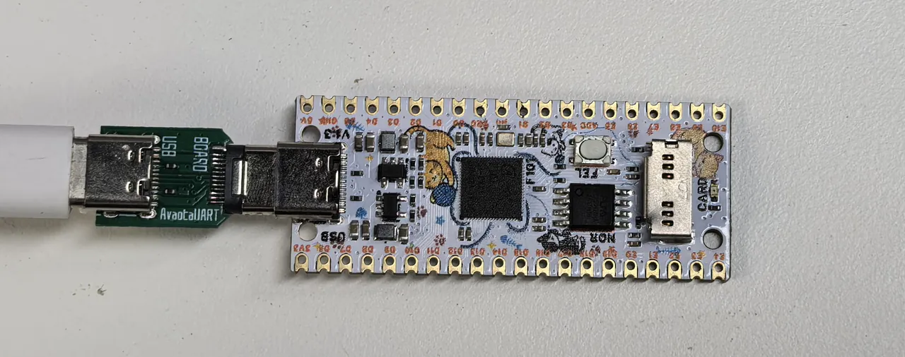
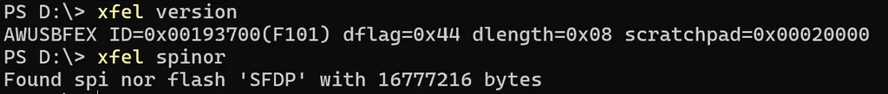
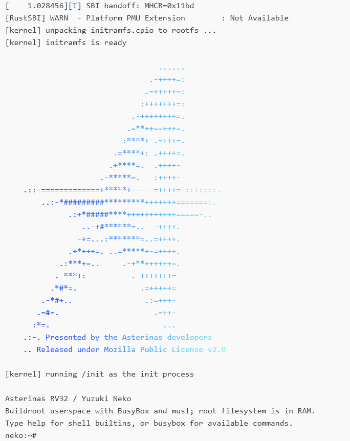

This page explains how to flash the prebuilt firmware onto a YuzukiNeko <strong>F101-S3</strong>, boot Asterinas from the SPI NOR, reach the BusyBox command line and run nine examples. For a first look you can use the full image directly, without building anything yourself.

[RustSBI](https://github.com/rustsbi/rustsbi) is a project that implements RISC-V SBI (Supervisor Binary Interface) in Rust, providing operating systems with a standard firmware service interface. It lets a kernel use low-level services such as timers, inter-processor interrupts and system reset through a unified interface, reducing its dependence on a specific hardware platform.

[Asterinas](https://github.com/asterinas/asterinas) is an operating system kernel written in Rust. It aims for Linux application compatibility and uses Rust's type system and memory-safety mechanisms to make the kernel more secure.

This package uses an RV32 port adapted for Neko; the exact sources and changes are in [Component versions](#component-versions).

From power-up to the command line, the components relate as follows:

```text
BROM → SyterKit → RustSBI → Asterinas → BusyBox shell
```

| Component | Role in this image |
| --- | --- |
| BROM | Boot code built into the chip; enters FEL download mode or loads the boot program |
| SyterKit | Initializes RAM, loads the following images from the SPI NOR and hands over execution |
| RustSBI | Provides the SBI firmware service interface to the kernel |
| Asterinas | Runs the operating system kernel and manages resources such as memory and processes |
| BusyBox | Provides an interactive shell and basic commands for the user to run the examples |

Work through the sections below in the order "preparation and wiring → flashing and verification → boot and examples"; when a single component needs updating, read [Replacing a single component](#replacing-a-single-component).

## Before you start

### Prepare the hardware and software

- A YuzukiNeko F101-S3 board, configured with 16 MiB RAM and 16 MiB SPI NOR.
- A USB cable that can carry data, for powering the board and for FEL download.
- A Yuzuki AvaotaUART, or a generic USB-to-TTL serial adapter with <strong>3.3 V logic level</strong>, connecting wires, and serial terminal software, for watching the boot log and typing commands.
- A host machine for flashing: <strong>Windows, Linux and macOS all work.</strong> First install xfel or rfel and the corresponding USB driver or access permissions as described in [FEL download mode and tools](../../boot/fel.md).

### Get the image

The firmware is in the repository's [`02_Firmware/RustSBI-Asterinas/`](https://github.com/YuzukiHD/YuzukiNeko/tree/main/02_Firmware/RustSBI-Asterinas) directory. For a first installation, download the full image `yuzukineko-rustsbi-asterinas.img` and the `SHA256SUMS` in the same directory; `manifest.json` records the versions, Flash layout and verification information. The purpose of every file is in [File list](#file-list).

The following assumes the tools are on `PATH` and the terminal is in the directory holding the image. Flashing commands run in a <strong>host terminal</strong>, and the example commands after boot run in the <strong>board's serial terminal</strong>.

A single image is `.bin`; a composed image is `.img`. The `.img` is <strong>raw SPI NOR data</strong> assembled at fixed offsets; it is neither a PhoenixSuit container nor a disk image with a partition table.

Use the full image for a first installation or when switching from other firmware. It writes to NOR `0x000000..0x6d0000`; `0x6d0000..0x1000000` is not affected. "Full" means the file contains everything needed to boot, not that it is padded out to the whole 16 MiB. To keep the existing firmware, [back up](../../boot/flash-layout.md#back-up-the-whole-flash) first.

### Connecting the serial port

This image uses <strong>UART1 (PB0 / PB1)</strong> as the console, which appears as `ttyS0` in the system. First disconnect the board's power, then connect the AvaotaUART adapter to the board as shown below:



> If you do not have an AvaotaUART, connect a generic USB-to-TTL serial adapter as in the table below:
> 
> | Board pin | Signal direction | Connect to serial adapter |
> | --- | --- | --- |
> | `PB0` | UART1 TX, board transmits | `RX` |
> | `PB1` | UART1 RX, board receives | `TX` |
> | `GND` | Signal ground | `GND` |
> 
> With the component side up and the USB-C connector at the top, `PB0` and `PB1` are on rows 10 and 11 of the right-hand header, and `GND` is on row 2 of the right-hand header; see [Pinout](../../hardware/pinout.md) for the positions, and before wiring check the [schematic](../../hardware/files.md) for the corresponding hardware revision. The board is powered over USB; connect only the three signal wires from the table to the serial adapter and leave the power pins unconnected, using 3.3 V logic level.

In the serial terminal, select the port the adapter actually uses, set it to <strong>115200 baud, 8N1, no flow control</strong>, and open the port before resetting the board to boot the system. 8N1 means 8 data bits, no parity and 1 stop bit. The port name on the host varies with the adapter and the computer, so do not copy someone else's port name as a fixed value.

Serial input in this package is sensitive to <strong>long pasted strings</strong>; you can set the terminal's send delay to about <strong>20 ms per character</strong>.

## Flashing the full image

The examples below use xfel. When using rfel, just replace `xfel` with `rfel` in the commands.

### 1. Enter FEL and identify the device

Hold the <strong>FEL</strong> button, reconnect the USB data cable, and release it. Then check the chip and flash in the host terminal:

```sh
xfel version
xfel spinor
```

An F101 with chip ID `0x00193700` and a 16 MiB flash should be detected. This step <strong>does not</strong> need the `ddr` command. If the device is not found or the chip is reported as unsupported, check the tool version, the connection and the driver as described in [FEL common errors](../../boot/fel.md#common-errors) before continuing to flash.



### 2. Write the image and read it back

```sh
xfel spinor write 0x0 yuzukineko-rustsbi-asterinas.img
xfel spinor read 0x0 0x6d0000 readback.img
```

Wait for the write and read-back commands to finish normally. The read-back range covers the `0x6d0000` bytes of the full image (7,143,424 bytes).

### 3. Verify the read-back

Compute the SHA-256 of the original image and of `readback.img`, and confirm that they match each other and match the value recorded in `SHA256SUMS`. Pick one of the command groups below according to the host system.

Windows PowerShell:

```powershell
Get-FileHash -Algorithm SHA256 yuzukineko-rustsbi-asterinas.img
Get-FileHash -Algorithm SHA256 readback.img
```

Linux:

```sh
sha256sum yuzukineko-rustsbi-asterinas.img readback.img
```

macOS:

```sh
shasum -a 256 yuzukineko-rustsbi-asterinas.img readback.img
```

The SHA-256 of this package's full image is:

```text
368b658f93cb921a66c690a1ae26def95fbb500d0098b955695cebb977228cc5
```

Resolve any error or digest mismatch before booting. A matching read-back shows the image was written correctly; whether the system boots and the examples complete still requires the verification steps that follow.


## After boot

### Reset and enter the BusyBox shell

Confirm the serial terminal is open, release the FEL button, and reset the board from the host terminal:

```sh
xfel reset
```

Then watch the boot process in the serial terminal. The system loads the image from the SPI NOR, boots and finally reaches a BusyBox shell. The prompt in this package is `neko:~#`, where commands can be typed. RustSBI logs at WARN level, so its INFO banner is not visible during a normal boot.



### Run the nine examples

In the BusyBox shell, run:

```sh
/root/run-demos.sh
```

The following nine examples run in order, showing the basic features of the current port:

| Example | Content |
| --- | --- |
| `01-system.sh` | Show system, architecture, memory, uptime and mount information |
| `02-files.sh` | Create, copy and rename files in the RAM filesystem |
| `03-pipes.sh` | Combine sort, filter and count commands through pipes |
| `04-process.sh` | Create a child process, wait for it to exit and read its exit status |
| `05-signals.sh` | Send and handle a signal, then continue with the following operations |
| `06-float.sh` | Format and print floating-point numbers |
| `memory-demo` | Anonymous memory mapping, read/write, changing protection attributes and unmapping |
| `threads-demo` | Thread scheduling and synchronization; two threads update the same counter |
| `ipc-demo` | Private memory, pipe communication and process reaping between a parent and child process |

When the run completes you should see:

```text
All 9 Asterinas examples completed.
```

The shell prompt then returns. The `Collected child exit status: 7` in the process example is the child exit status the example is designed to produce; it does not mean the whole set of examples failed. The current root filesystem resides in RAM, so changes are not kept after a reboot.


Other notes:

- `reboot` restarts the system.
- `poweroff` stops the system, but the board is still powered over USB and <strong>the power is not cut</strong>.

## File list

The repository's `02_Firmware/RustSBI-Asterinas/` provides the following files:

| File | Purpose | Size (bytes) |
| --- | --- | ---: |
| `syterkit-3bf4f61f.bin` | SyterKit with an eGON boot header; initializes RAM and loads the following images | 49,152 |
| `rustsbi-0.4.1.bin` | RustSBI 0.4.1, customized for the Neko RV32 scalar extensions, WARN-level logging | 270,336 |
| `asterinas.bin` | Raw image of the Asterinas RV32 kernel | 2,762,160 |
| `yuzukineko-rustsbi-asterinas.img` | Full boot image: the three above + devicetree + initramfs containing BusyBox | 7,143,424 |
| `SHA256SUMS` | SHA-256 of the four images above | — |
| `manifest.json` | Source versions, Flash layout and verification information | — |
| `licenses/` | Licenses and third-party notices | — |

## Replacing a single component

Prerequisite: the board already has the full image from this directory installed. Hold FEL and reconnect USB, then check the device with `version` and `spinor` first.

In this layout the Flash offsets and RAM load addresses differ; use the <strong>NOR offsets</strong> below:

| Component | NOR offset | Reserved in this layout | RAM load address |
| --- | --- | --- | --- |
| SyterKit | `0x000000` | 64 KiB | `0x00020000` |
| Devicetree (in the full image) | `0x010000` | 256 KiB | `0x40f40000` |
| RustSBI | `0x050000` | 512 KiB | `0x40f80000` |
| Asterinas | `0x0d0000` | 5 MiB, up to the initramfs | `0x40000000` |
| initramfs (in the full image) | `0x5d0000` | 1 MiB | `0x40500000` |

These size limits apply only to this image layout. When building your own, you must also ensure that the entry point, load addresses, devicetree and memory usage are compatible with one another; the binary size alone is not enough. In particular, the memory RustSBI uses at runtime (including BSS, stack and heap) must fall inside its reserved area.

Choose the write commands you need; replacing one component does not require rewriting the others:

```sh
xfel spinor write 0x0 syterkit-3bf4f61f.bin
xfel spinor write 0x50000 rustsbi-0.4.1.bin
xfel spinor write 0xd0000 asterinas.bin
```

After writing, read back the corresponding range using the actual file size and verify it. For example, after replacing RustSBI:

```sh
xfel spinor read 0x50000 0x42000 rustsbi-readback.bin
```

`0x42000` is the size of this package's RustSBI file (270,336 bytes); for other versions adjust the length to the actual size. Once the read-back SHA-256 matches the written file, run `xfel reset`.

:::caution
Writing these three images individually <strong>does not</strong> install the devicetree and root filesystem; a first installation must use the full image.
:::

## Component versions

From [`manifest.json`](https://github.com/YuzukiHD/YuzukiNeko/blob/main/02_Firmware/RustSBI-Asterinas/manifest.json):

| Component | Version / commit | Notes |
| --- | --- | --- |
| SyterKit | Based on `3bf4f61f` | Neko SPI NOR loader and Asterinas handover; not an unmodified upstream build |
| RustSBI | 0.4.1 (`4068e0d0`) | Color-removal patch, Neko RV32 scalar target, WARN logging |
| Asterinas | Based on `db0d7958` | Neko RV32 port and BusyBox integration |
| BusyBox | 1.37.0 | Static RV32GC ILP32D musl build |
| musl | 1.2.5 | |

## Verification record

Verification date 2026-09-12, board Yuzuki Neko F101-S3: flash read-back matched the image SHA-256; SPI NOR boot reached the BusyBox shell; the nine examples passed.

## License

The firmware and its third-party software follow their own licenses; the repository's CC0 statement <strong>does not apply</strong> to them. The license texts and sources for the four components are in the repository's [`licenses/README.md`](https://github.com/YuzukiHD/YuzukiNeko/blob/main/02_Firmware/RustSBI-Asterinas/licenses/README.md).
