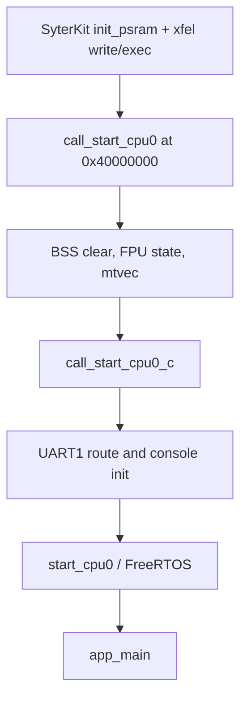

The ESP-IDF port for F101 is not "the ESP32 boot flow on another chip". It connects the ESP-IDF kernel, memory management and driver framework to a RISC-V SoC that has no bootloader, no flash mapping and no GPIO matrix. Once this is clear, the driver limitations and configuration style follow.

## Target integration

| Location | Purpose |
| --- | --- |
| Root `Kconfig` | Registers `IDF_TARGET_SUN252I_F101`, defaults to a RAM build and the UART1 console |
| `tools/cmake/toolchain-sun252i-f101.cmake` | Selects the `riscv32-esp-elf-` prefix |
| `tools/idf_py_actions/constants.py` | Adds `sun252i-f101` to the preview target list |
| `components/soc/sun252i-f101/` | SoC capabilities, register access, pad multiplexing table, linker scripts |
| `components/esp_system/port/soc/sun252i-f101/` | Entry assembly, startup C code, reset, task watchdog |
| `components/freertos/FreeRTOS-Kernel/portable/sun252i/` | FreeRTOS port, FPU context, CLINT tick |
| `components/esp_hw_support/port/sun252i-f101/` | Clocks, PLIC, cache, chip information, random numbers, RTC |

The compile flag is `-march=rv32imafc_zicsr_zifencei`, matching the single-precision FPU of the C907; there is no `d` extension and no vector extension. `IDF_TARGET=sun252i-f101` works in CMake and Kconfig, but `idf.py` requires `--preview`.

## Image and memory map

The image and the heap share one PSRAM region: 16 MiB by default (F101S3), extended to 32 MiB on F101S4 with `CONFIG_ESP_F101_PSRAM_MB=32`. The map below uses 16 MiB:

```text
0x40000000  .exception_vectors.text
            .iram0.text .dram0.data
            .dram0.bss .flash.text
            .flash.rodata .flash.init_array
_heap_start
0x41000000
```

`call_start_cpu0` sits on the first line, and `_heap_start` is the boundary between the image and the heap.

`RAM_LEN` in `components/esp_system/ld/sun252i-f101/memory.ld.in` comes from `CONFIG_ESP_F101_PSRAM_MB`, and the script aliases `iram_text_seg`, `dram_seg`, `flash_text_seg` and `flash_rodata_seg` to the same `ram_seg`. The linker script's `ENTRY` is `call_start_cpu0`, placed in `.exception_vectors.text`, so the ELF entry address and the first byte are both at `0x40000000`. Everything from the end of the image to the end of the region becomes heap: `0x41000000` in the 16 MiB configuration and `0x42000000` in the 32 MiB one.

`components/heap/port/sun252i-f101/memory_layout.c` describes the whole PSRAM as one memory type carrying `MALLOC_CAP_INTERNAL`, `MALLOC_CAP_DMA`, `MALLOC_CAP_EXEC`, `MALLOC_CAP_8BIT` and `MALLOC_CAP_32BIT`. There is no separate IRAM/DRAM split, so the caps argument to `heap_caps_malloc` does not change where memory comes from on F101.

## Startup sequence



Before the image runs, FEL executes the SyterKit helper matching the board: the 16 MiB APS128M table for S3 or the 32 MiB W958 table for S4. The helper programs PSRAM in SRAM, checks the type against the eFuse, and returns to FEL; only then does xfel write the ESP-IDF image to `0x40000000` and jump to it.

`start.S` runs in machine mode with interrupts disabled, sets `mstatus.FS` to its initial state, clears `fcsr`, programs the C907 cache and prefetch CSRs, points `mtvec` at an early exception handler that only polls UART, then sets `gp` and `sp`, clears BSS and enters `call_start_cpu0_c()`.

`call_start_cpu0_c()` first builds a TLS block for code that runs before the scheduler, then routes the console signals to the pads named by `CONFIG_ESP_CONSOLE_UART_TX_GPIO`/`RX_GPIO`, initializes UART, prints the `ESP-ROM:sun252i-f101-fel` banner and finally calls `start_cpu0()` into FreeRTOS and `app_main()`.

The early exception handler uses no driver or heap. It prints `mcause`, `mepc`, `mtval`, `ra` and stack words in hexadecimal to the UART3 register block at `0x02500c00`. It is the last visible output when startup fails; in normal operation FreeRTOS replaces `mtvec` with its trap entry.

## CPU, interrupts and time

The CPU is a single XuanTie C907 at 600 MHz by default. `clk_f101.c` raises `PLL_CPU` in 72 MHz steps and runs a memory test after each step, undoing a failing step; the ceiling is 1008 MHz and the supply voltage is not changed. `esp_clk_cpu_freq()` and `esp_clk_apb_freq()` return the current frequencies.

The interrupt controller is a PLIC with 192 sources. The first argument of `esp_intr_alloc()` is the PLIC interrupt number, and `ESP_INTR_FLAG_LEVEL1` through `LEVEL7` map to PLIC priorities 1 through 7; nested priority preemption is not supported. Each GPIO bank owns one PLIC line, UART0 through UART5 use interrupt numbers 2 through 7, DMA uses 50, GPIO banks start at 67, and the display and accelerators use their own higher numbers.

There are two time bases: the CLINT `mtime` is a free-running 24 MHz counter used directly by `esp_timer`; the FreeRTOS tick and the `esp_timer` alarm share one `mtimecmp`, and the port writes the earlier of the two deadlines each time. `esp_timer_get_time()` returns microseconds and works before the scheduler starts.

## Cache, DMA and heap

The data cache line is 64 bytes. `esp_cache_msync()` uses the T-Head `th.dcache.cpa`, `th.dcache.ipa` and `th.dcache.cipa` instructions to clean, invalidate or both over an address range; unaligned addresses need `ESP_CACHE_MSYNC_FLAG_UNALIGNED`. The DMA controller does no cache maintenance itself; `esp_async_memcpy` and the I2S driver handle it around each transfer.

The DMA controller has 12 channels and 24-byte descriptors, supporting memory-to-memory copies and the cyclic I2S chain. The heap starts at `_heap_start`; hello_world reports about 16,306 KiB free in the default configuration. Wi-Fi firmware and display frame buffers come from this heap; one 1024×768 RGB565 frame buffer is about 1.5 MiB.

## Chip identity

`esp_chip_info()` returns `CHIP_SUN252I_F101`, one core and `CHIP_FEATURE_EMB_PSRAM`. The SoC has no MAC fuse; `esp_efuse_mac_get_default()` hashes the 128-bit chip id with FNV-1a, sets the locally administered bit and clears the multicast bit, producing a stable default MAC. The eFuse block is 512 bits of read-only data, readable with `esp_efuse_read_field_blob()`; the write API is unsupported.

`esp_random()` is xorshift seeded from the timer and the chip id. It is suitable for initialization noise, not for keys, nonces or security tokens.

## Source layout

| Path | Content |
| --- | --- |
| `components/soc/sun252i-f101/` | SoC registers, capabilities, pad tables, linker scripts |
| `components/esp_system/port/soc/sun252i-f101/` | Entry, startup, console, reset, task watchdog |
| `components/esp_driver_*/sun252i-f101/` | ESP-IDF driver implementations for each peripheral |
| `components/esp_lcd/sun252i-f101/` | Display engine, TCON, DSI, panels and backlight |
| `components/aic8800/` | AIC8800 FullMAC driver, supplicant and esp_wifi glue |
| `components/esp_lcd_jd9168s/`, `components/esp_lcd_touch_gt967/` | Board panel and touch controller |
