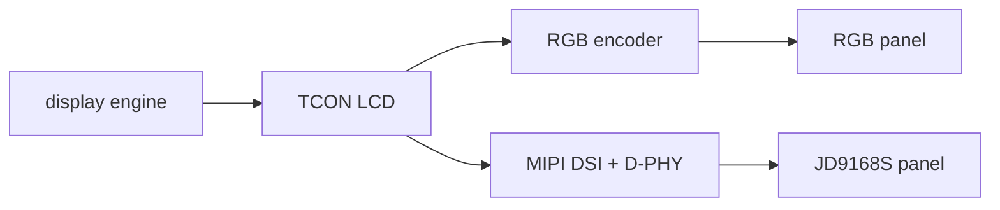

The F101 display stack wraps the Allwinner display engine (DE), TCON, RGB/DSI encoders and combo D-PHY behind the ESP-IDF `esp_lcd` API. YuzukiNeko uses a four-lane MIPI DSI JD9168S panel; `f101_evb` uses a parallel RGB panel.

## Display pipeline



The display engine is at `0x05000000`, TCON at `0x05461000`, the DSI host at `0x05450000` and the combo D-PHY at `0x05451000`. The DE handles layers, scaling, color-space conversion and gamma; TCON generates timing; the encoder sends pixels to the panel. The `esp_lcd` panel object exposes only initialization, enable, draw and backlight operations; `components/esp_lcd/sun252i-f101/` builds the underlying graphics pipeline.

## DSI panel

The JD9168S is a 1024×768, four-lane, RGB888 panel controller with a 54 MHz pixel clock and 324 Mbps per lane. Reset is on PD9:

```c
#include "esp_lcd_mipi_dsi.h"
#include "esp_lcd_jd9168s.h"
#include "esp_lcd_panel_ops.h"

esp_lcd_dsi_bus_config_t bus_cfg = {
    .bus_id = 0,
    .num_data_lanes = 4,
    .lane_bit_rate_mbps = 324,
};
esp_lcd_dsi_bus_handle_t dsi_bus;
esp_lcd_new_dsi_bus(&bus_cfg, &dsi_bus);

esp_lcd_dbi_io_config_t dbi_cfg = {
    .virtual_channel = 0,
    .lcd_cmd_bits = 8,
    .lcd_param_bits = 8,
};
esp_lcd_panel_io_handle_t io;
esp_lcd_new_panel_io_dbi(dsi_bus, &dbi_cfg, &io);

esp_lcd_dpi_panel_config_t dpi_cfg = {
    .virtual_channel = 0,
    .dpi_clock_freq_mhz = JD9168S_DPI_CLOCK_MHZ,
    .in_color_format = LCD_COLOR_FMT_RGB565,
    .out_color_format = LCD_COLOR_FMT_RGB888,
    .num_fbs = 1,
    .video_timing = JD9168S_1024_768_PANEL_TIMING(),
};
jd9168s_vendor_config_t vendor = {
    .mipi_config = { .dsi_bus = dsi_bus, .dpi_config = &dpi_cfg },
};
esp_lcd_panel_dev_config_t panel_cfg = {
    .reset_gpio_num = GPIO_NUM_PD(9),
    .rgb_ele_order = LCD_RGB_ELEMENT_ORDER_RGB,
    .bits_per_pixel = 16,
    .vendor_config = &vendor,
};
esp_lcd_panel_handle_t panel;
esp_lcd_new_panel_jd9168s(io, &panel_cfg, &panel);
esp_lcd_panel_reset(panel);
esp_lcd_panel_init(panel);
esp_lcd_panel_disp_on_off(panel, true);
```

`JD9168S_1024_768_PANEL_TIMING()` supplies the porches and sync widths, and `JD9168S_DPI_CLOCK_MHZ` is 54.0. The F101 DPI panel accepts only RGB565 frame buffers; the DSI link format is fixed to RGB888 and converted by the display stack on output. The panel initialization command table is built in; a non-NULL `vendor.init_cmds` replaces it. The coordinates of `esp_lcd_panel_draw_bitmap()` run from the top-left origin to the bottom-right, and the color format follows `in_color_format`.

## RGB panel

A parallel RGB panel uses `esp_lcd_new_rgb_panel()`. Frame buffers can only be RGB565, and both timing and pins come from the configuration; the DE pipeline is built from them at creation:

```c
#include "esp_lcd_panel_rgb.h"

esp_lcd_rgb_panel_config_t rgb_cfg = {
    .clk_src = LCD_CLK_SRC_DEFAULT,
    .timings = {
        .pclk_hz = 30000000,
        .h_res = 1024,
        .v_res = 600,
        .hsync_pulse_width = 20,
        .hsync_back_porch = 40,
        .hsync_front_porch = 40,
        .vsync_pulse_width = 10,
        .vsync_back_porch = 10,
        .vsync_front_porch = 10,
    },
    .data_width = 16,
    .num_fbs = 2,
    .flags.double_fb = true,
};
esp_lcd_panel_handle_t rgb_panel;
esp_lcd_new_rgb_panel(&rgb_cfg, &rgb_panel);
```

The timing above is only an example; take real values from the panel datasheet. `data_width` may be 16, 18 or 24 bits, and `data_gpio_nums`, `pclk_gpio_num`, `hsync_gpio_num`, `vsync_gpio_num` and `de_gpio_num` must all name pads that can carry the RGB bus. With `refresh_on_demand` set, the panel refreshes only after `esp_lcd_rgb_panel_refresh()`, which suits static interfaces.

## Backlight

The YuzukiNeko backlight is on PD22, active low, using LEDC channel 2. The panel object accepts a brightness callback:

```c
#include "esp_lcd_dpi_f101.h"
#include "driver/ledc.h"

static esp_err_t backlight_set(void *ctx, int level)
{
    ledc_set_duty(LEDC_LOW_SPEED_MODE, LEDC_CHANNEL_2, level * 4);
    ledc_update_duty(LEDC_LOW_SPEED_MODE, LEDC_CHANNEL_2);
    return ESP_OK;
}

esp_lcd_panel_f101_set_backlight(panel, backlight_set, NULL);
esp_lcd_panel_set_brightness(panel, 128);
```

`level` ranges from 0 to 255, and multiplying by four maps it to the 10-bit duty range 0 to 1020. Configure the LEDC channel first for 1 kHz, 10-bit resolution and `output_invert = 1`, then register the callback. The other backlight path is `f101_pwm_bl_init()`, which drives the PWM_BL block outputs on PB0 through PB3; use it only when the base board connects the backlight to those pads.

## Touch integration

The touch controller is not part of the `esp_lcd` panel object; it is a separate `esp_lcd_touch` device. GT967 initialization, coordinate reads and orientation are covered in [I2C and GT967 touch](i2c-touch.md). The panel resolution and the touch `x_max`/`y_max` must agree, and rotating the screen means changing both the display orientation and the touch swap/mirror flags.

## Frame buffers and cache

Frame buffers are allocated from the PSRAM heap, and a DSI panel can obtain the driver-allocated address with `esp_lcd_dpi_panel_get_frame_buffer()`. The DE reads frame buffers through MBUS, so CPU writes must be made visible to hardware; the display driver cleans the cache on draw and frame switches, and application-owned buffers need the same maintenance.

The display and touch code only cross-compiled and linked in this session; no frame was displayed on hardware. On the first board run, confirm the backlight, DSI clock and panel reset first, then check the frame buffer address and cache configuration.
