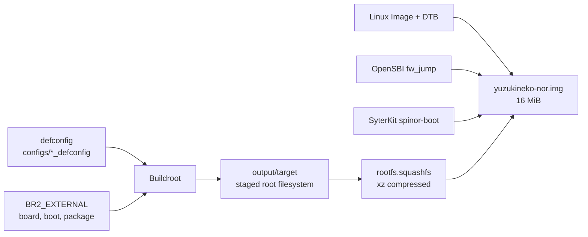

The root filesystem on YuzukiNeko is deliberately small: BusyBox, the MTD utilities, the C library, and one loadable kernel module. There is no package manager, no Bash, no Python, and no network stack. Everything else is either in the kernel or must be cross-compiled and copied onto the board.

This page describes what the image contains, how the external tree is laid out, what the six defconfigs build, how to add a package, and how to rebuild only part of the system. The build commands themselves are in [Linux + Buildroot](../linux-buildroot.md).



## What the root filesystem contains

The shipped image is assembled from these pieces. Versions are the ones recorded in the tree at the time of writing.

| Component | Version | Main files in `output/target` | Role |
| --- | --- | --- | --- |
| BusyBox | 1.38.0 | `/bin/busybox`, 281 symlinks under `bin/`, `sbin/`, `usr/bin/`, `usr/sbin/` | Shell, init, and 284 applets |
| mtd-utils | 2.3.1 | `flash_erase`, `flashcp`, `mtd_debug`, `mtdinfo`, `nanddump`, `nandwrite`, `mkfs.jffs2`, `ubi*` | Erase and inspect the NOR, build JFFS2 images |
| musl | 1.2.6 | `lib/libc.so`, `lib/ld-musl-*.so.1` | C library |
| Toolchain runtime | GCC | `libgcc_s.so.1`, `libatomic.so.1.2.0` | Compiler support routines |
| Linux module | 7.2.0 | `lib/modules/7.2.0/.../rng-core.ko` | Hardware random-number core |
| Buildroot init scripts | initscripts, urandom-scripts | `/etc/init.d/S01syslogd`, `S02klogd`, `S02sysctl`, `S11modules`, `S50crond`, `S01seedrng` | Boot-time scripts; the syslog pair cannot log without `CONFIG_NET` |
| Board overlay | external tree | `/sbin/init`, `/etc/init.d/S40network`, `/mnt/overlay`, `/mnt/root` | Overlay root and board customisation |

The filesystem is built in this order:

1. Buildroot installs its skeleton (`/etc/passwd`, `/etc/inittab`, `/etc/fstab`, device nodes and directory layout).
2. Each selected package installs into `output/target`.
3. The board overlay from `BR2_ROOTFS_OVERLAY` is copied over the result, replacing files with the same path.
4. The post-image script runs and assembles the 16 MiB NOR image.

:::note
There is no `opkg`, `apk`, `dpkg` or `rpm`. A command that is not in the image cannot be installed on the board; add it to the defconfig and rebuild, or cross-compile a static binary and copy it over.
:::

The tree in this repository has 74 regular files and 302 symbolic links, and those two numbers are almost the whole story: one large BusyBox binary, the handful of MTD utilities, the C library, and links that give each applet its name.

### What is not in the image

| Absent | Consequence on the board |
| --- | --- |
| Bash, coreutils, util-linux | The shell is BusyBox ash, and the file utilities are BusyBox applets with fewer options |
| Python, Perl, Lua, Tcl | No scripting beyond ash, awk, and sed |
| `opkg` or any package manager | A missing command means rebuilding the image |
| Network clients and daemons | `ping`, `wget`, `ip` and `telnet` applets exist, but the kernel has no `CONFIG_NET` |
| `libdrm`, `libv4l2`, `libpng`, `zlib` development files | Programs talk to the kernel through ioctls, or are linked statically elsewhere |
| Dropbear, OpenSSH, `gdb`, `strace` | Debugging is through the serial console and `/proc`, `/sys` |

The absence of `zlib` and `libdrm` is not an oversight: the board programs in this documentation are static binaries cross-compiled on the host and copied in, so they do not need target libraries.

## The external tree

All board support lives in `buildroot-external-yuzukihd`, outside the upstream Buildroot checkout. `BR2_EXTERNAL` is the official Buildroot mechanism for this.

```text
buildroot-external-yuzukihd/
├── configs/                          # the six board defconfigs
├── board/yuzukihd/yuzukineko/
│   ├── overlay/                      # copied over output/target
│   │   ├── etc/init.d/S40network     # no-op: the kernel has no CONFIG_NET
│   │   ├── mnt/overlay/              # mount point for the JFFS2 upper
│   │   ├── mnt/root/                 # mount point for the overlayfs root
│   │   └── sbin/init                 # PID 1: pivot_root onto the overlay
│   ├── scripts/
│   │   ├── busybox.fragment          # extra BusyBox options
│   │   ├── linux-nor.fragment        # extra kernel options
│   │   └── post-image-nor.sh         # assembles the 16 MiB image
│   ├── bin/                          # reserved, currently empty
│   └── readme.txt
├── boot/syterkit/                    # SyterKit package (Config.in + .mk)
├── package/xuantie-riscv-toolchain/  # downloaded bare-metal toolchain
├── Config.in
├── external.desc
└── external.mk
```

| Path | Contents |
| --- | --- |
| `configs/` | One defconfig per build target; this is what `make <name>_defconfig` reads |
| `board/yuzukihd/yuzukineko/` | Board files: rootfs overlay, config fragments, image script |
| `boot/syterkit/` | Builds SyterKit with either the rootfs toolchain or the Xuantie ELF/Newlib toolchain |
| `package/xuantie-riscv-toolchain/` | Host package that downloads and installs Xuantie-900 GCC V3.2.0 |
| `Config.in` | Sources the external package menus; `external.mk` includes `boot/*/*.mk` and `package/*/*.mk` automatically |

The `external.desc` file gives the tree its name, `YUZUKIHD`, which becomes the `BR2_EXTERNAL_YUZUKIHD_PATH` variable used by every defconfig.

## The six defconfigs

The tree has three families: RV32, RV32 with the Xuantie rootfs toolchain, and RV64I. Each family has a NOR build and a ramdisk build.

| defconfig | Word size | Root filesystem toolchain | Output |
| --- | --- | --- | --- |
| `yuzukihd_yuzukineko_nor_defconfig` | RV32 (C907 / ilp32) | Buildroot internal musl | Full 16 MiB NOR image |
| `yuzukihd_yuzukineko_xuantie_nor_defconfig` | RV32 (C907 / ilp32) | Xuantie musl32, downloaded | Full 16 MiB NOR image |
| `yuzukihd_yuzukineko_rv64i_nor_defconfig` | RV64I (lp64) | Buildroot internal musl | Full 16 MiB NOR image |
| `yuzukihd_yuzukineko_ramdisk_defconfig` | RV32 | Buildroot internal musl | `rootfs.cpio` only |
| `yuzukihd_yuzukineko_xuantie_ramdisk_defconfig` | RV32 | Xuantie musl32, downloaded | `rootfs.cpio` only |
| `yuzukihd_yuzukineko_rv64i_ramdisk_defconfig` | RV64I | Buildroot internal musl | `rootfs.cpio` only |

The three NOR defconfigs differ in the kernel configuration and the DTB as well:

| defconfig | Linux defconfig | DTB | SyterKit image |
| --- | --- | --- | --- |
| `yuzukihd_yuzukineko_nor_defconfig` | `sun252i_f101_yuzukineko` | `sun252i-f101-yuzukineko.dtb` | `spinor-boot_spi.bin` |
| `yuzukihd_yuzukineko_xuantie_nor_defconfig` | `sun252i_f101_yuzukineko` | `sun252i-f101-yuzukineko.dtb` | `spinor-boot_spi.bin` |
| `yuzukihd_yuzukineko_rv64i_nor_defconfig` | `sun252i_f101_rv64_yuzukineko` | `sun252i-f101-yuzukineko-rv64i.dtb` | `spinor-boot-rv64i_spi.bin` |

Notes on the choices:

- The two internal-musl NOR defconfigs set `BR2_TARGET_SYTERKIT_USE_XUANTIE_TOOLCHAIN=y`, because SyterKit's C907 build options need the Xuantie-900 ELF/Newlib V3.2.0 compiler. The Xuantie NOR defconfig builds SyterKit with the same `riscv32-unknown-linux-musl-` cross-compiler used for the root filesystem.
- All three NOR defconfigs select OpenSBI `fw_jump` from `YuzukiHD/opensbi` branch `sun252i-f101`, with `FW_JUMP_ADDR=0x40000000` and `FW_JUMP_FDT_ADDR=0x40f40000`.
- The ramdisk defconfigs are for bring-up and debugging. They build BusyBox and a login prompt on `ttyS1`, but no kernel, bootloader, or storage image. Load `rootfs.cpio` as an initrd, or link it into a kernel as an initramfs.

## Linux and BusyBox configuration fragments

Buildroot applies kconfig fragments on top of the base configuration. The external tree has one fragment for each.

`board/yuzukihd/yuzukineko/scripts/linux-nor.fragment`:

```text
# Linux config fragment for NOR boot (merged into the YuzukiNeko defconfig)
#
# MTD partitioning from the DT fixed-partitions table (flash@0/partitions),
# squashfs read-only root, and a JFFS2-backed overlayfs upper.
CONFIG_MTD=y
CONFIG_MTD_BLOCK=y
CONFIG_MTD_OF_PARTS=y
CONFIG_MTD_SPI_NOR=y
CONFIG_SQUASHFS=y
CONFIG_JFFS2_FS=y
CONFIG_OVERLAY_FS=y
```

`board/yuzukihd/yuzukineko/scripts/busybox.fragment`:

```text
# Busybox config fragment for YuzukiNeko NOR overlayfs boot
# pivot_root is used by /sbin/init to switch onto the overlay root.
CONFIG_PIVOT_ROOT=y
```

The fragment mechanism is the same for both packages: the defconfig names the fragment file with `BR2_LINUX_KERNEL_CONFIG_FRAGMENT_FILES` or `BR2_PACKAGE_BUSYBOX_CONFIG_FRAGMENT_FILES`, and Buildroot merges it into the package's `.config` with `merge_config.sh`. A symbol present in both places takes the fragment's value. Do not edit `output/build/linux-.../.config` or `output/build/busybox-.../.config` directly; the next configure step overwrites them.

Several of the kernel symbols in the fragment are also in the base defconfig. The duplicate is intentional: the RV64I defconfig is smaller, and the fragment makes the NOR requirements explicit for every arch.

## What a NOR build produces

The post-image script writes a fixed layout. Every region except the last is followed by erased space, and the whole image starts as `0xFF`.

| Region | Offset | Size | Limit | Content |
| --- | ---: | ---: | --- | --- |
| bootloader | `0x000000` | 48 KiB | < 64 KiB | `spinor-boot_spi.bin` or `spinor-boot-rv64i_spi.bin` |
| device tree | `0x010000` | about 11 KiB | < 256 KiB | `sun252i-f101-yuzukineko.dtb` or the RV64I DTB |
| OpenSBI | `0x050000` | about 261 KiB | < 512 KiB | `fw_jump.bin` |
| kernel | `0x0d0000` | about 5 MiB | < 6 MiB | `Image` |
| rootfs | `0x6d0000` | about 1.2 MiB | < 8.2 MiB | `rootfs.squashfs` |
| overlay | `0xf00000` | 1 MiB | = 1 MiB | erased; the JFFS2 overlay upper |

The SquashFS is written at its real size, with no padding. The script refuses to build if the rootfs would run past `0xf00000`; the usable region is `0x6d0000` to `0xf00000`, which is `0x830000` bytes, 8,585,216 bytes or 8.2 MiB.

A successful RV32 build ends with a report like this (the sizes are from one recorded build):

```text
== build/br-rv32/images/yuzukineko-nor.img : 16 MiB SPI NOR image (RV32 (C907 / ilp32)) ==
  REGION      OFFSET          SIZE  LIMIT    CONTENT
  bootloader  0x000000      48 KiB  <64K     spinor-boot_spi.bin
  dtb         0x010000      11 KiB  <256K    sun252i-f101-yuzukineko.dtb
  fw_jump     0x050000     261 KiB  <512K    fw_jump.bin
  Image       0x0d0000    5121 KiB  <6M      Image
  rootfs      0x6d0000    1252 KiB  <8.2M    rootfs.squashfs
  overlay     0xf00000    1024 KiB  =1M      erased; JFFS2 overlayfs upper
== done: build/br-rv32/images/yuzukineko-nor.img (16384 KiB on disk) ==
```

## Adding a package

### Selecting an existing package

Every Buildroot package has a `BR2_PACKAGE_<NAME>` symbol. The reliable way to find the right one is `menuconfig`, not guessing the spelling.

```sh
cd buildroot
make O=../build/br-rv32 BR2_EXTERNAL=../buildroot-external-yuzukihd menuconfig
```

Pick the package under `Target packages`, save, and rebuild:

```sh
make O=../build/br-rv32 BR2_EXTERNAL=../buildroot-external-yuzukihd
```

To make the choice permanent in the board defconfig, use `make savedefconfig` after `menuconfig`, or add the symbol to the defconfig directly:

```text
BR2_PACKAGE_STRACE=y
```

Then rebuild. Buildroot notices the changed configuration, builds only the new package and its dependencies, reinstalls it into `output/target`, regenerates `rootfs.squashfs`, and reruns the post-image script.

:::caution
A package that needs `CONFIG_NET` is useless even if it builds: the kernel has no network stack. The same applies to packages that expect a package manager, Python, Perl, or glibc-only features.
:::

### Writing a package in the external tree

A custom package lives under `package/<name>/` with a `Config.in` and a `.mk`. The external `Config.in` must source the menu; `external.mk` already includes every `package/*/*.mk`.

```text
buildroot-external-yuzukihd/package/hello-f101/Config.in
buildroot-external-yuzukihd/package/hello-f101/hello-f101.mk
```

`Config.in`:

```text
config BR2_PACKAGE_HELLO_F101
	bool "hello-f101"
	help
	  Example package built from a local directory.
```

`hello-f101.mk`:

```make
HELLO_F101_VERSION = 1.0
HELLO_F101_SITE = $(BR2_EXTERNAL_YUZUKIHD_PATH)/package/hello-f101/src
HELLO_F101_SITE_METHOD = local
HELLO_F101_LICENSE = MIT

define HELLO_F101_BUILD_CMDS
	$(TARGET_MAKE_ENV) $(MAKE) -C $(@D) CC="$(TARGET_CC)"
endef

define HELLO_F101_INSTALL_TARGET_CMDS
	$(INSTALL) -D -m 0755 $(@D)/hello $(TARGET_DIR)/usr/bin/hello
endef

$(eval $(generic-package))
```

Source it from the external tree's `Config.in`:

```text
source "$BR2_EXTERNAL_YUZUKIHD_PATH/package/hello-f101/Config.in"
```

Enable `BR2_PACKAGE_HELLO_F101=y` and rebuild. The package installs into `output/target/usr/bin/hello`, so it ends up in the SquashFS and consumes part of the 8.2 MiB rootfs budget.

## Inspecting the built root filesystem

Before flashing, check what actually landed in the image. The staging tree is a normal directory, and the SquashFS can be listed without mounting it:

```sh
du -sh output/target
find output/target -type f | wc -l
find output/target -type l | wc -l
output/host/bin/unsquashfs -l output/images/rootfs.squashfs | head
```

`du -sh output/target` is the uncompressed size and is much larger than the compressed SquashFS; the limit applies to the compressed file that is written to NOR, so compare `wc -c output/images/rootfs.squashfs` with 8,585,216. `unsquashfs -l` is also the quickest way to confirm that a new package or a changed overlay file made it into the final image rather than only into the staging tree.

To see the files a single package installed, Buildroot keeps a per-package manifest:

```sh
grep '^mtd,' output/build/packages-file-list.txt
```

The file has one `<package>,<path>` line per installed file. The matching `packages-file-list-staging.txt` and `packages-file-list-host.txt` cover the staging and host trees.

If a file is in `output/target` but not in the SquashFS listing, the image was not regenerated after the last install; run `make rootfs-squashfs`.

## Rebuilding

All commands below run in the Buildroot source directory with the same `O=` and `BR2_EXTERNAL=` as the original build; those two arguments are omitted for brevity. For example, the first row is really `make O=../build/br-rv32 BR2_EXTERNAL=../buildroot-external-yuzukihd busybox-rebuild`.

| Goal | Command |
| --- | --- |
| Rebuild one package and reinstall it | `make <pkg>-rebuild` |
| Reconfigure one package first | `make <pkg>-reconfigure` |
| Delete one package's build directory | `make <pkg>-dirclean` |
| Rebuild BusyBox | `make busybox-rebuild` |
| Rebuild the kernel | `make linux-rebuild` |
| Edit the kernel configuration | `make linux-menuconfig`, then copy the options you need into `linux-nor.fragment` |
| Edit the BusyBox configuration | `make busybox-menuconfig`, then copy the options you need into `busybox.fragment` |
| Regenerate only `rootfs.squashfs` | `make rootfs-squashfs` |
| Regenerate the 16 MiB image | `make target-post-image` |
| Do everything that changed | `make` |

`<pkg>-rebuild` removes only that package's install stamps, rebuilds it, and reinstalls it into `output/target`. It does not by itself rewrite the SquashFS; run `make rootfs-squashfs` or a plain `make` afterwards.

The `*-menuconfig` targets edit the package's own `.config`. On this board the kernel uses an in-tree defconfig and BusyBox uses Buildroot's base config, so the matching `-update-config` target would write into the upstream Buildroot or kernel tree, not into the external tree. The durable place for a change is the fragment under `board/yuzukihd/yuzukineko/scripts/`; add the symbols there and rebuild.

## Where the outputs land

| Path | Contents |
| --- | --- |
| `output/target/` | The complete root filesystem tree before it is packed |
| `output/build/<pkg>-<version>/` | Unpacked sources and object files for each package |
| `output/host/` | The cross-compiler and host tools, including `mksquashfs` |
| `output/images/` | `Image`, the DTB, `fw_jump.bin`, the SyterKit binary, `rootfs.squashfs`, and `yuzukineko-nor.img` |

`output/target` is the place to look when checking whether a package really installed a file. `THIS_IS_NOT_YOUR_ROOT_FILESYSTEM` at its top is a Buildroot marker, not a file for the board.

## Kernel modules

The kernel is built with `CONFIG_MODULES=y`, but almost everything is built in. The only loadable module in the image is `rng-core.ko`:

```sh
find /lib/modules -name '*.ko'
```

On the board, that prints one path under `/lib/modules/7.2.0/kernel/drivers/char/hw_random/`. Nothing loads it at boot: `/etc/modules-load.d` does not exist, and `S11modules` exits immediately when there is nothing to load. Load it by hand when a program needs `/dev/hwrng`:

```sh
modprobe rng-core
lsmod
```

Two limits matter. First, a module must match the running kernel's version and configuration; the vermagic here is `7.2.0 preempt riscv`. Second, the RV64I kernel in this tree is built without `CONFIG_MODULE_UNLOAD`, so `rmmod` cannot remove a module once loaded.

## Size limits and the overlay

The rootfs partition is the tightest constraint. A SquashFS is compressed once at build time and mounted read-only, so there is no way to free space on the board. If a package pushes the image past 8.2 MiB, the post-image script fails before writing anything usable. A rootfs one byte over the limit would print:

```text
post-image-nor.sh: rootfs (8585217 B) overflows into overlay @ 0xf00000
```

For reference, the two images built for this documentation are 1,282,048 bytes (RV32) and 1,253,376 bytes (RV64I), so there is a lot of headroom for small tools and almost none for a second C library or a large application.

The writable part is the last 1 MiB, formatted as JFFS2 on first boot and used as the upper layer of an overlayfs. Edited scripts and files created at runtime live there, not in the SquashFS. Kernel logging goes to the `dmesg` ring buffer, not to a file: syslogd cannot create its `AF_UNIX` socket without `CONFIG_NET`. Flashing a full image erases the overlay, so anything that must survive a reflash belongs in the board overlay under `board/yuzukihd/yuzukineko/overlay/`, not in a file edited on the board.

## Troubleshooting

| Observation | Cause and fix |
| --- | --- |
| `rootfs (...) overflows into overlay` | The rootfs exceeded 8.2 MiB. Remove a package, or build with a smaller config; check `du -sh output/target` |
| A new package is not in the image | The `BR2_PACKAGE_*` symbol is not enabled for the defconfig in use, or the build was not rerun after changing it |
| `menuconfig` does not list a custom package | Its `Config.in` is not sourced, or `BR2_EXTERNAL` does not point at the external tree |
| A package rebuild changes nothing | The package uses a cached build; use `make <pkg>-rebuild`, or `make <pkg>-dirclean` first |
| Changes made on the board disappear after flashing | They were in the JFFS2 overlay, which the full image erases; put them in the board overlay tree |
| `modprobe` cannot find a module | Only `rng-core.ko` is shipped; check `find /lib/modules -name '*.ko'` and the kernel version |
| `rmmod` fails | The RV64I kernel is configured without module unloading; reboot instead |
