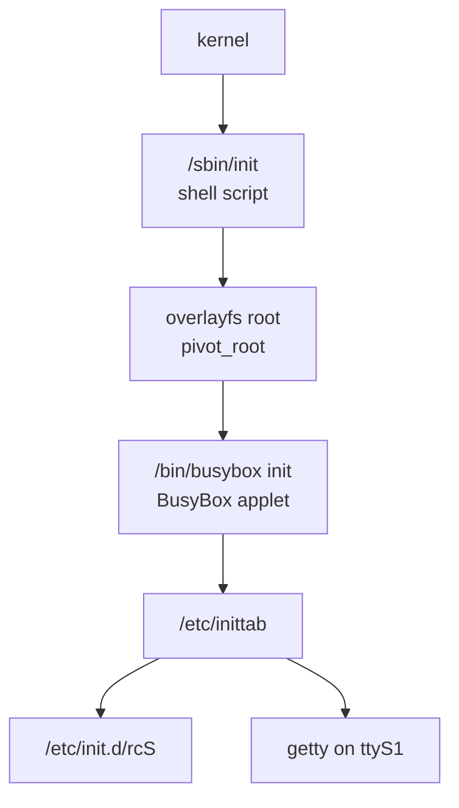

BusyBox is the whole user space on YuzukiNeko: one executable provides the shell, the file utilities, the init process, the logging daemons, the cron daemon, the I2C tools, the serial terminal, and the editor. This page covers how the applets are invoked, which applets are in the shipped image, how ash differs from bash, how init and the boot scripts work, and the small set of interactive tools you will actually use on the serial console.



## What BusyBox is here

| Item | Value |
| --- | --- |
| Version | 1.38.0 |
| Binary | `/bin/busybox`, dynamically linked against musl |
| Applets compiled in | 284 |
| Applet links installed | 281, plus `/linuxrc` |
| Shell | `ash`, also reachable as `/bin/sh` |
| Configuration | `output/build/busybox-1.38.0/.config`, built from Buildroot's BusyBox config plus `busybox.fragment` |
| PID 1 | Not the applet directly: `/sbin/init` is a shell script that prepares the overlay root and then `exec`s `busybox init` |

`busybox` with no arguments prints its version, usage, and the full applet list:

```text
BusyBox v1.38.0 (2026-09-08 13:40:57 UTC) multi-call binary.
```

The date is the build time and changes when you rebuild the image. The first line is the quick way to check both the version and whether the binary runs at all.

## Invoking an applet

BusyBox looks at how it was called. A symlink named `ls` makes the same binary run the `ls` applet, and `busybox ls` does the same explicitly:

```sh
ls -l /
busybox ls -l /
```

The explicit form is useful when a symlink is missing or when you want to be certain which implementation runs. For example, `/sbin/init` is the board script, so the init applet is reached only as `busybox init`; `ubirename` has no symlink either and is reached as `busybox ubirename`.

Three listing options describe the installed set:

```sh
busybox --list
busybox --list-full
busybox --help
```

`--list` prints one applet name per line; `--list-full` prints the path BusyBox would install it at. The first ten lines of each are:

```text
$ busybox --list | head
[
[[
addgroup
adduser
ar
arch
arp
arping
ascii
ash
```

```text
$ busybox --list-full | head
usr/bin/[
usr/bin/[[
usr/sbin/addgroup
usr/sbin/adduser
usr/bin/ar
bin/arch
sbin/arp
usr/sbin/arping
usr/bin/ascii
bin/ash
```

To create the links yourself, for example in a directory you control:

```sh
mkdir -p /tmp/bb
busybox --install -s /tmp/bb
ls /tmp/bb | head
```

`--install` without `-s` creates hard links instead of symlinks. On a read-only filesystem, or when the links already exist and the filesystem refuses to replace them, `--install` reports an error per applet; that is harmless if the links are already there.

### Install paths

The shipped image follows the paths from `--list-full`. The counts are links, not applets: three applet names have no link in these four directories (see below).

| Directory | BusyBox links | Examples |
| --- | ---: | --- |
| `/bin` | 75 | `ls`, `cp`, `sh`, `vi`, `mount`, `dmesg` |
| `/sbin` | 52 | `init` is a script here, plus `mount`, `modprobe`, `reboot`, `sysctl` links |
| `/usr/bin` | 127 | `awk`, `hexdump`, `microcom`, `md5sum`, `top`, `less` |
| `/usr/sbin` | 27 | `crond`, `fbset`, `i2cdetect`, `start-stop-daemon` |
| `/linuxrc` | 1 | A single link to `bin/busybox` at the root |

The 284 applets minus the 281 links in those four directories leaves three names. Two are reachable another way: `init` is run as `busybox init` because the path `/sbin/init` is the board script, and `linuxrc` has its own link at `/linuxrc`. Only `ubirename` has no link anywhere, because the MTD utilities install their own `ubi*` tools; run it as `busybox ubirename`.

## The applet list

This is the complete set compiled into the shipped image, grouped by what you would use it for. Names are exactly what `busybox --list` prints.

| Category | Applets |
| --- | --- |
| Shell and scripting | `[`, `[[`, ash, awk, bc, dc, echo, env, expr, factor, false, getopt, printenv, printf, seq, sh, test, true, yes |
| Text and streams | ascii, cat, cmp, cut, diff, dos2unix, egrep, fgrep, fold, grep, head, hexdump, hexedit, less, more, nl, od, paste, patch, pipe_progress, sed, sort, strings, tail, tee, tr, ts, tsort, uniq, unix2dos, uuidgen, vi, wc, xxd |
| Archives and checksums | ar, base32, base64, bunzip2, bzcat, cksum, cpio, crc32, gunzip, gzip, lzcat, lzma, lzopcat, md5sum, sha1sum, sha256sum, sha384sum, sha3sum, sha512sum, tar, unlzma, unlzop, unxz, unzip, uudecode, uuencode, xz, xzcat, zcat |
| Files and directories | basename, chattr, chgrp, chmod, chown, cp, dirname, fallocate, find, getfattr, install, link, ln, ls, lsattr, makedevs, mkdir, mkfifo, mknod, mktemp, mv, nuke, pwd, readlink, realpath, rm, rmdir, setfattr, shred, touch, tree, truncate, unlink, which, xargs |
| Disks and filesystems | blkid, dd, df, du, eject, fdflush, fdformat, fdisk, freeramdisk, fsck, fsfreeze, fstrim, hdparm, losetup, lsblk, lsscsi, mkdosfs, mke2fs, mkswap, mount, mountpoint, mt, partprobe, swapoff, swapon, sync, ubirename, umount |
| Processes and system | arch, chroot, chrt, flock, free, fuser, hostid, hostname, ipcrm, ipcs, kill, killall, killall5, linux32, linux64, lsof, nice, nohup, nproc, pidof, ps, renice, setarch, setpriv, setsid, sysctl, time, top, uname, uptime, vmstat, watch |
| Logs, time, scheduling | crond, crontab, date, dmesg, hwclock, klogd, logger, rdate, seedrng, sleep, syslogd, usleep |
| Hardware and buses | devmem, i2cdetect, i2cdump, i2cget, i2cset, i2ctransfer, lspci, lsusb, microcom, readprofile, setserial, stty |
| Display and console | chvt, clear, deallocvt, dumpkmap, fbset, loadfont, loadkmap, openvt, reset, resize, setconsole, setkeycodes, setlogcons |
| Users and sessions | addgroup, adduser, delgroup, deluser, getty, id, last, login, logname, mesg, mkpasswd, nologin, passwd, su, sulogin, tty, vlock, w, who, whoami |
| Network (cannot reach a network) | arp, arping, dnsd, dnsdomainname, ether-wake, ifconfig, ifdown, ifup, inetd, ip, ipaddr, iplink, ipneigh, iproute, iprule, iptunnel, nameif, netstat, nslookup, ping, route, ssl_server, telnet, tftp, traceroute, udhcpc, vconfig, wget |
| Init, services, modules | halt, init, insmod, linuxrc, lsmod, mdev, mim, modprobe, pivot_root, poweroff, reboot, resume, rmmod, run-init, run-parts, runlevel, start-stop-daemon, svc, svok, switch_root, uevent, watchdog |

The network applets are present but useless: the kernel is built without `CONFIG_NET`, so the socket calls they make fail before any packet can leave the board. See [Common commands](linux-commands.md) for what actually works.

## ash, the shell

`/bin/sh` and `/bin/ash` are the same applet. It is a POSIX shell with a set of bash-compatible extensions enabled, not bash. The image has no bash.

### Builtins

`help` is compiled in, and lists the builtins:

```text
Built-in commands:
------------------
	. : [ [[ alias bg break cd command continue echo eval exec exit
	export false fg getopts hash help history jobs kill let local
	printf pwd read readonly return set shift source test times trap
	true type ulimit umask unalias unset wait
```

Everything else, including `ls`, `grep`, `sed`, `awk` and `vi`, is an applet launched as a separate process.

### Syntax differences from bash

| Feature | In this ash | Notes |
| --- | --- | --- |
| Arrays (`a=(1 2 3)`) | No | Syntax error |
| `declare`, `typeset` | No | Not a builtin |
| Brace expansion `{a,b}` | No | Printed literally |
| `${var:offset:length}` | Yes | Bash compatibility is enabled |
| `${var/pat/repl}` and `${var//pat/repl}` | Yes | Pattern substitution |
| `[[ ... ]]` | Yes | Also `[`, `test` |
| `$'a\tb'` | Yes | ANSI-C quoting |
| `function name { ...; }` | Yes | The `name()` form also works |
| `&>` and `&>>` | Yes | Combined stdout and stderr |
| `set -o pipefail` | Yes | |
| Process substitution `<(cmd)` | Yes | Creates a `/dev/fd` path |
| `$RANDOM` | Yes | |
| `$HOSTNAME`, `$EPOCHSECONDS`, `$SHLVL` | Yes | Set by ash |
| `read -d DELIM` | Yes | |
| `wait -n` | Yes | |
| `$PIPESTATUS` | No | Use temporary files or restructure the pipeline |
| `local` | Yes | Function-local variables |
| `source` and `.` | Yes | Both builtins |

Job control is compiled in: `jobs`, `fg`, `bg`, and `kill` work in an interactive shell. In a script there are no jobs to control, and background processes simply run detached. Use `nohup` or `setsid` for long commands that must survive the console session.

### Arithmetic

`$((...))` is 64-bit and supports the usual operators, including `**` and base prefixes:

```sh
echo $(( 2 ** 10 ))
echo $(( 16#ff + 1 ))
echo $(( (3 + 4) * 5 ))
```

The first prints `1024`, the second `256`, the third `35`. `let` is a builtin and takes the same expressions. There is no floating point; use `awk` or `bc` for that.

## init and the boot scripts

PID 1 is `/sbin/init`, a shell script (see the next section). After it has built the overlay root, it `exec`s `/bin/busybox init`, and from then on the BusyBox init applet is PID 1. It reads `/etc/inittab` and starts the services.

### inittab

The shipped `/etc/inittab` uses the BusyBox format `<id>:<runlevels>:<action>:<process>`. Runlevels are ignored. The entries that matter at boot are:

```text
::sysinit:/bin/mount -t proc proc /proc
::sysinit:/bin/mount -o remount,rw /
::sysinit:/bin/mount -a
::sysinit:/etc/init.d/rcS
ttyS1::respawn:/sbin/getty -L  ttyS1 115200 vt100 # GENERIC_SERIAL
::shutdown:/etc/init.d/rcK
::shutdown:/bin/umount -a -r
```

| Action | Meaning |
| --- | --- |
| `sysinit` | Run once, before any `respawn` entry |
| `respawn` | Restart the process whenever it exits; this keeps getty alive |
| `askfirst` | Like `respawn`, but waits for Enter before starting |
| `wait` | Run once and wait for it to finish |
| `once` | Run once, do not wait |
| `shutdown` | Run when init halts or reboots |

The empty `id` means `/dev/console`; `ttyS1` means the process runs with that tty as stdin, stdout, and stderr. The login prompt is `getty -L` on `ttyS1` at 115200; `-L` sets CLOCAL so getty does not wait for carrier detect. The root account has an empty password.

### rcS and rcK

`/etc/init.d/rcS` runs every `S??*` script in lexical order. If the name ends in `.sh`, it is sourced in a subshell with `$1` set to `start`; otherwise it is executed as `"$i" start`. `/etc/init.d/rcK` runs the same list in reverse with `stop`.

The shipped boot order is:

| Script | What it starts |
| --- | --- |
| `S01seedrng` | `seedrng`, preserving the random seed in `/var/lib/seedrng` |
| `S01syslogd` | `syslogd`; it exits immediately because `AF_UNIX` is unavailable |
| `S02klogd` | `klogd`; it may stay up but cannot reach syslogd |
| `S02sysctl` | `sysctl`, applying `/etc/sysctl.d/*.conf` and the other sysctl sources |
| `S11modules` | `modprobe` for each module in `/etc/modules-load.d`; the directory does not exist |
| `S40network` | A stub that exits immediately, because there is no network stack |
| `S50crond` | `crond`, watching `/etc/cron/crontabs` |

`run-parts` is installed but the Buildroot scripts do not use it: `rcS` implements the loop itself so that it can source `.sh` scripts and pass them `start` without forking. The applet is still useful for your own directories:

```sh
run-parts --test /etc/init.d
```

`--test` lists the scripts without running them; without `--test`, `run-parts DIR` runs every script in lexical order without arguments. That is why it does not fit the boot scripts here: they expect `start` or `stop` as `$1`. For your own services, use a separate directory whose scripts can run with no arguments.

### start-stop-daemon

The daemons that must run in the background use `start-stop-daemon`. `S01syslogd` is a complete example of the pattern:

```sh
start-stop-daemon --start --background --make-pidfile \
	--pidfile "$PIDFILE" --exec "/sbin/$DAEMON" \
	-- -n $SYSLOGD_ARGS
```

`--start` starts the program only if no matching process is running. `--background` detaches it, `--make-pidfile` writes the PID to `--pidfile` because BusyBox syslogd does not, and everything after `--` is passed to the daemon. `-n` keeps syslogd in the foreground from the daemon's point of view, which is what makes the PID file meaningful. The stop path uses `--stop` and then polls with `--test` until the process is gone.

### The boot services

| Daemon | Arguments | Output / state |
| --- | --- | --- |
| `syslogd` | `-n` | Cannot start here: it needs an `AF_UNIX` socket, and the kernel has no `CONFIG_NET`; no `/var/log/messages` is written |
| `klogd` | `-n` | May stay up, but its `syslog()` calls have no socket to reach; it records nothing |
| `crond` | `-f` | `/etc/cron/crontabs`; no crontab files by default |
| `seedrng` | none | Seed and lock files under `/var/lib/seedrng` |

:::caution
The logging setup does not work on this kernel. BusyBox syslogd creates a local `AF_UNIX` datagram socket at startup, and the kernel is built without `CONFIG_NET`, so the `socket()` call fails with `EAFNOSUPPORT` and syslogd exits. `start-stop-daemon --background` has already returned success by then, so the boot console still prints `Starting syslogd: OK`. `klogd` may stay up reading the kernel log, but its `syslog()` calls have no `/dev/log` to reach. `logger` and `/var/log/messages` are therefore unavailable. Use `dmesg` for kernel messages, and capture the serial console on the host for a persistent record.
:::

`/var/lib/seedrng` and the rest of `/var` are on the writable JFFS2 overlay, so the seed survives a reboot until the overlay is erased. The overlay is only 1 MiB; anything that writes there consumes it.

### Adding a service

Create a script named `S<number><name>` in `/etc/init.d`, make it executable, and give it `start`, `stop`, and `restart` actions. The number decides the order. This template runs a foreground program under `start-stop-daemon`:

```sh
#!/bin/sh
DAEMON="mydaemon"
PIDFILE="/var/run/$DAEMON.pid"

start() {
	printf 'Starting %s: ' "$DAEMON"
	start-stop-daemon --start --background --make-pidfile \
		--pidfile "$PIDFILE" --exec "/usr/bin/$DAEMON" -- -f
	echo "OK"
}

stop() {
	printf 'Stopping %s: ' "$DAEMON"
	start-stop-daemon --stop --pidfile "$PIDFILE" --exec "/usr/bin/$DAEMON"
	rm -f "$PIDFILE"
	echo "OK"
}

case "$1" in
	start|stop|restart)
		"$1";;
	*)
		echo "Usage: $0 {start|stop|restart}"
		exit 1
esac
```

Run it now with `/etc/init.d/S99mydaemon start`. It will run automatically at the next boot. A file created in `/etc/init.d` lands in the JFFS2 upper and survives a reboot, but not a reflash of the full image; to keep it permanently, put the same file under `buildroot-external-yuzukihd/board/yuzukihd/yuzukineko/overlay/etc/init.d/` and rebuild.

### cron

`crond` is already running. `crontab -e` opens the editor set in `/etc/profile`, which is `/bin/vi`; `crontab -l` lists the current table. The format is the usual five fields:

```text
# min hour day month weekday command
*/5 * * * * date >> /tmp/cron.log
```

Save the file and crond picks it up within a minute. A job must write its own output: `logger` and syslogd do not work on this kernel, so redirect to a file instead. `/tmp` is a tmpfs and disappears at reboot; put a file you need to keep under `/root` or `/var`. The crontab files live under `/etc/cron/crontabs`; `crond -c DIR` changes the directory if you start it by hand.

## The board's /sbin/init

The kernel mounts the read-only SquashFS as `/` and executes `/sbin/init`. That file is not the BusyBox applet; it is this script, which builds an overlayfs whose lower layer is the SquashFS and whose upper layer is the JFFS2 partition, switches the root onto it, and only then starts BusyBox init.

```sh
#!/bin/sh
# SPDX-License-Identifier: GPL-2.0+
#
# YuzukiNeko /sbin/init (PID 1)
#
# The kernel mounts the read-only SquashFS root and hands control here. We
# build an overlayfs whose lower is that SquashFS root and whose upper lives
# on the JFFS2 "overlay" MTD partition, pivot_root() onto it, and then start
# the real (busybox) init. From then on the whole root is writable and the
# changes persist on the JFFS2 upper.
#
# Requires busybox applets: mount, pivot_root, flash_erase (mtd-utils).
set -e

msg() { echo "init: $*"; }

# On any failure fall back to the plain (read-only) root so the board is
# still debuggable instead of panicking.
fallback() {
	echo "init: overlay setup failed; busybox init on read-only root"
	exec /bin/busybox init
}
trap fallback ERR

# --- basic pseudo-filesystems -------------------------------------------
mount -t proc proc /proc 2>/dev/null || true
mount -t sysfs sysfs /sys 2>/dev/null || true
mount -t devtmpfs devtmpfs /dev 2>/dev/null || true

mtd="$(sed -n 's/^mtd\([0-9]\+\):.*"overlay".*/\1/p' /proc/mtd | head -n1)"
if [ -z "$mtd" ]; then
	msg "no 'overlay' MTD partition; staying on read-only root"
	exec /bin/busybox init
fi

# --- JFFS2 upper (mount by partition name) ------------------------------
mkdir -p /mnt/overlay
if ! mount -t jffs2 mtd:overlay /mnt/overlay 2>/dev/null; then
	msg "initializing JFFS2 on /dev/mtd$mtd"
	flash_erase /dev/mtd$mtd 0 0 >/dev/null || true
	mount -t jffs2 mtd:overlay /mnt/overlay
fi
mkdir -p /mnt/overlay/upper /mnt/overlay/work

# --- overlay the SquashFS root ------------------------------------------
mkdir -p /mnt/root
mount -t overlay overlay \
	-o "lowerdir=/,upperdir=/mnt/overlay/upper,workdir=/mnt/overlay/work" \
	/mnt/root
msg "overlayfs ready at /mnt/root (upper: mtd:overlay)"

# --- make the overlay the root ------------------------------------------
mkdir -p /mnt/root/oldroot
pivot_root /mnt/root /mnt/root/oldroot
cd /

# --- remount pseudo-filesystems in the new root -------------------------
mount -t proc proc /proc 2>/dev/null || true
mount -t sysfs sysfs /sys 2>/dev/null || true
mount -t devtmpfs devtmpfs /dev 2>/dev/null || true

msg "switched root; starting busybox init"
exec /bin/busybox init
```

Line by line:

1. `set -e` makes any unhandled failure fatal, and `trap fallback ERR` runs `fallback` instead of leaving PID 1 dead. `fallback` starts BusyBox init on the read-only SquashFS, so the board still gives a shell.
2. `mount -t proc`, `sysfs`, and `devtmpfs` give the script the pseudo-filesystems it needs before the real init exists. The `|| true` ignore failures because the kernel may already have mounted some of them.
3. The `sed` extracts the MTD number of the partition whose name is `overlay` from `/proc/mtd`. On this layout that is `mtd5`, but the script does not hard-code the number. If no such partition exists, it starts BusyBox init on the read-only root.
4. `mount -t jffs2 mtd:overlay /mnt/overlay` mounts by partition name. If it fails, the partition is assumed blank: `flash_erase /dev/mtd$mtd 0 0` erases the whole partition, then the mount is retried. The `upper` and `work` directories are created inside it.
5. The overlay mount combines `lowerdir=/` (the SquashFS) with `upperdir=/mnt/overlay/upper` and `workdir=/mnt/overlay/work` at `/mnt/root`.
6. `pivot_root /mnt/root /mnt/root/oldroot` makes the overlay the new root and moves the old SquashFS root under `/oldroot`, then `cd /` leaves the old directory.
7. The pseudo-filesystems are mounted again in the new root. The old mounts are still under `/oldroot`, but the new `/proc`, `/sys`, and `/dev` are what the services use.
8. `exec /bin/busybox init` replaces the script with the init applet. From here `/etc/inittab` takes over.

The script depends on `pivot_root` (the BusyBox fragment enables `CONFIG_PIVOT_ROOT`) and on `flash_erase` from mtd-utils. The old root stays mounted at `/oldroot`; nothing unmounts it, which is also why the overlay's lower layer stays valid.

## vi

The editor is the BusyBox vi applet. It is small but usable for editing scripts and configuration on the board.

```text
Usage: vi [-c CMD] [-R] [-H] [FILE]...

Edit FILE

	-c CMD	Initial command to run ($EXINIT and ~/.exrc also available)
	-R	Read-only
	-H	List available features
```

`vi -H` shows what this build supports:

```text
These features are available:
	Pattern searches with / and ?
	Last command repeat with .
	Line marking with 'x
	Named buffers with "x
	Some colon mode commands with :
	Settable options with ":set"
	Signal catching- ^C
	Job suspend and resume with ^Z
```

The commands you need most:

| Key / command | Effect |
| --- | --- |
| `i` | Insert before the cursor |
| `a` | Append after the cursor |
| `o` | Open a new line below |
| `Esc` | Leave insert mode |
| `h j k l` | Move left, down, up, right |
| `x` | Delete the character under the cursor |
| `dd` | Delete the current line |
| `yy` | Copy the current line |
| `p` | Paste after the cursor |
| `/pattern` | Search forward; `n` repeats |
| `:w` | Write the file |
| `:q` | Quit |
| `:wq` | Write and quit |
| `:q!` | Quit without saving |
| `:set nu` | Show line numbers |
| `u` | Not available; there is no undo |

Files under `/etc` are writable because the root is the overlayfs; the change is stored in the JFFS2 upper and survives a reboot. It does not survive flashing a full image.

## microcom

`microcom` copies bytes between stdin/stdout and a tty. It is the way to talk to a serial device or to the USB ACM gadget from the board itself.

```text
Usage: microcom [-d DELAY_MS] [-t TIMEOUT_MS ] [-s SPEED] [-X] TTY

Copy bytes from stdin to TTY and from TTY to stdout

	-d DELAY	Wait up to DELAY ms for TTY output before sending
			every next byte to it
	-t TIMEOUT	Exit if both stdin and TTY are silent for TIMEOUT ms
	-s SPEED	Set serial line to SPEED
	-X		Disable special meaning of NUL and Ctrl-X from stdin
```

Examples:

```sh
microcom -s 115200 /dev/ttyGS0
microcom -s 115200 -t 5000 /dev/ttyGS0
```

The first opens the USB gadget serial port at 115200 and stays until Ctrl-X. The second also exits after five seconds of silence on both sides, which is useful in a script. `-d 10` waits up to 10 ms for output from the tty before sending each byte, which helps a slow device.

Two pitfalls:

- Ctrl-X exits microcom by default. If the remote device needs a literal Ctrl-X, start with `-X`; then the only way out is to kill the process from another session.
- `/dev/ttyS1` is the console, and getty owns it. Running microcom on it competes with the login prompt. Use `/dev/ttyGS0` after bringing up the USB gadget, or stop getty first.

## hexdump and md5sum

### hexdump

`hexdump` is the general-purpose byte viewer. `-C` gives the canonical hex and ASCII form, `-n` limits the length, and `-s` skips bytes:

```text
Usage: hexdump [-bcdoxCv] [-e FMT] [-f FMT_FILE] [-n LEN] [-s OFS] [FILE]...

Display FILEs (or stdin) in a user specified format

	-b		1-byte octal display
	-c		1-byte character display
	-d		2-byte decimal display
	-o		2-byte octal display
	-x		2-byte hex display
	-C		hex+ASCII 16 bytes per line
	-v		Show all (no dup folding)
	-e FORMAT_STR	Example: '16/1 "%02x|""\n"'
	-f FORMAT_FILE
	-n LENGTH	Show only first LENGTH bytes
	-s OFFSET	Skip OFFSET bytes
```

The first bytes of the SquashFS root partition are the `hsqs` magic:

```sh
hexdump -C -n 4 /dev/mtdblock4
```

```text
00000000  68 73 71 73                                       |hsqs|
00000004
```

The trailing `00000004` is the final offset line that BusyBox hexdump prints; `xxd -l 4 /dev/mtdblock4` gives the same bytes without it. For a larger read, `-s` skips into the device:

```sh
hexdump -C -s 0x1000 -n 64 /dev/mtdblock4
```

Reading an MTD block device is safe. Erasing or writing it is not; see [Common commands](linux-commands.md).

### md5sum

`md5sum` prints or checks MD5 digests:

```text
Usage: md5sum [-c[sw]] [FILE]...

Print or check MD5 checksums

	-c	Check sums against list in FILEs
	-s	Don't output anything, status code shows success
	-w	Warn about improperly formatted checksum lines
```

To checksum a file and later verify it:

```sh
md5sum /tmp/rootfs.squashfs > /tmp/rootfs.md5
md5sum -c /tmp/rootfs.md5
```

The check prints `OK` or `FAILED` per file and exits non-zero on a mismatch. `sha1sum`, `sha256sum`, `sha384sum`, `sha512sum`, `sha3sum` and `crc32` are also available; use `sha256sum` for anything security-related, since MD5 is not collision-resistant.

## Troubleshooting

| Observation | Cause and fix |
| --- | --- |
| `applet not found` | The name is not compiled in; check `busybox --list` |
| `Permission denied` from `busybox --install` | The destination is read-only, or the links already exist and cannot be replaced |
| A script fails with `syntax error: bad substitution` | It uses a bash feature ash does not have, such as arrays or `$PIPESTATUS` |
| `vi` cannot write a file | The path is on a read-only mount, or the overlay is full |
| No login prompt on `ttyS1` | getty exited; check `/etc/inittab` and run `ps` for `getty` |
| Changes to `/etc/init.d` vanish after flashing | The file was in the JFFS2 upper; put it in the board overlay tree and rebuild |
| `logger` produces nothing and `/var/log/messages` is missing | syslogd cannot create an `AF_UNIX` socket without `CONFIG_NET`; use `dmesg` and capture the serial console instead |
| cron job never runs | `crond` is not running, the crontab is in the wrong directory, or the script is not executable |
