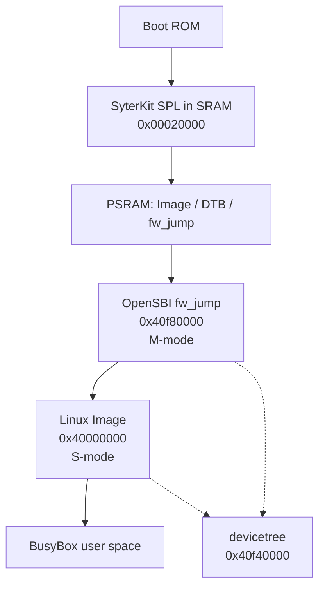

OpenSBI is the firmware that runs in RISC-V machine mode between the bootloader and Linux. On the YuzukiNeko it is built as `fw_jump`, loaded at `0x40f80000` in PSRAM, and entered by SyterKit with the devicetree address in `a1`. It then jumps to the kernel at `0x40000000` in supervisor mode.

:::note[Version scope]
This page describes the `sun252i-f101` branch of `YuzukiHD/opensbi`, which reports OpenSBI 1.9 and SBI specification 3.0. The in-tree checkout is at commit `3ad76d4a`. The build artifacts quoted here were produced by the in-tree `build.sh`; the Buildroot external tree builds the same branch through Buildroot's OpenSBI package with a slightly different command line, described under [Where the binary goes](#where-the-binary-goes).
:::

## What SBI is

RISC-V defines three privilege levels: machine mode (M-mode), supervisor mode (S-mode, where Linux runs) and user mode (U-mode). M-mode is the only level allowed to touch the physical memory protection unit, the timer comparator, the PLIC enable bits and the power-management registers. SBI (Supervisor Binary Interface) is the contract through which S-mode asks M-mode to do those things: a small set of functions selected by an extension ID in `a7` and a function ID in `a6`, invoked with the `ecall` instruction.

OpenSBI implements that contract. It also owns the platform-specific knowledge that the kernel must not carry: how this SoC turns a hart on and off, which register enables the RISC-V MMIO block, and how to reset the board. The platform file `platform/generic/allwinner/sun252i-f101.c` supplies exactly that knowledge as callbacks into the generic OpenSBI core.

`fw_jump` is one of OpenSBI's firmware layouts. Unlike `fw_dynamic`, which receives the next-stage address from the previous bootloader, `fw_jump` has the next-stage address compiled in (`FW_JUMP_ADDR`) and an optional compiled-in FDT address (`FW_JUMP_FDT_ADDR`). It does not contain a payload. On this board the next stage is the Linux `Image` at `0x40000000`.

## Where fw_jump sits in the boot chain



| Stage | Address | Privilege | Job |
| --- | --- | --- | --- |
| Boot ROM | on-chip | M-mode | Loads the eGON SPL into SRAM and starts it |
| SyterKit `spinor-boot` or `usb-boot` | `0x00020000` | M-mode | Brings up PSRAM, stages the three payloads, enters `fw_jump` |
| OpenSBI `fw_jump` | `0x40f80000` | M-mode | Installs the SBI implementation and the platform overrides, then enters Linux |
| Linux `Image` | `0x40000000` | S-mode | Runs the kernel and its drivers |
| Devicetree | `0x40f40000` | data | Passed from SyterKit through OpenSBI to Linux |

The two boot paths into `fw_jump` are described in [SyterKit](syterkit.md): the FEL path writes the three binaries with `xfel` and runs `usb-boot`, while the NOR path has `spinor-boot` read them from fixed offsets. Both leave the same memory image behind, so OpenSBI does not need to know which path was used.

## The sun252i-f101 platform file

The platform is registered as an FDT match on `allwinner,sun252i-f101`, the SoC compatible string that the board devicetree already carries:

```c
static const struct fdt_match sun252i_f101_match[] = {
	{ .compatible = "allwinner,sun252i-f101" },
	{ },
};

const struct fdt_driver sun252i_f101 = {
	.match_table = sun252i_f101_match,
	.init = sun252i_f101_platform_init,
};
```

`sun252i_f101_platform_init()` does nothing except replace three callbacks in `generic_platform_ops`: `early_init`, `final_init` and `extensions_init`. Everything else (PLIC, UART, timer, IPI) comes from the generic platform's FDT drivers and the platform defconfig.

| Callback | Replaced by | What it does |
| --- | --- | --- |
| `early_init` | `sun252i_f101_early_init` | Registers the system reset device |
| `final_init` | `sun252i_f101_final_init` | Programs `riscv_cfg`, installs the HSM device, adds the CPU idle state, enables PBMTE on RV32 |
| `extensions_init` | `sun252i_f101_extensions_init` | Registers the T-Head PMU and writes the C907 CSRs |

### riscv_cfg: enabling MMIO access and the reset entry

The RISC-V system block at `0x06010000` is not reachable until its bus clock gate is opened. The gate lives in the CCU at `0x02001000`, register `0xd0c`; bits 16 and 0 must be set. After that, the platform programs the warm-boot entry of hart 0 and puts the cluster power controller into automatic mode:

```c
static void sun252i_f101_riscv_cfg_init(void)
{
	u64 entry = sbi_hartid_to_scratch(0)->warmboot_addr;

	/* Enable RISCV_SYS MMIO access. */
	writel_relaxed(CCU_BGR_ENABLE, SUN252I_F101_CCU_BASE + RISCV_CFG_BGR_REG);

	/* Program the reset entry address for the boot hart. */
	sun252i_f101_set_bootaddr(0, entry);

	/* Put the cluster power controller in automatic mode. */
	writel_relaxed(0, PMC_BASE(4) + SW_MODE_CTRL(0));
	writel_relaxed(0, PMC_BASE(4) + SW_MODE_CTRL(1));

	/* Configure PMC delay timers used by CPU power transitions. */
	writel_relaxed(1, PMC_BASE(0) + TIMER_MODE_CONFIG);
	writel_relaxed(0x01010100, PMC_BASE(0) + DELAY_CTRL_CONFIG);
	writel_relaxed(1, PMC_BASE(1) + TIMER_MODE_CONFIG);
	writel_relaxed(0x01010100, PMC_BASE(1) + DELAY_CTRL_CONFIG);
	writel_relaxed(1, PMC_BASE(4) + TIMER_MODE_CONFIG);
	writel_relaxed(0x01010100, PMC_BASE(4) + DELAY_CTRL_CONFIG);
}
```

The reset entry is a per-hart pair of registers: low word at `0x06010100 + 0x80 * hartid`, high word at `+0x04`. `sun252i_f101_set_bootaddr()` writes both, which is what makes both cold boot and `sbi_hart_start()` land on a valid address:

```c
void sun252i_f101_set_bootaddr(u32 hartid, u64 entry)
{
	writel_relaxed(entry, SUN252I_F101_RISCV_CFG_BASE +
		       RESET_ENTRY_LO_REG(hartid));
	writel_relaxed(entry >> 32, SUN252I_F101_RISCV_CFG_BASE +
		       RESET_ENTRY_HI_REG(hartid));
}
```

On cold boot the entry is OpenSBI's own warm-boot address, so a hart that is powered off and on again re-enters OpenSBI rather than the Boot ROM.

### PMC power modes

Each hart has a power-management controller at `0x06018000 + 0x1000 * hartid`. Two registers, `SW_MODE_CTRL(0)` at offset `0x100` and `SW_MODE_CTRL(1)` at `0x104`, select between automatic and manual power transitions.

* Writing `0` to both lets the PMC choose the transition itself. This is used for the boot cluster in `riscv_cfg_init()` and for the non-retentive idle path.
* Writing `0x2 << 3` requests a manual power-down, which is how `hart_stop()` removes a hart.
* Writing `0x3 << 3` to the first register and `0x11` to the second selects manual mode and powers the core on; this is how `hart_start()` and `hart_resume()` bring a hart back.

The three `TIMER_MODE_CONFIG` / `DELAY_CTRL_CONFIG` pairs configure the delay timers of PMC 0, 1 and 4. The platform writes the same values (`1` and `0x01010100`) to all three.

### The HSM device

The Hart State Management extension is implemented by `sun252i_f101_ppu`, a `struct sbi_hsm_device` with four callbacks. OpenSBI installs it during cold boot with `sbi_hsm_set_device()`.

```c
static int sun252i_f101_hart_start(u32 hartid, ulong saddr)
{
	sun252i_f101_set_bootaddr(hartid, saddr);

	/* Select manual mode and power on the requested core. */
	writel_relaxed(0x3 << 3, PMC_BASE(hartid) + SW_MODE_CTRL(0));
	writel_relaxed(0x11, PMC_BASE(hartid) + SW_MODE_CTRL(1));

	return SBI_OK;
}
```

`hart_stop()` first flushes the dirty D-cache with `th.dcache.call`, then issues `fence iorw, iorw` or `th.sync.s` depending on `MXSTATUS` bit 22, clears `MSMPR` bit 0 to stop cache snooping, requests the manual power-down and executes `wfi()`. `hart_suspend()` accepts only the non-retentive type; the retentive type is left to the generic HSM code. `hart_resume()` re-selects manual mode and powers the core back on after its warm-boot sequence.

The two cache instructions are emitted as raw `.word 0x0010000b` and `.word 0x0190000b` rather than as `th.dcache.call` and `th.sync.s`. The Xuantie toolchain knows the mnemonics, but upstream binutils does not, and the platform is also built by Buildroot with a stock toolchain.

### CPU idle state: cpu-nonretentive

`final_init()` adds one idle state to the devicetree with `fdt_add_cpu_idle_states()`. The helper creates `/cpus/idle-states/cpu-nonretentive` and a `cpu-idle-states` phandle in every CPU node, but only if the devicetree does not already have an `idle-states` node.

```c
static const struct sbi_cpu_idle_state sun252i_f101_cpu_idle_states[] = {
	{
		.name			= "cpu-nonretentive",
		.suspend_param		= SBI_HSM_SUSPEND_NON_RET_DEFAULT,
		.local_timer_stop	= true,
		.entry_latency_us	= 40,
		.exit_latency_us	= 67,
		.min_residency_us	= 1100,
		.wakeup_latency_us	= 67,
	},
	{ },
};
```

The node describes a state in which the core loses its cache and register state, the local timer stops, and the wake-up latency is 67 microseconds. The kernel only uses this node when `CONFIG_CPU_IDLE` is enabled; the F101 RV32 and RV64I kernel configurations both leave `CONFIG_CPU_IDLE` off, so the node is informational in the current images. It is still added because it describes the hardware and costs nothing when unused.

### System reset through the watchdog

The platform registers `sun252i_f101_reset` as an `sbi_system_reset_device`. Its check function gives shutdown priority 1 and both reboot types priority 255, so OpenSBI prefers this device for reboot:

```c
static int sun252i_f101_system_reset_check(u32 type, u32 reason)
{
	(void)reason;

	switch (type) {
	case SBI_SRST_RESET_TYPE_SHUTDOWN:
		return 1;
	case SBI_SRST_RESET_TYPE_COLD_REBOOT:
	case SBI_SRST_RESET_TYPE_WARM_REBOOT:
		return 255;
	default:
		return 0;
	}
}
```

A reset is performed by the RISC-V watchdog at `0x06011000`, not by a dedicated reset controller. The sequence disables the watchdog, waits one millisecond, then programs it to reset the SoC after its 0.5-second timeout:

```c
static void sun252i_f101_wdt_reset_system(void)
{
	/* Disable the watchdog before programming its reset mode. */
	writel((readl(WDT_CFG) & ~BIT(0)) | WDT_UPDATE_FLAG, WDT_CFG);
	sbi_timer_mdelay(1);

	/* Reset after the hardware's 0.5-second watchdog timeout. */
	writel(WDT_UPDATE_FLAG | BIT(0), WDT_CFG);
	writel(WDT_UPDATE_FLAG, WDT_MODE);
	writel(readl(WDT_MODE) | BIT(0) | WDT_UPDATE_FLAG, WDT_MODE);
}
```

`WDT_UPDATE_FLAG` is `0x16aa << 16`, the key that makes the watchdog accept a write. Shutdown is a different path: the reset handler executes `wfi()` in a loop and never returns. The same watchdog block is used by SyterKit's `sys_reset()` and by the RV64 handoff stub on this board, so a board that resets unexpectedly can be resetting through either firmware layer.

### T-Head CSR setup

The C907 needs several vendor CSRs programmed before Linux starts. `extensions_init()` first runs the generic extension setup, then registers the T-Head PMU device and writes the values the vendor power-management sequence requires:

```c
static int sun252i_f101_extensions_init(bool cold_boot)
{
	int rc;

	rc = generic_extensions_init(cold_boot);
	if (rc)
		return rc;

	thead_c9xx_register_pmu_device();

	/* C907 CSR values required by the F101 power-management sequence. */
	csr_write(THEAD_C9XX_CSR_MSMPR, BIT(0));
	csr_write(THEAD_C9XX_CSR_MCCR2, 0xa0420002);
	csr_write(THEAD_C9XX_CSR_MXSTATUS, 0x438000);
	csr_write(THEAD_C9XX_CSR_MHINT, 0x3a1aa10c);
	csr_write(THEAD_C9XX_CSR_MHCR, 0x10011bf);

#if __riscv_xlen == 64
	csr_write(CSR_MENVCFG, 0x4000000000000000ULL);
#endif

	return SBI_OK;
}
```

The register names are the C907's: `MSMPR` controls cache snooping, `MCCR2` and `MXSTATUS` control cache and bus behaviour, `MHINT` holds bus hint settings, and `MHCR` enables the caches. The exact bit meanings are not documented in this repository; the values are the ones the F101 power-management sequence requires, and the platform treats them as opaque. On RV64 the same function sets `menvcfg` bit 62, which enables Svpbmt for the 64-bit kernel; on RV32 that bit is handled separately, below.

### PBMTE on RV32

The C907 implements Svpbmt under Sv32, not only under Sv64. Under Sv32 the memory type of a page lives in bits 31:30 of the page-table entry, and those bits are only interpreted as a memory type when `menvcfg.PBMTE` is set. Otherwise they are ordinary physical page-number bits.

The generic OpenSBI code sets `PBMTE` only for RV64. The platform therefore sets it itself in `final_init()`:

```c
#if __riscv_xlen == 32
	/*
	 * The C907 has Svpbmt in Sv32 too, with the memory type in bits 31:30
	 * of the PTE. The generic code only enables PBMTE on RV64, and without
	 * it those bits are PPN bits. PBMTE is bit 30 of menvcfgh here.
	 */
	csr_set64(CSR_MENVCFG, ENVCFG_PBMTE);
#endif
```

On RV32 `CSR_MENVCFG` is the 64-bit `menvcfg` accessed as `menvcfgh`/`menvcfg`; bit 30 of the high half is PBMTE. Without this, a kernel that marks a page as non-cacheable or I/O-mapped through Svpbmt hangs at the first such mapping, usually before the console is up. This is the single most important platform fix on the branch: the kernel's DMA and MMIO paths rely on the memory types that Svpbmt provides.

## Platform defconfig

`platform/generic/configs/sun252i-f101.defconfig` selects the platform override and the generic FDT drivers that this board uses. Every option is a build-time choice; the driver instances themselves come from the devicetree at runtime.

```text
CONFIG_PLATFORM_ALLWINNER_SUN252I_F101=y
CONFIG_FDT_IPI=y
CONFIG_FDT_IPI_MSWI=y
CONFIG_FDT_IPI_PLICSW=y
CONFIG_FDT_IRQCHIP=y
CONFIG_FDT_IRQCHIP_PLIC=y
CONFIG_FDT_RESET=y
CONFIG_FDT_SERIAL=y
CONFIG_FDT_SERIAL_UART8250=y
CONFIG_FDT_TIMER=y
CONFIG_FDT_TIMER_MTIMER=y
```

| Option | Meaning on this board |
| --- | --- |
| `PLATFORM_ALLWINNER_SUN252I_F101` | Compiles `sun252i-f101.c` into the platform override list and selects the T-Head C9xx PMU driver |
| `FDT_IPI`, `FDT_IPI_MSWI`, `FDT_IPI_PLICSW` | IPI delivery through the machine software interrupt and the PLIC software interrupt |
| `FDT_IRQCHIP`, `FDT_IRQCHIP_PLIC` | The PLIC at `0x10000000`, as described by the devicetree |
| `FDT_RESET` | Reset devices from the devicetree. The sunxi watchdog driver is not selected (`FDT_RESET_SUNXI_WDT` is off); the platform's own reset device handles SRST |
| `FDT_SERIAL`, `FDT_SERIAL_UART8250` | The 8250-compatible UART, used for the OpenSBI console on UART1 |
| `FDT_TIMER`, `FDT_TIMER_MTIMER` | The RISC-V machine timer, used for `sbi_timer` and the 0.5-second reset delay |

The platform commit also changes `lib/utils/serial/uart8250.c` to align the serial base down to a page boundary before adding it to the root domain. The F101 UARTs are packed at a 1 KiB stride, so an unaligned base would be split into sub-page memory ranges that a single PMP entry cannot represent.

## Building fw_jump

The repository's `build.sh` already contains the F101 parameters. It needs the Xuantie glibc Linux toolchain, a 32-bit target, and an existing `build/` directory:

```sh
cd opensbi
mkdir -p build
./build.sh --arch rv32 \
	$HOME/f101-linux/toolchain/Xuantie-900-gcc-linux-6.6.0-glibc-x86_64-V3.2.0/bin/riscv64-unknown-linux-gnu-
```

`--arch rv32` sets `PLATFORM_RISCV_XLEN=32`, `PLATFORM_RISCV_ABI=ilp32` and the ISA string `rv32imafdcv_zicsr_zifencei_xtheadcmo_xtheadsync`. The script also sets `FW_DYNAMIC=n`, `FW_JUMP=y`, `FW_PAYLOAD=n`, `FW_TEXT_START=0x40f80000`, `FW_JUMP_ADDR=0x40000000`, and clears `FW_JUMP_FDT_OFFSET` so the FDT address is taken from `a1` at runtime.

The equivalent `make` line, with the FDT address pinned explicitly, is:

```sh
make O=build/sun252i-f101 \
	PLATFORM=generic \
	PLATFORM_DEFCONFIG=sun252i-f101.defconfig \
	CROSS_COMPILE=$HOME/f101-linux/toolchain/Xuantie-900-gcc-linux-6.6.0-glibc-x86_64-V3.2.0/bin/riscv64-unknown-linux-gnu- \
	PLATFORM_RISCV_XLEN=32 \
	PLATFORM_RISCV_ABI=ilp32 \
	PLATFORM_RISCV_ISA=rv32imafdcv_zicsr_zifencei_xtheadcmo_xtheadsync \
	FW_DYNAMIC=n FW_JUMP=y FW_PAYLOAD=n \
	FW_TEXT_START=0x40f80000 \
	FW_JUMP_ADDR=0x40000000 \
	FW_JUMP_FDT_ADDR=0x40f40000
```

`FW_JUMP_FDT_ADDR` wins over `FW_JUMP_FDT_OFFSET` when both are defined, and both win over the `a1` value passed by the previous stage. Pinning it is harmless here because every boot path places the devicetree at `0x40f40000`, but it removes the dependency on SyterKit passing the right register.

:::caution
Do not omit `PLATFORM_RISCV_XLEN=32`. The toolchain is a 64-bit riscv64 toolchain; without the explicit XLEN it produces a 64-bit `fw_jump.elf` that still carries the expected file name, and the board then fails in a way that looks like a memory problem. Run `file` on `fw_jump.elf` and confirm it is 32-bit before flashing.
:::

The result is `build/sun252i-f101/platform/generic/firmware/fw_jump.bin`, 266,344 bytes in the in-tree build. The `build/sun252i-f101-rv64` directory is the RV64I variant produced by `--arch rv64`; it is not used by the RV32 Linux image.

## Where the binary goes

| Medium | Offset or address | Reserved | Notes |
| --- | --- | --- | --- |
| SPI NOR | `0x050000` | 512 KiB | Read by `spinor-boot` into PSRAM on every boot |
| PSRAM | `0x40f80000` | 512 KiB | Execution address; linked here by `build.sh` |
| SRAM | not used | | OpenSBI is too large for the 64 KiB SPL slot |

The fixed layout is shared by three independent pieces: the SyterKit reader, the Buildroot `post-image-nor.sh` script, and the MTD partition table in the Linux devicetree. Changing the address means changing all three. See [SPI NOR layout and backup](../../../boot/flash-layout.md).

:::note[Buildroot links fw_jump at zero]
Buildroot's OpenSBI package does not pass `FW_TEXT_START`; the `fw_jump.elf` it installs has entry point `0x0` and is relocated by OpenSBI's own boot code. It still runs correctly when loaded at `0x40f80000`. The in-tree `build.sh` links at `0x40f80000` instead and produces an ELF whose entry point is already the load address. Both binaries are valid; do not use the ELF entry point to decide where to place the image.
:::

## SBI version and what the kernel uses

The firmware reports SBI specification 3.0 and implementation version OpenSBI 1.9. The platform defconfig compiles in the extension set below; the kernel's use of each is noted.

| Extension | ID | Compiled | Used by the F101 kernel |
| --- | --- | --- | --- |
| TIME | `0x54494D45` | yes | Yes, for the timer interrupt |
| IPI | `0x735049` | yes | Hooks are present, but `CONFIG_SMP` is off, so no other hart is signalled |
| RFENCE | `0x52464E43` | yes | Same as IPI; used for remote fence operations |
| HSM | `0x48534D` | yes | The firmware implements start/stop/suspend; `CONFIG_SMP` and `CONFIG_CPU_IDLE` are off |
| SRST | `0x53525354` | yes | Yes, for `reboot` and `poweroff` |
| Legacy 0.1 calls | `0x00`–`0x08` | yes | Enabled by `CONFIG_RISCV_SBI_V01=y` |
| DBCN | `0x4442434E` | yes | No; `CONFIG_SERIAL_EARLYCON_RISCV_SBI` is off |
| PMU, SUSP, CPPC, FWFT, DBTR, SSE, MPXY | various | yes | Not exercised by the current kernel configuration |

The F101 kernel configuration is single-hart (`CONFIG_SMP` is not set), so the HSM callbacks described above are not part of a normal boot. They matter for a future SMP kernel and for the idle state. The DBCN extension is present in the firmware but the kernel keeps its early console on the 8250 UART instead.

## Seeing it at runtime

The kernel prints the SBI specification it detected during boot. The line is emitted by `arch/riscv/kernel/sbi.c` and looks like `SBI specification v3.0 detected`; the exact surrounding lines depend on the kernel version.

```sh
dmesg | grep -i sbi
cat /proc/device-tree/cpus/timebase-frequency | hexdump -C
ls /proc/device-tree/cpus/idle-states/
cat /proc/device-tree/cpus/idle-states/cpu-nonretentive/riscv,sbi-suspend-param | hexdump -C
```

The `idle-states` directory exists because OpenSBI added it; it is not in the board devicetree source. The devicetree also carries the `riscv,isa-extensions` property that OpenSBI rewrites, including `svpbmt`. If `svpbmt` is missing from that list, the kernel will not use Svpbmt and the PBMTE setup above has no effect.

A direct `ecall` from user space is possible from a small static program. The SBI v0.2+ convention returns an error in `a0` and the value in `a1`:

```c
#include <stdio.h>

struct sbi_ret {
	long error;
	long value;
};

static inline struct sbi_ret sbi_ecall(long ext, long fid, long arg0, long arg1)
{
	register long a0 asm("a0") = arg0;
	register long a1 asm("a1") = arg1;
	register long a6 asm("a6") = fid;
	register long a7 asm("a7") = ext;

	asm volatile("ecall" : "+r"(a0), "+r"(a1) : "r"(a6), "r"(a7) : "memory");
	return (struct sbi_ret){ .error = a0, .value = a1 };
}

int main(void)
{
	/* SBI_EXT_BASE, SBI_EXT_BASE_GET_SPEC_VERSION */
	struct sbi_ret r = sbi_ecall(0x10, 0, 0, 0);

	printf("spec %ld.%ld (error %ld)\n",
	       (r.value >> 24) & 0x7f, r.value & 0xffffff, r.error);
	return 0;
}
```

The specification version is packed as major in bits 30:24 and minor in bits 23:0, so 3.0 prints as `3.0`. The kernel falls back to 0.1 when its base-extension probe fails, so a `SBI specification v0.1 detected` line in dmesg almost always means the firmware image is truncated or was not loaded at `0x40f80000`.

## Troubleshooting

| Symptom | Likely cause | What to check |
| --- | --- | --- |
| No OpenSBI output at all after SyterKit prints the handoff line | PSRAM is not stable, or `fw_jump` is not at `0x40f80000` | Re-run `init_psram` and confirm 32 MiB / `init_ok = 1`; read back the region at `0x40f80000` and compare with `fw_jump.bin` |
| Board resets in a loop instead of booting | The watchdog reset path is being reached, or the kernel faults and SRST reboots | Catch the first lines on UART1; check that the DTB is valid and that the kernel does not overlap the DTB at `0x40f40000` |
| Kernel hangs at the first driver probe, before the console | PBMTE is not set on RV32 | Confirm the build includes commit `3ad76d4a` or later; check `svpbmt` in `/proc/device-tree/cpus/cpu@0/riscv,isa-extensions` |
| `SBI specification v0.1 detected` | Base extension probe failed | The image is truncated or loaded at the wrong address; compare sizes and the load address |
| `fw_jump.elf` is 64-bit | `PLATFORM_RISCV_XLEN` was not set | Rebuild with `--arch rv32`, or pass `PLATFORM_RISCV_XLEN=32` |
| Kernel starts but cannot find the devicetree | FDT address mismatch | Check that SyterKit passes `0x40f40000` in `a1`, or define `FW_JUMP_FDT_ADDR=0x40f40000` |
| No OpenSBI console even though the kernel boots | The devicetree `stdout-path` does not point at UART1 | Check `chosen/stdout-path` and the UART node's `status` |
