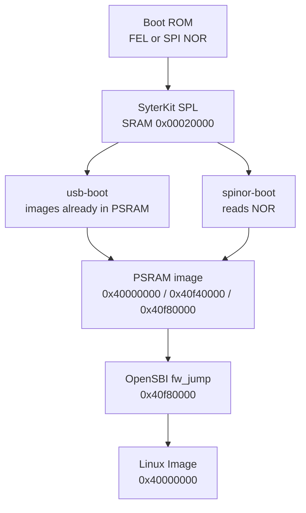

SyterKit is the first code that runs after the Allwinner Boot ROM on the YuzukiNeko. It runs from SRAM at `0x00020000`, brings up the PSRAM, and stages the three payloads that the rest of the boot chain needs: the Linux `Image`, the devicetree and OpenSBI's `fw_jump`. It then enters OpenSBI, which starts Linux.

This page covers the two applications used to boot Linux, `usb-boot` (FEL, images staged by `xfel`) and `spinor-boot` (NOR, images read from flash), the eFEX `init_psram` application that initializes the 32 MiB W958 PSRAM, the fixed address layout, and the PSRAM parameter table in `boards/yuzukineko/board.dts`.

:::note[Version scope]
The in-tree SyterKit is version 0.5.0 at commit `5d426c0a`. The Buildroot external tree pins its own copy at commit `f95d29d611ce439a2510957b0f312b5b439f53b8`; the two are close enough for the boot path described here but are not the same tree. Sizes quoted below come from the in-tree build under `out-usb` and `out-efex`.
:::

## What SyterKit does

The Boot ROM of the F101 loads an eGON image into SRAM and jumps to it. That image is limited to 64 KiB in the SRAM window starting at `0x00020000`. OpenSBI is about 260 KiB and Linux is several megabytes, so neither can be loaded by the Boot ROM directly. SyterKit fills the gap:

* It initializes the PSRAM controller, which the Boot ROM leaves off.
* It reads or receives the payloads and places them at fixed addresses in PSRAM.
* It switches on the data cache, flushes what it wrote, and calls `fw_jump` with the hart ID and the devicetree address.

SyterKit is also a small bare-metal framework: the same tree builds display tests, an SD card test, a USB test, an RV64 application and the eFEX PSRAM initializer. Only the boot applications matter for Linux.

## Boot paths



Both applications leave exactly the same PSRAM image, so OpenSBI and Linux cannot tell which one ran. The difference is where the bytes came from and whether PSRAM was initialized by SyterKit itself or by a previous eFEX run.

### FEL path: init_psram then usb-boot

In the FEL development layout there is no valid boot image at NOR offset `0x000000`, so the board enters FEL on power-up. The host then has two jobs: initialize PSRAM, and place the payloads. PSRAM initialization is a separate returning eFEX application, because the `xfel write` of a 6 MiB kernel would otherwise overwrite the initializer before it could run.

```sh
xfel write 0x00020000 init_psram_efex.bin
xfel exec  0x00020000
xfel write 0x40f40000 dtb.bin
xfel write 0x40f80000 fw_jump.bin
xfel write 0x40000000 Image
xfel write 0x00020000 usb-boot_fel.bin
xfel exec  0x00020000
```

`usb-boot` deliberately does not re-run the PSRAM bring-up: doing so could disturb the images that the host has just written. It initializes the console and clocks, validates the devicetree header and jumps to OpenSBI.

### NOR path: spinor-boot

When a valid SyterKit image is present at NOR offset `0x000000`, the Boot ROM loads and runs it. `spinor-boot` then brings up PSRAM itself, probes the SPI NOR through the SPIF controller, reads the three fixed regions and boots them without any host interaction.

The NOR image must be built for the SPI boot path: `spinor-boot_spi.bin`, not `spinor-boot_fel.bin`. The `_spi.bin` variant is padded and carries the eGON checksum that the Boot ROM verifies.

## The eFEX init_psram application

### What eFEX means

An eFEX application is a FEL payload that returns to the FEL loop instead of jumping to a kernel. Its eGON head is still 0x30 bytes, but offset `+0x30` holds a 16-byte descriptor with the magic `"SKEP"`, the SRAM address of a 4 KiB parameter area, its size and the ABI version. The head's `ret_addr` at `+0x1c` points at the same area, so a host that only knows the Boot ROM result pointer can still find it.

The parameter area is a flat table of 32-bit key/value pairs. A host may patch it in the image file before download or write it through FEL after download, and the target writes its results back into the same area. The ABI is documented in `docs/efex-param.md` and defined in `include/efex.h`; the host helper is `tools/efex-param.py`.

The key space is divided into groups, so one table can describe every module the application touches:

| Group | Name | Contents |
| ---: | --- | --- |
| `0x01` | `uart` | Controller base, ID, baud rate, TX/RX pins and mux, clock gate and reset |
| `0x02` | `twi` | PMU I2C controller: base, ID, speed, SCL/SDA pins and mux |
| `0x03` | `rail` | PMU rail voltage in mV, indexed by PMU and rail number |
| `0x04` | `dram` | DRAM parameter words and the detected size |
| `0x05` | `psram` | PSRAM parameter words and the detected size |
| `0x3f` | `app` | Application-defined values, 24-bit number |

Each memory group has the same field layout: `id 0x00` is `para[index]`, `0x01` is the parameter count, `0x02` is the CPU-visible base, `0x03` is the window size, and the outputs are `0x10` (`size_mb`) and `0x11` (`init_ok`). The UART and TWI fields are applied as a whole after the scan, so their order in the table does not matter.

### Running it

```sh
xfel write 0x00020000 init_psram_efex.bin
xfel exec  0x00020000
```

The application initializes UART1 at 115200, initializes the clock tree, then calls `sunxi_psram_init()` with the board parameter table. On success it reports the measured size and returns 0; the eFEX entry writes `status = "DONE"`, `ret = 0`, the output entries and a fresh checksum before returning to FEL.

### The parameter area

The area is linked into the image at a fixed SRAM address, which for this build is `0x000239d0` (the descriptor at image offset `0x30` stores it). All fields are little-endian:

```text
0x000  u32 magic      "SKPA" (0x41504b53)
0x004  u16 version    1
0x006  u16 hdr_size   32
0x008  u16 count      entries in use
0x00a  u16 capacity   508
0x00c  u32 checksum   32-bit sum of key+value over all used entries, 0 = unchecked
0x010  u32 status     written by the target: 0 idle, "DONE", "FAIL", "BADP"
0x014  i32 ret        written by the target: main() return value
0x018  u32 reserved[2]
0x020  {u32 key, u32 value} entries[508]
```

Keys are packed as `group[29:24] | id[23:8] | index[7:0]`, with bit 31 meaning "the host value was applied" and bit 30 meaning "the target wrote this entry". The PSRAM group is `0x05`; the memory fields are `id = 0x00` for the parameter words, `0x01` for the count, `0x02` for the base, `0x03` for the window size, and the results are `0x10` (`size_mb`) and `0x11` (`init_ok`). A run of `init_psram` therefore leaves a `size_mb` entry with value 32 and an `init_ok` entry with value 1.

Read the area back and decode it with the host helper:

```sh
xfel read 0x000239d0 0x1000 efex-param.bin
python3 SyterKit/tools/efex-param.py dump efex-param.bin
```

The three fields to check are `status`, the PSRAM `size_mb` and `init_ok`. If the header or the checksum is invalid, the target resets the table, uses the compiled defaults, still records its results, and sets `status` to `BADP`. `BADP` therefore does not mean the PSRAM failed; it means the host table was rejected.

### Changing the PSRAM settings per run

`init_psram` keeps the whole parameter table in a C structure, so a host can override any word for one run without rebuilding. The clock is `psram.para[0]`, encoded as group `0x05`, id `0x00`, index 0. The host helper understands the same encoding:

```sh
python3 SyterKit/tools/efex-param.py set init_psram_efex.bin psram.para[0]=252
```

The override only lives as long as the run; the compiled default stays 192 MHz. See [PSRAM](#psram) for why 252 MHz is not the default.

## spinor-boot

`boards/yuzukineko/app_sram/spinor-boot/main.c` is the NOR reader. Its constants define the whole layout:

```c
#define F101_KERNEL_SIZE 0x00600000U /* Linux Image up to 6 MiB */
#define F101_DTB_SIZE	 0x00040000U /* Device tree up to 256 KiB */
#define F101_SBI_SIZE	 0x00080000U /* SBI firmware fw_jump 512 KiB */

#define F101_LINUX_ADDR (F101_RAM_BASE)
#define F101_SBI_ADDR	(F101_RAM_BASE + F101_RAM_SIZE - F101_SBI_SIZE)
#define F101_DTB_ADDR	(F101_SBI_ADDR - F101_DTB_SIZE)
```

`F101_RAM_BASE` is `SUNXI_PSRAM_BASE` (`0x40000000`) and `F101_RAM_SIZE` is `0x01000000`, 16 MiB. The three reservations are placed from the top down: the SBI firmware occupies the last 512 KiB of that 16 MiB window, the devicetree the 256 KiB below it, and the kernel starts at the base and may grow to 6 MiB. The gap between `0x40600000` and `0x40f40000` is the heap used by the SPIF sampling-point training.

The flash offsets are derived from the same constants: the bootloader slot is 64 KiB, the devicetree follows at `0x010000`, `fw_jump` at `0x050000` and the kernel at `0x0d0000`. A short read is fatal and drops the application into its shell.

After loading, `spinor-boot` validates the devicetree header with `fdt_check_header()`, checks that its total size is at most 256 KiB, flushes the data cache, enables it if `MHCR.DE` is clear, and calls `fw_jump` with `a0 = 0` and `a1 = 0x40f40000`.

The control flow of `main()` is short enough to follow in order:

1. Initialize UART1 as the console and print the banner.
2. Initialize the clock tree with `sunxi_clk_init()`.
3. Read the `psram0` node through its devicetree alias and run `sunxi_psram_init()`.
4. Initialize a heap inside the gap between the kernel reservation and the DTB reservation. A failure here only disables the SPIF sampling-point training; the boot continues at the safe 1-1-1 timing.
5. Probe the SPIF controller and the NOR flash, and print the flash ID and capacity.
6. Read the devicetree, `fw_jump` and `Image` from their fixed offsets.
7. Validate the devicetree header and size.
8. Flush the data cache, enable it, issue `fence rw, rw` and `fence.i`, then call `fw_jump`.

Any failure in steps 5 to 7 jumps to `fallback`, which prints a warning and attaches the shell, where the `boot` command can be run. There is no reset in that path: the board stays in the shell until the user resets or loads images manually.

### The RV64 handoff SPL

`spinor-boot-rv64i` is the same reader linked as RV32, because the C907 always starts in RV32 mode. Its handoff is different: instead of jumping straight to `fw_jump`, it resets the core into RV64 and lands on a small raw-instruction stub:

```c
static const uint32_t f101_rv64_entry[] __attribute__((section(".text.rv64_entry"), aligned(4), used)) = {
	0x00000513U,
	0x40f405b7U,
	0x40f802b7U,
	0x0000100fU,
	0x00028067U,
};
```

The five words are `addi a0, zero, 0`, `lui a1, 0x40f40`, `lui t0, 0x40f80`, `fence.i` and `jr t0`. The stub therefore supplies the same arguments that the RV32 path supplies (`hartid = 0`, `a1 = 0x40f40000`) and enters `fw_jump` at `0x40f80000`.

To get there it writes `1` to `0x02001d0c` to force the RV64 ISA mode, writes the stub address to the reset vector at `0x06010100`, sets `0x200` at `0x06010108`, clears `0x0601016c`, and then triggers the watchdog. The core resets into RV64 and starts at the stub. This is the same watchdog block that OpenSBI uses for `srst`.

## Fixed memory and flash layout

| Payload | NOR offset | NOR reservation | PSRAM address | RAM reservation |
| --- | --- | --- | --- | --- |
| SyterKit | `0x000000` | 64 KiB | `0x00020000` (SRAM) | 64 KiB |
| Devicetree | `0x010000` | 256 KiB | `0x40f40000` | 256 KiB |
| OpenSBI `fw_jump` | `0x050000` | 512 KiB | `0x40f80000` | 512 KiB |
| Linux `Image` | `0x0d0000` | 6 MiB | `0x40000000` | 6 MiB |
| SquashFS rootfs | `0x6d0000` | to `0xf00000` | mounted from MTD | |
| JFFS2 overlay | `0xf00000` | 1 MiB | mounted from MTD | |

The same table appears in three places: the SyterKit constants, `post-image-nor.sh` in the Buildroot external tree, and the fixed MTD partitions in the kernel devicetree. Changing an offset means changing all three. The reasoning behind the partition sizes is on [SPI NOR layout and backup](../../../boot/flash-layout.md).

The 16 MiB PSRAM window used by the bootloader is smaller than the 32 MiB part. The kernel devicetree declares the full 32 MiB of memory, but the loader only reserves addresses below `0x41000000`; the upper half is untouched during boot and becomes available to Linux.

## PSRAM

### The part and the clock

The board carries a 32 MiB W958 PSRAM. The driver identifies the part from the chip ID (`0x4700` or `0x7000` are treated as 32 MiB W958 parts, type 8 in the vendor table). The validated clock is 192 MHz.

The PSRAM initialization parameters are a vendor table copied word for word from the part's `dram_para` table. On this board they live in `boards/yuzukineko/board.dts`:

```text
allwinner,psram-parameters = <192 8 0x7bfffb 0 0x20 0
			      0 0 0 0
			      0 0 0 0 0 0 0 0 0 0 0 0x00ff44ff 0 0>;
```

The same values are compiled into the eFEX initializer in `soc/sun252iw2/app_efex/init_psram/main.c`, so the FEL path does not depend on a devicetree.

### The parameter table

`lpsram_para_t` in `drivers/psram/psram-sun252iw2.c` names the 24 words that the table carries. The board values:

| Word | Field | Value | Meaning |
| ---: | --- | --- | --- |
| 0 | `dram_clk` | `192` | Target clock in MHz |
| 1 | `dram_type` | `8` | W958 |
| 2 | `dram_zq` | `0x007bfffb` | ZQ calibration value |
| 3 | `dram_odt_en` | `0` | On-die termination disabled |
| 4 | `dram_para1` | `0x20` | Bits 15:0 are the size in MiB, 32 |
| 5 | `dram_para2` | `0` | Flags: dual die, width |
| 6 | `dram_mr0` | `0` | Mode register 0 |
| 7 | `dram_mr1` | `0` | Mode register 1 |
| 8 | `dram_mr2` | `0` | Mode register 2 |
| 9 | `dram_mr3` | `0` | Mode register 3 |
| 10 | `dram_tpr0` | `0` | Vendor timing parameter |
| 11 | `dram_tpr1` | `0` | Vendor timing parameter |
| 12 | `dram_tpr2` | `0` | Vendor timing parameter |
| 13 | `dram_tpr3` | `0` | Bits 7:0 are the SoC voltage trim |
| 14 | `dram_tpr4` | `0` | Per-DX UI delay adjustments |
| 15 | `dram_tpr5` | `0` | ZQ reference; 0 becomes `0x48484848` |
| 16 | `dram_tpr6` | `0` | ZQ parameter; 0 becomes 72 |
| 17 | `dram_tpr7` | `0` | Vendor timing parameter |
| 18 | `dram_tpr8` | `0` | Vendor timing parameter |
| 19 | `dram_tpr9` | `0` | Vendor timing parameter |
| 20 | `dram_tpr10` | `0` | Mode flags: bit 19 train request, bit 31 trained |
| 21 | `dram_tpr11` | `0x00ff44ff` | RDQ window nibbles |
| 22 | `dram_tpr12` | `0` | WDQ window nibbles |
| 23 | `dram_tpr13` | `0` | Control flags |

The devicetree parser accepts 1 to 32 words and zero-fills the rest, so a board file can list only the words it needs. The driver's per-type sanitising code (`lpsram_para_merge_config()`) clamps the W958 clock to at most 252 MHz, clamps `dram_para1` width to 32, and fills `dram_zq` with `0x7b7bfb` when it is zero; the board's explicit values take precedence.

### Why 192 MHz, not 252 MHz

The vendor table for the W958 lists 252 MHz. On these boards that is not stable:

* Some boards hang during instruction fetch from PSRAM, with no OpenSBI output at all.
* Others boot but show intermittent bit errors in the upper 16 MiB, corrupting kernel data structures and stack canaries.

At 192 MHz the full 32 MiB boots and survives a read-write verification of a 12 MiB tmpfs. The default is therefore 192 in both `board.dts` and the eFEX initializer. A single run can still be tried at 252 MHz through the eFEX parameter override; if it hangs, power-cycle the board with `relay1` and it will come back at the compiled default.

## Defconfigs and outputs

The board directory has five defconfigs. Three matter for Linux bring-up and RV64 work; the other two are for display tests and Rust experiments.

| Defconfig | Architecture | Application mode | Outputs |
| --- | --- | --- | --- |
| `yuzukineko_rv32_sram_defconfig` | RV32 C907 | `APP_SRAM` | `app`, `spinor-boot`, `spinor-boot-rv64i`, `usb-boot`, `flash-boot`, `xip-boot`, `intc_test`, `sd_test`, `disp_test` |
| `yuzukineko_rv32_usb_sram_defconfig` | RV32 C907 | `APP_SRAM` | `app`, `intc_test`, `sd_test`, `usb_test` |
| `yuzukineko_rv64_sram_defconfig` | RV64 C907 | `APP_SRAM` with `ARCH_BOOT` | `app`, `intc_test`, `sd_test`, `arch_boot` |
| `yuzukineko_rv32_dram_defconfig` | RV32 C907 | `APP_DRAM` | `disp_test` loaded at `0x40100000` |
| `yuzukineko_rv32_rust_sram_defconfig` | RV32 C907 | `APP_SRAM` | `app`, `app-rs`, plus the PSRAM boot applications |

The `rv32_sram` configuration is the one the Buildroot external tree uses for the F101 NOR image. It is also the one that builds the RV64 handoff SPL: `spinor-boot-rv64i` is linked as RV32 because the C907 starts in RV32 mode, loads the payloads, then resets the core into RV64 and enters `fw_jump`.

Image suffixes have meaning:

| Suffix | Meaning |
| --- | --- |
| `_fel.bin` | Raw FEL payload, used with `xfel write` and `xfel exec` |
| `_spi.bin` | eGON image padded and checksummed by `mksunxi` for the SPI NOR boot path |
| `_card.bin` | eGON image padded to 512 bytes for the SD card boot path |
| `_efex.bin` | Returning eFEX payload with the 4 KiB parameter area |

The sizes of the Linux boot artifacts in the in-tree build are 18,896 bytes for `init_psram_efex.bin`, 20,256 bytes for `usb-boot_fel.bin` and 49,152 bytes for `spinor-boot_spi.bin`.

## SRAM budget

Both boot applications and the eFEX initializer are linked at `0x00020000` with a maximum size of 64 KiB. The eFEX parameter area is part of that image and is linked after `.data`, so it consumes 4 KiB of the same budget.

| Region | Address range | Size |
| --- | --- | --- |
| SPL load and link base | `0x00020000` | start |
| SPL maximum (`SPL_FEL_MAX_SIZE`) | `0x00020000`–`0x00030000` | 64 KiB |
| eFEX parameter area (this build) | `0x000239d0`–`0x000249d0` | 4 KiB |
| `init_psram_efex.bin` | `0x00020000`–`0x000249d0` | 18,896 bytes |
| `usb-boot_fel.bin` | `0x00020000`–`0x00024f20` | 20,256 bytes |

The SPL is deliberately small. Everything that needs more room, including the Linux image and OpenSBI, is placed in PSRAM by the host or read from NOR, never linked into the SRAM image.

## Building with the Xuantie ELF toolchain

SyterKit uses the bare-metal elf-newlib toolchain, not the Linux glibc or musl one. The in-tree toolchain is `Xuantie-900-gcc-elf-newlib-x86_64-V3.2.0`:

```sh
cd SyterKit
export CROSS_COMPILE=$HOME/f101-linux/toolchain/Xuantie-900-gcc-elf-newlib-x86_64-V3.2.0/bin/riscv64-unknown-elf-

# NOR boot applications and the FEL boot payloads
make O=out-usb yuzukineko_rv32_sram_defconfig
make O=out-usb -j$(nproc)

# eFEX PSRAM initializer
make O=out-efex sun252iw2_rv32_efex_defconfig
make O=out-efex -j$(nproc)
```

The outputs:

```text
out-usb/build/yuzukineko/app_sram/spinor-boot/spinor-boot_spi.bin
out-usb/build/yuzukineko/app_sram/usb-boot/usb-boot_fel.bin
out-usb/build/yuzukineko/app_sram/spinor-boot-rv64i/spinor-boot-rv64i_spi.bin
out-efex/build/soc/sun252iw2/app_efex/init_psram/init_psram_efex.bin
```

`CROSS_COMPILE` must point at the ELF toolchain. The glibc and musl Linux toolchains can compile parts of SyterKit, but the C907-specific options and the bare-metal startup code expect elf-newlib. Buildroot's external tree selects this toolchain for the same reason, through its `xuantie-riscv-toolchain` package.

## Replacing SyterKit in NOR

Only the 64 KiB region at offset zero is involved. Back up the flash first; see [SPI NOR layout and backup](../../../boot/flash-layout.md). Then:

```sh
xfel spinor write 0x0 spinor-boot_spi.bin
xfel spinor read  0x0 0xC000 spinor-boot-verify.bin
```

Compare the first 49,152 bytes of `spinor-boot-verify.bin` with the file that was written. The bootloader does not read anything from the rest of the 64 KiB slot, so the trailing bytes are irrelevant. Do not write `spinor-boot_fel.bin` there: it lacks the SPI padding and checksum.

:::caution
Writing a valid boot image to offset zero changes the power-on behaviour: the board stops entering FEL and boots from NOR instead. To get FEL back, erase that region with `xfel spinor erase 0x0 0x10000` or restore a blank image.
:::

## Serial console and debugging

`spinor-boot` prints its banner on UART1 at 115200. A PSRAM initialization failure stops it before the shell is attached. A failure in the SPI NOR probe, the reads or the DTB check prints a warning and attaches a small shell instead of booting. The shell exposes the application command `boot` and the built-in commands below. There is no `regdump` command; register inspection is done with `read32`, `write32` and `hexdump`, all of which take hexadecimal arguments.

| Command | Arguments | Meaning |
| --- | --- | --- |
| `help` | `[command]` | List commands, or print the usage of one command |
| `echo` | text | Print its arguments |
| `history` | | List the command history |
| `hexdump` | `[addr] [len]` | Dump a memory range |
| `read32` | `[addr]` | Read one 32-bit register |
| `write32` | `[addr] [val]` | Write one 32-bit register |
| `screenfetch` | | Print board information |
| `ls` | | List files |
| `boot` | | Validate and boot the images already in memory |

Useful checks before booting:

```sh
read32 0x40f80000        # first word of fw_jump in PSRAM
read32 0x40f40000        # devicetree magic, little-endian 0xedfe0dd0
hexdump 0x40000000 0x40  # first bytes of the kernel Image
help boot
```

`read32 0x40f40000` returns `0xedfe0dd0`; the bytes in memory are `d0 0d fe ed`, which is the big-endian DTB magic `0xd00dfeed`. That is a quick way to tell whether the DTB was staged. The `boot` command re-runs the same validation and handoff as the automatic path, so it is useful after manually loading images with `xfel`.

## Troubleshooting

| Symptom | Likely cause | What to check |
| --- | --- | --- |
| `PSRAM: initialization failed` | The PSRAM table is wrong or the part is not seated | Run `init_psram` again; check `size_mb` and `init_ok` in the eFEX area; do not use `xfel ddr` on the 32 MiB part |
| Board hangs with no output when booting from PSRAM | The PSRAM clock is too high | Use 192 MHz; try 252 MHz only through the eFEX override |
| `usb-boot` prints "Memory images are not ready" | PSRAM was not initialized, or the payloads were not written | Run `init_psram` first, then write the DTB, `fw_jump` and `Image` at `0x40f40000`, `0x40f80000`, `0x40000000` |
| `DTB: invalid blob` | The DTB was not written, or it is not at `0x40f40000` | `read32 0x40f40000` should return `0xedfe0dd0` |
| `SPI NOR: no supported flash detected` | The SPIF controller or the flash ID is not recognized | Check the board revision and the SPIF pins; the flash must answer the JEDEC ID read |
| `short read` from NOR | The image is larger than its reserved region or the flash is not erased | Rebuild the NOR image with `post-image-nor.sh`; verify the region sizes |
| Board no longer enters FEL | A valid eGON image is at NOR offset 0 | Erase `0x0..0x10000` with `xfel spinor erase`, or restore the backup |
| `fw_jump` starts but Linux does not | The SBI image is truncated or the cache flush failed | Compare the `fw_jump` region with the file; check the OpenSBI page's PBMTE notes |
| Build fails with unknown `th.` instructions | A stock binutils is being used for the platform | Build with the Xuantie toolchain, or use the platform commit that emits the instructions as `.word` |
