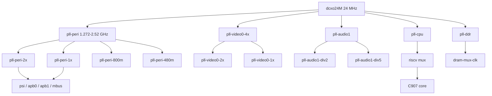

The clock controller unit (CCU) of the F101 generates every peripheral clock and holds the reset line of each SoC block. Linux drives it with the common sunxi-ng framework: the whole clock tree is registered with the common clock framework, and the reset lines are registered as a reset controller from the same register window. Three devicetree nodes share the address range at `0x02001000`, one for the peripheral clocks and two for the CPU and DDR PLLs, and a fourth drives the always-on domain at `0x03090000`.

| Item | Content |
| --- | --- |
| Drivers | `drivers/clk/sunxi-ng/ccu-sun252i-f101.c`, `-cpupll.c`, `-ddrpll.c`, `-rtc.c` |
| Compatibles | `allwinner,sun252i-f101-ccu`, `-cpupll`, `-ddrpll`, `-rtc-ccu` |
| Bases | `0x02001000` (CCU, CPU PLL, DDR PLL, 0x1000 each), `0x03090000` (RTC CCU, 0x330) |
| Inputs | `dcxo24M` 24 MHz, `rc-16m` 16 MHz, `rtc32k` |
| Clock IDs | `CLK_NUMBER` = 101 in the main CCU, 3 in each PLL provider, 8 in the RTC CCU |
| Reset lines | 49, `RST_NUMBER` = 49 in `include/dt-bindings/reset/sun252i-f101-ccu.h` |
| Kconfig | `CONFIG_SUNXI_CCU` (default with `CONFIG_ARCH_SUNXI`), `CONFIG_RESET_CONTROLLER`, `CONFIG_DEBUG_FS` |
| Userspace | `/sys/kernel/debug/clk/` (read-only rates), `/sys/kernel/debug/clk/clk_summary` |

## Hardware

### Clock inputs

The SoC has two fixed oscillators in the devicetree. `dcxo24M` is the 24 MHz crystal and the parent of every PLL except the internal oscillator tree. `rc-16m` is the on-chip RC oscillator; it is the parent of `iosc` (a 1:1 software alias), `iosc-div32k` (16 MHz / 500 = 32000 Hz) and `clk1m-rc` (16 MHz / 16 = 1 MHz). The RTC CCU additionally exposes `dcxo24M-div32k`, a fixed 32768 Hz rate that comes from dividing the 24 MHz crystal, and `rtc-1k` (32 kHz / 32).

The only hardware mux that chooses the 32 kHz source is `LOSC_CTRL_REG[0]`: 0 selects the RC16M divider and 1 selects the DCXO divider. The RTC CCU probe writes 1 with the `0x16AA` key field, so the boot default is the crystal-derived 32768 Hz, not the RC oscillator.

### PLLs

All PLLs are built from the sunxi-ng `ccu_nm`, `ccu_nkmp` and `ccu_mp` types. The multiplier fields are wider than the visible rate range, so the framework also enforces the minimum and maximum rate declared in the table.

| PLL or output | Node | Register | Factor | Notes |
| --- | --- | --- | --- | --- |
| `pll-peri` | `pll_peri_clk` | `0x0020` | N = 53 to 105 (register + 1) | 1.272 to 2.52 GHz, critical |
| `pll-peri-2x` | `pll_peri_2x_clk` | `0x0020` bits 18:16 | M divider | parent of PSI, APB, MBUS and several modules |
| `pll-peri-1x` | `pll_peri_1x_clk` | fixed | /2 of `pll-peri-2x` | CPU alternative, SD card, SPI |
| `pll-peri-800m` | `pll_peri_800m_clk` | `0x0020` bits 22:20 | M divider | CPU alternative, CSI, SPIF |
| `pll-peri-480m` | `pll_peri_480m_clk` | `0x0020` bits 4:2 | M divider | UART and VE alternative |
| `pll-video0-4x` | `pll_video0_4x_clk` | `0x0040` | N = 53 to 105 | display PLL |
| `pll-video0-2x` | `pll_video0_2x_clk` | fixed | /2 of 4x | DSI and CSI alternative |
| `pll-video0-1x` | `pll_video0_1x_clk` | fixed | /4 of 4x | TCON alternative |
| `pll-audio1` | `pll_audio1_clk` | `0x0080` | N at least 12 (register + 1) | audio and several module alternatives |
| `pll-audio1-div2` | `pll_audio1_div2_clk` | `0x0080` bits 18:16 | M divider | critical |
| `pll-audio1-div5` | `pll_audio1_div5_clk` | `0x0080` bits 22:20 | M divider | critical |
| `pll-cpu` | `pll_cpu_clk` in the CPU PLL provider | `0x0000` | NKMP, max 2016 MHz | feeds the `riscv` mux |
| `riscv` | `riscv_clk` | `0x0d00` bits 26:24 | 3-bit mux plus 5-bit divider | C907 core clock |
| `riscv-axi` | `riscv_axi_clk` | `0x0d00` bits 9:8 | M divider | AXI side of the core |
| `pll-ddr` | `pll_ddr_clk` in the DDR PLL provider | `0x0010` | NKMP | DRAM PLL |
| `dram-mux-clk` | `dram_mux_clk` | `0x0800` | dual divider plus 3-bit mux | DRAM controller clock |
| `dfi-clk` | `dfi_clk` | fixed | /2 of `dram-mux-clk` | DFI bus |

The CPU PLL provider has its own probe and registers three clocks independently of the main CCU. Its probe sets bits 27, 29, 30 and 31 of the PLL control register, and forces the RISC-V mux to value 5, which is `pll-cpu`. The devicetree also names `CLK_RISCV` as the clock of the C907 core, so the core rate reported by Linux is the output of this mux and divider without a cpufreq driver changing it.

The DDR PLL provider registers `pll-ddr`, a `dram-mux-clk` with `CCU_FEATURE_DUAL_DIV` and the four parents `pll-peri-2x`, `pll-ddr`, `pll-peri-800m` and `pll-audio1-div2`, and `dfi-clk` at half the DRAM rate. The PSRAM rate itself is programmed by SyterKit before Linux starts; Linux reads it back and does not retune it.



### Bus and module clocks

The bus clock tree is small. `psi` is a multi-parent mux with a 2-bit divider, `apb0` and `apb1` add 5-bit dividers, and `apb-uart` has its own mux with the 480 MHz PLL as one of the parents. `mbus` is critical and must never be gated while Linux runs.

| Clock | Parents | Divider or mux | Typical consumer |
| --- | --- | --- | --- |
| `psi` | `dcxo24M`, `rtc32k`, `clk1m-rc`, `pll-peri-1x` | M 2 bits, P 2 bits, mux 2 bits | bus gates and `rtc-spi` |
| `apb0` | `dcxo24M`, `rtc32k`, `psi`, `pll-peri-1x` | M 5 bits, P 2 bits | pinctrl, CAN |
| `apb1` | `dcxo24M`, `rtc32k`, `psi`, `pll-peri-1x` | M 5 bits, P 2 bits | I2C |
| `apb-uart` | `dcxo24M`, `rtc32k`, `pll-peri-480m`, `pll-peri-1x`, `pll-audio1-div2` | M 5 bits, mux 3 bits | all six UARTs |
| `mbus` | `dcxo24M`, `pll-peri-2x`, `pll-audio1-div2`, `pll-ddr` | M 5 bits, mux 2 bits, gate | MBUS arbiter |
| `de` | `pll-peri-2x`, `pll-video0-4x`, `pll-audio1-div2` | M 5 bits, mux 3 bits | display engine |
| `g2d` | same as `de` | M 5 bits, mux 3 bits | 2D engine |
| `ve` | `pll-peri-480m`, `pll-peri-2x`, `pll-audio1-div2`, `pll-cpu`, `pll-ddr` | M 5 bits, mux 3 bits | video engine |
| `dsi` | `dcxo24M`, `pll-peri-1x`, `pll-video0-2x`, `pll-audio1-div2` | M 4 bits, mux 3 bits | MIPI DSI host |
| `tconlcd` | `pll-video0-1x`, `pll-video0-4x`, `pll-peri-2x`, `pll-audio1-div2` | MP with mux | LCD controller pixel clock |
| `smhc0` | `dcxo24M`, `pll-peri-1x`, `pll-peri-2x`, `pll-audio1-div2` | MP with mux, fixed post-divider 2 | microSD |
| `smhc2` | `dcxo24M`, `pll-peri-1x`, `pll-peri-2x`, `pll-peri-800m`, `pll-audio1-div2` | MP with mux, fixed post-divider 2 | eMMC |
| `spi0`, `spi1` | `dcxo24M`, `pll-peri-1x`, `pll-peri-2x`, `pll-audio1-div2`, `pll-audio1-div5` | MP with mux | SPI controller |
| `spif` | `dcxo24M`, `pll-peri-1x`, `pll-peri-2x`, `pll-peri-800m` | MP with mux, no index | SPI flash controller |

Most bus gates take `dcxo24M` directly as their parent rather than a divided bus clock. The UART gates are the exception and use `apb-uart`; the I2C gates use `apb1`. The SMHC module clock is the one that needs the fixed post-divider of 2; without it the card is clocked at twice the rate the framework calculates.

The `dsi` clock is pinned by an `assigned-clock-rates` property at 150 MHz, and the TCON pixel clock is pinned by `assigned-clock-parents` to `pll-video0-4x`. Those properties are the only rate constraints the devicetree applies to these two clocks at boot.

### Reset lines

The reset controller is part of the main CCU provider. Each entry in `sun252i_f101_ccu_resets[]` maps a reset ID to a register and one bit. The hardware bit is active low: deassert sets the bit, assert clears it, and the reset status operation inverts the read value to match the reset framework convention.

| Reset | Register | Bit | Used by |
| --- | --- | --- | --- |
| `RST_BUS_DRAM` | `0x080c` | 16 | MBUS; must be released or the window reads `0x4` |
| `RST_BUS_VE` | `0x069c` | 16 | video engine |
| `RST_BUS_DE` | `0x060c` | 16 | display engine |
| `RST_BUS_G2D` | `0x063c` | 16 | G2D |
| `RST_BUS_SMHC0` | `0x084c` | 16 | microSD |
| `RST_BUS_SMHC2` | `0x084c` | 18 | eMMC |
| `RST_BUS_DSI` | `0x0b4c` | 16 | DSI host and D-PHY |
| `RST_BUS_TCONLCD` | `0x0b7c` | 16 | LCD controller |
| `RST_USB_PHY0_RSTN` | `0x0a70` | 30 | USB PHY |
| `RST_USB_OTG0` | `0x0a8c` | 24 | MUSB OTG |
| `RST_USB_EHCI0` | `0x0a8c` | 20 | EHCI |
| `RST_USB_OHCI0` | `0x0a8c` | 16 | OHCI |

## Devicetree

Four nodes describe the controller. `ccu`, `cpupll_ccu` and `ddrpll_ccu` intentionally use the same `reg` value. The CPU PLL and DDR PLL drivers map the window with `devm_ioremap()` instead of `devm_ioremap_resource()` so that they do not claim the resource owned by the main CCU driver.

```text
ccu: ccu@2001000 {
	compatible = "allwinner,sun252i-f101-ccu";
	reg = <0x0 0x02001000 0x0 0x1000>;
	clocks = <&osc24M>, <&rtc_ccu CLK_RTC_32K>,
		 <&rtc_ccu CLK_RTC_IOSC>;
	clock-names = "hosc", "losc", "iosc";
	#clock-cells = <1>;
	#reset-cells = <1>;
};

cpupll_ccu: cpupll@2001000 {
	compatible = "allwinner,sun252i-f101-cpupll";
	reg = <0x0 0x02001000 0x0 0x1000>;
	#clock-cells = <1>;
};

ddrpll_ccu: ddrpll@2001000 {
	compatible = "allwinner,sun252i-f101-ddrpll";
	reg = <0x0 0x02001000 0x0 0x1000>;
	#clock-cells = <1>;
};

rtc_ccu: rtc-ccu@3090000 {
	compatible = "allwinner,sun252i-f101-rtc-ccu";
	reg = <0x0 0x03090000 0x0 0x330>;
	clocks = <&osc24M>, <&rc16m>;
	clock-names = "dcxo24M", "rc-16m";
	#clock-cells = <1>;
};
```

The two fixed oscillators are `fixed-clock` nodes, not children of any controller:

```text
osc24M: oscillator-24M {
	compatible = "fixed-clock";
	#clock-cells = <0>;
	clock-frequency = <24000000>;
	clock-output-names = "dcxo24M";
};

rc16m: oscillator-16M {
	compatible = "fixed-clock";
	#clock-cells = <0>;
	clock-frequency = <16000000>;
	clock-output-names = "rc-16m";
};
```

Peripheral nodes name the clocks and resets they need. The DSI host asks for 150 MHz, and the LCD controller takes its pixel clock from the 4x video PLL:

```text
dsi0: dsi@5450000 {
	clocks = <&ccu CLK_BUS_DSI>, <&ccu CLK_DSI>;
	clock-names = "bus", "mod";
	assigned-clocks = <&ccu CLK_DSI>;
	assigned-clock-rates = <150000000>;
	resets = <&ccu RST_BUS_DSI>;
};

tcon_lcd0: lcd-controller@5461000 {
	clocks = <&ccu CLK_BUS_TCONLCD>, <&ccu CLK_TCONLCD>;
	clock-names = "ahb", "tcon-ch0";
	assigned-clocks = <&ccu CLK_TCONLCD>;
	assigned-clock-parents = <&ccu CLK_PLL_VIDEO0_4X>;
	resets = <&ccu RST_BUS_TCONLCD>, <&ccu RST_BUS_LVDS0>;
	reset-names = "lcd", "lvds";
};
```

| Binding | Scope |
| --- | --- |
| `Documentation/devicetree/bindings/clock/allwinner,sun4i-a10-ccu.yaml` | Common CCU node; the F101 compatible is not listed in the enum in this tree |
| `Documentation/devicetree/bindings/reset/allwinner,sunxi-ccu.yaml` | Reset cells exported by the CCU |
| `include/dt-bindings/clock/sun252i-f101-ccu.h` | 101 clock IDs |
| `include/dt-bindings/reset/sun252i-f101-ccu.h` | 49 reset IDs |
| `include/dt-bindings/clock/sun252i-f101-cpupll.h` | `CLK_PLL_CPU`, `CLK_RISCV`, `CLK_RISCV_AXI` |
| `include/dt-bindings/clock/sun252i-f101-ddrpll.h` | `CLK_PLL_DDR`, `CLK_DRAM_MUX`, `CLK_DFI` |
| `include/dt-bindings/clock/sun252i-f101-rtc.h` | 8 RTC clock IDs |

## Kconfig

```text
CONFIG_SUNXI_CCU=y
CONFIG_RESET_CONTROLLER=y
CONFIG_DEBUG_FS=y
```

`CONFIG_SUNXI_CCU` is a tristate that defaults to `y` when `CONFIG_ARCH_SUNXI` is set, and it selects `CONFIG_RESET_CONTROLLER`. The four F101 files are part of the `sunxi-ccu` composite object, so all of them are built together. The RISC-V `ARCH_SUNXI` symbol also selects `PINCTRL_SUNXI`, but that is unrelated to the clock controller.

## Driver internals

### Main CCU probe

`sun252i_f101_ccu_probe()` maps the 0x1000 window with `devm_platform_ioremap_resource()` and calls `devm_sunxi_ccu_probe()`. The common code walks `sun252i_f101_ccu_clks[]`, applies the rate range from each `ccu_common` entry, registers every `clk_hw`, then publishes the one-cell provider and the reset controller. The order inside the array does not matter for parents from other providers; the clock core matches parent names after all providers have registered.

The main provider registers 101 outputs. They cover the four peripheral PLL outputs, the PSI/APB bus clocks, the module clocks of DE, DI, G2D, CE, VE, DMA and the display pipeline, every bus gate, the UART/TWI/SPI/SPIF gates, the USB and combo PHY gates, and the fixed 24/25/16/12/32 kHz fanout gates.

### CPU and DDR PLL providers

`sun252i_f101_cpupll_probe()` deliberately does not claim the memory resource. It maps the shared window, turns on the PLL enable and lock bits, forces the RISC-V mux to `pll-cpu`, and then registers three clocks through `of_sunxi_ccu_probe()`.

`sun252i_f101_ddrpll_probe()` follows the same pattern. It registers `pll-ddr`, `dram-mux-clk` and `dfi-clk`. The DRAM mux uses `CCU_FEATURE_DUAL_DIV`, because the M and P dividers are in separate fields (bits 1:0 and 9:8), unlike the usual adjacent layout.

### RTC CCU

The RTC CCU drives the always-on domain at `0x03090000`. Its probe maps the window with `devm_ioremap()` instead of `devm_ioremap_resource()` because the RTC device driver needs the same resource later. `clock_source_init()` enables the DCXO, enables the HOSC-to-32K divider, routes the 32K fanout to the system 32K, and selects the DCXO-derived 32 kHz source with the RTC key field. The provider then registers 8 clocks, including `rtc-spi` (PSI divided by M+1) and `rtc-1k`.

### Rate constraints and critical clocks

The framework enforces the `min_rate` and `max_rate` fields of each PLL. `pll-cpu` is capped at 2016 MHz, the three peripheral PLLs are capped at 2520 MHz and floored at 1272 MHz, and no module clock declares a cap of its own. The VE and G2D drivers set their module clock to 300 MHz from driver code, not from the clock table.

`CLK_IS_CRITICAL` is set on `pll-peri` and its derived outputs, `mbus`, `pll-cpu`, `riscv`, and the two audio dividers. These clocks cannot be disabled by the unused-clock cleanup, which runs at the end of `do_initcalls()` and prints `clk: Disabling unused clocks`. A peripheral that is enabled in the devicetree but has no driver therefore shows rate 0 and enable count 0 in `clk_summary` unless its clock is marked critical.

### Reset controller

`ccu_reset_assert()` clears the mapped bit, `ccu_reset_deassert()` sets it, and `ccu_reset_reset()` performs assert, a 10 microsecond delay and deassert. `ccu_reset_status()` returns the inverted bit so that the reset framework sees 1 while the line is asserted. Consumers get their resets from the `resets` and `reset-names` properties of their own nodes. The MBUS driver is the notable case: it must release `RST_BUS_DRAM` before its register window responds.

## Userspace interface

### debugfs layout

The image does not mount debugfs at boot, so mount it first:

```sh
mkdir -p /sys/kernel/debug
mount -t debugfs none /sys/kernel/debug
ls /sys/kernel/debug/clk
```

`/sys/kernel/debug/clk/clk_summary` shows the whole tree. Each clock also has a directory named after the clock, with these files:

| File | Meaning |
| --- | --- |
| `clk_rate` | current rate in Hz |
| `clk_min_rate`, `clk_max_rate` | boundaries from the provider or the rate range |
| `clk_accuracy` | accuracy in ppb, 0 for these clocks |
| `clk_phase` | phase in degrees, 0 for these clocks |
| `clk_duty_cycle` | duty cycle in percent, scaled by 100000 |
| `clk_flags` | decoded `CLK_*` flags |
| `clk_prepare_count`, `clk_enable_count` | framework reference counts |
| `clk_protect_count`, `clk_notifier_count` | protection and notifier counts |
| `clk_parent` | current parent name |
| `clk_possible_parents` | parent list when the clock has more than one |

### Reading the tree

```sh
cat /sys/kernel/debug/clk/clk_summary
cat /sys/kernel/debug/clk/dsi/clk_rate
cat /sys/kernel/debug/clk/pll-cpu/clk_max_rate
cat /sys/kernel/debug/clk/mbus/clk_flags
```

The summary has one row per clock, indented by depth. A representative, trimmed excerpt looks like this; the exact PLL rates depend on what SyterKit programmed before the kernel started:

```text
                                 enable  prepare  protect                                duty  hardware                            connection
   clock                          count    count    count        rate   accuracy phase  cycle    enable   consumer                         id
---------------------------------------------------------------------------------------------------------------------------------------------
    dcxo24M                          6        7        0    24000000          0     0  50000     Y      clk24m-bus                       ...
       pll-peri                      1        1        0   1440000000          0     0  50000     Y      pll-peri-2x                      ...
          pll-peri-2x                3        3        0    720000000          0     0  50000     Y      psi                              ...
             psi                     1        1        0    360000000          0     0  50000     Y      apb0                             ...
...
          dsi                        1        1        0    150000000          0     0  50000     Y      5450000.dsi                      ...
...
```

`clk_flags` prints one flag name per line, for example `CLK_IS_CRITICAL` for `mbus` or `CLK_SET_RATE_PARENT` for `riscv`.

### Changing rates

The common clock debugfs interface can be compiled read-write, but this kernel does not enable it: `drivers/clk/clk.c` starts with `#undef CLOCK_ALLOW_WRITE_DEBUGFS`, so `clk_rate`, `clk_phase`, `clk_parent` and the enable-count files are read-only. Writing a rate from the shell fails. To change a rate, use `assigned-clock-rates` or `assigned-clock-parents` in the board devicetree and rebuild the DTB, or change it from a driver with `clk_set_rate()`. The CPU and PSRAM rates belong to the boot chain, not to Linux.

### Reset status

There is no `/sys/kernel/debug/reset` in this kernel tree. The upstream reset core in `drivers/reset/core.c` has no debugfs interface, and the sunxi-ng CCU does not add one. The reset registers are still visible in the CCU window, for example `devmem 0x0200180c` reads the register that holds `RST_BUS_DRAM` at bit 16; deasserted means the bit reads 1. Treat any direct write to these registers as a debugging step, not as a supported interface.

## Worked examples

### Check that a peripheral clock is running

Start with the bus and module clocks of the display pipeline:

```sh
for c in de de-bus tconlcd dsi ve ve-bus g2d g2d-bus smhc0 smhc2 mbus; do
	printf '%-10s ' "$c"
	cat "/sys/kernel/debug/clk/$c/clk_rate"
done
```

A driver that probed successfully leaves a non-zero rate and a non-zero enable count. A gated clock that no driver claimed reports 0, and its parent remains off unless another child uses it.

### Check the reset of the MBUS window

The MBUS driver releases `RST_BUS_DRAM` in its probe. Reading the register is a quick way to see whether the line is asserted:

```sh
devmem 0x0200180c
```

Bit 16 is the DRAM reset. If it reads 0 while the MBUS driver is loaded, the reset was never deasserted and the MBUS window will answer with `0x4`; see [MBUS and SRAM](mbus-sram.md).

### Compare the DSI and TCON clocks

The DSI clock is assigned 150 MHz in the devicetree, while the TCON pixel clock is derived from the video PLL and further divided by the panel mode. Reading both is the quickest way to tell a bad assigned rate from a bad panel mode:

```sh
cat /sys/kernel/debug/clk/dsi/clk_rate
cat /sys/kernel/debug/clk/tconlcd/clk_rate
cat /sys/kernel/debug/clk/tconlcd/clk_parent
```

## Limitations and troubleshooting

| Symptom | Cause | Fix |
| --- | --- | --- |
| `ls /sys/kernel/debug/clk` says no such file | debugfs is not mounted | `mount -t debugfs none /sys/kernel/debug` |
| A peripheral shows rate 0 although its node is `okay` | the driver did not probe, or the clock was disabled as unused | check `dmesg`, the driver binding and whether the clock should be critical |
| `echo 150000000 > clk_rate` fails | the debugfs write interface is compiled out | change `assigned-clock-rates` in the devicetree and rebuild |
| No `/sys/kernel/debug/reset` | this tree has no reset debugfs | read the CCU reset register with `devmem`, or use a driver |
| SD card runs at twice the expected rate | a custom clock table omitted the SMHC fixed post-divider | use the in-tree `smhc0` and `smhc2` entries with `fixed_post_div = 2` |
| VE hangs on the first register access | module clock raised to 512 MHz | keep the driver at 300 MHz; do not raise it through a custom assigned rate |
| Display blank after changing the video PLL | DSI still expects 150 MHz, or the TCON parent changed | restore `assigned-clock-rates` and `assigned-clock-parents` |
| `pll-cpu` changes have no effect | no cpufreq driver, and the RISC-V mux is forced at probe | change the boot chain or the devicetree, not the runtime clock |
| RTC reads a drifting time | the 32 kHz source is the RC oscillator | check `LOSC_CTRL_REG[0]` and the `rtc32k` parent in `clk_summary` |

## Related links

See [MBUS and SRAM](mbus-sram.md) for the reset that gates the bus arbiter, [Pin multiplexing and GPIO](pinctrl-gpio.md) for the APB0 clock that drives the pin controller and the DSI pin group, and [USB](usb.md) for the PHY and controller resets. The display and video pages of this chapter document how the DSI, TCON and VE clocks are used. The [Linux introduction](../index.md) lists the other drivers, and [Prebuilt images](../linux-prebuilt.md) describes the boot flow whose PLL setup Linux inherits.
