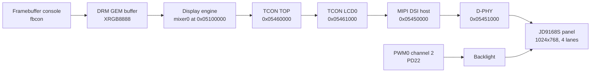

The F101 display path is one fixed chain: the display engine (DE, called a mixer in the Linux driver) composes the picture, the timing controller (TCON) turns it into the timings the panel expects, and a MIPI DSI host and D-PHY carry it to the 1024x768 JD9168S panel of the carrier board. Linux describes this chain as a DRM/KMS pipeline, so the kernel exposes a framebuffer console on `/dev/fb0` and a modesetting device on `/dev/dri/card0`; there is no separate fbdev driver.

| Item | Content |
| --- | --- |
| Driver files | `drivers/gpu/drm/sun4i/sun4i_drv.c`, `sun8i_mixer.c`, `sun8i_tcon_top.c`, `sun4i_tcon.c`, `sun6i_mipi_dsi.c`; `drivers/phy/allwinner/phy-sun6i-mipi-dphy.c`; `drivers/gpu/drm/panel/panel-jadard-jd9168s.c`; `drivers/pwm/pwm-sunxi.c`; `drivers/video/backlight/pwm_bl.c` |
| Compatibles | `allwinner,sun20i-d1-display-engine`, `allwinner,sun252i-f101-de33-mixer-0`, `allwinner,sun252i-f101-tcon-top`, `allwinner,sun252i-f101-tcon-lcd`, `allwinner,sun252i-f101-mipi-dsi`, `allwinner,sun252i-f101-mipi-dphy`, `jadard,jd9168s` |
| Base addresses | Mixer layers `0x05100000`, mixer top `0x05000000`, display block `0x051c0000`; TCON TOP `0x05460000`; TCON LCD0 `0x05461000`; DSI `0x05450000`; D-PHY `0x05451000`; PWM `0x02000c00` |
| Interrupts | TCON LCD0 PLIC 90, DSI PLIC 92; the mixer has no interrupt |
| Clocks and resets | DE bus and module clock (module 300 MHz), reset `RST_BUS_DE`; TCON bus and `tcon-ch0` (parent `PLL_VIDEO0_4X`); TCON TOP bus and `RST_BUS_DPSS_TOP`; DSI bus and module clock at 150 MHz, `RST_BUS_DSI`; D-PHY bus and module clock |
| SRAM and bus priority | The mixer claims the DE SRAM section; the board gives MBUS master 16 (the DE) priority 3 |
| Kconfig | `CONFIG_DRM`, `CONFIG_DRM_SUN4I`, `CONFIG_DRM_SUN6I_DSI`, `CONFIG_PHY_SUN6I_MIPI_DPHY`, `CONFIG_DRM_PANEL_JADARD_JD9168S`, `CONFIG_PWM_SUNXI`, `CONFIG_BACKLIGHT_PWM`, `CONFIG_DRM_FBDEV_EMULATION`, `CONFIG_FRAMEBUFFER_CONSOLE` |
| Userspace | `/dev/dri/card0` (modesetting), `/dev/fb0` (framebuffer console), `/sys/class/backlight/` |

## The pipeline



Only the DSI output exists in the F101 devicetree. Unlike the larger Allwinner SoCs there are no parallel RGB, LVDS or HDMI encoders to choose from: the TCON has a single output endpoint that points at the DSI host, and the DSI host has a single panel.

### Display engine

The F101 mixer identifies itself as a DE33 generation engine, the same family as the H616 mixer, with a different register layout at the top. It has one video (VI) channel and two UI channels, mapped to physical layer slots 0, 3 and 4. The first UI channel is the primary plane, so the framebuffer console is scanned out from a UI plane; the VI plane is an overlay that can take YUV and scaled content.

The driver maps three register windows:

| Window | Base | Purpose |
| --- | --- | --- |
| `layers` | `0x05100000` | Blender, overlay channels, video scaler, layer registers |
| `top` | `0x05000000` | Internal reset, AHB gate, MBUS gate and clock gate at `0x10`-`0x1c`, global control at `0x100` |
| `display` | `0x051c0000` | Display-side registers such as the background colour and output size |

The F101 top block is not the generic DE33 layout. The driver sets `SUN252I_MIXER_TOP_MIXER` (bit 0) in the reset register at `0x10`, the AHB gate at `0x14`, the MBUS gate at `0x18` and the clock gate at `0x1c`, then writes the global control register at `SUN252I_MIXER_GLB + SUN8I_MIXER_GLOBAL_CTL` (`0x100`) to enable the mixer. The global output size lives at `0x100 + SUN50I_MIXER_GLOBAL_SIZE`.

Each plane supports scaling through the DE33 scaler blocks. The UI plane accepts the packed RGB formats used by the console; the VI plane additionally accepts NV12, NV21, NV61, NV16, YUYV, YUV420 and the related packed formats. The driver does not expose a rotation property on any plane, so plane rotation is not available even though the hardware family has a rotation block on some other SoCs.

### TCON TOP and TCON LCD0

The TCON TOP is the clock and signal router between the mixer and the encoders. On the F101 it registers the DSI clock gate with `CLK_IS_CRITICAL`, because a DSI panel cannot recover if that gate closes while the link is running. Its F101 quirk also sets `clk_from_phy`, so the driver writes `TCON_TOP_CLK_SRC_LCD0_PHY | TCON_TOP_CLK_SRC_PHY0` into the clock source register and the LCD0 pixel clock is taken from the D-PHY rather than from a TCON PLL. It also has the mixer input port and the mixer-to-TCON output port.

The TCON LCD0 generates the panel timing. On this SoC it is fed by the D-PHY: the pixel clock is not divided down from a TCON PLL but comes from the low-speed output of the D-PHY PLL. The devicetree assigns `CLK_PLL_VIDEO0_4X` as the parent of `CLK_TCONLCD`, and the F101 TCON quirk `dsi_phy_clock` makes the driver set the DCLK divider to 1 and program the full mode timing (horizontal and vertical total, back porch, sync widths) instead of only the visible size. The TCON is put in the CPU interface mode used for DSI (`SUN4I_TCON0_CTL_IF_8080`) and drives the DSI host through its DRQ/trigger interface.

### DSI host and D-PHY

The DSI host is a DesignWare-style Allwinner controller with an instruction engine. The driver runs it in video mode with sync pulses, four lanes and RGB888 pixels. For the F101 variant the driver sets `video_start_delay` to 1: the TCON starts the frame, so the DSI host must start sending video data immediately. The generic delay computed from the mode moves the whole picture down by one or more lines and leaves an empty line at the top; this is the fix in commit `9b4496973`.

The D-PHY is shared by DSI and LVDS in the hardware family. On the F101 its PLL has a low-speed output that becomes the LCD pixel clock. The driver chooses the smallest post divider `m = M1 + 1` that brings the VCO to at least 1.1 GHz, sets `N = symbol_rate * m / 24 MHz`, and derives two low-speed dividers from `coef = bpp / lanes`. For this panel the numbers are:

| Quantity | Value |
| --- | --- |
| Pixel clock | 54 MHz |
| Bits per pixel | 24 |
| Lanes | 4 |
| Lane symbol rate | 54 MHz x 24 / 4 = 324 Mbps |
| PLL post divider (`M1 + 1`) | 4 (VCO 1296 MHz) |
| PLL `N` | 324 x 4 / 24 = 54 |
| `coef` | 24 / 4 = 6 |
| Low-speed divider `div0` | 3 |
| Low-speed divider `div1` | 4 x 6 / 3 = 8 |
| Low-speed output | 1296 / (3 x 8) = 54 MHz |

The D-PHY module clock is not fixed by the devicetree; the driver takes it exclusively and sets it to 150 MHz while the PHY is powered.

### Panel and backlight

The panel is a Jadard JD9168S controller with a 1024x768 IPS glass, four DSI lanes and 24-bit RGB. The driver holds a fixed mode:

| Timing | Value |
| --- | --- |
| Pixel clock | 54 MHz |
| Visible area | 1024 x 768 |
| Horizontal sync | 10 |
| Horizontal front porch | 40 |
| Horizontal back porch | 40 |
| Horizontal total | 1114 |
| Vertical sync | 8 |
| Vertical front porch | 12 |
| Vertical back porch | 21 |
| Vertical total | 809 |
| Frame rate | 54 MHz / (1114 x 809) = about 59.9 Hz |
| Physical size | 65 mm x 48 mm |

The reset sequence is high, low, high with 100 ms between the steps, followed by the vendor init table, exit sleep mode and a 120 ms wait. Display on sends the DCS command and waits 20 ms; display off sends the DCS command. The panel uses `MIPI_DSI_MODE_VIDEO | MIPI_DSI_MODE_VIDEO_SYNC_PULSE | MIPI_DSI_MODE_LPM`.

The backlight is a `pwm-backlight` on channel 2 of PWM0, routed to `PD22`. The PWM period is 1,000,000 ns, that is 1 kHz, and the output is inverted: a low level lights the LED string. The brightness table has twelve levels from 0 to 255, and the default index 6 selects 96, about 38 percent.

## Devicetree

### SoC nodes

The display engine, mixer and TCON TOP:

```text
de: display-engine {
	compatible = "allwinner,sun20i-d1-display-engine";
	allwinner,pipelines = <&mixer0>;
	status = "disabled";
};

mixer0: mixer@5100000 {
	compatible = "allwinner,sun252i-f101-de33-mixer-0";
	reg = <0x0 0x05100000 0x0 0xc0000>,
	      <0x0 0x05000000 0x0 0x1000>,
	      <0x0 0x051c0000 0x0 0x40000>;
	reg-names = "layers", "top", "display";
	clocks = <&ccu CLK_BUS_DE>, <&ccu CLK_DE>;
	clock-names = "bus", "mod";
	resets = <&ccu RST_BUS_DE>;
	allwinner,sram = <&de_sram_section 1>;
	status = "disabled";

	ports {
		#address-cells = <1>;
		#size-cells = <0>;

		mixer0_out: port@1 {
			reg = <1>;

			mixer0_out_tcon_top_mixer0: endpoint {
				remote-endpoint = <&tcon_top_mixer0_in_mixer0>;
			};
		};
	};
};

tcon_top: tcon-top@5460000 {
	compatible = "allwinner,sun252i-f101-tcon-top",
		     "allwinner,sun20i-d1-tcon-top";
	reg = <0x0 0x05460000 0x0 0x1000>;
	clocks = <&ccu CLK_BUS_DPSS_TOP>,
		 <&ccu CLK_TCONLCD>,
		 <&ccu CLK_TCONLCD>,
		 <&ccu CLK_TCONLCD>;
	clock-names = "bus", "tcon-tv0", "tve0", "dsi";
	clock-output-names = "tcon-top-tv0", "tcon-top-dsi";
	resets = <&ccu RST_BUS_DPSS_TOP>;
	#clock-cells = <1>;
	status = "disabled";

	ports {
		#address-cells = <1>;
		#size-cells = <0>;

		tcon_top_mixer0_in: port@0 {
			reg = <0>;

			tcon_top_mixer0_in_mixer0: endpoint {
				remote-endpoint = <&mixer0_out_tcon_top_mixer0>;
			};
		};

		tcon_top_mixer0_out: port@1 {
			reg = <1>;
			#address-cells = <1>;
			#size-cells = <0>;

			tcon_top_mixer0_out_tcon_lcd0: endpoint@0 {
				reg = <0>;
				remote-endpoint = <&tcon_lcd0_in_tcon_top_mixer0>;
			};
		};
	};
};
```

The TCON, DSI host and D-PHY:

```text
tcon_lcd0: lcd-controller@5461000 {
	compatible = "allwinner,sun252i-f101-tcon-lcd",
		     "allwinner,sun20i-d1-tcon-lcd";
	reg = <0x0 0x05461000 0x0 0x1000>;
	interrupts-extended = <&plic 90 IRQ_TYPE_LEVEL_HIGH>;
	clocks = <&ccu CLK_BUS_TCONLCD>, <&ccu CLK_TCONLCD>;
	clock-names = "ahb", "tcon-ch0";
	assigned-clocks = <&ccu CLK_TCONLCD>;
	assigned-clock-parents = <&ccu CLK_PLL_VIDEO0_4X>;
	clock-output-names = "tcon-pixel-clock";
	resets = <&ccu RST_BUS_TCONLCD>, <&ccu RST_BUS_LVDS0>;
	reset-names = "lcd", "lvds";
	#clock-cells = <0>;
	status = "disabled";

	ports {
		#address-cells = <1>;
		#size-cells = <0>;

		tcon_lcd0_in: port@0 {
			reg = <0>;
			#address-cells = <1>;
			#size-cells = <0>;

			tcon_lcd0_in_tcon_top_mixer0: endpoint@0 {
				reg = <0>;
				remote-endpoint = <&tcon_top_mixer0_out_tcon_lcd0>;
			};
		};

		tcon_lcd0_out: port@1 {
			reg = <1>;
			#address-cells = <1>;
			#size-cells = <0>;

			tcon_lcd0_out_dsi: endpoint@1 {
				reg = <1>;
				remote-endpoint = <&dsi_in_tcon_lcd0>;
			};
		};
	};
};

dsi0: dsi@5450000 {
	#address-cells = <1>;
	#size-cells = <0>;
	compatible = "allwinner,sun252i-f101-mipi-dsi",
		     "allwinner,sun50i-a100-mipi-dsi";
	reg = <0x0 0x05450000 0x0 0x1000>;
	interrupts-extended = <&plic 92 IRQ_TYPE_LEVEL_HIGH>;
	clocks = <&ccu CLK_BUS_DSI>, <&ccu CLK_DSI>;
	clock-names = "bus", "mod";
	assigned-clocks = <&ccu CLK_DSI>;
	assigned-clock-rates = <150000000>;
	resets = <&ccu RST_BUS_DSI>;
	phys = <&dphy0>;
	phy-names = "dphy";
	status = "disabled";

	port {
		dsi_in_tcon_lcd0: endpoint {
			remote-endpoint = <&tcon_lcd0_out_dsi>;
		};
	};
};

dphy0: phy@5451000 {
	compatible = "allwinner,sun252i-f101-mipi-dphy",
		     "allwinner,sun50i-a100-mipi-dphy";
	reg = <0x0 0x05451000 0x0 0x1000>;
	clocks = <&ccu CLK_BUS_COMBOPHY0>, <&ccu CLK_COMBOPHY0>;
	clock-names = "bus", "mod";
	resets = <&ccu RST_BUS_DSI>;
	#phy-cells = <0>;
	status = "disabled";
};
```

The display engine SRAM section lives under the system controller:

```text
syscon: syscon@3000000 {
	compatible = "allwinner,sun252i-f101-system-control";
	reg = <0x0 0x03000000 0x0 0x1000>;
	#address-cells = <1>;
	#size-cells = <1>;
	ranges = <0x0 0x0 0x0 0x40000000>;

	de_sram_section: sram-section-de {
		compatible = "allwinner,sun252i-f101-sram-de";
	};
};
```

The PWM controller that drives the backlight is a normal SoC node:

```text
pwm0: pwm@2000c00 {
	compatible = "allwinner,sunxi-pwm-v201",
		     "allwinner,sun252i-f101-pwm";
	reg = <0x0 0x02000c00 0x0 0x400>;
	clocks = <&ccu CLK_BUS_PWM>;
	resets = <&ccu RST_BUS_PWM>;
	#pwm-cells = <3>;
	status = "disabled";
};
```

### Board nodes

The board enables the chain and describes the panel, the backlight and the pins:

```text
&pwm0 {
	pinctrl-names = "default";
	pinctrl-0 = <&pwm0_pd22_pin>;
	status = "okay";
};

&de {
	status = "okay";
};

&mixer0 {
	status = "okay";
};

&tcon_top {
	status = "okay";
};

&tcon_lcd0 {
	status = "okay";
};

&dphy0 {
	status = "okay";
};

&dsi0 {
	pinctrl-names = "default";
	pinctrl-0 = <&dsi_pd_pins>;
	status = "okay";

	panel@0 {
		compatible = "jadard,jd9168s";
		reg = <0>;
		reset-gpios = <&pio 3 9 GPIO_ACTIVE_LOW>; /* PD9 */
		backlight = <&backlight>;
	};
};

/ {
	backlight: backlight {
		compatible = "pwm-backlight";
		/* PWM0 channel 2 on PD22, low is on */
		pwms = <&pwm0 2 1000000 PWM_POLARITY_INVERTED>;
		brightness-levels = <0 4 8 16 32 64 96 128 160 192 224 255>;
		default-brightness-level = <6>;
	};
};
```

The two pin groups are declared in the board file:

```text
&pio {
	pwm0_pd22_pin: pwm0-pd22-pin {
		pins = "PD22";
		function = "pwm0_2";
	};

	dsi_pd_pins: dsi-pd-pins {
		pins = "PD12", "PD13", "PD14", "PD15", "PD16",
		       "PD17", "PD18", "PD19", "PD20", "PD21";
		function = "dsi";
		drive-strength = <30>;
	};
};
```

The DSI pins are `PD12` through `PD21` in the `dsi` function with 30 ohm drive strength. The reset line is `PD9`, active low, and the backlight is PWM channel 2 on `PD22`. The board also gives the display engine the highest MBUS priority:

```text
&mbus {
	status = "okay";

	display-engine@10 {
		reg = <SUN252I_F101_MBUS_MASTER_DE>;
		priority = <3>;
	};
};
```

### Bindings

| Node | Binding |
| --- | --- |
| Display engine | `Documentation/devicetree/bindings/display/allwinner/allwinner,sun4i-a10-display-engine.yaml` |
| Mixer | `Documentation/devicetree/bindings/display/allwinner/allwinner,sun8i-a83t-de2-mixer.yaml` |
| TCON TOP | `Documentation/devicetree/bindings/display/allwinner/allwinner,sun8i-r40-tcon-top.yaml` |
| TCON LCD | `Documentation/devicetree/bindings/display/allwinner/allwinner,sun4i-a10-tcon.yaml` |
| DSI host | `Documentation/devicetree/bindings/display/allwinner/allwinner,sun6i-a31-mipi-dsi.yaml` |
| D-PHY | `Documentation/devicetree/bindings/phy/allwinner,sun6i-a31-mipi-dphy.yaml` |
| Panel | `Documentation/devicetree/bindings/display/panel/jadard,jd9168s.yaml` |

## Kconfig

The options are selected in `arch/riscv/configs/sun252i_f101_yuzukineko_defconfig`, which the Buildroot defconfig names with `BR2_LINUX_KERNEL_DEFCONFIG`:

```text
CONFIG_DRM=y
CONFIG_DRM_FBDEV_EMULATION=y
CONFIG_DRM_SUN4I=y
CONFIG_DRM_SUN6I_DSI=y
CONFIG_PHY_SUN6I_MIPI_DPHY=y
CONFIG_DRM_PANEL_JADARD_JD9168S=y
CONFIG_FRAMEBUFFER_CONSOLE=y
CONFIG_LOGO=y
CONFIG_PWM=y
CONFIG_PWM_SUNXI=y
CONFIG_BACKLIGHT_CLASS_DEVICE=y
CONFIG_BACKLIGHT_PWM=y
CONFIG_SUNXI_SRAM=y
CONFIG_SUN252I_F101_MBUS=y
```

`CONFIG_DRM_SUN8I_MIXER` and `CONFIG_DRM_SUN8I_TCON_TOP` default to yes when `CONFIG_DRM_SUN4I` is enabled, so they do not appear in the defconfig. The panel option depends on `DRM_MIPI_DSI` and `BACKLIGHT_CLASS_DEVICE`; the DSI option selects `PHY_SUN6I_MIPI_DPHY` and `CRC_CCITT`.

## Driver internals

### Probe and component binding

The DRM driver is a component master. `sun4i_drv_bind()` allocates the `drm_device`, initialises the mode config and calls `component_bind_all()`, which binds the mixer, TCON TOP, TCON and DSI in whatever order the platform devices probe. The mixer registers itself as a `sunxi_engine` and as a CRTC; the TCON registers a CRTC encoder; the DSI host registers an encoder and a bridge; the panel registers a `drm_panel` through the MIPI DSI bus.

The panel probe attaches to the DSI host with `mipi_dsi_attach()`. The DSI host refuses to attach until the DRM device is registered, so a missing panel or D-PHY shows up as `-EPROBE_DEFER` and the whole pipeline comes up later. The mixer claims its SRAM section before it maps its registers; if the section is already claimed the probe fails with `Couldn't claim the SRAM`.

### Modeset

A commit runs through the atomic helpers in this order:

1. The mixer `mode_set` writes the global output size to the F101 top block and the same size to the blender output.
2. The TCON `mode_set` selects the DSI CPU interface, writes the full timing and starts the TCON trigger logic. The DCLK divider is 1 because the clock comes from the D-PHY.
3. The DSI host writes the video packet configuration, the burst timing and a start delay of 1, then enables the video stream.
4. The D-PHY configures its PLL for the 324 Mbps lane rate, enables the four lanes and powers the PHY.
5. The panel `prepare` sequence resets the controller, loads the init table and leaves sleep mode; `enable` sends display on.

### Framebuffer and console

Because `CONFIG_DRM_FBDEV_EMULATION` is set, the DRM client code creates a DMA framebuffer and an fbdev device. The console is bound to it, so kernel messages and the BusyBox prompt appear on the panel without any userspace program. The console buffer is a normal DRM GEM buffer with the XRGB8888 format, 1024 pixels wide and therefore a 4096-byte pitch. The fbdev emulation keeps a single buffer; there is no page-flip double buffering through `/dev/fb0`.

### Clocks, SRAM and MBUS

The mixer module clock is set from `CLK_DE`. The TCON channel clock is parented to `PLL_VIDEO0_4X`; the DSI module clock is set to 150 MHz; the D-PHY driver takes its module clock exclusively while powered. The display engine also needs its SRAM section: the mixer writes value 5 into bits 27:25 of the system control register at `0x03000004`, which hands the internal SRAM to the DE. The USB OTG controller later claims the same bits back to 0; the display keeps working because the section is only needed while the engine is being set up.

The board raises MBUS master 16 to priority 3 and caps the CPU at 500 Mbps. Without the priority, a saturated bus can starve the display engine, which shows as a rolling or tearing picture.

### Cache and DMA

The C906/C907 cores run Sv32, which has no PBMT, so a DMA mapping cannot be made uncached by attribute alone. The display engine reads the scanout buffer through the MBUS. DRM GEM buffers are allocated through the DMA API; if a buffer is mapped cached, a userspace program that draws into it with the CPU must clean the cache before the next scanout, because the DRM page-flip path does not do it. The shipped test programs avoid the question by letting G2D write the buffer, so the only writer is hardware. The DE itself has no cache to maintain.

## Userspace

### fb0 and fbcon

The console is the simplest interface:

```sh
cat /sys/class/graphics/fb0/virtual_size
cat /sys/class/graphics/fb0/bits_per_pixel
cat /sys/class/graphics/fb0/stride
```

On this board the values are `1024,768`, `32` and `4096`. The framebuffer is XRGB8888: byte order B, G, R, X in memory. A program can `mmap()` `/dev/fb0` and write pixels, but it must respect the stride and the fact that the console owns the buffer.

### The DRM device

`/dev/dri/card0` is the modesetting node. The image has no libdrm, so a program talks to the kernel with the raw ioctls and the structures from `<drm/drm.h>` and `<drm/drm_mode.h>`:

| Ioctl | Use |
| --- | --- |
| `DRM_IOCTL_SET_MASTER` | Take the DRM master role, required for modesetting |
| `DRM_IOCTL_MODE_GETRESOURCES` | List connectors and CRTCs |
| `DRM_IOCTL_MODE_GETCONNECTOR` | Read the connection state and the mode list |
| `DRM_IOCTL_MODE_GETCRTC` | Read the current CRTC state and its framebuffer id |
| `DRM_IOCTL_MODE_GETFB` | Turn a framebuffer id into width, height, pitch and a GEM handle |
| `DRM_IOCTL_PRIME_HANDLE_TO_FD` | Export the GEM handle as a dma-buf file descriptor |
| `DRM_IOCTL_MODE_ADDFB2` | Add a framebuffer for a dumb buffer |
| `DRM_IOCTL_MODE_SETCRTC` | Program a CRTC with a mode and a framebuffer |
| `DRM_IOCTL_MODE_PAGE_FLIP` | Queue a page flip and wait for the vblank event |

The PRIME export is the useful trick on a 32 MiB board: the fbcon framebuffer can be reused as a G2D output buffer instead of allocating a second 3 MiB scanout buffer. The G2D driver accepts it as `V4L2_MEMORY_DMABUF`.

### A minimal DRM query program

The following program prints the connector, the CRTC and the console framebuffer. It is the same sequence used by `hplay.c` and `vplay.c` in `fel-stage/src/`.

```c
#include <stdio.h>
#include <stdint.h>
#include <stdlib.h>
#include <string.h>
#include <fcntl.h>
#include <unistd.h>
#include <sys/ioctl.h>
#include <drm/drm.h>
#include <drm/drm_mode.h>

int main(void)
{
	struct drm_mode_card_res res = { 0 };
	struct drm_mode_get_connector conn = { 0 };
	struct drm_mode_crtc crtc = { 0 };
	struct drm_mode_fb_cmd fb = { 0 };
	uint32_t *conns, *crtcs;
	int fd, i, conn_id = 0, crtc_id = 0;

	fd = open("/dev/dri/card0", O_RDWR);
	if (fd < 0) {
		perror("card0");
		return 1;
	}
	ioctl(fd, DRM_IOCTL_SET_MASTER, 0);

	ioctl(fd, DRM_IOCTL_MODE_GETRESOURCES, &res);
	conns = calloc(res.count_connectors, sizeof(*conns));
	crtcs = calloc(res.count_crtcs, sizeof(*crtcs));
	res.connector_id_ptr = (uintptr_t)conns;
	res.crtc_id_ptr = (uintptr_t)crtcs;
	ioctl(fd, DRM_IOCTL_MODE_GETRESOURCES, &res);

	for (i = 0; i < (int)res.count_connectors; i++) {
		memset(&conn, 0, sizeof(conn));
		conn.connector_id = conns[i];
		ioctl(fd, DRM_IOCTL_MODE_GETCONNECTOR, &conn);
		if (conn.connection == 1 && conn.count_modes) {
			conn_id = conns[i];
			break;
		}
	}
	if (!conn_id) {
		printf("no connector\n");
		return 1;
	}
	crtc_id = crtcs[0];

	memset(&conn, 0, sizeof(conn));
	conn.connector_id = conn_id;
	ioctl(fd, DRM_IOCTL_MODE_GETCONNECTOR, &conn);
	printf("connector %d crtc %d modes %u\n", conn_id, crtc_id, conn.count_modes);

	crtc.crtc_id = crtc_id;
	ioctl(fd, DRM_IOCTL_MODE_GETCRTC, &crtc);
	fb.fb_id = crtc.fb_id;
	ioctl(fd, DRM_IOCTL_MODE_GETFB, &fb);
	printf("fb %ux%u pitch %u handle %u\n", fb.width, fb.height, fb.pitch, fb.handle);

	return 0;
}
```

The output has this shape; the numeric ids depend on probe order:

```text
connector <id> crtc <id> modes <n>
fb 1024x768 pitch 4096 handle <handle>
```

### Backlight

The backlight is a standard LED class device under `/sys/class/backlight/`. The directory name comes from the devicetree node, so list it first rather than hard-coding it:

```sh
ls /sys/class/backlight/
cat /sys/class/backlight/*/max_brightness
echo 128 > /sys/class/backlight/*/brightness
```

`max_brightness` is 255 because the table is scaled to 255. Writing 0 turns the panel dark without stopping the DSI link.

## Limitations

| Limitation | Detail |
| --- | --- |
| One output | Only DSI is described in the F101 devicetree; there is no parallel RGB, LVDS or HDMI output |
| One mode | The JD9168S driver exposes the fixed 1024x768 mode and nothing else |
| No plane rotation | The DRM planes have no rotation property; the engine's rotation block is not wired up |
| Video mode only | The panel runs in DSI video mode with sync pulses; command mode is not supported |
| Single fbdev buffer | The console uses one buffer; page flips are only possible through the DRM API |
| CPU cache | Sv32 has no PBMT; a CPU-written scanout buffer needs cache maintenance before scanout |
| No hardware cursor | The pipeline has no cursor plane, so a compositor has to blend its own cursor |

## Troubleshooting

| Symptom | Cause | Fix |
| --- | --- | --- |
| No `/dev/dri/card0` | The display nodes are disabled, a component is missing, or DRM is not built | Enable `de`, `mixer0`, `tcon_top`, `tcon_lcd0`, `dphy0` and `dsi0`; check for `-EPROBE_DEFER` in `dmesg` |
| Card exists but the screen stays black | Panel did not attach, or the DSI link never started | Check `Attached device` and the panel reset line on `PD9`; the backlight may be off |
| Picture shifted down, empty top line | DSI start delay is computed from the mode instead of 1 | Use the F101 DSI variant with `video_start_delay = 1` |
| No `/dev/fb0` | `DRM_FBDEV_EMULATION` or `FRAMEBUFFER_CONSOLE` is off | Enable both; the console is not a separate driver |
| Wrong colours | The buffer format does not match the hardware byte order | The console is XRGB8888; for G2D use `V4L2_PIX_FMT_XBGR32` |
| Backlight dark at boot | Inverted PWM polarity or the default level index | Check `PWM_POLARITY_INVERTED` and `default-brightness-level` |
| Mixer probe fails with `Couldn't claim the SRAM` | Another driver owns the DE SRAM section | Check the SRAM users; the section is shared with the USB FIFO and must be claimed once |
| Picture tears under load | The display engine loses MBUS arbitration | Keep MBUS master 16 at priority 3 and the CPU limit in place |
| Random corruption after long uptime | PSRAM running at 252 MHz | Use the 192 MHz PSRAM setting from the boot flow |

## See also

- [Linux development](../index.md)
- [MBUS and SRAM](mbus-sram.md)
- [CCU](clock.md)
- [Pin multiplexing and GPIO](pinctrl-gpio.md)
- [Prebuilt images](../linux-prebuilt.md)
