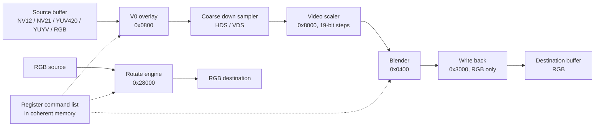

The F101 G2D is a memory-to-memory 2D engine: it reads a picture from RAM, optionally converts it from YUV to RGB, scales it, blends it onto a background and writes an RGB picture back to RAM. It can also rotate or flip an RGB picture, but that is a separate DMA path that does neither scaling nor colour conversion. Linux exposes the whole block as a V4L2 mem2mem device on `/dev/video0`, so a program drives it with the ordinary V4L2 format, buffer and streaming ioctls.

| Item | Content |
| --- | --- |
| Driver files | `drivers/media/platform/sunxi/sun252i-g2d/sun252i-g2d-main.c`, `sun252i-g2d.h`, `sun252i-g2d-tables.c` |
| Compatible | `allwinner,sun252i-f101-g2d` |
| Base | `0x05410000`, 256 KiB register window |
| Interrupt | PLIC 111, level high; one job-end interrupt |
| Clocks and reset | `mod`, `bus`, `mbus`; module clock 300 MHz; reset `RST_BUS_G2D` |
| Kconfig | `CONFIG_VIDEO_SUN252I_G2D`, `CONFIG_V4L_MEM2MEM_DRIVERS`, `CONFIG_VIDEO_DEV`, `CONFIG_VIDEOBUF2_DMA_CONTIG` |
| Userspace | `/dev/video0`, a V4L2 mem2mem device named `sun252i-g2d` |

## The pipeline

The mixer path is a small fixed pipeline. The source always enters through the V0 video overlay, which is the only overlay the driver uses. The overlay can pre-reduce very large pictures with its coarse down-sampler, the video scaler (VSU) does the fractional scaling, the blender combines the result with a fill colour, and the write-back block stores the RGB result.



The rotate engine is selected by `G2D_CORE_CTRL`. It is a straight DMA-to-DMA copy that applies a 0/90/180/270 degree rotation and optional horizontal or vertical flip. It cannot scale and cannot convert format, so the driver refuses a rotation job unless the source and destination formats and the resulting sizes match.

### Register blocks

The CPU writes only the control registers at the bottom of the window. Everything else is written through the register command queue (RCQ), a list of blocks in memory that the hardware copies into its register file before it starts.

| Block | Offset | Role |
| --- | --- | --- |
| Control | `0x000`-`0x064` | Reset, clock gate, MBUS gate, master mode, core status, internal cache and DDR bandwidth limiter |
| RCQ thread 0 | `0x100` | Interrupt enable and status, command-list head address and length, command count, update doorbell |
| Core select | `0x300` | Selects the mixer pipeline (`BIT(0)`) or the rotate engine (`BIT(4)`) |
| V0 overlay | `0x0800`, size `0x40` | Source format, size, pitches, three plane addresses, coarse sampling factors |
| UI overlays | `0x1000 + 0x800 * n` | The driver writes three of them as disabled |
| Blender | `0x0400`, size `0x1a0` | Pipe enable, fill colours, pipe sizes, output size, colour space conversion |
| Write back | `0x3000` | Output format, size, pitches and plane addresses |
| Video scaler | `0x8000`, size `0x480` | Step sizes, coefficient tables, chroma handling |
| Rotate engine | `0x28000`, size `0xb8` | Rotation mode, degree, flips, input and output planes |

The RCQ thread registers are the only ones the CPU has to write to start a job:

| Register | Value written by the driver |
| --- | --- |
| `THREAD_IRQ_EN` | task-end and timeout interrupts |
| `THREAD_HEAD_LOW` | low 32 bits of the command-list DMA address |
| `THREAD_HEAD_HIGH_LEN` | command-list length in bits 31:16 |
| `THREAD_ATTR` | command count 0 and end-of-list interrupt |
| `THREAD_UPDATE` | `1`, the doorbell |

### Formats

The driver has one format table and marks which entries can be a write-back destination. Only the RGB entries have `dst = true`, which is why the capture queue enumerates RGB formats only.

| V4L2 format | Hardware value | Planes | Bytes per sample | YUV | Destination |
| --- | --- | --- | --- | --- | --- |
| `V4L2_PIX_FMT_ABGR32` | `0x00` | 1 | 4 | no | yes |
| `V4L2_PIX_FMT_RGBA32` | `0x01` | 1 | 4 | no | yes |
| `V4L2_PIX_FMT_BGRA32` | `0x02` | 1 | 4 | no | yes |
| `V4L2_PIX_FMT_ARGB32` | `0x03` | 1 | 4 | no | yes |
| `V4L2_PIX_FMT_XBGR32` | `0x04` | 1 | 4 | no | yes |
| `V4L2_PIX_FMT_RGBX32` | `0x05` | 1 | 4 | no | yes |
| `V4L2_PIX_FMT_BGR24` | `0x08` | 1 | 3 | no | yes |
| `V4L2_PIX_FMT_RGB24` | `0x09` | 1 | 3 | no | yes |
| `V4L2_PIX_FMT_RGB565` | `0x0a` | 1 | 2 | no | yes |
| `V4L2_PIX_FMT_NV12` | `0x28` | 2 | 1, 2 | yes | no |
| `V4L2_PIX_FMT_NV21` | `0x29` | 2 | 1, 2 | yes | no |
| `V4L2_PIX_FMT_YUV420` | `0x2a` | 3 | 1, 1, 1 | yes | no |
| `V4L2_PIX_FMT_YUYV` | `0x20` | 1 | 2 | yes | no |

`V4L2_PIX_FMT_XBGR32` has the same fourcc and byte order as `DRM_FORMAT_XRGB8888`, which is the format of the fbcon buffer. That is what makes the console buffer usable directly as a G2D destination.

The driver clamps both dimensions to the range 16 to 8192 and rounds them up to even values. The pitch is rounded up to 16 bytes and is at least `width * bytes_per_pixel`. The size image is the sum of the plane sizes, with chroma planes subsampled according to the format.

## Devicetree

The SoC node:

```text
g2d: g2d@5410000 {
	compatible = "allwinner,sun252i-f101-g2d";
	reg = <0x0 0x05410000 0x0 0x40000>;
	interrupts-extended = <&plic 111 IRQ_TYPE_LEVEL_HIGH>;
	clocks = <&ccu CLK_G2D>, <&ccu CLK_BUS_G2D>, <&ccu CLK_BUS_G2D_M>;
	clock-names = "mod", "bus", "mbus";
	resets = <&ccu RST_BUS_G2D>;
	status = "disabled";
};
```

The board enables it:

```text
&g2d {
	status = "okay";
};
```

There is no pinctrl and no SRAM claim: the engine is a pure bus master and does not use on-chip SRAM. The binding is `Documentation/devicetree/bindings/media/allwinner,sun252i-f101-g2d.yaml`.

## Kconfig

```text
CONFIG_MEDIA_SUPPORT=y
CONFIG_MEDIA_PLATFORM_SUPPORT=y
CONFIG_VIDEO_DEV=y
CONFIG_V4L_MEM2MEM_DRIVERS=y
CONFIG_VIDEOBUF2_DMA_CONTIG=y
CONFIG_VIDEO_SUN252I_G2D=y
```

The driver is selected in `arch/riscv/configs/sun252i_f101_yuzukineko_defconfig`. `CONFIG_VIDEO_SUN252I_G2D` is a tristate and depends on `V4L_MEM2MEM_DRIVERS`, `VIDEO_DEV`, `ARCH_SUNXI`, `COMMON_CLK`, `RESET_CONTROLLER` and `OF`; it selects `VIDEOBUF2_DMA_CONTIG` and `V4L2_MEM2MEM_DEV`.

## Driver internals

### Probe and clocks

The probe maps the register window, gets the three clocks and the reset, sets the module clock to 300 MHz, enables the bus and MBUS clocks, pulses the reset and enables the module clock. It then opens the hardware:

- core clock gate and thread 0 clock gate on;
- MBUS gate and reset on;
- core reset and thread reset released;
- internal cache enabled with size `0x40`;
- DDR bandwidth limiter enabled with value `0x90`.

The cache and limiter values are the ones the vendor driver uses. The limiter keeps G2D from starving the display engine and the CPU of memory bandwidth.

The driver allocates a 4 KiB coherent command-list buffer once and requests the PLIC interrupt. It then registers a V4L2 device and a video device with `VFL_TYPE_VIDEO` and minor `-1`, so the device number follows probe order. In the shipped configuration G2D is `/dev/video0` and cedrus is `/dev/video1`.

### mem2mem queues

Both queues are single-planar and use `vb2_dma_contig_memops`. They accept `VB2_MMAP` and `VB2_DMABUF`. Every context gets its own format pair, control handler and m2m context, so several processes can open the device; a per-device mutex serialises the ioctls and a spinlock protects the single running job.

The defaults on `open()` are a 640x480 NV12 source and a 640x480 XBGR32 destination. `try_fmt` falls back to NV12 for the output queue and XBGR32 for the capture queue when the requested format is not in the table. `set_fmt` is refused with `-EBUSY` while the queue is streaming.

### Buffer sizing

`queue_setup` always uses one plane per buffer and takes the size from the current format. `buf_prepare` checks the plane is at least `sizeimage` and sets the payload. The multi-plane V4L2 API is not used even for NV12: the three planes of a YUV420 picture or the two planes of NV12 are packed one after another into a single buffer, and the hardware plane addresses are derived from the base address plus the cumulative plane sizes.

`g2d_hw_buf_init()` computes each plane pitch and address:

- plane 0 uses the luma pitch;
- for NV12/NV21 the chroma plane also uses the luma pitch;
- for YUV420 the chroma planes use half the luma pitch;
- each plane starts after the previous plane's pitch times its height.

### Command list construction

A job is built into the coherent command list:

1. `cl_init()` reserves the header area, twelve 16-byte entries.
2. `mixer_begin()` reserves blocks for `CORE_CTRL`, `WB`, `V0`, three UI overlays and `BLD`, and writes the core-select mixer value and the ROP bypass.
3. `v0_setup()` programs the source format, size, pitch and three plane addresses.
4. `v0_coarse()` and `vsu_enable()` add the scaler block when the source is YUV or the size changes.
5. The blender is configured as a single pipe 0 with the fill enabled, the output size, the YUV or RGB output mode, and the 601/709 colour-space matrix when the source is YUV.
6. The write-back block gets the destination format, size, pitch and address.
7. `cl_finish()` rounds the block count up to a pair, because the hardware reads the headers two at a time.

Each block header is `{ addr_low, len, flags, reg_offset }`:

```c
struct g2d_rcq_header {
	__le32 addr_low;
	__le32 len;
	__le32 flags;
	__le32 reg_offset;
};
```

`flags` carries `G2D_CL_DIRTY` so an unused block is ignored. Blocks are 32-byte aligned and the whole list fits in 4 KiB. The engine reads the headers two at a time, which is why `cl_finish()` rounds the count up to an even number.

### Plane addressing

The single V4L2 buffer is divided by `g2d_hw_buf_init()` into the planes the hardware expects. For a 640x480 NV12 source with a 640-byte pitch:

| Plane | Offset in the buffer | Pitch | Size |
| --- | --- | --- | --- |
| Y | 0 | 640 | 307200 |
| UV interleaved | 307200 | 640 | 153600 |
| Total | | | 460800 |

For a 640x480 YUV420 source the two chroma planes each get a 320-byte pitch:

| Plane | Offset in the buffer | Pitch | Size |
| --- | --- | --- | --- |
| Y | 0 | 640 | 307200 |
| U | 307200 | 320 | 76800 |
| V | 384000 | 320 | 76800 |
| Total | | | 460800 |

The source of the example is NV12, so the second table is only for the three-plane format.

### Scaling

The scaler works with 19-bit fractional steps: `step = in_size << 19 / out_size`. Steps are programmed with bit 0 reserved, so the driver writes `step << 1`. Horizontal coefficients come from one of sixteen Lanczos sets selected by the ratio; vertical coefficients are programmed into a separate table. Planar 4:2:0 pictures also program the chroma step, phase and coefficients, packed 4:2:2 uses a linear vertical table, and RGB reuses the chroma path with the same sample count as luma.

Before the scaler, the V0 overlay can coarse-reduce the picture. If the input is at least eight times the output width it reduces to `out_width * 8`, capped at 2048 pixels; if it is merely wider than 2048 it reduces to 2048. Vertically it reduces to `out_height * 4` when the input is at least four times the output. This keeps the fine scaler inside its 8x horizontal and 4x vertical range.

### Interrupts and watchdog

When the command list is ready the driver records the running context, arms a 1 second delayed work watchdog, executes a write memory barrier and rings the doorbell. The interrupt handler reads and clears the thread status. A task-end interrupt completes both buffers with `VB2_BUF_STATE_DONE`; a timeout interrupt resets the core and the thread and completes them with `VB2_BUF_STATE_ERROR`. The watchdog does the same if the interrupt never arrives and logs `the engine did not finish the frame`.

The handler pulses the thread reset after every job, so the next job starts from a known state.

### Cache and PBMT

The C906/C907 cores run Sv32, which has no PBMT. DMA mappings are therefore not automatically uncached. The command list is allocated with `dmam_alloc_coherent()` and is written with a barrier before the doorbell, so the engine sees it. The image buffers are `vb2_dma_contig` buffers. MMAP buffers come from the DMA allocator and are not marked non-coherent on this queue; USERPTR and dma-buf imports are marked non-coherent, and the `prepare` and `finish` memops synchronise them with `dma_sync_sgtable_for_device` and `dma_sync_sgtable_for_cpu`. The shipped tests pass dma-bufs between cedrus and G2D, so the import path is the one they exercise.

## Userspace

### The device

`/dev/video0` reports:

- driver `sun252i-g2d`;
- card `Allwinner F101 G2D`;
- capabilities `V4L2_CAP_VIDEO_M2M | V4L2_CAP_STREAMING`.

The programming model is the usual mem2mem one: `VIDIOC_S_FMT` on `V4L2_BUF_TYPE_VIDEO_OUTPUT` describes the source, `VIDIOC_S_FMT` on `V4L2_BUF_TYPE_VIDEO_CAPTURE` describes the destination, buffers are allocated on both queues, one source and one destination buffer are queued, and the driver runs one job per pair.

| Ioctl | Use |
| --- | --- |
| `VIDIOC_QUERYCAP` | Driver and card name |
| `VIDIOC_ENUM_FMT` | The format table, separately for output and capture |
| `VIDIOC_G_FMT`, `VIDIOC_TRY_FMT`, `VIDIOC_S_FMT` | Negotiate source and destination formats |
| `VIDIOC_REQBUFS`, `VIDIOC_QUERYBUF`, `VIDIOC_QBUF`, `VIDIOC_DQBUF` | MMAP buffers |
| `VIDIOC_EXPBUF` | Export a buffer as a dma-buf |
| `VIDIOC_STREAMON`, `VIDIOC_STREAMOFF` | Start and stop both queues |
| `VIDIOC_S_CTRL`, `VIDIOC_G_CTRL` | Rotation and flips |

The driver also accepts DMABUF memory. The usual pipeline is: cedrus exports its NV12 capture buffers with `VIDIOC_EXPBUF`, G2D imports them as source buffers, and G2D writes into the fbcon framebuffer exported through DRM PRIME. No copy is made.

### Controls

| Control | Range | Effect |
| --- | --- | --- |
| `V4L2_CID_ROTATE` | 0 to 270, step 90 | Selects the rotate engine and the angle |
| `V4L2_CID_HFLIP` | 0 or 1 | Horizontal flip in the rotate engine |
| `V4L2_CID_VFLIP` | 0 or 1 | Vertical flip in the rotate engine |

A rotation job requires the source and destination formats to be identical and the destination size to be the source size with width and height swapped for 90 and 270 degrees. Otherwise `start_streaming` returns `-EINVAL` and all queued buffers are returned with `VB2_BUF_STATE_QUEUED`. Rotation of a YUV picture is impossible in practice because the capture queue has no YUV format.

### Example: convert and scale

This program takes a 640x480 NV12 picture and writes a 1024x768 XBGR32 picture. It uses MMAP buffers and the minimum V4L2 calls.

```c
#include <stdio.h>
#include <string.h>
#include <fcntl.h>
#include <unistd.h>
#include <errno.h>
#include <sys/ioctl.h>
#include <sys/mman.h>
#include <linux/videodev2.h>

static int xioctl(int fd, unsigned long req, void *arg)
{
	int ret = ioctl(fd, req, arg);

	if (ret)
		perror("ioctl");
	return ret;
}

int main(void)
{
	enum v4l2_buf_type out = V4L2_BUF_TYPE_VIDEO_OUTPUT;
	enum v4l2_buf_type cap = V4L2_BUF_TYPE_VIDEO_CAPTURE;
	struct v4l2_format f;
	struct v4l2_requestbuffers rq;
	struct v4l2_buffer b;
	void *src, *dst;
	int fd, i;

	fd = open("/dev/video0", O_RDWR);
	if (fd < 0) {
		perror("video0");
		return 1;
	}

	memset(&f, 0, sizeof(f));
	f.type = out;
	f.fmt.pix.pixelformat = V4L2_PIX_FMT_NV12;
	f.fmt.pix.width = 640;
	f.fmt.pix.height = 480;
	xioctl(fd, VIDIOC_S_FMT, &f);
	printf("src NV12 %ux%u pitch %u size %u\n", f.fmt.pix.width,
	       f.fmt.pix.height, f.fmt.pix.bytesperline, f.fmt.pix.sizeimage);

	memset(&f, 0, sizeof(f));
	f.type = cap;
	f.fmt.pix.pixelformat = V4L2_PIX_FMT_XBGR32;
	f.fmt.pix.width = 1024;
	f.fmt.pix.height = 768;
	xioctl(fd, VIDIOC_S_FMT, &f);
	printf("dst XBGR32 %ux%u pitch %u size %u\n", f.fmt.pix.width,
	       f.fmt.pix.height, f.fmt.pix.bytesperline, f.fmt.pix.sizeimage);

	for (i = 0; i < 2; i++) {
		enum v4l2_buf_type t = i ? cap : out;

		memset(&rq, 0, sizeof(rq));
		rq.count = 1;
		rq.type = t;
		rq.memory = V4L2_MEMORY_MMAP;
		xioctl(fd, VIDIOC_REQBUFS, &rq);
	}

	memset(&b, 0, sizeof(b));
	b.type = out;
	b.memory = V4L2_MEMORY_MMAP;
	b.index = 0;
	xioctl(fd, VIDIOC_QUERYBUF, &b);
	src = mmap(NULL, b.length, PROT_READ | PROT_WRITE, MAP_SHARED, fd, b.m.offset);

	memset(&b, 0, sizeof(b));
	b.type = cap;
	b.memory = V4L2_MEMORY_MMAP;
	b.index = 0;
	xioctl(fd, VIDIOC_QUERYBUF, &b);
	dst = mmap(NULL, b.length, PROT_READ | PROT_WRITE, MAP_SHARED, fd, b.m.offset);

	/* fill the NV12 source: a grey luma ramp and neutral chroma */
	memset(src, 128, 640 * 480 * 3 / 2);
	for (i = 0; i < 640 * 480; i++)
		((unsigned char *)src)[i] = i / 640;

	memset(&b, 0, sizeof(b));
	b.type = out;
	b.memory = V4L2_MEMORY_MMAP;
	b.index = 0;
	xioctl(fd, VIDIOC_QBUF, &b);

	memset(&b, 0, sizeof(b));
	b.type = cap;
	b.memory = V4L2_MEMORY_MMAP;
	b.index = 0;
	xioctl(fd, VIDIOC_QBUF, &b);

	xioctl(fd, VIDIOC_STREAMON, &out);
	xioctl(fd, VIDIOC_STREAMON, &cap);

	memset(&b, 0, sizeof(b));
	b.type = cap;
	b.memory = V4L2_MEMORY_MMAP;
	xioctl(fd, VIDIOC_DQBUF, &b);
	printf("capture buffer %u done, bytesused %u\n", b.index, b.bytesused);

	return 0;
}
```

The program prints:

```text
src NV12 640x480 pitch 640 size 460800
dst XBGR32 1024x768 pitch 4096 size 3145728
capture buffer 0 done, bytesused 3145728
```

The source buffer is filled before `VIDIOC_QBUF`. The example uses an MMAP buffer from the DMA allocator, so it does not need an explicit cache flush. A USERPTR or dma-buf buffer follows the synchronisation rules of its mapping or exporter. The destination is written by G2D, so its CPU mapping must not be touched while the job runs.

### Example: rotate

Rotation is a control, not a format. Set both formats to the same RGB format, swap the destination dimensions for 90 or 270 degrees, and set the control before streaming:

```c
struct v4l2_control ctrl = { .id = V4L2_CID_ROTATE, .value = 90 };

xioctl(fd, VIDIOC_S_CTRL, &ctrl);
```

A 640x480 source needs a 480x640 destination. The engine performs a move, so the command list has no scaler block and the job does less work than a scaled blit.

## Limitations

| Limitation | Detail |
| --- | --- |
| No YUV output | The write-back block produces RGB only; the capture queue enumerates the nine RGB formats and nothing else |
| Rotation is a move | Rotate and flip require the same format and no scaling, with width and height swapped for 90 and 270 degrees |
| Single source plane | Blending two arbitrary pictures is not exposed; the driver always uses pipe 0 and a fill colour |
| No alpha blending API | The blender supports alpha modes, but the V4L2 driver does not expose them; the RGB alpha channel is passed through |
| Single planar buffers | NV12, NV21 and YUV420 are packed into one V4L2 buffer; there is no multi-planar API |
| Maximum size | 8192 x 8192, minimum 16 x 16, both rounded to even |
| No 10-bit formats | Only 8-bit RGB and 8-bit 4:2:0/4:2:2 YUV |
| No hardware timestamps | `V4L2_BUF_FLAG_TIMESTAMP_COPY`; the driver copies the source timestamp |

## Troubleshooting

| Symptom | Cause | Fix |
| --- | --- | --- |
| No `/dev/video0` | The node is disabled or the driver is not built | Set `status = "okay"` on `&g2d` and enable `CONFIG_VIDEO_SUN252I_G2D` |
| `VIDIOC_STREAMON` returns `-EINVAL` | A rotation was requested with scaling, a different format, or wrong destination size | Make the formats identical and swap the dimensions for 90/270 |
| `VIDIOC_S_FMT` returns `-EBUSY` | Buffers are already allocated or streaming | `VIDIOC_STREAMOFF` and free the buffers first |
| Colours are swapped | The V4L2 RGB fourcc does not match the expected byte order | Use `V4L2_PIX_FMT_XBGR32` for a DRM XRGB8888 surface |
| Output is all black | The source buffer was never filled, or the buffer was not mapped correctly | Fill before `VIDIOC_QBUF`; check the mapping and `bytesused` |
| `the engine did not finish the frame` | The job timed out and the watchdog reset the engine | Check the buffer addresses and pitches; retry the job |
| Corrupted output at high memory pressure | PSRAM or MBUS instability | Keep the MBUS CPU limit, and use the 192 MHz PSRAM setting |
| Device number is not 0 | G2D and cedrus probe in a different order | Find the device with `cat /sys/class/video4linux/video*/name` |

## See also

- [Linux development](../index.md)
- [Display - DE, TCON, DSI and the panel](display.md)
- [VE - video decoding](vdec.md)
- [MBUS and SRAM](mbus-sram.md)
- [Prebuilt images](../linux-prebuilt.md)
