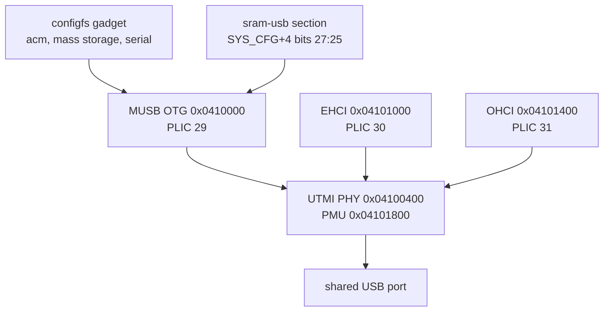

The F101 has one USB 2.0 OTG controller built on a Mentor MUSB core and a separate EHCI/OHCI host pair. All three controllers share a single UTMI PHY at `0x04100400`, so only one role can be active at a time. Linux drives the device side with the MUSB glue layer and configfs gadgets, and the host side with the generic platform EHCI and OHCI drivers. The board has no ID or VBUS detection, so the role is chosen by writing to the MUSB `mode` attribute.



| Item | Content |
| --- | --- |
| Device controller | MUSB OTG at `0x0410000`, 0x400 bytes, PLIC 29, high and full speed |
| Host controllers | EHCI at `0x04101000` (PLIC 30), OHCI at `0x04101400` (PLIC 31) |
| PHY | `0x04100400` (0x100 bytes) plus PMU `0x04101800` (0x100 bytes) |
| Shared port | One PHY, one role at a time, no ID or VBUS pin on the board |
| Device FIFO | 2 KiB dynamic FIFO RAM, five endpoints, 512-byte maximum packet |
| Transfer | PIO only, the MUSB DMA controller is not implemented in the glue |
| Kconfig | `CONFIG_USB_MUSB_SUNXI`, `CONFIG_PHY_SUN4I_USB`, `CONFIG_USB_CONFIGFS*` |
| Userspace | MUSB `mode` attribute, `/sys/class/udc/`, configfs, `/dev/ttyGS0` |

## Hardware

### Controllers and PHY

The OTG controller is a MUSB core with the Allwinner register translation. Its register window is only the generic control and endpoint blocks; the FIFO data, endpoint control, indexed bus control and configdata registers are at fixed offsets that the glue layer translates. The MUSB core is a high-speed device and can also act as a host, but the board uses it as the device side.

The EHCI controller handles high-speed host traffic and the OHCI controller handles full-speed and low-speed devices. They are independent host controllers with their own register windows and interrupts, but they share the PHY with the OTG controller. The PHY has one route bit, `OTGCTL[0]` at PHY offset `0x20`: 1 routes the PHY to MUSB and 0 routes it to the EHCI/OHCI pair. The PHY also has force bits for the ID and VBUS comparators, because the board does not connect those pins.

| Controller | Base | Size | PLIC | Clock | Reset |
| --- | --- | --- | --- | --- | --- |
| MUSB OTG | `0x04100000` | 0x400 | 29 | `CLK_BUS_USBOTG0` | `RST_USB_OTG0` |
| PHY | `0x04100400` | 0x100 | none | `osc24M` | `RST_USB_PHY0_RSTN` |
| EHCI | `0x04101000` | 0x100 | 30 | `CLK_BUS_USBEHCI0`, `CLK_BUS_USB` | `RST_USB_EHCI0` |
| OHCI | `0x04101400` | 0x100 | 31 | `CLK_BUS_USBOHCI0`, `CLK_BUS_USB` | `RST_USB_OHCI0` |

### FIFO RAM ownership

The MUSB core has 2 KiB of FIFO RAM selected by `SUNXI_MUSB_RAM_BITS` = 11. The RAM is not always wired to the USB controller: bits 27:25 of the system-control register at `0x03000004` select between the display engine (value 5) and the OTG FIFO (value 0). The `allwinner,sun252i-f101-sram-usb` section exists for exactly this, and the MUSB driver claims it through `allwinner,sram` when the core initializes, which clears the field to 0. With the field left at 5 the controller still answers register reads, but the gadget stays in the `default` state and never enumerates. See [MBUS and SRAM](mbus-sram.md) for the claim counting and the conflict with the display engine.

### Register translation and endpoints

The glue layer reports `MUSB_INDEXED_EP`, translates the generic control registers at 0x40 to 0x57, keeps the endpoint control block at 0x80 with a two-byte hole before `MUSB_TXTYPE`, and places the bus control registers at 0x98. It reports no test mode and no ULPI block. The F101 configuration has `no_configdata`, so the configdata read returns `0xde` instead of a real register.

The FIFO configuration table declares five endpoints, each with a 512-byte maximum packet size and single buffering. The core has 2 KiB of dynamic FIFO RAM (`dyn_fifo` in the HDRC config), so the RAM is packed at runtime rather than cut into a fixed 512-byte block per endpoint. `sunxi_musb_dma_controller_create()` returns `NULL`, so the MUSB core runs in PIO mode and the CPU moves every FIFO word. The `VEND0` register is written with the PIO mode value (0) during init.

### Role selection

There is no ID pin and no VBUS comparator on the board, so `sun4i_usb_phy` uses the force bits in `ISCR`: the ID force field is bits 15:14 and the VBUS force field is bits 13:12. In `USB_DR_MODE_OTG` with no `usb0_id_det-gpios`, the ID fallback returns 1, which means peripheral. In `USB_DR_MODE_HOST` it returns 0. Every `phy_set_mode()` call sets `data->dr_mode`, forces `id_det` to -1 and queues an immediate detection work item; the work item then forces the ID and VBUS comparators, notifies the extcon, enables PHY passby and calls `sun4i_usb_phy0_reroute()`.

Both the MUSB controller and the two HCDs call `phy_set_mode()` when they start. The HCD core routes the `usb` PHY of each host controller through `usb_phy_roothub`, which calls `PHY_MODE_USB_HOST_SS` first and falls back to `PHY_MODE_USB_HOST`; the PHY rejects the SS mode and accepts the USB2 host mode. On this board the HCDs are the last to set the mode, so the PHY is left on the host side, which is the observed boot state. The comment in the board file says the port starts as a device; it does not match the behavior of the shared PHY on the board.

## Devicetree

### SoC nodes

```text
usb_otg: usb@4100000 {
	compatible = "allwinner,sun252i-f101-musb";
	reg = <0x0 0x04100000 0x0 0x400>;
	interrupts-extended = <&plic 29 IRQ_TYPE_LEVEL_HIGH>;
	interrupt-names = "mc";
	clocks = <&ccu CLK_BUS_USBOTG0>;
	resets = <&ccu RST_USB_OTG0>;
	extcon = <&usbphy 0>;
	phys = <&usbphy 0>;
	phy-names = "usb";
	allwinner,sram = <&usb_sram_section 1>;
	status = "disabled";
};

usbphy: phy@4100400 {
	compatible = "allwinner,sun20i-d1-usb-phy";
	reg = <0x0 0x04100400 0x0 0x100>,
	      <0x0 0x04101800 0x0 0x100>;
	reg-names = "phy_ctrl", "pmu0";
	clocks = <&osc24M>;
	clock-names = "usb0_phy";
	resets = <&ccu RST_USB_PHY0_RSTN>;
	reset-names = "usb0_reset";
	#phy-cells = <1>;
	status = "disabled";
};

ehci0: usb@4101000 {
	compatible = "allwinner,sun20i-d1-ehci", "generic-ehci";
	reg = <0x0 0x04101000 0x0 0x100>;
	interrupts-extended = <&plic 30 IRQ_TYPE_LEVEL_HIGH>;
	clocks = <&ccu CLK_BUS_USBOHCI0>,
		 <&ccu CLK_BUS_USBEHCI0>,
		 <&ccu CLK_BUS_USB>;
	resets = <&ccu RST_USB_OHCI0>,
		 <&ccu RST_USB_EHCI0>;
	phys = <&usbphy 0>;
	phy-names = "usb";
	status = "disabled";
};

ohci0: usb@4101400 {
	compatible = "allwinner,sun20i-d1-ohci", "generic-ohci";
	reg = <0x0 0x04101400 0x0 0x100>;
	interrupts-extended = <&plic 31 IRQ_TYPE_LEVEL_HIGH>;
	clocks = <&ccu CLK_BUS_USBOHCI0>,
		 <&ccu CLK_BUS_USB>;
	resets = <&ccu RST_USB_OHCI0>;
	phys = <&usbphy 0>;
	phy-names = "usb";
	status = "disabled";
};
```

The OTG node has one clock and one reset. The PHY node has two `reg` ranges, the control window and the PMU window, and takes the 24 MHz oscillator directly. The EHCI node lists three clocks without names, so the platform driver takes them by index 0, 1 and 2 in that order, and it lists both the OHCI and EHCI resets, so both lines are deasserted when EHCI probes.

### Board enable

```text
&usbphy {
	status = "okay";
};

&usb_otg {
	dr_mode = "otg";
	status = "okay";
};

&ehci0 {
	status = "okay";
};

&ohci0 {
	status = "okay";
};
```

The board supplies no `usb0_id_det-gpios`, no `usb0_vbus_det-gpios` and no `usb0_vbus-supply`. There is therefore no software-controlled VBUS switch and no cable detection. Device mode relies on the host at the other end providing VBUS; host mode has no way to report an over-current event or to switch port power. The physical port is the same one used by FEL and by the ThunderLinker, so the Windows host sees the gadget (VID `1d6b`) instead of the FEL device once Linux is running.

| Binding | Scope |
| --- | --- |
| `Documentation/devicetree/bindings/usb/allwinner,sun4i-a10-musb.yaml` | MUSB OTG node; the F101 compatible is listed as a standalone enum value |
| `Documentation/devicetree/bindings/phy/allwinner,sun50i-a64-usb-phy.yaml` | PHY node, `usb0_id_det-gpios`, `usb0_vbus-supply` |
| `Documentation/devicetree/bindings/usb/generic-ehci.yaml` | EHCI node; `sun20i-d1-ehci` is one of the compatibles |
| `Documentation/devicetree/bindings/usb/generic-ohci.yaml` | OHCI node; `sun20i-d1-ohci` is one of the compatibles |

## Kconfig

```text
CONFIG_USB=y
CONFIG_USB_EHCI_HCD=y
CONFIG_USB_EHCI_HCD_PLATFORM=y
CONFIG_USB_OHCI_HCD=y
CONFIG_USB_OHCI_HCD_PLATFORM=y
CONFIG_USB_MUSB_HDRC=y
CONFIG_USB_MUSB_SUNXI=y
CONFIG_NOP_USB_XCEIV=y
CONFIG_GENERIC_PHY=y
CONFIG_PHY_SUN4I_USB=y
CONFIG_EXTCON=y
CONFIG_USB_GADGET=y
CONFIG_USB_CONFIGFS=y
CONFIG_USB_CONFIGFS_SERIAL=y
CONFIG_USB_CONFIGFS_ACM=y
CONFIG_USB_CONFIGFS_MASS_STORAGE=y
CONFIG_USB_STORAGE=y
CONFIG_USB_ACM=y
```

`CONFIG_USB_MUSB_SUNXI` depends on `ARCH_SUNXI`, `NOP_USB_XCEIV`, `PHY_SUN4I_USB` and `EXTCON`, and selects `GENERIC_PHY` and `SUNXI_SRAM`. The MUSB mode is a choice with three entries; with both `USB` and `USB_GADGET` enabled the default is `USB_MUSB_DUAL_ROLE`, which is why the board can switch roles at runtime.

The defconfig lists `CONFIG_USB_CONFIGFS_ECM=y`, but ECM depends on `CONFIG_NET` in `drivers/usb/gadget/Kconfig`. The board kernel is built with `CONFIG_NET` off (the generated `.config` has `# CONFIG_NET is not set`), so the ECM function is not built at all, not merely unusable. There is no RNDIS or NCM option in this defconfig either. `CONFIG_USB_ACM` and `CONFIG_USB_STORAGE` are the host-side class drivers, not gadget functions.

## Driver internals

### MUSB glue probe

`sunxi_musb_probe()` reads `dr_mode` from the devicetree and maps it to `MUSB_OTG`, `MUSB_HOST` or `MUSB_PERIPHERAL`. For this board it is `MUSB_OTG`, so `glue->phy_mode` starts at `PHY_MODE_USB_OTG`. The function then takes the clock, the reset, the extcon through the first phandle, the PHY through `phy-names = "usb"`, registers a generic USB PHY for the xceiv, and creates a child platform device named `musb-hdrc` with `PLATFORM_DEVID_AUTO`. That child is what appears as `musb-hdrc.1.auto`.

The F101 configuration sets `has_sram`, `has_reset` and `no_configdata`. The probe itself does not claim the SRAM; the claim happens in `sunxi_musb_init()` when the MUSB core starts.

### MUSB core init and exit

`sunxi_musb_init()` is the first place the hardware is touched. It claims the SRAM section, enables the clock, deasserts the reset, writes `VEND0` for PIO mode, registers the extcon notifier for `EXTCON_USB_HOST`, calls `phy_init()` and installs the interrupt handler. If any step fails it unwinds in reverse order, releasing the SRAM last. `sunxi_musb_exit()` powers the PHY off, calls `phy_exit()`, asserts the reset, disables the clock and releases the SRAM. The claim count is therefore balanced across a driver bind and unbind, but the register field is not restored on release.

The interrupt handler reads `INTRUSB`, `INTRTX` and `INTRRX` from the translated addresses, clears them and calls `musb_interrupt()`. On a bus reset in device mode it selects endpoint 0 and writes `FADDR = 0` before handing control to the core.

### HCD probe

EHCI and OHCI are generic platform drivers. `ehci_platform_probe()` takes the three clocks by index, deasserts the two resets as an array, calls `usb_add_hcd()`, and the HCD core then allocates the PHY roothub from `phy-names = "usb"`, calls `phy_init()`, sets `PHY_MODE_USB_HOST` and powers the PHY on. `ohci_platform_probe()` does the same with its two clocks and one reset. The result is two root hubs on the same PHY.

### Role switch path

Switching to device mode is a chain through three drivers:

1. `echo peripheral > /sys/devices/platform/soc/4100000.usb/musb-hdrc.1.auto/mode` calls `musb_platform_set_mode(MUSB_PERIPHERAL)`.
2. `sunxi_musb_set_mode()` refuses unless `port_mode` is `MUSB_OTG`, disconnects the MUSB root hub if it was enabled, records `PHY_MODE_USB_DEVICE` and queues the glue work item.
3. `sunxi_musb_work()` calls `phy_set_mode(PHY_MODE_USB_DEVICE)`.
4. `sun4i_usb_phy_set_mode()` sets `dr_mode = USB_DR_MODE_PERIPHERAL`, forces `id_det = -1`, sets `force_session_end` and queues the detection work.
5. The detection work reads the ID fallback as 1, toggles the VBUS force bits to end any host session, sets the ID force bits, notifies `EXTCON_USB_HOST = false`, enables PHY passby and writes `OTGCTL[0] = 1` to route the PHY to MUSB.
6. The gadget can now bind to `musb-hdrc.1.auto`.

Switching back to host is the same chain with `MUSB_HOST` and `PHY_MODE_USB_HOST`. The important consequence is that the `host` value gives the PHY back to the EHCI/OHCI pair; the MUSB controller itself is not the host used for USB devices on this board. Unbind the gadget before switching, otherwise the UDC is still bound when the PHY is routed away.

### DMA and cache

The MUSB glue has no DMA controller, so device transfers are PIO: the CPU reads and writes the FIFO, and there is no descriptor ring or cache maintenance on that path. The EHCI and OHCI controllers do use DMA. The SoC node is marked `dma-noncoherent`, and the RISC-V Sv32 page table format has no PBMT, so the DMA API performs cache maintenance for the HCD buffers. USB descriptors and data buffers are allocated by the HCD through the DMA API; do not hand a stack buffer to a gadget function and expect the cache maintenance to cover it.

## Userspace interface

### The mode attribute

The MUSB device exposes one read-write attribute:

```sh
cat /sys/devices/platform/soc/4100000.usb/musb-hdrc.1.auto/mode
echo peripheral > /sys/devices/platform/soc/4100000.usb/musb-hdrc.1.auto/mode
echo host > /sys/devices/platform/soc/4100000.usb/musb-hdrc.1.auto/mode
```

The read side prints the MUSB OTG state name. The write side accepts `host`, `peripheral` and `otg`; any other string returns `-EINVAL`. Writing a value calls `musb_platform_set_mode()` with a spinlock held, so the actual PHY work is deferred to a work item and the write returns before the role has changed.

### UDC and configfs

The gadget side is the standard configfs interface. The UDC name is the child platform device name:

```sh
cat /sys/class/udc/musb-hdrc.1.auto/state
```

The state is one of `not attached`, `attached`, `powered`, `reconnect`, `unauthorized`, `default`, `addressed` or `configured`. The gadget is built by creating a directory under `/sys/kernel/config/usb_gadget`, filling its strings and configuration, and linking a function into the configuration. Mount configfs first; the image does not mount it at boot.

### Host side

When the PHY is routed to the HCDs, the two root hubs are visible in the normal USB sysfs tree:

```sh
lsusb -t
ls /sys/bus/usb/devices/
```

The kernel log shows the HCD registration and, when a device is plugged in, the enumeration messages.

## Worked examples

### ACM serial gadget

This creates a CDC ACM port that Windows enumerates as a new COM port. It is the recipe that was verified on the board.

```sh
mkdir -p /sys/kernel/config
mount -t configfs none /sys/kernel/config
cd /sys/kernel/config/usb_gadget
mkdir g1
cd g1

echo 0x1d6b > idVendor
echo 0x0104 > idProduct
mkdir strings/0x409
echo YuzukiNeko > strings/0x409/product
echo 0001 > strings/0x409/serialnumber

mkdir functions/acm.usb0
mkdir configs/c.1
ln -s functions/acm.usb0 configs/c.1/
echo musb-hdrc.1.auto > UDC
```

Check the result from the board:

```sh
cat /sys/class/udc/musb-hdrc.1.auto/state
dmesg | tail
```

Once the host has enumerated the gadget, the state reads `configured`. The gadget creates `/dev/ttyGS0`; writing to it sends bytes to the host COM port, and reading from it returns what the host sends:

```sh
echo hello > /dev/ttyGS0
cat /dev/ttyGS0
```

To stop the gadget, unbind it before removing the directories:

```sh
echo "" > UDC
rm configs/c.1/acm.usb0
rmdir configs/c.1 functions/acm.usb0
```

If the UDC write fails, the port is still in host mode; run the `echo peripheral` command first.

### Mass storage gadget

This exports a regular file as a USB disk. Windows sees a new disk and asks to format it, because the file is exported as a raw block device.

```sh
cd /sys/kernel/config/usb_gadget
mkdir g2
cd g2

echo 0x1d6b > idVendor
echo 0x0104 > idProduct
mkdir strings/0x409
echo YuzukiNeko > strings/0x409/product

dd if=/dev/zero of=/tmp/disk.img bs=1M count=8
mkdir functions/mass_storage.0
echo /tmp/disk.img > functions/mass_storage.0/lun.0/file
echo 1 > functions/mass_storage.0/lun.0/removable

mkdir configs/c.1
ln -s functions/mass_storage.0 configs/c.1/
echo musb-hdrc.1.auto > UDC
```

The backing file must not be modified by any other process while it is exported. Use `lun.0/ro` to make the disk read-only, and `lun.0/file` with an empty value to eject the medium of a removable LUN. The same mechanism accepts a block device instead of a regular file, but exporting the microSD card while the kernel is using it is not safe.

### Switch back to host

```sh
echo "" > /sys/kernel/config/usb_gadget/g1/UDC
echo host > /sys/devices/platform/soc/4100000.usb/musb-hdrc.1.auto/mode
lsusb -t
```

Two root hubs appear: the EHCI high-speed hub and the OHCI full/low-speed hub. The board has been tested with the root hubs only; enumeration of a real USB device on this port has not been verified. The same physical connector is used by FEL, so a Windows host sees the gadget when device mode is active and the FEL device only after a power cycle.

## Limitations and troubleshooting

| Symptom | Cause | Fix |
| --- | --- | --- |
| Writing `peripheral` returns `Invalid argument` | `dr_mode` is not `otg`, or the port is already in that mode with a bound gadget | check `dr_mode = "otg"` and unbind the UDC first |
| UDC state stays `default` and Windows does not enumerate | bits 27:25 of `0x03000004` are 5, or no function is linked | make the OTG claim last; check the configfs symlink |
| `echo musb-hdrc.1.auto > UDC` fails with `No such device` | the MUSB controller did not probe | check `dmesg`, `CONFIG_USB_MUSB_SUNXI` and the `status` of `usb_otg` |
| The `mode` file is missing | the kernel was built without MUSB or without the OTG node | enable the USB options and `usb_otg` |
| `/sys/class/udc` is empty in host mode | expected, the PHY belongs to the HCDs | echo `peripheral` to the `mode` file |
| Windows shows VID `1d6b` instead of the FEL ID | the Linux gadget is bound to the shared port | power cycle with `relay1` to return to FEL |
| No network adapter appears | `CONFIG_NET` is off, so ECM is not built | rebuild the kernel with networking if a network gadget is needed |
| Mass storage write fails | the backing file is read-only, or `lun.0/ro` is set | use a writable file or clear `ro` |
| The gadget disappears after `echo host` | expected, the PHY was routed to EHCI/OHCI | echo `peripheral` and bind the UDC again |
| `dmesg` shows `Changing dr_mode` repeatedly | two controllers are fighting over the PHY | leave the gadget unbound until the role is stable, then bind |
| A device on the host port does not power up | the devicetree has no `usb0_vbus-supply`, so the PHY driver has no regulator to enable | check whether the port has permanent 5 V; otherwise power the device externally |

## Related links

See [MBUS and SRAM](mbus-sram.md) for the FIFO RAM claim and the shared bits, [CCU](clock.md) for the USB clocks and resets, and [Pin multiplexing and GPIO](pinctrl-gpio.md) for the pins used by the DSI panel that shares the display path. The [Linux introduction](../index.md) lists the other drivers, and [Prebuilt images](../linux-prebuilt.md) documents the FEL flow that uses the same physical port before Linux starts.
