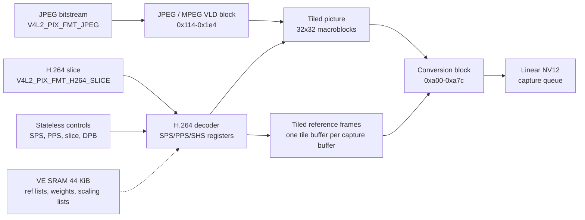

The F101 video engine (VE) is a hardware video decoder. On this chip it decodes JPEG and H.264; it has no encoder, and the HEVC, MPEG-2 and VP8 blocks that the cedrus driver supports on other Allwinner SoCs are not present. Linux drives it with the mainline cedrus driver, exposed as a V4L2 mem2mem decoder on `/dev/video1` plus a media controller on `/dev/media0`. Both decoders write linear NV12 pictures for the consumer, even though the engine decodes into a tiled internal layout.

| Item | Content |
| --- | --- |
| Driver files | `drivers/staging/media/sunxi/cedrus/cedrus.c`, `cedrus_hw.c`, `cedrus_video.c`, `cedrus_dec.c`, `cedrus_jpeg.c`, `cedrus_h264.c`, `cedrus_regs.h` |
| Compatible | `allwinner,sun252i-f101-video-engine` |
| Base | `0x01c0e000`, 8 KiB register window |
| Interrupt | PLIC 66, level high; one decoder interrupt line |
| Clocks and reset | `ahb`, `mod`, `ram`; module clock 300 MHz; reset `RST_BUS_VE` |
| SRAM | VE section at `0x00020000`-`0x0002afff` (44 KiB), claimed through the system controller |
| Kconfig | `CONFIG_MEDIA_SUPPORT`, `CONFIG_VIDEO_DEV`, `CONFIG_VIDEO_SUNXI_CEDRUS`, `CONFIG_MEDIA_CONTROLLER`, `CONFIG_SUNXI_SRAM`, `CONFIG_VIDEOBUF2_DMA_CONTIG` |
| Userspace | `/dev/video1` (V4L2 mem2mem decoder), `/dev/media0` (media requests) |

## The hardware

The engine is organised as a top block, a decoder section and a conversion block. The top block selects the decoder and manages the SRAM port; the decoder section contains the JPEG/MPEG VLD block, the H.264 decoder and their shared memories; the conversion block turns the tiled macroblock picture into the linear NV12 that the capture queue exposes.



### Top block and decoder numbering

The top of the register window is shared by all decoders. `VE_MODE` at `0x00` selects the decoder, the picture width flags and the memory write mode. The F101 variant has `CEDRUS_CAPABILITY_MODE_INVERTED`: the low three bits of the decoder field are inverted, so the driver XORs the value with `VE_MODE_INVERT`.

| Decoder | Base value | F101 value written |
| --- | --- | --- |
| MPEG/JPEG | `0x00` | `0x08` |
| H.264 | `0x01` | `0x09` |
| HEVC | `0x04` | `0x0c` |

Only JPEG and H.264 are enabled for the F101 variant, so only the first two rows are reachable. JPEG uses the MPEG decoder block because the JPEG entropy decoder lives there; `VE_MODE` is set to the MPEG family value and the JPEG VLD is triggered separately through the block at `0x114`.

`VE_BUF_CTRL` at `0x50` chooses where the H.264 line buffers live. The F101 writes `0x0a`, which is `VE_BUF_CTRL_INTRAPRED_EXT_RAM | VE_BUF_CTRL_DBLK_EXT_RAM`: both the intra-prediction and the deblocking line buffers are in external RAM. The addresses go to `VE_DBLK_DRAM_BUF_ADDR` (`0x54`) and `VE_INTRAPRED_DRAM_BUF_ADDR` (`0x58`). This is the setting that makes H.264 decode at all on this engine revision; the internal SRAM is not given to the decoder.

### SRAM section

The VE SRAM is an `mmio-sram` child of the system controller, 44 KiB at `0x00020000`. Claiming the section writes value 0 to bit 24 of the system control register at `0x03000004`; value 1 would give the area to the CPU. The boot loader also runs from `0x00020000`, so the area is free for the decoder only after Linux has started. The H.264 decoder uses it for the reference picture list, the reference lists 0 and 1, the 8x8 and 4x4 scaling lists and the prediction weight table. The driver writes those structures through the SRAM port:

- `VE_AVC_SRAM_PORT_OFFSET` selects a word offset;
- `VE_AVC_SRAM_PORT_DATA` writes one 32-bit word.

The offsets are fixed: prediction weights at `0x000`, the frame buffer list at `0x100`, reference list 0 at `0x190`, reference list 1 at `0x199`, the 8x8 scaling lists at `0x200` and `0x210`, and the 4x4 list at `0x220`.

### JPEG block

The JPEG decoder is a baseline JPEG entropy decoder. Software parses the marker segments (DQT, DHT, SOF0, SOS), builds the Huffman tables in the form the engine wants and loads them through `JPEG_HUFF_ADDR`/`JPEG_HUFF_DATA`. The engine then decodes the scan into tiled macroblocks at `JPEG_RECON_Y` and `JPEG_RECON_C`.

| Register | Offset | Role |
| --- | --- | --- |
| `JPEG_CTRL` | `0x114` | Interrupt enable and control |
| `JPEG_START` | `0x118` | Write `JPEG_START_DECODE` (14) to start |
| `JPEG_FORMAT` | `0x11b` | Byte `(chroma_sampling << 3) \| 3` |
| `JPEG_STATUS` | `0x11c` | Write 1 to clear, bit 0 is done |
| `JPEG_STREAM_ADDR` | `0x128` | Encoded data address, in the engine's word format |
| `JPEG_STREAM_OFFSET` | `0x12c` | Start of the scan, in bits |
| `JPEG_STREAM_LEN` | `0x130` | Scan length, in bits |
| `JPEG_STREAM_END` | `0x134` | Last byte of the input buffer |
| `JPEG_QTAB` | `0x180` | Quantisation table entry |
| `JPEG_MCU_SIZE` | `0x1b8` | MCU columns and rows, minus one |
| `JPEG_RESTART` | `0x1c0` | Restart interval |
| `JPEG_RECON_Y`, `JPEG_RECON_C` | `0x1cc`, `0x1d0` | Tiled output planes |
| `JPEG_HUFF_ADDR`, `JPEG_HUFF_DATA` | `0x1e0`, `0x1e4` | Huffman table port |

The driver accepts only 4:2:0 pictures, and only when the 32-aligned source size matches the capture size. Other samplings are parsed but rejected at setup. The Huffman tables may be omitted, in which case the standard tables are used. A restart interval is supported.

### H.264 block

The H.264 decoder is a stateless decoder: userspace parses the bitstream and passes SPS, PPS, slice parameters, decode parameters, scaling matrix and prediction weights as V4L2 controls attached to a media request. The driver turns them into the engine's own registers:

| Register group | Role |
| --- | --- |
| `VE_H264_SPS`, `VE_H264_PPS` | Sequence and picture parameters |
| `VE_H264_SHS`, `VE_H264_SHS2`, `VE_H264_SHS_QP` | Slice header, reference counts, deblocking, QP |
| `VE_H264_VLD_ADDR`, `VE_H264_VLD_LEN`, `VE_H264_VLD_OFFSET`, `VE_H264_VLD_END` | Slice bitstream window |
| `VE_H264_TRIGGER_TYPE` | Flush-bits and slice-decode triggers |
| `VE_H264_STATUS`, `VE_H264_CTRL` | Interrupt status and enable |
| `VE_H264_OUTPUT_FRAME_IDX` | Slot in the reference frame list |

Two F101 details matter. First, `VE_H264_VLD_END` must hold the last byte of the whole input buffer, not the end of the slice; with the end at the slice the decoder stops after the first burst and leaves the picture unfinished. Second, `VE_H264_CTRL` keeps bit 10 set between pictures because that is the reset value of this engine revision. The trigger also sets bit 6 of register `0x1c` before it starts the slice decode.

The input format is `V4L2_PIX_FMT_H264_SLICE` with `V4L2_STATELESS_H264_DECODE_MODE_SLICE_BASED` and `V4L2_STATELESS_H264_START_CODE_NONE`. `START_CODE_NONE` means the buffer starts at the NAL header, not at a `00 00 01` start code. The test program strips the start codes itself and queues one slice NAL per request.

### Conversion block

The conversion block is the same for JPEG and H.264. It reads the tiled picture and writes two linear planes: luma at the destination address and chroma at `destination + width * height`. The driver programs it through a fixed register group:

| Register | Offset | Value or role |
| --- | --- | --- |
| `CV_SIZE` | `0xa00` | Macroblock columns and rows |
| `CV_STRIDE` | `0xa04` | Source strides |
| `CV_ENABLE` | `0xa08` | `0x50080001`, bit 0 enables |
| `CV_MODE` | `0xa0c` | `1` starts the conversion |
| `CV_STATUS` | `0xa10` | Bit 0 done |
| `CV_LINE` | `0xa14` | Line count |
| `CV_CONFIG` | `0xa2c` | Configuration |
| `CV_OUT_Y`, `CV_OUT_C` | `0xa70`, `0xa74` | Linear output planes |
| `CV_IN_Y`, `CV_IN_C` | `0xa78`, `0xa7c` | Tiled input planes |

Before starting the block the driver writes `VE_MODE` with value 2, the "top mode" that selects the conversion path, and resets the top block. The conversion is a second stage of the same job, not a separate V4L2 buffer.

## Devicetree

The SoC node and its SRAM section:

```text
ve: video-codec@1c0e000 {
	compatible = "allwinner,sun252i-f101-video-engine";
	reg = <0x0 0x01c0e000 0x0 0x2000>;
	interrupts = <66 IRQ_TYPE_LEVEL_HIGH>;
	clocks = <&ccu CLK_BUS_VE>,
		 <&ccu CLK_VE>,
		 <&ccu CLK_BUS_VE_M>;
	clock-names = "ahb", "mod", "ram";
	resets = <&ccu RST_BUS_VE>;
	allwinner,sram = <&ve_sram_section 1>;
	status = "disabled";
};

syscon: syscon@3000000 {
	compatible = "allwinner,sun252i-f101-system-control";
	reg = <0x0 0x03000000 0x0 0x1000>;
	#address-cells = <1>;
	#size-cells = <1>;
	ranges = <0x0 0x0 0x0 0x40000000>;

	ve_sram: sram@20000 {
		compatible = "mmio-sram";
		reg = <0x20000 0xb000>;
		#address-cells = <1>;
		#size-cells = <1>;
		ranges = <0 0x20000 0xb000>;

		ve_sram_section: sram-section@0 {
			compatible = "allwinner,sun252i-f101-sram-ve";
			reg = <0x0 0xb000>;
		};
	};
};
```

The board enables the engine:

```text
&ve {
	status = "okay";
};
```

The binding is `Documentation/devicetree/bindings/media/allwinner,sun4i-a10-video-engine.yaml`, which lists the F101 compatible and the required `allwinner,sram` property.

## Kconfig

```text
CONFIG_MEDIA_SUPPORT=y
CONFIG_MEDIA_SUPPORT_FILTER=y
CONFIG_MEDIA_PLATFORM_SUPPORT=y
CONFIG_STAGING=y
CONFIG_STAGING_MEDIA=y
CONFIG_VIDEO_DEV=y
CONFIG_VIDEO_SUNXI=y
CONFIG_VIDEO_SUNXI_CEDRUS=y
CONFIG_MEDIA_CONTROLLER=y
CONFIG_SUNXI_SRAM=y
CONFIG_VIDEOBUF2_DMA_CONTIG=y
```

The options are set in `arch/riscv/configs/sun252i_f101_yuzukineko_defconfig`. `CONFIG_VIDEO_SUNXI_CEDRUS` is a tristate and selects `MEDIA_CONTROLLER`, `SUNXI_SRAM`, `VIDEOBUF2_DMA_CONTIG` and `V4L2_MEM2MEM_DEV`. The driver is in staging, so `CONFIG_STAGING` and `CONFIG_STAGING_MEDIA` are needed as well.

## Driver internals

### Variant and probe

The F101 variant advertises three capabilities and a 300 MHz module clock:

```c
static const struct cedrus_variant sun252i_f101_cedrus_variant = {
	.capabilities	= CEDRUS_CAPABILITY_MODE_INVERTED |
			  CEDRUS_CAPABILITY_JPEG_DEC |
			  CEDRUS_CAPABILITY_H264_DEC,
	.mod_rate	= 300000000,
};
```

The probe requests the interrupt, initialises the optional reserved memory, claims the SRAM section, gets the three clocks and the reset, maps the registers and sets the module clock. The clock is 300 MHz because 512 MHz hangs the engine on this board. The driver enables runtime PM; the suspend path disables the RAM, module and AHB clocks and asserts the reset, and the resume path reverses that order.

The video device is registered with `VFL_TYPE_VIDEO` and the media device with `v4l2_m2m_register_media_controller()`. The media device is what makes stateless requests possible: `MEDIA_IOC_REQUEST_ALLOC` creates a request file descriptor, controls and buffers are attached to it, and `MEDIA_REQUEST_IOC_QUEUE` submits them atomically.

### Queues and buffers

Both queues are single-planar and use `vb2_dma_contig_memops`. `queue_setup` takes the size from the current format and accepts one plane. `buf_prepare` checks the size and, for capture buffers, sets the payload to `sizeimage`.

The output format decides the codec and whether requests are needed:

| Output format | Codec | Requests |
| --- | --- | --- |
| `V4L2_PIX_FMT_JPEG` | `cedrus_dec_ops_jpeg` | Not required |
| `V4L2_PIX_FMT_H264_SLICE` | `cedrus_dec_ops_h264` | Required |

`cedrus_s_fmt_vid_out_p()` sets `vq->requires_requests` to true for every format except JPEG, and installs the matching codec operations. Changing the output format is refused while either queue is busy.

### Capture format and alignment

On the F101 both codecs are "converted": `cedrus_cap_converted()` is true for JPEG and for H.264 when the variant has `CEDRUS_CAPABILITY_MODE_INVERTED`. For a converted codec only `V4L2_PIX_FMT_NV12` is usable on the capture queue, and `try_fmt` forces the macroblock alignment:

- `bytesperline = ALIGN(source_width, 32)`;
- `width = bytesperline`;
- `height = ALIGN(source_height, 32)`;
- `sizeimage = stride * height * 3 / 2`.

The visible part is smaller than the buffer when the source is not a multiple of 32. `VIDIOC_G_SELECTION` reports it:

| Selection target | Rectangle |
| --- | --- |
| `V4L2_SEL_TGT_COMPOSE` | `0,0,source_width,source_height` |
| `V4L2_SEL_TGT_COMPOSE_DEFAULT` | Same as compose |
| `V4L2_SEL_TGT_COMPOSE_BOUNDS` | `0,0,capture_width,capture_height` |
| `V4L2_SEL_TGT_COMPOSE_PADDED` | Same as bounds |

A player that copies the picture must use the compose width and height and the capture stride, not the capture width and height.

### JPEG job

The JPEG path is stateful and needs no media request. A job has two stages, each ending with an interrupt:

1. Software parses the JPEG markers and loads tables, stream address, stream length and the tiled output addresses.
2. `cedrus_jpeg_trigger()` writes 14 to `JPEG_START`.
3. The decoder interrupt sets `converting`, starts the conversion block and returns `CEDRUS_IRQ_CONTINUE`.
4. The conversion interrupt completes the capture buffer.

The tile buffer is allocated once per streaming session in `cedrus_jpeg_start()`, with the luma plane at `width * height` and a chroma plane of `2 * ALIGN((width + 1) / 2, 16) * ALIGN((height + 1) / 2, 32)`. The output buffer is the V4L2 capture buffer.

### H.264 job

The H.264 path is stateless. `cedrus_device_run()` copies the request controls into the per-context control handler, then `cedrus_h264_setup()` programs the engine:

1. Select the H.264 decoder and reset the F101 output registers.
2. Write the extra buffers: picture info and neighbour info.
3. Write the scaling lists.
4. Build the reference frame list from the DPB and write it to SRAM.
5. Allocate or reuse the tiled output buffer for this capture buffer.
6. Write SPS, PPS, slice header, QP, reference lists and prediction weights.
7. Clear status, enable the slice-decode, decode-error and VLD-data-request interrupts, and keep bit 10 set.
8. Trigger the slice decode; the engine writes the tiled picture, the interrupt starts the conversion block, and the second interrupt completes the buffer.

Each capture buffer owns a tile buffer and a motion-vector/column buffer. The tile buffer is allocated lazily by `cedrus_h264_tile_alloc()` when the buffer is first used. The deblocking and intra-prediction line buffers are per-context and their sizes use the vendor formulas for the F101:

- deblock: `DIV_ROUND_UP(width, 16) * 1024`;
- intra prediction: `16 KiB + DIV_ROUND_UP(width, 16) * 546`.

The picture info buffer starts at `18 * 0x1000` bytes, grows by `source_height * 2 * 64`, and is never smaller than 130 KiB; the neighbour info buffer is 32 KiB.

### Interrupts and watchdog

The single interrupt line is shared by the decoder and the conversion block. `cedrus_irq()` cancels the watchdog, asks the current codec for its status and handles three cases:

- `CEDRUS_IRQ_OK`: the job is done;
- `CEDRUS_IRQ_CONTINUE`: one stage finished, re-arm the watchdog and wait for the next interrupt;
- `CEDRUS_IRQ_ERROR`: complete the buffers with `VB2_BUF_STATE_ERROR`.

The watchdog fires after 2 seconds, logs `frame processing timed out!`, resets the engine and completes the job as an error. The JPEG path uses the same watchdog around both stages.

### Cache and PBMT

The C906/C907 cores run Sv32, which has no PBMT, so DMA buffers are not automatically uncached. The decoder writes the capture buffers in hardware. The tests use MMAP buffers from the DMA allocator, which are not marked non-coherent on this queue; a dma-buf import is marked non-coherent and the `vb2_dma_contig` prepare and finish memops synchronise it around the job. The H.264 line buffers and tile buffers are allocated with `dma_alloc_attrs()` and are intentionally mapped so that the kernel clears them, because the decoder expects the line buffers to start zeroed.

## Userspace

### Devices

`/dev/video1` is the decoder. With G2D at `/dev/video0`, the two video nodes are assigned in probe order; confirm with:

```sh
cat /sys/class/video4linux/video*/name
```

The decoder reports driver `cedrus` and card `cedrus`. `/dev/media0` is the media controller for the same device; it is used only for request allocation and queueing.

### Stateless controls

The H.264 controls are the standard V4L2 stateless H.264 set:

| Control | Content |
| --- | --- |
| `V4L2_CID_STATELESS_H264_SPS` | Sequence parameters, 4:2:0 8-bit only |
| `V4L2_CID_STATELESS_H264_PPS` | Picture parameters |
| `V4L2_CID_STATELESS_H264_SLICE_PARAMS` | Slice header fields |
| `V4L2_CID_STATELESS_H264_DECODE_PARAMS` | DPB entries, frame number, POC, flags |
| `V4L2_CID_STATELESS_H264_SCALING_MATRIX` | Scaling lists |
| `V4L2_CID_STATELESS_H264_PRED_WEIGHTS` | Prediction weight table |
| `V4L2_CID_STATELESS_H264_DECODE_MODE` | Fixed to slice-based |
| `V4L2_CID_STATELESS_H264_START_CODE` | Fixed to none |

`cedrus_try_ctrl()` rejects any SPS that is not 4:2:0, has mismatched luma and chroma bit depths, or has a bit depth other than 8. The profile control accepts Baseline, Main and High; Extended is masked out.

### Example: decode a JPEG

The following program decodes one baseline JPEG into linear NV12. It uses the stateful path: no media request, one output buffer and one capture buffer. The output format must carry the picture's real width and height, because the capture format is derived from it; the example assumes a 1920x1080 JPEG, so change the two numbers for another picture.

```c
#include <stdio.h>
#include <stdlib.h>
#include <string.h>
#include <fcntl.h>
#include <unistd.h>
#include <errno.h>
#include <poll.h>
#include <sys/ioctl.h>
#include <sys/mman.h>
#include <sys/stat.h>
#include <linux/videodev2.h>

static int xioctl(int fd, unsigned long req, void *arg)
{
	int ret = ioctl(fd, req, arg);

	if (ret)
		perror("ioctl");
	return ret;
}

int main(int argc, char **argv)
{
	enum v4l2_buf_type out = V4L2_BUF_TYPE_VIDEO_OUTPUT;
	enum v4l2_buf_type cap = V4L2_BUF_TYPE_VIDEO_CAPTURE;
	struct v4l2_format f;
	struct v4l2_requestbuffers rq;
	struct v4l2_buffer b;
	struct stat st;
	void *src, *dst;
	int fd, i, size;

	if (argc != 2) {
		fprintf(stderr, "usage: jpegdec picture.jpg\n");
		return 1;
	}
	fd = open("/dev/video1", O_RDWR);
	if (fd < 0) {
		perror("video1");
		return 1;
	}

	memset(&f, 0, sizeof(f));
	f.type = out;
	f.fmt.pix.pixelformat = V4L2_PIX_FMT_JPEG;
	f.fmt.pix.width = 1920;
	f.fmt.pix.height = 1080;
	f.fmt.pix.sizeimage = 2 * 1024 * 1024;
	xioctl(fd, VIDIOC_S_FMT, &f);

	memset(&f, 0, sizeof(f));
	f.type = cap;
	f.fmt.pix.pixelformat = V4L2_PIX_FMT_NV12;
	f.fmt.pix.width = 1920;
	f.fmt.pix.height = 1080;
	xioctl(fd, VIDIOC_S_FMT, &f);
	printf("capture %ux%u stride %u size %u\n", f.fmt.pix.width,
	       f.fmt.pix.height, f.fmt.pix.bytesperline, f.fmt.pix.sizeimage);

	for (i = 0; i < 2; i++) {
		enum v4l2_buf_type t = i ? cap : out;

		memset(&rq, 0, sizeof(rq));
		rq.count = 1;
		rq.type = t;
		rq.memory = V4L2_MEMORY_MMAP;
		xioctl(fd, VIDIOC_REQBUFS, &rq);
	}

	memset(&b, 0, sizeof(b));
	b.type = out;
	b.memory = V4L2_MEMORY_MMAP;
	b.index = 0;
	xioctl(fd, VIDIOC_QUERYBUF, &b);
	src = mmap(NULL, b.length, PROT_READ | PROT_WRITE, MAP_SHARED, fd, b.m.offset);

	memset(&b, 0, sizeof(b));
	b.type = cap;
	b.memory = V4L2_MEMORY_MMAP;
	b.index = 0;
	xioctl(fd, VIDIOC_QUERYBUF, &b);
	dst = mmap(NULL, b.length, PROT_READ | PROT_WRITE, MAP_SHARED, fd, b.m.offset);

	stat(argv[1], &st);
	{
		FILE *fp = fopen(argv[1], "rb");

		if (!fp || (int)fread(src, 1, st.st_size, fp) != st.st_size) {
			perror("read");
			return 1;
		}
		fclose(fp);
	}

	memset(&b, 0, sizeof(b));
	b.type = out;
	b.memory = V4L2_MEMORY_MMAP;
	b.index = 0;
	b.bytesused = st.st_size;
	xioctl(fd, VIDIOC_QBUF, &b);

	memset(&b, 0, sizeof(b));
	b.type = cap;
	b.memory = V4L2_MEMORY_MMAP;
	b.index = 0;
	xioctl(fd, VIDIOC_QBUF, &b);

	xioctl(fd, VIDIOC_STREAMON, &out);
	xioctl(fd, VIDIOC_STREAMON, &cap);

	{
		struct pollfd p = { .fd = fd, .events = POLLIN | POLLOUT };

		poll(&p, 1, 3000);
		memset(&b, 0, sizeof(b));
		b.type = cap;
		b.memory = V4L2_MEMORY_MMAP;
		xioctl(fd, VIDIOC_DQBUF, &b);
		if (b.flags & V4L2_BUF_FLAG_ERROR) {
			printf("decode error\n");
			return 1;
		}
		printf("decoded buffer %u, %u bytes\n", b.index, b.bytesused);
		size = b.bytesused;
	}

	return size > 0 ? 0 : 1;
}
```

The program prints the aligned capture format that the driver chose. For a source whose width and height are already multiples of 32, the numbers are the source size and a stride equal to the width; otherwise both are rounded up.

### Example: decode H.264 with requests

The test program `fel-stage/src/h264t.c` is a complete stateless client. The essential sequence is:

1. Set `V4L2_CID_STATELESS_H264_DECODE_MODE` to slice-based and `V4L2_CID_STATELESS_H264_START_CODE` to none with `VIDIOC_S_EXT_CTRLS` on the current values.
2. Set the output format to `V4L2_PIX_FMT_H264_SLICE` and the capture format to `V4L2_PIX_FMT_NV12`.
3. Allocate one output buffer and `NBUF` capture buffers; the test uses four.
4. For every NAL of type 1 or 5, parse SPS/PPS and the slice header, fill the six controls, allocate a media request with `MEDIA_IOC_REQUEST_ALLOC`, and set the controls with `V4L2_CTRL_WHICH_REQUEST_VAL` and `request_fd`.
5. Queue the slice buffer with `V4L2_BUF_FLAG_REQUEST_FD`, queue a free capture buffer, and call `MEDIA_REQUEST_IOC_QUEUE` on the request fd.
6. `poll()` the request fd for `POLLPRI`, then dequeue both buffers.
7. Copy the visible rectangle using the capture stride and compare its CRC with the expected value.

The control set is attached to the request, not to the context, so two requests can be in flight without the parameters of one overwriting the other. The driver's request validator accepts exactly one buffer per request, so the test sends one slice per request.

### Worked example: the CRC test

Build the program on the host:

```sh
build-rv32/host/bin/riscv32-buildroot-linux-musl-gcc -static -O2 \
	-o h264t fel-stage/src/h264t.c
```

The board has no network. The program and the stream are written into the reserved memory at `0x41e00000` with `xfel`, then copied out with `/dev/mem`. This uses the test devicetree, which reserves 2 MiB at `0x41e00000`; the production NOR devicetree does not describe that reservation.

```bat
xfel write 0x41e00000 h264t
xfel write 0x41f00000 test.h264
```

On the board, `0x41e00000` is 1054 MiB, so one megabyte is read with:

```sh
dd if=/dev/mem of=/tmp/h264t bs=1M skip=1054 count=1
dd if=/dev/mem of=/tmp/test.h264 bs=1M skip=1055 count=1
chmod +x /tmp/h264t
/tmp/h264t /tmp/test.h264
```

The two-megabyte reserved region is at `0x41e00000`, so the program must be smaller than the 1 MiB gap to the stream. The exact `count` should be the file size rounded up to a megabyte; reading a fixed megabyte is only safe because both files fit.

The program prints a line per stage and ends with a verdict:

```text
stream <width>x<height>, <n> frames
SPS profile <profile_idc> level <level_idc> poc_type <type> refs <n> <w>x<h> mbs
PPS cabac <0|1> qp <qp> deblock_ctl <0|1>
capture <aligned width>x<aligned height> stride <stride> size <size>
H264 result: <ok> frames ok, <bad> bad
H264 PASS
```

`H264 PASS` means every frame's luma CRC matched the value generated on the host by ffmpeg. The verified set is Baseline, Main with CABAC and High with 8x8dct, using I and P frames. B frames, multiple slices per picture, MBAFF and weighted prediction have not been tested.

### Playback pipeline

`fel-stage/src/hplay.c` chains the decoder to the display:

1. cedrus decodes H.264 into NV12 capture buffers.
2. The capture buffers are exported as dma-buf file descriptors with `VIDIOC_EXPBUF`.
3. G2D imports them as `V4L2_MEMORY_DMABUF` source buffers and writes XBGR32 into the fbcon framebuffer.
4. The fbcon framebuffer is obtained through `DRM_IOCTL_MODE_GETCRTC`, `DRM_IOCTL_MODE_GETFB` and `DRM_IOCTL_PRIME_HANDLE_TO_FD`, then passed to G2D as a dma-buf file descriptor.

No libdrm is present, so the DRM side uses the raw ioctls described in the [display page](display.md). The program scales to the panel size with G2D and prints a per-frame timing summary:

```text
shown <n> frames, g2d <x.x> ms/frame
PLAY DONE
```

`vplay.c` follows the same pattern for MJPEG.

## Limitations

| Limitation | Detail |
| --- | --- |
| No encoder | The F101 has a decoder only; there is no H.264 or JPEG encoder |
| Two codecs | Only JPEG and H.264 are enabled for this variant; HEVC, MPEG-2 and VP8 are absent |
| H.264 profile coverage | I and P frames verified for Baseline, Main CABAC and High 8x8dct; B frames, multi-slice, MBAFF and weighted prediction untested |
| JPEG sampling | Only baseline 4:2:0; other samplings and progressive JPEG are rejected |
| Output format | Linear NV12 only; the tiled NV12_32L32 format is not exposed for the converted codecs |
| Alignment | Capture is 32-aligned; the visible rectangle comes from the compose selection |
| No scaling | The decoder does not scale; use G2D after decoding |
| One slice per request | The media request validator accepts one buffer per request |
| Clock | 300 MHz; 512 MHz hangs the engine |
| Size | Driver maximum 4096 x 2304, minimum 16 x 16 |

## Troubleshooting

| Symptom | Cause | Fix |
| --- | --- | --- |
| No `/dev/video1` | The node is disabled, cedrus is not built, or the SRAM claim failed | Enable `&ve`, `CONFIG_VIDEO_SUNXI_CEDRUS`, and check `dmesg` for `Failed to claim SRAM` |
| `VIDIOC_S_FMT` on capture returns `V4L2_PIX_FMT_NV12_32L32` only | The variant is not recognised as converted | Check the compatible string and that the F101 variant is matched |
| H.264 output is shifted or the bottom is missing | The capture copy ignored the compose rectangle | Use compose width and height with the capture stride |
| H.264 job times out | `VE_BUF_CTRL` is not `0x0a`, or the VLD end address is wrong | Use the F101 variant; verify the buffer end is the last byte |
| JPEG rejected with `-EINVAL` | Not 4:2:0, or the 32-aligned size does not match the capture format | Use a 4:2:0 baseline JPEG and let `try_fmt` set the capture size |
| Requests time out | More than one buffer attached, or the request was not queued | Queue exactly one buffer and call `MEDIA_REQUEST_IOC_QUEUE` |
| Capture buffer has coloured noise | Cache not synchronised between the decoder and the consumer | Use the MMAP path that `vb2_dma_contig` synchronises, or a dma-buf consumer with begin/end CPU access |
| Corruption only at 252 MHz PSRAM | PSRAM instability affects the decoder's reference frames | Use the 192 MHz PSRAM setting |

## See also

- [Linux development](../index.md)
- [Display - DE, TCON, DSI and the panel](display.md)
- [G2D - 2D graphics acceleration](g2d.md)
- [MBUS and SRAM](mbus-sram.md)
- [Prebuilt images](../linux-prebuilt.md)
