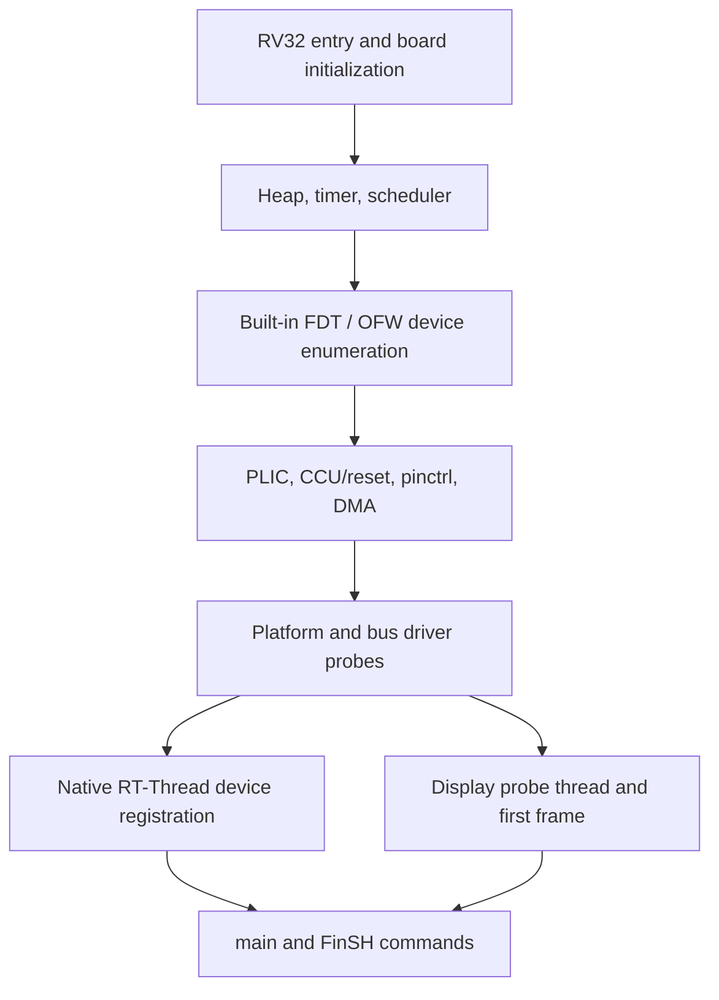

## Initialization sequence



`board/SConscript` preprocesses `dts/sun252iw2-${SUN252I_BOARD}.dts`, compiles the DTB and embeds it through `board/builtin_fdt.S`. This is not Zephyr compile-time device generation. Drivers match `compatible` at runtime and obtain clocks, resets, interrupts, pins and DMA from the RT-Thread device model. The display initializes in its own thread; a registered platform device does not immediately guarantee a non-NULL framebuffer.

## Where code belongs

| Path relative to BSP | Responsibility |
| --- | --- |
| `board/` | Startup, console, heap and embedded DTB |
| `dts/` | Board wiring and SoC resources |
| `drivers/` | F101 device-model drivers and public BSP headers |
| `applications/*.c` | Application startup and small FinSH examples |
| `applications/apps/` | USB CDC, USB display and MP4 applications |
| `applications/tests/` | Driver regression commands |
| `applications/bench/` | Explicitly enabled performance commands |

## Add and invoke an example

Save one complete C listing from a driver page as `applications/demo_<name>.c`. `applications/SConscript` already collects top-level C files and the driver groups export their include paths. Build and boot again, then invoke the name registered by `MSH_CMD_EXPORT`. Run examples individually; they may change framebuffer contents, backlight or device ownership. The complete C listings were cross-compiled and linked against this BSP. They were not all executed on the board; board results belong to the separately identified regression commands.

```c
#include <rtthread.h>
#include <rtdevice.h>
#define DBG_TAG "demo"
#define DBG_LVL DBG_INFO
#include <rtdbg.h>

static int demo_devices(int argc, char **argv)
{
    const char *names[] = {"uart1", "i2c1", "touch0", "spi0", "rtc", "sd0"};
    for (rt_size_t i = 0; i < sizeof(names) / sizeof(names[0]); ++i)
        LOG_I("%s: %s", names[i], rt_device_find(names[i]) ? "present" : "absent");
    return 0;
}
MSH_CMD_EXPORT(demo_devices, Inspect board devices);
```

```text
msh /> demo_devices
msh /> list_device
msh /> free
```

## Return values and ownership

Check the contract of each subsystem. `rt_i2c_transfer` returns a message count; `rt_device_read` on `sd0` returns sectors; serial/audio reads return bytes; `rt_spi_send_then_recv` returns an error code. BSP graphics/decoder APIs often return negative POSIX errno, while native drivers use `-RT_EINVAL` and other RT-Thread errors. Do not compare all calls against a byte count or assume their numeric error values match.

Use 64-byte-aligned buffers for DMA and cache-line isolation. Pair `rt_malloc_align` with `rt_free_align`. Cache cleaning makes CPU writes visible to hardware; invalidation makes hardware writes visible to CPU. A successful submit does not transfer buffer ownership. Keep buffers alive until completion and until any display plane has stopped scanning them. Avoid logging, sleeping or heap allocation in interrupt callbacks; signal a worker or queue a small event instead.

## Native logging

Define `DBG_TAG` and `DBG_LVL` before including `rtdbg.h`. `LOG_E/W/I/D` append their own line endings. With `RT_USING_ULOG=y` they route through ulog; otherwise they use the standard debug implementation. Display tags include `display`, `display.core`, `display.dsi` and `display.de-rcq`. Change the relevant source tag level to expose debug messages; there is no separate display printf system.
