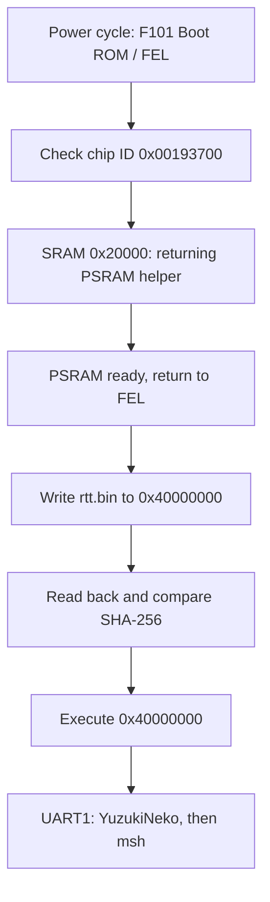

All build commands below run from `rt-thread/bsp/allwinner-hal/sun252iw2` with the [environment](setup.md) active. The board selector controls wiring; the Kconfig seed controls features. Select both deliberately.

## Resolve Kconfig and build

```sh
export SUN252I_BOARD=yuzukineko
python3 - <<'CONFIG'
from kconfiglib import Kconfig
k = Kconfig("Kconfig")
k.load_config("rtconfig.defconfig")
k.write_config(".config")
CONFIG
scons --useconfig=.config
scons -j8
```

`kconfiglib` resolves defaults and dependencies; `scons --useconfig=.config` generates `rtconfig.h`. Passing a sparse seed directly to `--useconfig` skips that resolution. Use `scons --menuconfig` to edit the solved configuration; never edit the generated header manually. Stop if the actual SCons exit status is nonzero. The outputs are `rtthread.elf`, `rtthread.map` and `rtt.bin` in the BSP directory.

| Seed / board | Purpose |
| --- | --- |
| `rtconfig.defconfig` / `yuzukineko` | Normal image; tests and benchmarks off |
| `test_defconfig` / `yuzukineko` | Driver regression commands |
| `pio_window_defconfig` / `yuzukineko` | SD PIO, UI divisor 2 and 512×384 output window |
| `test_defconfig` / `yuzukineko-spif` | Separate SPIF controller; SPI0 disabled |
| `usbdisp_defconfig` / `usbdisp` | Legacy EVB wiring and trimmed USB display; not for YuzukiNeko |

## Boot flow and addresses



The RAM image is linked at `0x40000000`. The helper runs in SRAM at `0x20000`; NOR offset `0x20000` is a different address space and contains development sampling parameters. This RAM procedure writes neither the NOR boot area nor the application partition.

## Build a returning PSRAM helper

Use current [`YuzukiHD/SyterKit`](https://github.com/YuzukiHD/SyterKit). The SoC eFEX application initializes PSRAM and returns to ROM; a normal SRAM boot application does not provide this return path. Its UART defaults must be UART1 PB0/PB1 and its memory parameters must match the board.

```sh
cd ~/f101-rtt
git clone https://github.com/YuzukiHD/SyterKit.git
cd SyterKit
make O=out/rtt-efex sun252iw2_rv32_efex_defconfig
make O=out/rtt-efex CROSS_COMPILE="$RTT_EXEC_PATH/riscv64-unknown-elf-" -j8
ls -l out/rtt-efex/build/soc/sun252iw2/app_efex/init_psram/init_psram_efex.bin
```

The tested configuration detected a 16 MiB APS128M at 252 MHz. Inspect the helper build status, source revision and hash. Do not assume `xfel ddr` presets or old loader files initialize the same memory correctly.

## Download and verify

Power-cycle into FEL before every run. Check the chip identity; F101 is `0x00193700` with scratchpad `0x00020000`. If several boards are attached, verify that this USB device disappears when the target is powered off. A `0x00191800` device is a different target.

```sh
xfel version
xfel write 0x20000 init_psram_efex.bin
xfel exec 0x20000
xfel version
xfel write 0x40000000 rtt.bin
python3 -c 'from pathlib import Path; print(hex(Path("rtt.bin").stat().st_size))'
```

Copy the printed size into the read command. Run each command separately, inspect its output, and compare the two hashes before executing. On Windows use `xfel.exe` and `Get-FileHash` for the same files.

```sh
xfel read 0x40000000 <size-in-hex> rtt-readback.bin
sha256sum rtt.bin rtt-readback.bin
xfel exec 0x40000000
```

## Confirm the board and console

```text
Machine model: YuzukiHD YuzukiNeko
Console: uart1 (serial@2500400)
```

These two lines are the observed board identity, not a full expected transcript. Wait for a fresh `msh />` prompt. FEL USB disappearing after exec only means ROM handed over control; it does not prove that the application booted. If the log says EVB or UART3, rebuild the correct DTS and check the helper UART and physical serial wiring.

Keep RAM development as the default. A standalone NOR image requires a separately verified boot chain and layout; the Zephyr XIP application offset is not a generic RT-Thread image recipe. See [flash layout](../../boot/flash-layout.md) and [SPIF APIs](drivers/spif-nor.md).
