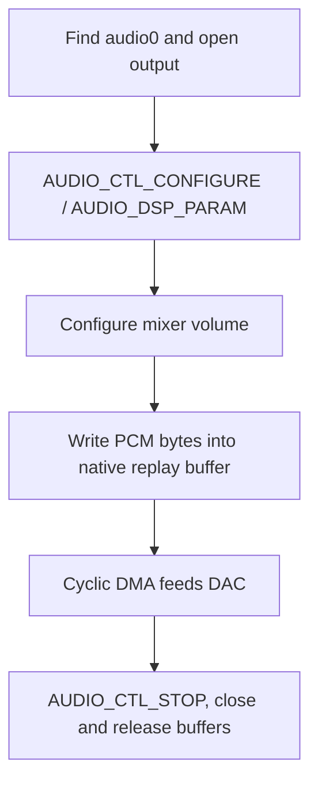

The on-chip codec uses native RT-Thread `audio0` (`drivers/audio/codec-sun252i.c`). The separate I2S0 and OWA/S/PDIF blocks expose BSP cyclic-ring functions in `i2s-sun252i.h` and `owa-sun252i.h`; they are not Zephyr I2S devices.

## Resources and supported configurations

Enable `RT_USING_AUDIO` and DMA, and retain the enabled `codec`, `i2s0` and `owa` DTS nodes, their clocks, resets, DMA requests and board pinctrl. Codec, I2S0 and OWA register windows begin at `0x02030000`, `0x02032000` and `0x02036000`. Check external amplifier routing separately from digital sample movement.

| Path | Current behavior |
| --- | --- |
| Codec playback | Mono/stereo, 16/24-bit configuration, 48 kHz and 44.1 kHz clock families |
| Codec capture | 48 kHz family, up to 48 kHz; verify actual channel packing |
| Playback DMA | Four blocks, 1200 stereo 16-bit frames / 4800 bytes per block in the tested mode |
| I2S0 | Master, 16-bit stereo samples in 32-bit slots, configurable supported rates |
| OWA | Current BSP ring helper uses 48 kHz stereo; RX DMA request remains unresolved |
| Clock sharing | Audio PLLs/resources must be coordinated; independent streams can conflict |

## Native codec call sequence



Use `struct rt_audio_caps` with `main_type=AUDIO_TYPE_OUTPUT` or `INPUT`, `sub_type=AUDIO_DSP_PARAM` and `udata.config` fields. Mixer controls use `AUDIO_TYPE_MIXER` with `AUDIO_MIXER_VOLUME` or `AUDIO_MIXER_MIC`. `rt_device_write/read` sizes are bytes, not frames. Playback starts through the native replay path; capture uses `AUDIO_CTL_START`. Stop and close before freeing caller-owned storage.

## Complete 48 kHz playback example

The command emits a low-amplitude 1 kHz square wave for roughly one second. Confirm the speaker/headphone route and run without the MP4 player or other audio owner. This demonstrates sample delivery, not audio quality.

```c
#include <rtthread.h>
#include <rtdevice.h>
static int demo_audio(int argc, char **argv)
{
    rt_device_t dev = rt_device_find("audio0");
    struct rt_audio_caps caps = {0};
    rt_int16_t *pcm = RT_NULL;
    int ret;
    if (!dev) return -RT_ENOSYS;
    ret = rt_device_open(dev, RT_DEVICE_OFLAG_WRONLY);
    if (ret) return ret;
    caps.main_type = AUDIO_TYPE_OUTPUT;
    caps.sub_type = AUDIO_DSP_PARAM;
    caps.udata.config.samplerate = 48000;
    caps.udata.config.channels = 2;
    caps.udata.config.samplebits = 16;
    ret = rt_device_control(dev, AUDIO_CTL_CONFIGURE, &caps);
    if (ret) goto out;
    caps.main_type = AUDIO_TYPE_MIXER; caps.sub_type = AUDIO_MIXER_VOLUME;
    caps.udata.value = 20;
    ret = rt_device_control(dev, AUDIO_CTL_CONFIGURE, &caps);
    if (ret) goto out;
    pcm = rt_malloc_align(4800, 64);
    if (!pcm) { ret = -RT_ENOMEM; goto out; }
    for (unsigned i = 0; i < 1200; ++i)
        pcm[2 * i] = pcm[2 * i + 1] = i % 48 < 24 ? 2000 : -2000;
    for (unsigned block = 0; block < 40; ++block)
        if (rt_device_write(dev, 0, pcm, 4800) != 4800) { ret = -RT_EIO; break; }
    rt_thread_mdelay(150);
out:
    rt_device_control(dev, AUDIO_CTL_STOP, RT_NULL);
    rt_device_close(dev);
    if (pcm) rt_free_align(pcm);
    return ret;
}
MSH_CMD_EXPORT(demo_audio, Play a short low-amplitude stereo tone);
```

## I2S and OWA ring interfaces

| Function family | Use |
| --- | --- |
| `sun252i_i2s_open(rate, period_frames, periods, loopback)` | Allocate driver-owned TX/RX rings, supported rate, 1–8 nonzero periods |
| `sun252i_i2s_tx_buffer()` / `rx_buffer()` | Ring pointers; each stereo 16-bit frame is 4 bytes |
| `sun252i_i2s_start()` / `stop()` / `close()` | Start DMA, stop, release rings and clock ownership |
| `sun252i_i2s_tx_periods()` / `rx_periods()` | Completed period counters |
| `sun252i_owa_open(period_frames, periods, loopback)` | Similar helper with fixed current rate |
| `sun252i_owa_*` | Matching ring, counter, start/stop/close calls |
| `sun252i_codec_dac_count/tx_blocks/tx_position` | Hardware/DMA progress for pacing and diagnosis |

Validate nonzero ring parameters in the caller; do not pass zero-length periods to these low-level helpers. Fill/clean TX before starting, start RX before TX, and never rewrite a DMA-owned period. Stop both directions before inspecting RX with CPU invalidation. Close after partial start failures. External I2S requires matching pinmux, MCLK/BCLK/LRCK, voltage and slot format; internal loopback cannot validate that wiring.

## Invocation and evidence

```text
demo_audio
test_audio
test_mic
test_i2s
test_owa
```

Save as `applications/demo_audio.c`. The regression checked codec DMA progression at 48/44.1 kHz and I2S internal movement. Audible output was not observed; microphone samples were zero. OWA RX received no DMA request and is explicitly SKIP, even when TX timing passes. Diagnose a silent speaker through analog routing/amplifier power after checking DAC count; diagnose missing RX through request routing and FIFO state separately.
