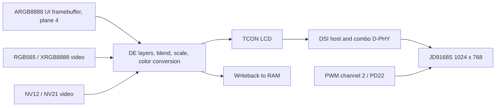

The display stack is in `drivers/display/`. Applications can use the small framebuffer/video-plane interface `drv_display.h`, or the explicit pipeline API in `hal/display/display_engine.h`. It is not a Zephyr `display_write` device or Linux DRM file descriptor.

## Pipeline and board specification



| Item | YuzukiNeko setting |
| --- | --- |
| Board DTS | `dts/sun252iw2-yuzukineko.dts` |
| Panel | JD9168S, 1024×768, RGB888, DSI lanes 0–3 |
| DSI pads | PD12–PD21, mux 4 |
| Pixel clock | 54 MHz |
| Horizontal sync / front / back | 10 / 40 / 40 pixels |
| Vertical sync / front / back | 8 / 12 / 21 lines |
| Nominal timing rate | 54 MHz / (1114 × 809), approximately 59.92 Hz |
| UI pixel layout | `0xAARRGGBB`, 4 bytes/pixel; little-endian memory B,G,R,A |
| Default UI allocation | 1024×768×4 = 3 MiB, dynamically allocated and 64-byte aligned |

`BSP_LCD_FB_DIV` reduces the allocated logical UI size by the divisor. `BSP_LCD_FB_WIDTH/HEIGHT` select an output window, not a new panel timing. With divisor 2 and a 512×384 window on this panel, the allocated framebuffer remains 512×384, while only its 256×192 source region is scaled into the 512×384 window. Query `lcd_width/height` instead of deriving a pitch from the visible panel.

## Panel adaptation and command sequences

Keep clocks, reset, pinctrl and endpoint graph in DTS. The panel node supplies dimensions, lane count, pixel format, mode flags, timing and power/init/exit sequences. The built-in board DTS contains the full JD9168S initialization; the short example below only illustrates encoding and is not a replacement for it.

```c
init-sequence = <SUNXI_CMD_DCS(120, 1, 0x11)
                 SUNXI_CMD_DCS(20, 1, 0x29)>;
```

`SUNXI_CMD_DCS(delay_ms, byte_count, bytes...)` uses an explicit byte count including the command byte. Include `dt-bindings/display/sunxi-display.h`; generic DSI writes use `SUNXI_CMD_GENERIC`. Convert the panel supplier's command table with exact counts and delays, including page-select and reset sequences. Link both ends of each endpoint. For RGB/LVDS panels change the encoder, pins and bus format as well as timing; enabling an old EVB RGB node conflicts with this board's touch/DSI wiring.

## Framebuffer and video interfaces

| Interface | Behavior / ownership |
| --- | --- |
| `lcd_framebuffer()` | BSP-owned ARGB8888 storage, NULL until ready; never free it |
| `lcd_width()` / `lcd_height()` | Allocated logical framebuffer size, not physical panel size |
| `lcd_flush()` | Clean the entire UI framebuffer cache; no copy or swap |
| `lcd_wait_vsync(timeout_ms)` | Wait for refresh; timeout is milliseconds |
| `lcd_fb_enable(bool)` | Toggle UI plane without freeing the UI buffer |
| `lcd_show_rgb(&img)` | RGB565 or XRGB8888, byte stride, aspect-preserving video plane |
| `lcd_show_yuv(&img)` | NV12/NV21, independent Y/UV byte strides, range/matrix selection |
| `lcd_hide_yuv()` | Disable the shared RGB/YUV video plane; UI remains available |

`crop_width/height=0` selects the full image. Crop coordinates are clamped; YUV crop is aligned to even coordinates and size. RGB `pixel_perfect=true` requests whole-number scaling and nearest sampling when the crop fits; otherwise ordinary aspect scaling applies. YUV `nv21`, `full_range` and `bt709` select chroma order, full/limited range and BT.709/601. These fields must match the producer, not the panel. A stride is bytes per row, including padding.

## Complete UI example

```c
#include <rtthread.h>
#include <rtdevice.h>
#include <drv_display.h>
static int demo_display(int argc, char **argv)
{
    rt_uint32_t *fb = lcd_framebuffer();
    rt_uint32_t w = lcd_width(), h = lcd_height();
    if (!fb || !w || !h) return -RT_ENOSYS;
    for (rt_uint32_t y = 0; y < h; ++y)
        for (rt_uint32_t x = 0; x < w; ++x)
            fb[y * w + x] = x < w / 2 ? 0xffff0000u : 0xff0000ffu;
    lcd_flush();
    int ret = lcd_fb_enable(RT_TRUE);
    if (!ret) ret = lcd_wait_vsync(100);
    return ret;
}
MSH_CMD_EXPORT(demo_display, Draw red and blue halves in the UI framebuffer);
```

## Complete RGB example with safe buffer lifetime

This pattern keeps the image allocated while the hardware scans it. `demo_rgb` shows a checkerboard; `demo_rgb_hide` disables the video plane before freeing it. Run `lcd` APIs from one owning thread or serialize them. The UI is made transparent so it cannot hide the video.

```c
#include <rtthread.h>
#include <rtdevice.h>
#include <string.h>
#include <drv_display.h>
static rt_uint16_t *rgb_demo_pixels;
static int demo_rgb_hide(int argc, char **argv)
{
    int ret = lcd_hide_yuv();
    if (!ret && rgb_demo_pixels)
    {
        rt_free_align(rgb_demo_pixels);
        rgb_demo_pixels = RT_NULL;
    }
    return ret;
}
static int demo_rgb(int argc, char **argv)
{
    if (!lcd_framebuffer()) return -RT_ENOSYS;
    if (rgb_demo_pixels) return -RT_EBUSY;
    rgb_demo_pixels = rt_malloc_align(160 * 120 * 2, 64);
    if (!rgb_demo_pixels) return -RT_ENOMEM;
    for (unsigned y = 0; y < 120; ++y)
        for (unsigned x = 0; x < 160; ++x)
            rgb_demo_pixels[y * 160 + x] = ((x / 8) ^ (y / 8)) & 1 ? 0xf800 : 0x07e0;
    rt_memset(lcd_framebuffer(), 0, lcd_width() * lcd_height() * 4);
    lcd_flush();
    rt_hw_cpu_dcache_ops(RT_HW_CACHE_FLUSH, rgb_demo_pixels, 160 * 120 * 2);
    struct lcd_rgb img = {
        .data = rgb_demo_pixels, .width = 160, .height = 120,
        .stride = 320, .pixel_perfect = RT_TRUE, .nonblock = RT_FALSE,
    };
    int ret = lcd_show_rgb(&img);
    if (ret) demo_rgb_hide(0, RT_NULL);
    return ret;
}
MSH_CMD_EXPORT(demo_rgb, Show an owned RGB565 video buffer);
MSH_CMD_EXPORT(demo_rgb_hide, Disable video before freeing its buffer);
```

## Explicit pipeline calls

Use `display_get_caps`, `display_get_plane_caps` and `display_get_mode` to discover capabilities. `display_get_state` reads current state; `display_pipeline_state_init` creates defaults. `display_submit` updates a pipeline, and `display_submit_ex(..., DISPLAY_SUBMIT_PARTIAL)` changes selected planes only. A normal submit waits for application; `DISPLAY_SUBMIT_NONBLOCK` returns before the refresh, so keep both old and new buffers alive until a confirmed latch. The low-level API also exposes `display_blank`, backlight, background, gamma, color adjustment, TCON test pattern, capture and statistics. Do not mix raw state submissions with an independent `lcd_*` owner.

## Logging, validation and diagnosis

All display sources call RT-Thread `rtdbg.h` macros with tags such as `display.core`, `display.dsi` and `display.de-rcq`; ulog is supported through the same calls. Enable debug level in the relevant module before rebuilding. A blank panel should be localized in order: framebuffer allocation, endpoint graph, DE/TCON running, DSI lane/format/mode, panel reset/init, then backlight. The TCON pattern distinguishes panel-link issues from pixel-buffer issues.

```text
demo_display
demo_rgb
demo_rgb_hide
test_display_features
usb_display_selftest
```

Save the C examples in separate application files. The board passed 22 internal pixel checks and 30-frame JPEG display self-tests with both logging backends. Full-frame writeback is reliable for these checks; a nonzero capture crop origin is a known issue. Intermediate-alpha colorimetry and physical screen appearance remain limited as documented in [verification](../testing.md).
