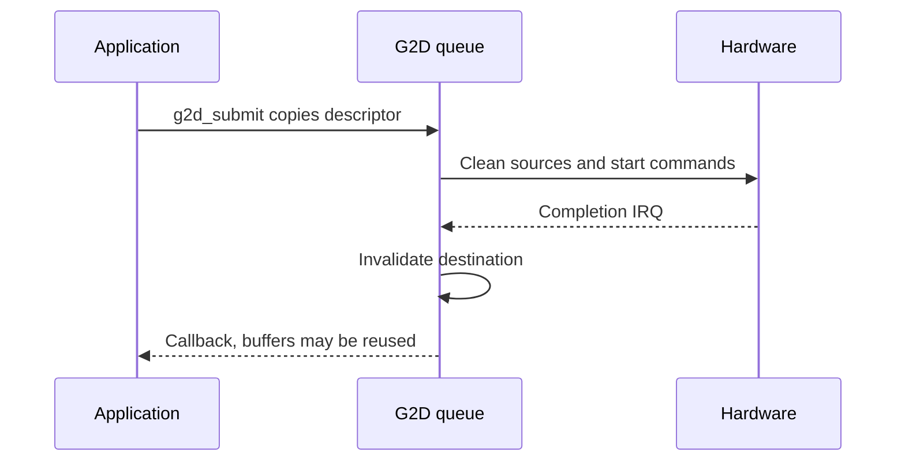

`drivers/g2d/g2d.h` exposes memory-to-memory fill, blit, scaling, rotation, format conversion and Porter-Duff composition. `g2d-sun252i.c` queues copied operation descriptors and completes work in submission order. It does not itself present pixels on the display.

## Configuration and surfaces

Enable `BSP_USING_G2D` and the board G2D node with its clock/reset/IRQ resources. Use `g2d_ready()` and `g2d_get_capabilities()` after initialization. Query source/destination format masks, maximum size, queue depth and rotation address/pitch alignment instead of assuming every format is writable. YUV formats NV12/NV21/I420/YUYV are source formats; RGB/ARGB variants provide the output routes.

| Type / field | Meaning |
| --- | --- |
| `g2d_surface.format` | Pixel format; word component order follows the enum |
| `width`, `height` | Full buffer dimensions in pixels |
| `plane[3]`, `pitch[3]` | Addresses and bytes/row; zero pitch means tightly packed |
| `g2d_rect` | Pixel origin and dimensions within a surface |
| `g2d_op` | Copied descriptor, but pixel buffers remain caller-owned |
| `G2D_FLAG_NO_CACHE_OPS` | Caller assumes all clean/invalidate obligations |
| `G2D_FLAG_YUV_FULL_RANGE` / `BT709` | Source color interpretation, default limited BT.601 |

## Operation interfaces

| Function | Use |
| --- | --- |
| `g2d_fill(dst, rect, color)` | Synchronous ARGB8888 color fill |
| `g2d_blit(src, sr, dst, dr, rotation, flags)` | Copy/convert/scale; rotation 0/90/180/270, then flips |
| `g2d_blend(fg, fr, bg, br, dst, dr, blend, flags)` | Foreground over background with selected Porter-Duff mode |
| `g2d_submit(&op)` | Queue asynchronously; callback in driver thread, do not block |
| `g2d_run(&op, timeout_ticks)` | Synchronous wait; `-EAGAIN` timeout does not cancel hardware |
| `g2d_last_hw_time_x100us()` | Hardware interval in 1/100 µs, excludes scheduling/cache |
| `g2d_set/get_clock_rate()` | Actual module clock; setter returns zero on failure |
| `g2d_set/get_ddr_limit()` | Engine bandwidth limit, separate from MBUS arbitration |

## Complete fill, scale and blend example

```c
#include <rtthread.h>
#include <rtdevice.h>
#include <g2d.h>
static int demo_g2d(int argc, char **argv)
{
    struct g2d_capabilities caps;
    struct g2d_rect sr = {0, 0, 64, 64}, dr = {0, 0, 128, 128};
    struct g2d_surface src = {.format = G2D_PIXFMT_ARGB8888, .width = 64, .height = 64};
    struct g2d_surface dst = {.format = G2D_PIXFMT_ARGB8888, .width = 128, .height = 128};
    struct g2d_blend blend = {
        .mode = G2D_BLEND_SRC_OVER, .fg_alpha_mode = G2D_ALPHA_GLOBAL, .fg_alpha = 128,
        .bg_alpha_mode = G2D_ALPHA_GLOBAL, .bg_alpha = 255,
    };
    int ret = g2d_get_capabilities(&caps);
    if (ret) return ret;
    src.plane[0] = rt_malloc_align(64 * 64 * 4, 64);
    dst.plane[0] = rt_malloc_align(128 * 128 * 4, 64);
    if (!src.plane[0] || !dst.plane[0]) { ret = -ENOMEM; goto out; }
    ret = g2d_fill(&src, &sr, 0xffff0000);
    if (!ret) ret = g2d_fill(&dst, &dr, 0xff0000ff);
    if (!ret) ret = g2d_blit(&src, &sr, &dst, &dr, G2D_ROTATE_0, 0);
    if (!ret) rt_kprintf("scaled pixel=%08x\n", *(rt_uint32_t *)dst.plane[0]);
    if (!ret) ret = g2d_fill(&dst, &dr, 0xff0000ff);
    if (!ret) ret = g2d_blend(&src, &sr, &dst, &dr, &dst, &dr, &blend, 0);
    if (!ret) rt_kprintf("first pixel=%08x\n", *(rt_uint32_t *)dst.plane[0]);
out:
    if (src.plane[0]) rt_free_align(src.plane[0]);
    if (dst.plane[0]) rt_free_align(dst.plane[0]);
    return ret;
}
MSH_CMD_EXPORT(demo_g2d, Fill scale and blend caller-owned surfaces);
```

## Async lifetime and validation



Save as `applications/demo_g2d.c`, invoke `demo_g2d`. Synchronous convenience calls wait to completion. For async work retain all source/destination buffers and callback state until completion, including after a wait timeout. Rotate 90/270 swaps the output dimensions; align every plane and pitch to the queried rotation constraints. Set premultiplication flags to match actual pixels, and use blend alpha modes deliberately.

`test_g2d` is part of the board regression. Historical throughput tables in the BSP predate this update and are not measurements of this example. To present the result, keep the destination buffer alive while a display plane references it, or blit into the persistent UI framebuffer and flush it; see [display](display.md).
