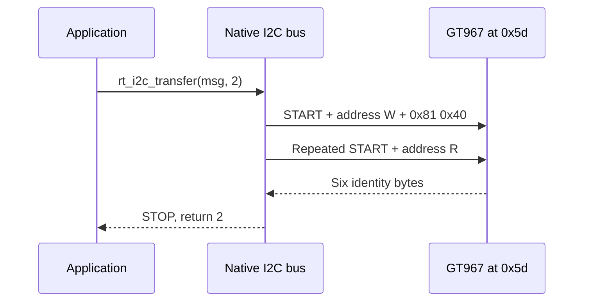

`drivers/i2c/i2c-sun252i.c` registers native `i2cN` buses. Transfers use `struct rt_i2c_msg` and `rt_i2c_transfer`; the driver polls controller status and supports write/read sequences with repeated START.

## Board configuration

```c
&i2c1 {
    status = "okay";
    clock-frequency = <400000>;
    touchscreen@5d {
        compatible = "goodix,gt967";
        reg = <0x5d>;
    };
};
```

This is a shortened node showing bus selection; retain the complete touch properties from the board DTS. I2C1 uses PD0/PD1, mux 4, and serves the GT967. I2C0 uses PE8/PE9; I2C2 is disabled. `CONFIG_RT_USING_I2C` and the device model are required. Supported `clock-frequency` values are exactly 100000, 200000 and 400000 Hz (default 100000); other values fail probe. External pull-ups and correct supply voltage are still necessary.

## Transaction contract

An address is the 7-bit address, not the address byte shifted left. `RT_I2C_WR`/`RT_I2C_RD` select direction. `rt_i2c_transfer(bus, messages, count)` succeeds only when it returns `count`, not zero or the number of data bytes. For a register read, keep register-address write and data read in one call to preserve the repeated START. Serialize device-specific multi-call protocols if several threads share the peripheral.

## Complete GT967 identity read

```c
#include <rtthread.h>
#include <rtdevice.h>
static int demo_i2c_id(int argc, char **argv)
{
    struct rt_i2c_bus_device *bus = rt_i2c_bus_device_find("i2c1");
    rt_uint8_t reg[] = {0x81, 0x40};
    rt_uint8_t id[6] = {0};
    struct rt_i2c_msg msg[2] = {
        {.addr = 0x5d, .flags = RT_I2C_WR, .len = sizeof(reg), .buf = reg},
        {.addr = 0x5d, .flags = RT_I2C_RD, .len = sizeof(id), .buf = id},
    };
    if (!bus) return -RT_ENOSYS;
    if (rt_i2c_transfer(bus, msg, 2) != 2) return -RT_EIO;
    rt_kprintf("GT product=%.4s firmware=%02x%02x\n", id, id[5], id[4]);
    return 0;
}
MSH_CMD_EXPORT(demo_i2c_id, Read GT967 identity with repeated START);
```

Save as `applications/demo_i2c.c` and invoke `demo_i2c_id`. The two register bytes are big-endian because that is the GT967 register protocol. This read does not consume touch coordinates or change its configuration. Generic I2C devices may use a one-byte register address or a different protocol.

## Bus sequence and verification



Run `test_i2c i2c1`: the board run passed five checks at 400 kHz and found `0x5d`. A NACK may indicate a wrong address; a START timeout suggests stuck lines, pin ownership, missing pull-ups or power. Scanning arbitrary devices can have side effects, so use an identity register when a device is already known. For event handling continue to [touch](touch.md).
