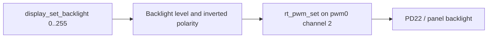

The general PWM driver is `drivers/pwm/pwm-sun252i.c`, native device `pwm0`, channels 0–3. YuzukiNeko uses channel 2 on PD22 (mux 4) for its DSI backlight. The separate analog PWM-BL current-sink block is disabled on this board; do not substitute the EVB `pwm_bl0` path.

## DTS and timing

```c
&pwm {
    pinctrl-names = "default";
    pinctrl-0 = <&pwm2_pins>;
    status = "okay";
};
/ {
    backlight_dsi: backlight-dsi {
        compatible = "pwm-backlight";
        pwms = <&pwm 2 1000000 1>;
        max-level = <255>;
        default-level = <96>;
    };
};
```

Enable `RT_USING_PWM`. Period and pulse are nanoseconds; `rt_pwm_set` rejects channel ≥4, period zero and pulse greater than period. A zero pulse gates the channel off. Normal periods use 24 MHz, a power-of-two divider and an 8-bit prescaler feeding a 16-bit counter; quantization is expected. Periods ≤334 ns select a 100 MHz bypass path, not an arbitrary high-frequency duty waveform.

## Interfaces and actual limitations

| Interface | Behavior |
| --- | --- |
| `rt_pwm_set(pwm, ch, period, pulse)` | Programs and enables the selected channel |
| `rt_pwm_enable(pwm, ch)` / `disable()` | Controls channel clock gate |
| `rt_pwm_get()` | Current driver does not populate meaningful hardware readback |
| `display_set_backlight(level)` | Preferred panel API, uses DTS polarity and level range |
| `display_get_backlight(&level)` | Read display-managed brightness state |

The raw PWM driver does not implement every generic PWM polarity/control command. The display backlight layer applies the board's inverted output convention. Using a raw 50% pulse as a brightness percentage can therefore be misleading.

## Complete backlight example

```c
#include <rtthread.h>
#include <rtdevice.h>
#include <hal/display/display_engine.h>
static int demo_backlight(int argc, char **argv)
{
    uint32_t saved;
    int ret = display_get_backlight(&saved);
    if (ret) return ret;
    for (uint32_t level = 32; level <= 224; level += 64)
    {
        ret = display_set_backlight(level);
        if (ret) break;
        rt_kprintf("backlight level=%u\n", level);
        rt_thread_mdelay(500);
    }
    int restore = display_set_backlight(saved);
    return ret ? ret : restore;
}
MSH_CMD_EXPORT(demo_backlight, Sweep and restore panel backlight);
```

## Call flow and verification



Save as `applications/demo_pwm.c`, invoke `demo_backlight` after the display is ready. `test_pwm` checks channel registers and `test_backlight` exercises the panel route. Register values and internal display checks do not prove visible brightness or PWM waveform accuracy; use an observer and oscilloscope for those claims.
