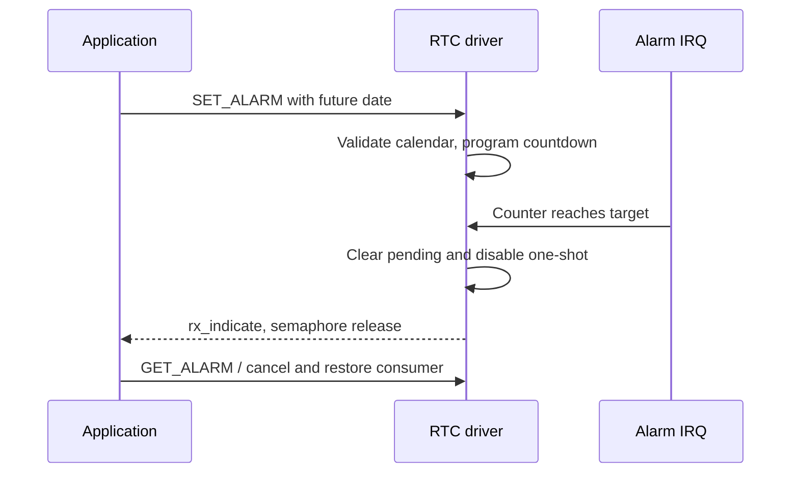

The native `rtc` device is implemented by `drivers/rtc/rtc-sun252i.c`. It handles calendar conversion, a dated one-shot alarm and interrupt notification through `rx_indicate`. Supported calendar years are 1970–2097 inclusive; the hardware day counter starts at day 1.

## Resources and native calls

```c
&rtc {
    status = "okay";
    clock-source = "hosc";
};
```

Enable `RT_USING_RTC`. The SoC node uses compatible `allwinner,sunxi-rtc`, registers at `0x03090000`, PLIC interrupt 144. The current board selects HOSC; the test does not establish backup-domain retention or oscillator accuracy after power removal.

| Control command | Argument |
| --- | --- |
| `RT_DEVICE_CTRL_RTC_GET_TIME` | `time_t *`, seconds since Unix epoch |
| `RT_DEVICE_CTRL_RTC_SET_TIME` | `time_t *`, supported year range checked |
| `RT_DEVICE_CTRL_RTC_GET_TIMEVAL` | `struct timeval *`, second resolution |
| `RT_DEVICE_CTRL_RTC_GET_ALARM` | `struct rt_rtc_wkalarm *` |
| `RT_DEVICE_CTRL_RTC_SET_ALARM` | Enable a future alarm, or `enable=0` to cancel |
| `rt_device_set_rx_indicate` | Callback on one-shot IRQ; signal a waiting thread |

Alarm date fields follow `struct tm`: year since 1900 and month 0–11. Use `timegm`/`gmtime_r` for UTC conversion, avoiding local timezone ambiguity. Past dates, overflowing years and invalid dates return an error. This hardware provides one alarm; coordinate ownership with any alarm framework or application.

## Complete future-alarm example

Run while no other application owns the RTC alarm. This example reads the current date, refuses an already enabled alarm, schedules three seconds ahead, waits and cancels before restoring the callback. It does not change the current clock.

```c
#include <rtthread.h>
#include <rtdevice.h>
#include <time.h>
static struct rt_semaphore rtc_demo_done;
static rt_err_t demo_alarm_rx(rt_device_t dev, rt_size_t n)
{
    return rt_sem_release(&rtc_demo_done);
}
static int demo_rtc(int argc, char **argv)
{
    rt_device_t rtc = rt_device_find("rtc");
    struct rt_rtc_wkalarm alarm = {0};
    struct tm tm;
    time_t now;
    int ret;
    if (!rtc) return -RT_ENOSYS;
    ret = rt_device_control(rtc, RT_DEVICE_CTRL_RTC_GET_ALARM, &alarm);
    if (ret || alarm.enable) return ret ? ret : -RT_EBUSY;
    ret = rt_device_control(rtc, RT_DEVICE_CTRL_RTC_GET_TIME, &now);
    if (ret) return ret;
    now += 3;
    if (!gmtime_r(&now, &tm)) return -RT_EINVAL;
    alarm.enable = 1;
    alarm.tm_year = tm.tm_year; alarm.tm_mon = tm.tm_mon;
    alarm.tm_mday = tm.tm_mday; alarm.tm_hour = tm.tm_hour;
    alarm.tm_min = tm.tm_min; alarm.tm_sec = tm.tm_sec;
    ret = rt_sem_init(&rtc_demo_done, "rtc-demo", 0, RT_IPC_FLAG_FIFO);
    if (ret) return ret;
    rt_err_t (*saved)(rt_device_t, rt_size_t) = rtc->rx_indicate;
    rt_device_set_rx_indicate(rtc, demo_alarm_rx);
    ret = rt_device_control(rtc, RT_DEVICE_CTRL_RTC_SET_ALARM, &alarm);
    if (!ret) ret = rt_sem_take(&rtc_demo_done, rt_tick_from_millisecond(4500));
    alarm.enable = 0;
    int cancel = rt_device_control(rtc, RT_DEVICE_CTRL_RTC_SET_ALARM, &alarm);
    rt_device_set_rx_indicate(rtc, saved);
    rt_sem_detach(&rtc_demo_done);
    rt_kprintf("alarm wait=%d cancel=%d\n", ret, cancel);
    return ret ? ret : cancel;
}
MSH_CMD_EXPORT(demo_rtc, Wait for a native one-shot RTC alarm);
```

## Alarm flow and verification



Save as `applications/demo_rtc.c`, invoke `demo_rtc`. `test_rtc` passed 13 checks including leap day, final supported year, invalid/past dates, ticking, cancellation and one-shot delivery. If a semaphore times out, check clock-source, pending IRQ and PLIC configuration separately from calendar readback.
