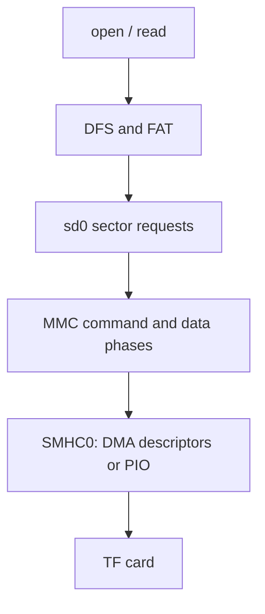

`drivers/sdio/sdio-sun252i.c` implements the native MMC/SD host. The MMC stack enumerates the card and exposes `sd0` as a block device. Applications normally use DFS/FAT for files rather than sending raw SD commands.

## Pins and configuration

```c
&mmc0 { status = "okay"; };
&{/jtag} { status = "disabled"; };
```

YuzukiNeko routes the TF slot to SMHC0 on PF0–PF5. These pads are shared with JTAG, so do not enable both. Retain the complete SoC/board pinctrl, clock/reset and bus-width settings. Enable `RT_USING_SDIO`, `RT_USING_DFS` and `RT_USING_DFS_ELMFAT`. `BSP_SD_DMA=y` uses up to `BSP_SD_DMA_DESCRIPTORS=128`; the current chain handles at most 1 MiB per host transfer, while the block stack splits larger requests. Disable it for the PIO profile.

## Block units and complete read example

`rt_device_read(sd, lba, buffer, count)` takes sectors and returns sectors, not bytes. Query geometry instead of assuming capacity. The following program opens read-only and prints the sector signature without modifying the card.

```c
#include <rtthread.h>
#include <rtdevice.h>
static int demo_sd(int argc, char **argv)
{
    rt_device_t sd = rt_device_find("sd0");
    struct rt_device_blk_geometry geo = {0};
    void *buf = RT_NULL;
    int ret;
    if (!sd) return -RT_ENOSYS;
    ret = rt_device_open(sd, RT_DEVICE_OFLAG_RDONLY);
    if (ret) return ret;
    ret = rt_device_control(sd, RT_DEVICE_CTRL_BLK_GETGEOME, &geo);
    if (ret) goto out;
    if (!geo.bytes_per_sector) { ret = -RT_EINVAL; goto out; }
    buf = rt_malloc_align(geo.bytes_per_sector, 64);
    if (!buf) { ret = -RT_ENOMEM; goto out; }
    if (rt_device_read(sd, 0, buf, 1) != 1) ret = -RT_EIO;
    if (!ret && geo.bytes_per_sector >= 512)
    {
        rt_uint8_t *p = buf;
        rt_kprintf("sector bytes=%u signature=%02x%02x\n",
                   geo.bytes_per_sector, p[510], p[511]);
    }
out:
    if (buf) rt_free_align(buf);
    rt_device_close(sd);
    return ret;
}
MSH_CMD_EXPORT(demo_sd, Read SD sector zero without writing);
```

## FAT mount and file calls

Use an existing mounted filesystem if the application already owns it. Otherwise mount `sd0` with the `elm` filesystem before reading. Mounting at `/` changes the application namespace; coordinate this with the MP4 player, which mounts the card on first use. Do not format a populated card just because mount fails.

```c
#include <rtthread.h>
#include <rtdevice.h>
#include <dfs_fs.h>
#include <fcntl.h>
#include <unistd.h>
static int demo_sd_file(int argc, char **argv)
{
    char buf[128];
    if (argc != 2) return -RT_EINVAL;
    int fd = open(argv[1], O_RDONLY);
    if (fd < 0) return -RT_EIO;
    ssize_t n = read(fd, buf, sizeof(buf));
    if (n > 0) rt_kprintf("read %d bytes\n", (int)n);
    int close_ret = close(fd);
    return n < 0 || close_ret < 0 ? -RT_EIO : 0;
}
MSH_CMD_EXPORT(demo_sd_file, Read a file from an already mounted SD card);
```

```text
demo_sd
mount sd0 / elm
demo_sd_file /example.txt
test_sd
```

## Request flow and evidence



Save the two C listings in separate application files. The board read 2 MiB in 89 ms with DMA and 772 ms with PIO; those values depend on card and build. Unaligned destinations were checked through the bounce path. A `55aa` signature describes the card image, not the electrical bus. For routine regression run `test_sd` without `write`; the optional write test changes a raw sector and is inappropriate on a live mounted filesystem.
