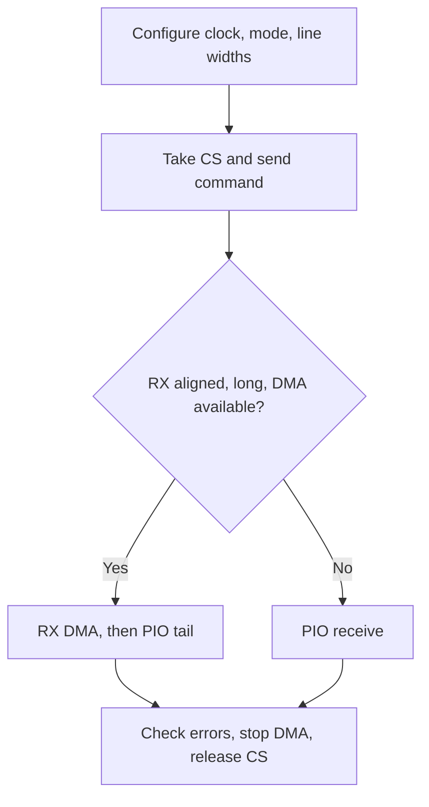

`drivers/spi/spi-sun252i.c` implements native RT-Thread SPI master transactions. SPI0 uses the on-board NOR pins PC0–PC5. SPI1 and the display-bus functions share pins with other peripherals; enabling a controller requires a board pin allocation, not only a Kconfig switch.

## Capabilities and configuration

| Item | Behavior |
| --- | --- |
| Role / word | Master, 8-bit words |
| Clock | 3 kHz–100 MHz requested rate; hardware dividers determine actual rate |
| Modes | CPOL/CPHA modes 0–3, MSB/LSB ordering |
| Lines | Single TX; single or quad RX through `data_width_rx` |
| Sampling | `sunxi_spi_set_sample(bus, mode, delay)`, mode 0–6, delay 0–63 |
| DMA | Receive ≥256 bytes, 64-byte-aligned destination, RX DMA channel present |
| Fallback | Unaligned/short reads use PIO; final FIFO tail drained by CPU |
| Rejected | Slave, active-high CS, no-CS, 3-wire, READY and non-8-bit words |

```c
&spi0 {
    status = "okay";
    clocks = <&ccu CLK_BUS_SPI0>, <&ccu CLK_SPI0>, <&ccu CLK_PLL_PERI_1X>;
    clock-names = "ahb", "mod", "peri1x";
    dmas = <&dma 7 22>;
    dma-names = "rx";
};
```

The SoC DTS already provides these resources; retain its pinctrl and reset properties. Enable `RT_USING_SPI`, `RT_USING_DMA` and `BSP_SPI_DMA`. `struct rt_spi_configuration.data_width` is bits per word; `data_width_tx/rx` are line counts. The native SPI core preserves these line counts when comparing/copying configurations.

## Complete read-only NOR example

```c
#include <rtthread.h>
#include <rtdevice.h>
#include <string.h>
static struct rt_spi_device demo_nor_device;
static int demo_spi(int argc, char **argv)
{
    struct rt_spi_device *dev = (void *)rt_device_find("demo-nor");
    struct rt_spi_configuration cfg = {
        .mode = RT_SPI_MODE_0 | RT_SPI_MSB, .data_width = 8,
        .data_width_tx = 1, .data_width_rx = 1, .max_hz = 24000000,
    };
    const rt_uint8_t cmd[] = {0x5a, 0, 0, 0, 0};
    rt_uint8_t *buf;
    int ret;
    if (!dev)
    {
        ret = rt_spi_bus_attach_device(&demo_nor_device, "demo-nor", "spi0", RT_NULL);
        if (ret) return ret;
        dev = &demo_nor_device;
    }
    ret = rt_spi_configure(dev, &cfg);
    if (ret) return ret;
    buf = rt_malloc_align(4096, 64);
    if (!buf) return -RT_ENOMEM;
    ret = rt_spi_send_then_recv(dev, cmd, sizeof(cmd), buf, 4096);
    if (!ret && memcmp(buf, "SFDP", 4)) ret = -RT_EIO;
    rt_kprintf("SFDP read result=%d\n", ret);
    rt_free_align(buf);
    return ret;
}
MSH_CMD_EXPORT(demo_spi, Read NOR SFDP through native SPI);
```

Save as `applications/demo_spi.c`, invoke `demo_spi`. `RT_NULL` attachment selects the board driver's default hardware CS0. `rt_spi_send_then_recv` keeps CS across command and data and returns `RT_EOK` on success. Separate `rt_spi_send` and `rt_spi_recv` calls normally release CS between them. No flash data is modified.

## High-speed and quad receive

First capture valid nonuniform data at 24 MHz. Increase `cfg.max_hz`, apply each candidate with `sunxi_spi_set_sample`, then compare repeated reads with the reference; choose the middle of a passing window. The test board passed 100 MHz at mode 0 / delay 17, but trace and flash differences change that point. The sampling setting applies to the bus on the next transfer, so coordinate all clients.

For 1-1-4 NOR reads use command `0x6b`, three address bytes and one dummy byte with TX width 1 / RX width 4. Confirm the flash QE bit and command protocol first. `test_spi_quad` temporarily enables the tested part's volatile QE and restores it; that status-register protocol is not universal. Do not copy it to an unidentified flash.

## Transfer flow and verification



```text
demo_spi
test_spi_features
test_spi_quad
```

The board passed 14 feature and 6 quad checks. Aligned DMA and unaligned PIO matched single-line reads at NOR `0x80000`. A valid JEDEC ID alone does not validate quad data or high-speed sampling. SPI0 and [SPIF](spif-nor.md) share pads and must not be enabled together.
