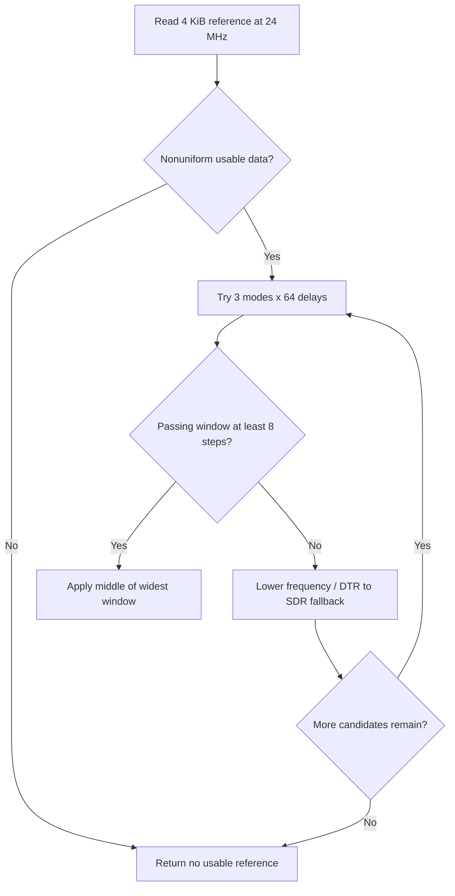

SPIF is a dedicated NOR controller, separate from SPI0. `drivers/spif/spif-sun252i.c` exposes the native MTD NOR device `spif0` plus the functions in `spif-sun252i.h`. SPI0 and SPIF use the same PC0–PC5 pads with different mux settings; only one may own the pins.

## Read-only board profile

Select `SUN252I_BOARD=yuzukineko-spif` with the normal or test seed, then regenerate and rebuild. The DTS includes YuzukiNeko, disables SPI0 and selects SPIF mux 4. `RT_USING_MTD_NOR` compiles the driver. The profile requests 100 MHz quad DTR and uses existing nonuniform data at `0x80000` for tuning.

```c
&spi0 { status = "disabled"; };
&spif {
    status = "okay";
    pinctrl-names = "default";
    pinctrl-0 = <&spif_data_pins>, <&spif_control_pins>;
    clock-frequency = <100000000>;
    quad;
    dtr;
    tune-offset = <0x80000>;
};
```

The complete pin groups live in `dts/sun252iw2-yuzukineko-spif.dts`. No `params-offset` or `clear-block-protect` is set, so the profile does not erase/program flash data or save parameters. Flash status/QE setup may still occur as required for quad reads.

## Public interfaces

| Interface | Contract |
| --- | --- |
| `sun252i_spif_get_info(&info)` | ID, capacity, actual clock, line mode, sample and XIP status |
| `sun252i_spif_read(offset, buf, len)` | Return bytes read or negative error |
| `sun252i_spif_write(offset, buf, len)` | Program NOR; caller must manage erase state and partitions |
| `sun252i_spif_erase(offset, len)` | Offset and length must be 4 KiB multiples |
| `sun252i_spif_tune(&result)` | Find/apply a passing sampling window; cannot run while XIP mapped |
| `sun252i_spif_set_sample(mode, delay)` | Apply an explicit operating-frequency point |
| `sun252i_spif_params_save/load/erase()` | Persistent record; disabled without a parameter sector |
| `sun252i_spif_xip_enable(offset, len)` | Map a 4 KiB-aligned flash range |
| `sun252i_spif_xip_window()` / `xip_disable()` | Get mapped address / stop mapping |

## Complete read example

```c
#include <rtthread.h>
#include <rtdevice.h>
#include <spif-sun252i.h>
static int demo_spif(int argc, char **argv)
{
    struct sun252i_spif_info info;
    rt_uint8_t *data;
    int ret = sun252i_spif_get_info(&info);
    if (ret) return ret;
    rt_kprintf("NOR %02x%02x%02x size=%u Hz=%u quad=%u dtr=%u\n",
               info.jedec_id[0], info.jedec_id[1], info.jedec_id[2], info.size,
               info.frequency, info.quad, info.dtr);
    if (info.size < 0x81000) return -RT_EINVAL;
    data = rt_malloc_align(4096, 64);
    if (!data) return -RT_ENOMEM;
    rt_ssize_t n = sun252i_spif_read(0x80000, data, 4096);
    if (n == 4096)
        rt_kprintf("first bytes: %02x %02x %02x %02x\n",
                   data[0], data[1], data[2], data[3]);
    rt_free_align(data);
    return n == 4096 ? 0 : -RT_EIO;
}
MSH_CMD_EXPORT(demo_spif, Read SPIF without changing flash data);
```

## Tuning flow



Tuning compares data and identity against the low-speed reference. An erased all-FF sector cannot validate sampling. The DTR read opcode follows address width (`0xed` for the tested three-byte mode, four-byte mode uses its matching opcode). The observed point was mode 0 delay 27, not a portable default.

## XIP ownership and verification

XIP mapping is a driver facility, not a standalone image format. Flash commands temporarily suspend the mapping with interrupts masked; no other context may execute from that window meanwhile, and the driver itself must reside in RAM. Disable the mapping before retuning. Persistent parameter APIs can erase/program the configured sector; keep the development boot area and NOR `0x20000` untouched unless a separate layout explicitly allocates them.

Save as `applications/demo_spif.c`, run `demo_spif`. `test_spif_read 0x11c60a82` passed 13 checks against the unchanged SPI reference. Recompute that CRC after changing flash data. See [SPI](spi.md) for the independent reference read and [flash layout](../../../boot/flash-layout.md) for partition responsibilities.
