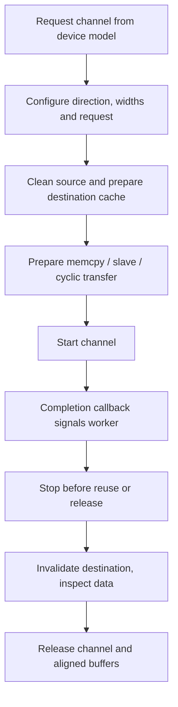

Peripheral drivers share the native RT-Thread clock, reset, pinctrl, interrupt and DMA frameworks. Keep resource acquisition in the owning driver; applications should not duplicate CCU or PLIC register writes. This page covers the supporting blocks that are not separate device tutorials.

## Source and configuration map

| Block | BSP source / interface / configuration |
| --- | --- |
| Clock/reset | `drivers/clock_control/ccu-sun252i.c`; native `rt_clk_*`, `rt_reset_control_*` |
| Interrupts | `drivers/interrupt_controller/pic-plic.c`, native PIC, `RT_USING_PIC` |
| Timer | `drivers/timer/riscv_machine_timer.c`, scheduler tick / `rt_hw_us_delay` |
| DMA | `drivers/dma/dma-sun252i.c`, `<drivers/dma.h>`, `RT_USING_DMA` |
| Watchdog | `drivers/watchdog/watchdog-sun252i.c`, `wdt0`, `RT_USING_WDT` |
| MBUS | `drivers/mbus/mbus-sun252i.h`, `BSP_USING_MBUS` |
| SID | `drivers/sid/sid-sun252i.h`, read-only fuse access |
| DBI | `drivers/mipi_dbi/mipi-dbi-sun252i.h`, `BSP_USING_DBI` |

## Clock/reset lifecycle

A platform driver gets clocks by index/name from its DTS node, checks `rt_is_err_or_null`, deasserts reset, sets the required module rate and prepares/enables the clock. Unwind each acquired resource on probe failure. PLL parents can be shared: a requested rate does not authorize arbitrary changes to another running client. Pin groups and DMA request numbers belong in DTS. Use `rt_thread_mdelay` for thread-level waits; reserve `rt_hw_us_delay` for short hardware timing because it busy-waits.

## Native DMA lifecycle



Channel allocation is shared with audio/SPI and other clients; do not hardcode a free channel. A callback completion size is bytes. DMA channels 8–11 have a polling completion path in this BSP, so callbacks are not guaranteed to originate in an ISR. Keep callbacks short in either case. `sun252i_dma_position` reports position inside a running buffer/ring; `sun252i_dma_pending` reports remaining bytes in the current block, not total queued work.

## Complete DMA copy with timeout cleanup

```c
#include <rtthread.h>
#include <rtdevice.h>
#include <drivers/dma.h>
#include <string.h>
static struct rt_semaphore dma_demo_done;
static void demo_dma_done(struct rt_dma_chan *chan, rt_size_t size)
{
    rt_sem_release(&dma_demo_done);
}
static int demo_dma(int argc, char **argv)
{
    enum { BYTES = 4096 };
    rt_uint8_t *src = rt_malloc_align(BYTES, 64), *dst = rt_malloc_align(BYTES, 64);
    struct rt_dma_chan *chan = RT_NULL;
    struct rt_dma_slave_config cfg = {.direction = RT_DMA_MEM_TO_MEM};
    int ret = -RT_ENOMEM;
    if (!src || !dst) goto free_buffers;
    ret = rt_sem_init(&dma_demo_done, "dma-demo", 0, RT_IPC_FLAG_FIFO);
    if (ret) goto free_buffers;
    chan = rt_dma_chan_request(rt_console_get_device(), RT_NULL);
    if (rt_is_err_or_null(chan)) { ret = -RT_EBUSY; goto detach; }
    ret = rt_dma_chan_config(chan, &cfg);
    if (ret) goto release;
    for (unsigned i = 0; i < BYTES; ++i) src[i] = i * 7 + 3;
    memset(dst, 0, BYTES);
    rt_hw_cpu_dcache_ops(RT_HW_CACHE_FLUSH, src, BYTES);
    rt_hw_cpu_dcache_ops(RT_HW_CACHE_FLUSH | RT_HW_CACHE_INVALIDATE, dst, BYTES);
    struct rt_dma_slave_transfer xfer = {
        .src_addr = (rt_ubase_t)src, .dst_addr = (rt_ubase_t)dst, .buffer_len = BYTES,
    };
    chan->callback = demo_dma_done;
    ret = rt_dma_prep_memcpy(chan, &xfer);
    if (!ret) ret = rt_dma_chan_start(chan);
    if (!ret) ret = rt_sem_take(&dma_demo_done, rt_tick_from_millisecond(1000));
    rt_dma_chan_stop(chan);
    rt_hw_cpu_dcache_ops(RT_HW_CACHE_INVALIDATE, dst, BYTES);
    if (!ret && memcmp(src, dst, BYTES)) ret = -RT_EIO;
release:
    rt_dma_chan_release(chan);
detach:
    rt_sem_detach(&dma_demo_done);
free_buffers:
    if (src) rt_free_align(src);
    if (dst) rt_free_align(dst);
    return ret;
}
MSH_CMD_EXPORT(demo_dma, Copy aligned memory through a native DMA channel);
```

## Watchdog control and application ownership

`wdt0` accepts `RT_DEVICE_CTRL_WDT_SET_TIMEOUT` / `GET_TIMEOUT` in seconds, `START`, `KEEPALIVE` and `STOP`. The driver rounds up to 1, 2, 3, 4, 5, 6, 8, 10, 12, 14 or 16 seconds. Configure before starting; changing an installed/running timeout is rejected until STOP clears ownership. Closing the device is not a substitute for STOP. Feed only after the application has established progress, not from an unrelated always-running loop.

```text
test_wdt
```

This command tests feeding and stopping. `test_wdt_reset` intentionally resets the chip and is outside an ordinary uninterrupted driver regression; a RAM-only image will return to the ROM boot path rather than automatically reload itself.

## SID and MBUS inspection example

```c
#include <rtthread.h>
#include <rtdevice.h>
#include <sid-sun252i.h>
#include <mbus-sun252i.h>
static int demo_system_info(int argc, char **argv)
{
    rt_uint8_t id[SUN252I_SID_CHIPID_BYTES];
    rt_ssize_t n = sun252i_sid_chipid(id, sizeof(id));
    if (n != sizeof(id)) return -RT_EIO;
    rt_kprintf("SID:");
    for (unsigned i = 0; i < sizeof(id); ++i) rt_kprintf("%02x", id[i]);
    rt_kprintf("\nDMA traffic counter=%u\n", mbus_traffic(MBUS_PMU_DMA));
    return 0;
}
MSH_CMD_EXPORT(demo_system_info, Inspect chip identity and MBUS without changing policy);
```

SID contains 512 fuse bits; `sun252i_sid_read(offset, buf, len)` requires 4-byte-aligned offset and length and returns bytes. Only read interfaces are provided. MBUS exposes named traffic counters plus `mbus_set/get_priority(master, ...)` and `mbus_set/get_limit(master, ...)`. Limits are quantized and zero disables a limit. Raw counter snapshots are not automatically MB/s; preserve a known sampling interval and account for wrap and background traffic. Changing priority can starve another real-time client, so prefer observation before tuning.

## DBI and validation boundaries

DBI uses a separate bus path: check `sun252i_dbi_ready`, reset the attached panel with `sun252i_dbi_reset(delay_ms)`, issue panel commands through `sun252i_dbi_command_write(cmd, data, len)` and transfer pixels with `sun252i_dbi_write_display(framebuf, size)`. Match the external panel command protocol and pixel packing before sending data; do not apply DSI panel sequences to DBI. No DBI panel was attached in this regression.

Save the complete C listings as separate files under `applications/`, invoke `demo_dma` and `demo_system_info`. Existing checks include `test_dma`, `test_dma_hi`, `test_wdt`, `test_sid`, `test_mbus`, `test_cache` and `test_cpu`. CPU/memory clock changes need a matching memory stability test over the intended address range; a passing register readback or short copy is not proof of full PSRAM stability.
