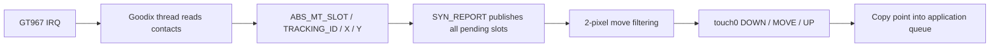

GT967 is handled by the native `components/drivers/input/touchscreen/ts-goodix.c` driver and `input_touch.c` bridge. The input device is `input0`, and the native touch device is `touch0`. Read the 228-byte configuration before publishing contact limits and ranges.

## DTS and configuration

```c
&i2c1 {
    clock-frequency = <400000>;
    touchscreen@5d {
        compatible = "goodix,gt967";
        reg = <0x5d>;
        touchscreen-size-x = <1024>;
        touchscreen-size-y = <768>;
        touchscreen-fuzz-x = <2>;
        touchscreen-fuzz-y = <2>;
        irq-gpios = <&pio ALLWINNER_PIO_PD 2 0>;
        reset-gpios = <&pio ALLWINNER_PIO_PD 3 1>;
    };
};
```

Enable `RT_USING_INPUT`, `RT_INPUT_TOUCHSCREEN`, `RT_INPUT_TOUCHSCREEN_GOODIX`, `RT_USING_TOUCH` and I2C in Kconfig (with `CONFIG_` prefixes in `.config`). PD2 is interrupt and PD3 is reset. Preserve reset polarity and address-selection timing. Coordinates belong to the physical 1024×768 panel; a lower-resolution UI must map them to its logical dimensions.

## Contact lifecycle



Track contacts by `track_id`, not array position. `ABS_MT_TRACKING_ID=-1` becomes one UP event; new contacts become DOWN, existing contacts MOVE. Multiple contacts in a single SYN are all published. Small MOVE changes within the configured X/Y fuzz are suppressed. `rt_device_read(touch, 0, &point, 1)` returns one point, not one byte. Read immediately in the receive callback: the bridge exposes the current slot and does not provide a persistent per-contact FIFO.

## Complete queued capture example

This example takes exclusive ownership of the touch consumer for ten seconds. Stop any GUI or touch watcher first. The callback copies the point without printing; the FinSH thread prints queued points and reports drops.

```c
#include <rtthread.h>
#include <rtdevice.h>
static rt_mq_t touch_queue;
static volatile unsigned touch_drops;
static rt_err_t demo_touch_rx(rt_device_t dev, rt_size_t size)
{
    struct rt_touch_data point;
    if (rt_device_read(dev, 0, &point, 1) == 1 &&
        rt_mq_send(touch_queue, &point, sizeof(point)) != RT_EOK)
        ++touch_drops;
    return RT_EOK;
}
static int demo_touch(int argc, char **argv)
{
    rt_device_t dev = rt_device_find("touch0");
    struct rt_touch_data point;
    rt_err_t ret;
    if (!dev || touch_queue) return -RT_EBUSY;
    touch_queue = rt_mq_create("touch-demo", sizeof(point), 32, RT_IPC_FLAG_FIFO);
    if (!touch_queue) return -RT_ENOMEM;
    ret = rt_device_open(dev, RT_DEVICE_OFLAG_RDONLY);
    if (ret) goto out;
    rt_err_t (*saved)(rt_device_t, rt_size_t) = dev->rx_indicate;
    touch_drops = 0;
    rt_device_set_rx_indicate(dev, demo_touch_rx);
    ret = rt_device_control(dev, RT_TOUCH_CTRL_ENABLE_INT, RT_NULL);
    rt_tick_t start = rt_tick_get();
    while (!ret && rt_tick_get() - start < 10 * RT_TICK_PER_SECOND)
    {
        if (rt_mq_recv(touch_queue, &point, sizeof(point), RT_TICK_PER_SECOND) < 0)
            continue;
        rt_kprintf("event=%u id=%u x=%u y=%u\n", point.event, point.track_id,
                   point.x_coordinate, point.y_coordinate);
    }
    rt_device_control(dev, RT_TOUCH_CTRL_DISABLE_INT, RT_NULL);
    rt_device_set_rx_indicate(dev, saved);
    rt_device_close(dev);
    rt_kprintf("dropped=%u\n", touch_drops);
out:
    rt_mq_delete(touch_queue);
    touch_queue = RT_NULL;
    return ret;
}
MSH_CMD_EXPORT(demo_touch, Capture physical touch for ten seconds);
```

## Invocation and evidence

```text
demo_touch
test_touch
test_touch_watch 60
```

Save as `applications/demo_touch.c`. Tap, drag and use two fingers while the command runs. `test_touch` passed 16 controller/native-event checks. The 180-second physical watch received no events, so physical touch is still unconfirmed. If identity reads work but no contacts arrive, check IRQ polarity, PD2 activity, reset wiring and the running consumer; synthetic events cannot validate the physical interrupt path.
