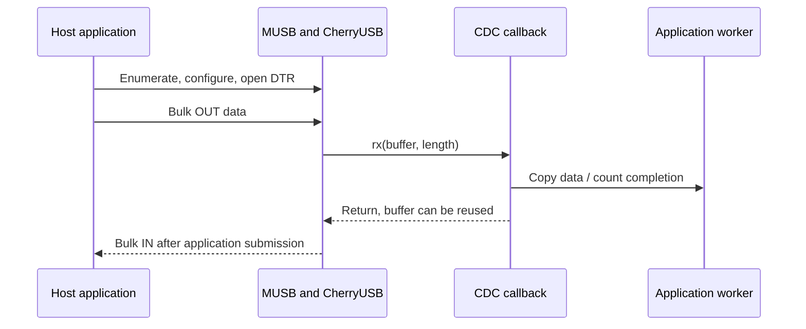

The BSP integrates the repository's CherryUSB stack through `drivers/usb/cherryusb/`, with the shared PHY in `drivers/usb/phy/`. MUSB provides device mode; EHCI/OHCI provide host mode. The single physical port is also the FEL download connection, so role and class ownership must be explicit.

## Configuration and resources

```text
CONFIG_RT_USING_CHERRYUSB=y
CONFIG_RT_CHERRYUSB_DEVICE=y
CONFIG_RT_CHERRYUSB_DEVICE_SPEED_HS=y
CONFIG_RT_CHERRYUSB_DEVICE_MUSB_SUNXI=y
CONFIG_RT_CHERRYUSB_DEVICE_CDC_ACM=y
CONFIG_RT_CHERRYUSB_DEVICE_DISPLAY=y
CONFIG_RT_CHERRYUSB_HOST=y
CONFIG_RT_CHERRYUSB_HOST_EHCI_CUSTOM=y
```

Keep `usbotg`, `usbhci` and `usbphy` DTS resources matched to the board. Controller base getters return zero before platform probe. The PHY is acquired exclusively for DEVICE or HOST and must be released before switching roles. Kconfig permits building both stacks; it does not mean both can own the same PHY at runtime. High-speed bulk packet size is 512 bytes. Aligned buffers can use internal MUSB DMA; short packets and tails require the CPU path.

## Complete CDC integration example

The existing CDC application owns descriptors and endpoints. Its hooks observe data; they do not turn it into a general-purpose serial device or echo server. Save this file as `applications/demo_usb.c`. Run it once after a fresh boot, without `usb_device_start`, a benchmark or the display class already active.

```c
#include <rtthread.h>
#include <rtdevice.h>
#include <usb/cherryusb/usb-glue-sun252i.h>
#include "apps/usb_cdc/cdc_device.h"
static volatile rt_uint32_t demo_rx_bytes, demo_tx_bytes;
static rt_bool_t demo_usb_started;
static void demo_cdc_rx(const uint8_t *data, uint32_t len) { demo_rx_bytes += len; }
static void demo_cdc_tx(uint32_t len) { demo_tx_bytes += len; }
static const struct usb_cdc_hooks demo_hooks = {.rx = demo_cdc_rx, .tx = demo_cdc_tx};
static int demo_usb_cdc(int argc, char **argv)
{
    rt_ubase_t base = sun252i_usb_otg_base();
    if (!base) return -RT_ENOSYS;
    if (demo_usb_started) return -RT_EBUSY;
    usb_cdc_set_hooks(&demo_hooks);
    cdc_acm_init(0, base);
    demo_usb_started = RT_TRUE;
    rt_kprintf("CDC initialized; verify host enumeration and open DTR\n");
    return 0;
}
static int demo_usb_stats(int argc, char **argv)
{
    rt_kprintf("CDC RX=%u TX=%u\n", demo_rx_bytes, demo_tx_bytes);
    return 0;
}
MSH_CMD_EXPORT(demo_usb_cdc, Initialize the existing CDC class once);
MSH_CMD_EXPORT(demo_usb_stats, Inspect CDC completion byte counters);
```

The hook structure has static lifetime. RX data is reused as soon as the callback returns, so copy it into an application queue if it is needed later. Do not retain its pointer, allocate large buffers, print or block inside completion callbacks. `cdc_acm_init` is a void helper and reports initialization problems in logs; the command returning zero is not proof of enumeration. Reboot before changing the active class because this example has no class teardown.

## Host transfer and callback flow



Identify the newly enumerated CDC COM port separately from the UART console. Host DTR must be asserted before the existing send helper transmits. In a test image, `usb_device_send` sends a 2048-byte pattern to an open host port. After FEL execution, `usb_reconnect` can force a fresh attach if the host has retained the old device state.

## USB display and decoder integration

```text
usb_display_selftest
usb_display_start 1024 768 30 6 500
usb_display_stop
```

`usb_display_selftest` decodes and presents 30 built-in JPEG frames without requiring USB host software. `usb_display_start [width height [fps [quality [limit_KB]]]]` enumerates a vendor display class for the matching Windows display driver. Descriptor dimensions are fixed for that boot; the DE scales the image to the panel. `usb_display_stop` stops presentation, not necessarily class enumeration. Restart before selecting CDC. Frame buffers, compressed ring and decoded pictures must all fit in PSRAM.

The optional legacy `touch` bridge uses the EVB controller protocol; it is not the YuzukiNeko GT967 native-touch path. Use [touch0](touch.md) for this board. For driver installation and the PC-side application model see the [Zephyr USB display guide](../../zephyr/apps/usb-display.md), but keep the RT-Thread commands and memory limits from this page.

## Host mode and actual validation

Host mode requires removing the PC device cable and connecting an appropriate powered peripheral/adapter. In a test image `usbh_start` starts enumeration through EHCI/OHCI; class selection additionally requires the corresponding CherryUSB host options. Do not acquire HOST while a device class holds the PHY. No USB host peripheral was attached in this regression, so host registration is not proof of class functionality.

The current confirmed result is a 30-frame JPEG decode/display self-test, with both normal and ulog builds. Historical CDC throughput in the BSP documentation predates this synchronization and must be remeasured before quoting current rates. Diagnose enumeration separately from bulk data integrity, short-packet handling and display quality.
