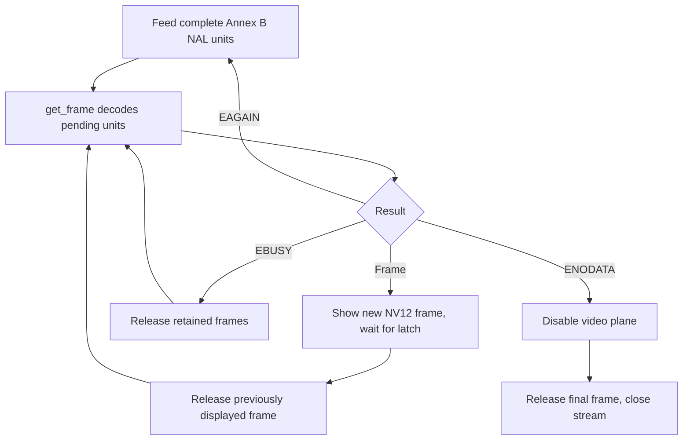

The public API is `drivers/vdec/vdec.h`; codecs, parsers, stream ring and picture pools are built from C sources under `drivers/vdec/sunxi/`. JPEG and H.264 use the video engine; PNG processing is implemented in software in the current port. API availability does not mean every format uses hardware.

## Formats, resources and configuration

| Input | API / output / limits |
| --- | --- |
| Baseline JPEG | `vdec_decode_image`, NV12 or NV21; current output path accepts 4:2:0 sampling |
| MJPEG | `vdec_stream_*`, codec JPEG, complete JPEG pictures; provide stream dimensions |
| PNG | `vdec_decode_image`, RGBA8888, including palette/gray/RGB/alpha and interlace parsing |
| H.264 | `vdec_stream_*`, Annex B whole NAL units, NV12 or NV21 |
| Not provided | Video encoding, HEVC and arbitrary container demuxing |
| VE resources | `0x01c0e000`, PLIC 66, DTS clocks and resets |
| Default budgets | VE 300 MHz, 512 KiB compressed ring, 12288 KiB decoder memory limit |
| Codec switches | `BSP_USING_VDEC`, `BSP_VDEC_JPEG`, `BSP_VDEC_PNG`, `BSP_VDEC_H264` |

NV12 has Y plus interleaved UV; NV21 has Y plus VU. RGBA8888 here means a little-endian word `0xRRGGBBAA`, memory bytes A,B,G,R. It is different from the display UI `0xAARRGGBB`. Honor `frame.stride[]`, visible dimensions and format; do not assume tightly packed planes. H.264 DPB, tiled references, linear outputs, ring and UI framebuffer all compete for 16 MiB PSRAM. A Kconfig memory ceiling does not reserve memory.

## All public calls and return behavior

| Call | Contract |
| --- | --- |
| `vdec_decode_image(codec, data, len, format, &frame)` | Blocking single image; input not retained after return |
| `vdec_frame_release(&frame)` | Return output ownership; required exactly once for each successful frame |
| `vdec_stream_open(&cfg, &stream)` | Claim decoder, allocate bounded session and ring |
| `vdec_stream_feed(stream, data, len, pts, &consumed)` | Copy whole NAL/picture units; always advance by actual consumed bytes |
| `vdec_stream_get_frame(stream, &frame)` | Decode work; 0 frame, `-EAGAIN` needs data, `-EBUSY` needs frame release |
| `vdec_stream_flush(stream)` | Signal end of input; drain until `-ENODATA` |
| `vdec_stream_close(stream)` | Stop session; held frames defer destruction and decoder claim release |
| `vdec_set_clock_hz(hz)` / `vdec_clock_hz()` | Set actual clock (negative errno on failure) / query rate |

`vdec_stream_config.buffer_size=0` uses the default. `no_cache_ops=true` skips output maintenance only when the CPU will not read pixels; keep it false for checksums or CPU conversion. `holding_frames` is reserved in this implementation; the extra-picture budget comes from `BSP_VDEC_H264_EXTRA_PICTURES`. A still image owns the global decoder claim until its frame is released, and a stream owns it through close and any outstanding frames. Starting a second decode before releasing the first can block.

## Complete JPEG file example

Mount the SD filesystem first. Save this program as `applications/demo_jpeg.c`; invoke `demo_jpeg /test.jpg`. It bounds compressed file size, handles short reads, prints a visible luma sample and releases the frame without involving display ownership.

```c
#include <rtthread.h>
#include <rtdevice.h>
#include <vdec.h>
#include <fcntl.h>
#include <unistd.h>
static int demo_jpeg(int argc, char **argv)
{
    if (argc != 2) return -EINVAL;
    int fd = open(argv[1], O_RDONLY), ret = -EIO;
    if (fd < 0) return ret;
    off_t len = lseek(fd, 0, SEEK_END);
    if (len <= 0 || len > 1024 * 1024 || lseek(fd, 0, SEEK_SET) < 0)
    { close(fd); return -EINVAL; }
    rt_uint8_t *data = rt_malloc((rt_size_t)len);
    if (!data) { close(fd); return -ENOMEM; }
    size_t off = 0;
    while (off < (size_t)len)
    {
        ssize_t n = read(fd, data + off, len - off);
        if (n <= 0) goto out;
        off += n;
    }
    struct vdec_frame frame = {0};
    ret = vdec_decode_image(VDEC_CODEC_JPEG, data, len, VDEC_FORMAT_NV12, &frame);
    if (!ret)
    {
        rt_kprintf("JPEG %ux%u stride=%u Y0=%u\n", frame.width, frame.height,
                   frame.stride[0], frame.plane[0][0]);
        vdec_frame_release(&frame);
    }
out:
    rt_free(data);
    close(fd);
    return ret;
}
MSH_CMD_EXPORT(demo_jpeg, Decode a mounted JPEG file and release its frame);
```

## Complete Annex B decode example

This example decodes the BSP's embedded 30-frame reference clip, so it does not need a card or a demuxer. It shows partial feed, backpressure, end-of-input draining and per-frame release. Save as `applications/demo_h264.c`. The included media header is a maintained test fixture, not an application requirement.

```c
#include <rtthread.h>
#include <rtdevice.h>
#include <vdec.h>
#include "tests/data/test_h264.h"
static int demo_h264(int argc, char **argv)
{
    struct vdec_stream *stream = RT_NULL;
    struct vdec_stream_config cfg = {
        .codec = VDEC_CODEC_H264, .format = VDEC_FORMAT_NV12,
        .buffer_size = 512 * 1024, .no_cache_ops = false,
    };
    size_t offset = 0;
    unsigned frames = 0;
    int flushed = 0, ret = vdec_stream_open(&cfg, &stream);
    if (ret) return ret;
    for (;;)
    {
        size_t used = 0;
        if (offset < sizeof(test_h264))
        {
            ret = vdec_stream_feed(stream, test_h264 + offset,
                                  sizeof(test_h264) - offset, -1, &used);
            if (ret && ret != -EAGAIN) break;
            offset += used;
        }
        if (offset == sizeof(test_h264) && !flushed)
        {
            ret = vdec_stream_flush(stream);
            if (ret) break;
            flushed = 1;
        }
        struct vdec_frame frame = {0};
        ret = vdec_stream_get_frame(stream, &frame);
        if (!ret)
        {
            ++frames;
            vdec_frame_release(&frame);
            continue;
        }
        if (ret == -ENODATA) { ret = 0; break; }
        if (ret != -EAGAIN || flushed || !used) break;
    }
    vdec_stream_close(stream);
    rt_kprintf("frames=%u result=%d\n", frames, ret);
    return ret;
}
MSH_CMD_EXPORT(demo_h264, Feed drain and release an Annex B stream);
```

## Decode and display ownership flow



For display, construct `lcd_yuv` from the returned plane pointers, strides and dimensions. JPEG is normally full range; set color range/matrix from the actual stream metadata. Present with a blocking `lcd_show_yuv`, release the previous frame only after replacement has latched, and hide the video before releasing the final displayed frame. Returning from `lcd_show_yuv` does not mean the new frame is no longer being scanned. Closing a stream while holding a frame is supported, but blocks reuse of the decoder until release.

## Validation and unsupported input

`test_vdec` uses embedded `test_jpeg.h`, `test_png.h` and `test_h264.h` under `applications/tests/data/`. The board passed 13 checks, JPEG maximum luma error 1, PNG CRC `03c854ec`, 30 H.264 frames with no reference mismatch, and 320 JPEG lifetime/ring-wrap iterations with stable heap. Progressive JPEG, unsupported H.264 features, malformed data or insufficient picture budget can fail; report the returned errno and retain the input for diagnosis. MP4 is a container: use the existing `mp4_play <file>` application or a demuxer; do not feed MP4 bytes directly to Annex B input.
