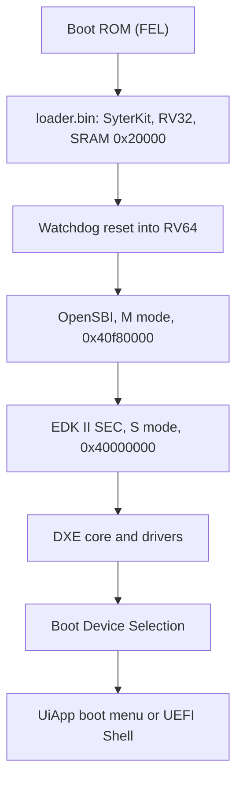

This chapter documents the EDK II (UEFI) firmware for YuzukiHD F101 boards, maintained in [`YuzukiHD/edk2-build`](https://github.com/YuzukiHD/edk2-build). The documentation baseline is commit `26143d69715127d9a52cf5e2cb8f269b9c900ea8` (2026-10-10). The build produces one firmware image that runs from PSRAM after a FEL download: a SyterKit loader switches the C907 from RV32 to RV64, OpenSBI runs in M mode, and EDK II is the S-mode payload with the boot menu on the panel and on the serial console.

:::caution
The only platform in the repository is the **F101 EVB**. Its console is UART3 (PE08/PE09), its panel is a 1024×600 RGB panel, and its memory map assumes 16 MiB of PSRAM. The packaged `run.sh` initializes PSRAM with `xfel ddr f101-s3`. YuzukiNeko has a different console (UART1, PB0/PB1) and a 1024×768 MIPI DSI panel, and F101S4 boards have 32 MiB of PSRAM; running this image there needs a board variant in the device tree and the display driver.
:::

| Item | Current port |
| --- | --- |
| CPU | XuanTie C907, RV64 `rv64imafdc`, single core; OpenSBI in M mode, EDK II in S mode |
| Memory | 16 MiB PSRAM at `0x40000000`; firmware at the base, device tree and OpenSBI at the top |
| Console | UART3, PE08 TX / PE09 RX, 115200 8N1, SBI debug console |
| Firmware | `edk2.fd`, about 0.7 MiB: SEC plus an LZMA-compressed DXE firmware volume |
| Loading | FEL; `run.sh` writes the image, the device tree and the loader, then executes the loader |
| Graphics | Display engine, TCON and RGB encoder; 1024×600 RGB666 panel; `EFI_GRAPHICS_OUTPUT_PROTOCOL` |
| Shell | UEFI Shell built in; the firmware starts in the UiApp boot menu |
| Variables | Emulated variable store in RAM; lost at reset |
| Input | Serial console only; no USB host or keyboard |

## What the build provides

- `edk2.fd`: SEC, DxeCore, the UEFI drivers and UiApp, packed as one 3 MiB FD with an LZMA-compressed DXE firmware volume.
- `dtb_sbi.bin`: the device tree in a 256 KiB slot followed by OpenSBI `fw_jump`.
- `loader.bin`: the SyterKit RV32 loader that switches the core to RV64.
- `run.sh` and `README.txt`: the xfel commands and the memory map.
- A graphics output driver for the EVB panel, a UEFI boot menu and a UEFI Shell.
- SMBIOS records for the board, the C907 and the 16 MiB memory.

## Boot flow

The C907 latches RV32 or RV64 at reset. The loader runs as an RV32 program in SRAM, programs the reset vector and the RV64 bit, and restarts the core through the RISC-V watchdog. The reset lands in a stub that jumps to OpenSBI; OpenSBI starts EDK II at `0x40000000` in S mode with the device tree in `a1`.

## Reading order

Start with [building and running](build-run.md) to produce `out/f101-edk2/` and boot it over FEL. [Boot chain](boot-chain.md) follows each stage from xfel to S-mode. [Platform firmware](platform.md) covers SEC, DXE, the variable store, the console, SMBIOS and the boot manager. [Graphics output](display.md) documents the GOP driver and the display stack. [Debugging](debug.md) lists the log levels, build switches and the SBI hello payload. [Status and known limits](limits.md) records what has been verified and what is still missing.

PSRAM initialization before any RAM image is a global topic; see [PSRAM initialization and RAM boot](../../boot/psram-init.md). The FEL commands and the USB driver are in [FEL download mode and tools](../../boot/fel.md).

## Status

The boot chain reaches the UiApp boot menu, the GOP driver scans out the panel, and the serial console works through the SBI debug console. The UEFI Shell is built into the firmware but is not a default boot option. USB input, SD cards, persistent variables and networking are not implemented. Details are in [status and known limits](limits.md).

## Relationship to the other chapters

Zephyr, RT-Thread and ESP-IDF run the C907 in RV32 mode and link their images at `0x40000000`. EDK II runs the same core in RV64 mode behind OpenSBI, and the loader is the `usb-boot-rv64i` application of SyterKit rather than the eFEX helper. The FEL, PSRAM and NOR rules in [boot and flashing](../../boot/bootloader.md) still apply: this image is a RAM image, and `run.sh` writes nothing to SPI NOR.
