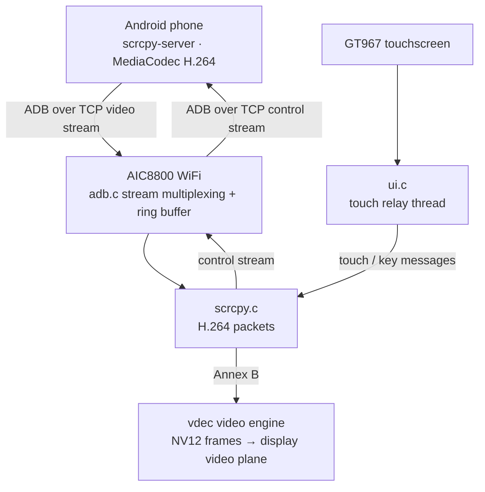
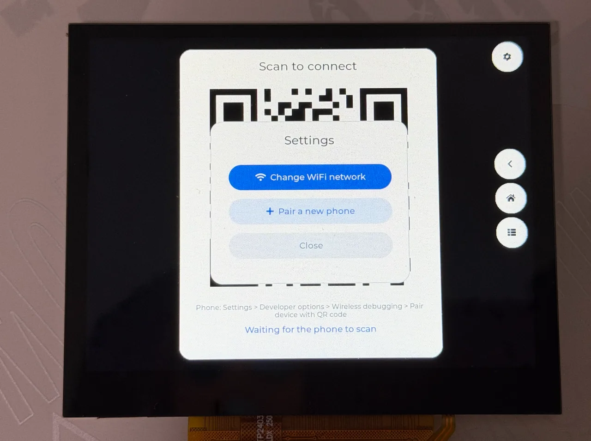
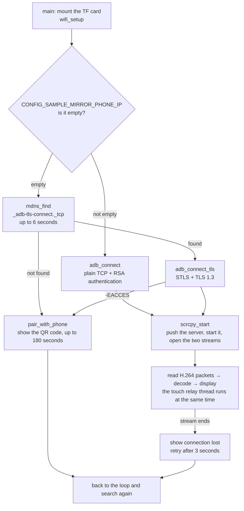
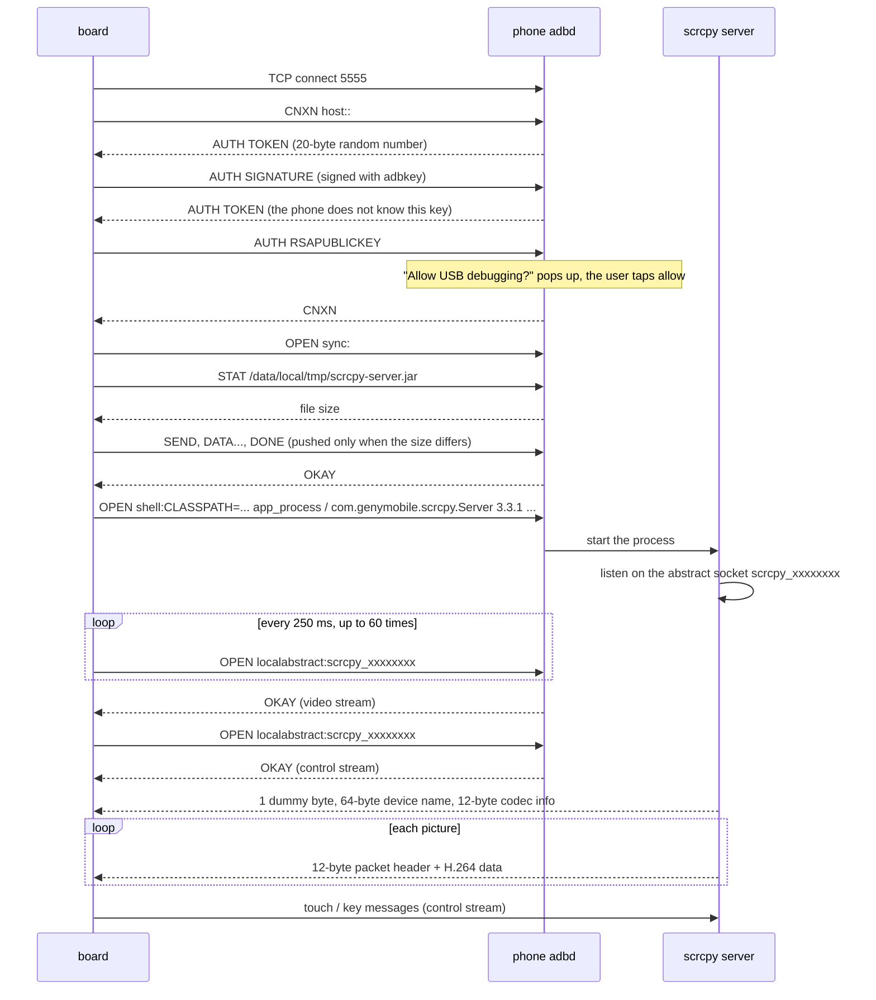
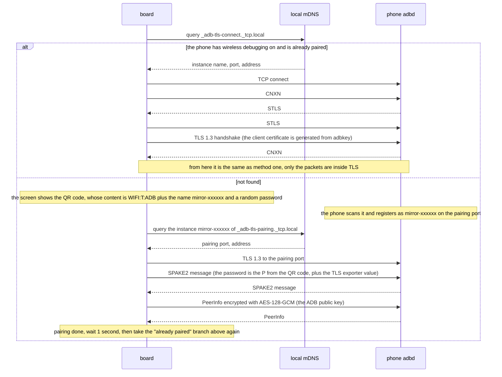
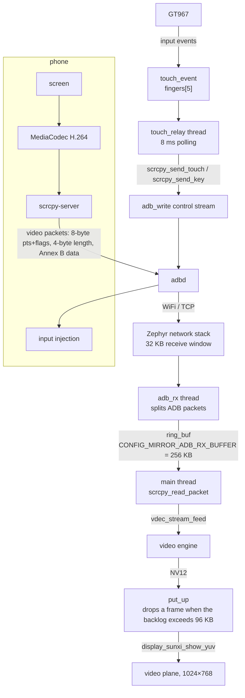

Mirror an Android phone's screen onto the board's screen and send touch and navigation keys back to the phone. The board connects to the phone's adbd over WiFi (ADB over TCP), starts the [scrcpy](https://github.com/Genymobile/scrcpy) server on the phone, the server encodes the screen into an H.264 stream and sends it back, and the board decodes it with the on-chip video engine and sends it to the display video plane. The example is `zephyr-components/android-screen-mirror/samples/mirror_player`; the component itself (ADB client, pairing, scrcpy client) is in the `src/` of the same directory.



Before you start, complete [Setting up the development environment](../zephyr-setup-env.md) and [Getting the Zephyr source](../zephyr-get-source.md). The WiFi part uses the [AIC8800 WIFI](../components/aic8800-wifi.md) driver; for the details of scanning, connecting and DHCP see that page.

## Preparation

### What you need

- Board: `yuzukineko`, using AIC8800 WiFi, the 1024×768 MIPI-DSI panel, the GT967 touchscreen (up to 5 points) and the TF card slot.
- Phone: an Android phone. Choose one of two connection methods: run `adb tcpip` once over a USB cable (any Android version), or use "Wireless debugging" (Android 11 and above).
- TF card: FAT or exFAT. Put `scrcpy-server.jar` on it; the board also writes `wifi.cfg` (WiFi name and password) and `adbkey` (the ADB private key) to the card.
- Network: the board and the phone are in the same WiFi, and the router must not have client isolation enabled; when using wireless debugging the router must also forward mDNS multicast.
- Computer: to download the scrcpy server; the `adb tcpip` method also needs `adb`.

### Preparing the phone

#### Turning on developer options

1. Settings → About phone → tap "Build number" 7 times to enter developer mode.
2. Settings → System → Developer options (the menu location differs between vendors).
3. Turn on "USB debugging".
4. Some vendors (MIUI-based systems, for example) also have a "USB debugging (Security settings)"; if it is not turned on, the system rejects touch and key injection. The picture is unaffected, so the symptom is "you can watch but not tap".

#### Method one: adb tcpip (fixed address)

Connect the phone to the computer over USB and run once:

```sh
adb tcpip 5555
adb shell ip route
```

In the output of the second command the address after `src` is the phone's WiFi address. The USB cable can then be unplugged. This setting is lost when the phone reboots and has to be run again.

Write the phone address into the board's configuration `CONFIG_SAMPLE_MIRROR_PHONE_IP` (see [Setting the phone address before building](#setting-the-phone-address-before-building)); once the board has started it connects directly to port 5555 of this address. On the first connection the phone pops up "Allow USB debugging?", where you tick "Always allow" and then tap allow; the board waits up to 60 seconds (`accept_timeout_ms` of `adb_connect()`, passed in by `scrcpy_start()`).

#### Method two: wireless debugging (no address, no USB)

Requires Android 11 or above, with the phone and the board in the same WiFi.

1. Developer options → turn on "Wireless debugging". The phone advertises the `_adb-tls-connect._tcp` service over mDNS.
2. After it starts, the board looks for this service; if it cannot find it, it shows a QR code on the screen (whose content is `WIFI:T:ADB;S:mirror-xxxxxx;P:<password>;;`, with the name and password randomised each time).
3. On the phone: Developer options → Wireless debugging → "Pair device with QR code", and scan the QR code on the board's screen.
4. Once pairing succeeds, the key the board saved is accepted by the phone, which then finds the service again and connects.

Leaving `CONFIG_SAMPLE_MIRROR_PHONE_IP` empty selects this method (the default). Pairing is needed only before the key is first accepted by the phone; if the key is changed or the pairing record is deleted on the phone, the connection returns `-EACCES` and the board shows the QR code again.

### The scrcpy server

The scrcpy server is a jar (in fact a zip containing `classes.dex`) which the board pushes to `/data/local/tmp/scrcpy-server.jar` on the phone and then starts with `app_process`. **The version must match the one configured on the board**: `CONFIG_SAMPLE_MIRROR_SERVER_VERSION` defaults to `3.3.1`, and when it starts the server compares the version number in the command line and exits if it does not match (the board prints the server's output as `server: …`).

Download version 3.3.1 on the computer, rename it to `scrcpy-server.jar` and put it in the root directory of the TF card:

```sh
curl -L -o scrcpy-server.jar \
  https://github.com/Genymobile/scrcpy/releases/download/v3.3.1/scrcpy-server-v3.3.1
sha256sum scrcpy-server.jar
```

The file size is 90788 bytes and the SHA-256 is `a0f70b20aa4998fbf658c94118cd6c8dab6abbb0647a3bdab344d70bc1ebcbb8`; take the checksum published on the [scrcpy release page](https://github.com/Genymobile/scrcpy/releases/tag/v3.3.1) as authoritative.

There is no need for a manual `adb push`: on every connection `adb_push_file()` first queries the size of this file on the phone with the `STAT` of the sync service and skips the push if it matches the file size on the card, pushing only when it differs (only the size is compared, not the content; swapping in another version of the same size will not be re-pushed, so delete the old file on the phone first). If the file is not on the card, `fs_stat()` fails and the screen shows `cannot copy the server`.

To change version: change both the jar on the card and `CONFIG_SAMPLE_MIRROR_SERVER_VERSION`. The server's control-message format changes with the version; the message layout in `scrcpy.c` corresponds to 3.x, and moving to another major version requires checking it against scrcpy's `doc/develop.md`.

### Configuring WiFi

For the WiFi driver, firmware loading and the `net_mgmt` interface see [AIC8800 WIFI](../components/aic8800-wifi.md). The parts this example uses:

- `CONFIG_AIC8800=y` enables the driver; the firmware is compiled into the image and does not have to be on the card.
- STA mode only; 2.4 GHz and 5 GHz, WPA2-PSK and open networks are supported; <strong>WPA3 is not supported</strong>.
- The board gets its address with DHCPv4; IPv6 is not supported (`CONFIG_NET_IPV6=n`).

How the example obtains the network name and password, trying in turn:

1. `/SD:/wifi.cfg` on the TF card: two lines of text, the first the name and the second the password, stored in plaintext.
2. `CONFIG_SAMPLE_MIRROR_WIFI_SSID` and `CONFIG_SAMPLE_MIRROR_WIFI_PSK` given at build time (used only when there is no saved network on the card).
3. If there is neither, or the connection fails: the screen shows the WiFi settings form — the "Scan" button scans, the dropdown selects a network (the "other" entry at the end of the list allows the name to be typed in manually), the password is entered with the on-screen keyboard, and connect is tapped. Once connected it is written back to `wifi.cfg`.

`wifi.cfg` is written only after a successful connection and is used directly on the next start-up. While mirroring, tap the gear in the top right corner, and "Change WiFi network" in the menu switches networks.

`wifi_join()` waits up to 30 seconds for the connection result and up to another 30 seconds for a DHCP address; in `main()` only a failure of `wifi_setup(false)` (no WiFi interface in the driver) shows `no WiFi` and exits, while a failure to reach the network keeps returning to the form.

:::note
When joining a network the AIC8800 driver prints the SSID and password in plaintext on the serial port in its `aic8800` log (`Connect Wi-Fi: …`, `SET_NETWORK 0 psk "…"`). Blank out these lines before pasting the serial log to anyone. The log pasted in this document has already had them replaced with the `<SSID>` and `<PSK>` placeholders.
:::

## Building

The component and the WiFi driver are both Zephyr modules under `zephyr-components`. The example's `CMakeLists.txt` adds them to `ZEPHYR_EXTRA_MODULES` itself:

```cmake
# the screen mirror module is two directories up, the WiFi module is a sibling
list(APPEND ZEPHYR_EXTRA_MODULES ${CMAKE_CURRENT_SOURCE_DIR}/../..
     ${CMAKE_CURRENT_SOURCE_DIR}/../../../aic8800)
```

So the module paths do not have to be given on the command line. Run this in the workspace:

```sh
. ~/f101-zephyr/env.sh
cd ~/f101-zephyr
west build -b yuzukineko -d build/android-mirror zephyr-components/android-screen-mirror/samples/mirror_player
```

<div class="asciinema-cast" data-src="assets/casts/zephyr/apps-android-mirror/build.cast" data-speed="6"></div>

The artifact is `build/android-mirror/zephyr/zephyr.bin`, 7567584 bytes (about 7.2 MiB, including the AIC8800 firmware), linked at `0x40010000`, using 7567584 bytes of RAM, 45.28% of 16320 KB.

The example's `prj.conf` sets `CONFIG_MINIMAL_LIBC=y`: the `compat/` headers of the AIC8800 driver are written for the minimal C library, and with the board's default picolibc they clash over the declaration of `getchar`, see [AIC8800 WIFI](../components/aic8800-wifi.md). Your own application must set this too when it uses the driver.

### Setting the phone address before building

When using the adb tcpip method, write the phone address into the example directory's `prj.conf` (the string must be quoted):

```ini
CONFIG_SAMPLE_MIRROR_PHONE_IP="192.168.1.23"
```

The initial WiFi can be given the same way: `CONFIG_SAMPLE_MIRROR_WIFI_SSID="…"` and `CONFIG_SAMPLE_MIRROR_WIFI_PSK="…"`, saving you from typing them on the screen. After changing `prj.conf`, switch to a new build directory or add `-p` to `west build`, otherwise the old values in the CMake cache take effect.

## Running

For the download procedure see [Building and running](../zephyr-build-run.md); the console is UART1 (PB00/PB01, 115200 8N1). The image is 7.2 MiB; use method one while debugging:

```sh
xfel ddr f101-s3
xfel write 0x40010000 build/android-mirror/zephyr/zephyr.bin
xfel exec 0x40010000
```

:::caution
The board has only one USB-C port, which is both the xfel download port and the UF2 drive port. Download first, then connect other devices.
:::

### Downloading and starting

Put `scrcpy-server.jar` in the root directory of the TF card, insert it into the board, and power on or download.

The serial port first prints the boot banner, then the display driver prints `1024x768 @ 60 Hz`, GT967 reports its firmware version, the configuration updates to `1024x768, 5 point(s)`, and the touchscreen and display are ready.

### Connecting to WiFi

The status box in the top left corner of the screen shows `joining the WiFi`. When there is already a saved `wifi.cfg` on the TF card, the board reads it and connects directly without going through the settings form; on first use, or when it cannot connect, the WiFi settings form appears on the screen, where you select a network, enter the password and connect.


The picture above is the WiFi settings form: the network is chosen from the dropdown (Scan rescans), the Show switch to the right of the password field toggles plaintext display, and the on-screen keyboard is below.

The serial port prints `wifi: connecting to <SSID>`. AIC8800 completes SDIO enumeration (`sdio card up: 2 functions`), chip identification (`chip_id=c3`) and firmware download (`### Upload firmware`, `Start app`); after wpa_supplicant starts it prints `wifi: connect ok (0)`, and DHCP gives `wifi: address 192.168.1.55`. For driver details see [AIC8800 WIFI](../components/aic8800-wifi.md). The driver printed the SSID and password in plaintext on the serial port; the log below has had them replaced with `<SSID>` and `<PSK>`. The complete log:

```text
*** Booting Zephyr OS build 55f8a211e870 ***
[00:00:00.494,000] <inf> display_sunxi: 1024x768 @ 60 Hz, fb 0x40287840, video plane 0
[00:00:00.565,000] <inf> gt967: GT967 firmware 0x1040, 1024x768
[00:00:00.570,000] <inf> gt967: configuration 0x63: 1024 x 768, up to 1 point(s), module switch 0x04
[00:00:00.576,000] <inf> gt967: configuration updated: 1024x768, 5 point(s)
wifi: connecting to <SSID>
[00:00:01.663,000] <inf> aic8800: aic_wifi_init, mode=0
[00:00:01.663,000] <inf> aic8800: release version:aic 2025-06-10 12:08:28 +0800 b6a954b6
[00:00:01.663,000] <inf> aic8800: aic_wifi_open: 0
[00:00:01.663,000] <inf> aic8800: aicwf chipid: USE AIC8800D80
[00:00:02.064,000] <inf> aic8800: aic_wifi_reset_power done
[00:00:03.078,000] <inf> sd: Card does not support CMD8, assuming legacy card
[00:00:03.089,000] <inf> aic8800: sdio card up: 2 functions
[00:00:03.089,000] <inf> aic8800: sdio aggr_buf:0x40847c10, aggr_buf_align:0x40847c40
[00:00:03.089,000] <inf> aic8800: sdio_host_init:enable func1 ok!
[00:00:03.089,000] <inf> aic8800: sdio_host_init:aic_sdio_set_block_size 512
[00:00:03.089,000] <inf> aic8800: sdio_host_init:sdio_set_block_size 512
[00:00:03.089,000] <inf> aic8800: aicwf_sdio_reg_init
[00:00:03.089,000] <inf> aic8800: sdio_host_init:host_int ok
[00:00:03.089,000] <inf> aic8800: fhost_rx_init
[00:00:03.089,000] <inf> aic8800: fhost_rx_task
[00:00:03.090,000] <inf> aic8800: rwnx_fdrv_init enter
[00:00:03.090,000] <inf> aic8800: chipid 3
[00:00:03.090,000] <inf> aic8800: 40500000=73c38820
[00:00:03.091,000] <inf> aic8800: flag:20=88200002
[00:00:03.091,000] <inf> aic8800: chip_id=c3, chip_sub_id=2
[00:00:03.091,000] <inf> aic8800: ### Upload firmware, @ = 120000
[00:00:03.091,000] <inf> aic8800: ### dst=0x4019ebf8, size=336848
[00:00:03.261,000] <inf> aic8800: rd_version_val=06090101
[00:00:03.265,000] <inf> aic8800: Read FW mem: 00120000
[00:00:03.266,000] <inf> aic8800: cfm: [00120000] = 001a0000
[00:00:03.266,000] <inf> aic8800: Start app: 00120000
[00:00:03.289,000] <inf> aic8800: get_userconfig_xtal_cap:enable       :1
[00:00:03.289,000] <inf> aic8800: get_userconfig_xtal_cap:xtal_cap     :24
[00:00:03.289,000] <inf> aic8800: get_userconfig_xtal_cap:xtal_cap_fine:31
[00:00:04.282,000] <inf> aic8800: rwnx_fdrv_init exit
[00:00:04.282,000] <inf> aic8800: aic_cli_cmd_init
[00:00:04.282,000] <inf> aic8800: cli_cmd_task
[00:00:04.282,000] <inf> aic8800: use default mac addr, read efuse
[00:00:04.282,000] <inf> aic8800: fhost_mac_addr cc:4e:6e:6c:47:9d
[00:00:04.282,000] <inf> aic8800: Connect Wi-Fi: Empty_SSID, Empty_Password
[00:00:04.282,000] <inf> aic8800: net_if_add wl
[00:00:04.282,000] <inf> aic8800: net_tx_buf_sema initial count:200
[00:00:04.284,000] <inf> aic8800: wifi open ok
[00:00:04.284,000] <inf> aic8800: aic_wifi_init ok
[00:00:04.284,000] <inf> aic8800: Connect Wi-Fi: <SSID>, <PSK>
[00:00:04.284,000] <inf> aic8800: fhost_wpa_create_network
[00:00:04.284,000] <inf> aic8800: fhost_wpa_start
[00:00:04.287,000] <inf> aic8800: target->sem 40880720
[00:00:04.287,000] <inf> aic8800: target.sem 0
[00:00:04.287,000] <inf> aic8800: WPA task started for interface {FVIF-0}
[00:00:04.287,000] <inf> aic8800: fhost_wpa_execute_cmd cmd:ADD_NETWORK
[00:00:04.288,000] <inf> aic8800: fhost_wpa_execute_cmd cmd:SET_NETWORK 0 ssid "<SSID>"
[00:00:04.289,000] <inf> aic8800: fhost_wpa_execute_cmd cmd:SET_NETWORK 0 key_mgmt WPA-PSK
[00:00:04.289,000] <inf> aic8800: fhost_wpa_execute_cmd cmd:SET_NETWORK 0 psk "<PSK>"
[00:00:04.516,000] <inf> aic8800: fhost_wpa_execute_cmd cmd:SET_NETWORK 0 ieee80211w 1
[00:00:04.516,000] <inf> aic8800: fhost_wpa_execute_cmd cmd:SET filter_ssids 1
[00:00:04.517,000] <inf> aic8800: WPA network 0: created and configured
[00:00:04.517,000] <inf> aic8800: fhost_wpa_execute_cmd cmd:ENABLE_NETWORK 0 
[00:00:04.518,000] <inf> aic8800:  fhost_cntrl_cfgrwnx_scan resp.status 0
wifi: connect ok (0)
[00:00:06.460,000] <inf> aic8800: WPA enter FHOST_WPA_STATE_CONNECTED
[00:00:06.461,000] <inf> aic8800: target->sem 40893b80
wifi: address 192.168.1.55
```

### Connecting to the phone

Method one: the phone has already run `adb tcpip 5555`, and the status bar on the screen shows `connecting to the phone`, `copying the server`, `starting the server` and `waiting for the first picture` in turn. The first connection needs an allow tap on the phone.

Method two: after wireless debugging is turned on on the phone, the screen shows `looking for the phone (turn on Wireless debugging)` and connects once it is found; if it has never been paired, the QR code is shown, and you scan it as described above.


The picture above is the QR code shown when it has never been paired; the small line of text below it is the path to follow on the phone, and at the very bottom is `Waiting for the phone to scan`.

### Operating the mirrored picture

Once the phone's picture appears, tapping anywhere in the picture is the same as tapping the corresponding place on the phone. The column of three round keys on the right of the screen is back, home and recent tasks, and the top right corner is settings.


The phone is on the left and the board's screen on the right: the phone is in portrait, and the picture is scaled proportionally and centred, with black bars on both sides. The column of round keys on the right is, from top to bottom, back, home and recent tasks, and the round key in the top right corner is settings.



Tapping the settings key in the top right corner brings up this menu: `Change WiFi network` reopens the WiFi settings form, `Pair a new phone` pairs again, and `Close` closes the menu.

### Status text on the screen

The text in the status bar comes from `ui_set_status()`; what `main.c` and `scrcpy.c` write is the original English:

| Text | Meaning |
| --- | --- |
| `joining the WiFi` | connecting to WiFi |
| `no SD card` | `fs_mount()` still failed after 5 retries; the program ends here |
| `no WiFi` | no WiFi interface; the program ends |
| `looking for the phone (turn on Wireless debugging)` | looking for the `_adb-tls-connect` service |
| `Waiting for the phone to scan` | showing the QR code, waiting for the phone to scan it |
| `Pairing...` | the phone has scanned it and pairing is under way |
| `connecting to the phone` | connecting to adbd |
| `key refused by the phone` | the phone refused the key (`-EACCES`) |
| `cannot connect to adb` | connection or TLS failed |
| `copying the server` | pushing the server |
| `cannot copy the server` | push failed, usually because `scrcpy-server.jar` is not on the card |
| `starting the server` | starting the server |
| `the server did not start` | could not connect to the server's socket within 15 seconds |
| `waiting for the first picture` | both streams are open, waiting for the first frame |
| `connection lost, retrying` | the stream dropped, retrying after 3 seconds |

## Features and where to change them

| Feature | Location | How to change |
| --- | --- | --- |
| Phone address, port, connection method | `SAMPLE_MIRROR_PHONE_IP`, `SAMPLE_MIRROR_PHONE_PORT` in `Kconfig`; `connect_round()` in `main.c` (lines 531–560) | Change the configuration; supporting both methods at once requires changing `connect_round()` |
| scrcpy parameters (resolution, frame rate, bit rate) | `SAMPLE_MIRROR_MAX_SIZE`, `SAMPLE_MIRROR_MAX_FPS`, `SAMPLE_MIRROR_BIT_RATE` in `Kconfig`; the command line is assembled at lines 84–90 of `scrcpy.c` | Change the configuration; to add other server parameters change that string |
| Frame-drop threshold | `BACKLOG_DROP` at line 35 of `main.c` | Change the macro |
| Maximum video packet length | `PACKET_MAX` at line 33 of `main.c` (1 MiB) | Change the macro; larger packets are dropped and print `packet too large` |
| Decoder buffer | `stream_open()` in `main.c`, `.buffer_size = 512 * 1024` | Change `buffer_size` |
| Navigation key positions and count | `KEY_SIZE`, `KEY_GAP` at lines 25–26 of `ui.c`, `key_rect()`; the key-value table is at line 603 | Change the constants, or change `key_codes[]` to other Android key values |
| Touch mapping | `picture_rect()` (lines 584–597) and `relay_main()` (from line 608) in `ui.c` | See [Touch mapping](#touch-mapping) |
| Touch release hold time | `RELEASE_HOLD_MS` at line 28 of `ui.c` (50 ms) | Change the macro |
| Settings menu items | `menu_build()` in `ui.c`, lines 492–493 | Change `items[]`, and handle the new `enum ui_action` in the loop in `main()` |
| WiFi configuration file location | `WIFI_CFG` at line 153 of `main.c` | Change the macro |

## Configuration options

### Component (`android-screen-mirror/Kconfig`)

| Option | Default | Notes |
| --- | --- | --- |
| `CONFIG_MIRROR` | `n` | Enables the component. Depends on `NETWORKING`, `NET_TCP`, `FILE_SYSTEM`, and selects mbed TLS RSA, PKCS#1 v1.5, SHA-1/256/512, HKDF, GCM and `RING_BUFFER` |
| `CONFIG_MIRROR_ADB_MAX_PAYLOAD` | 65536 | Maximum ADB packet the board accepts, range 4096–262144; one buffer each for sending and receiving is allocated at this size |
| `CONFIG_MIRROR_ADB_RX_BUFFER` | 262144 | Receive ring buffer per stream (bytes). Once it is full the receive thread waits for the reader to take data, and the TCP window tightens accordingly |
| `CONFIG_MIRROR_ADB_TRACE` | 0 | Set to 1 to print one packet-header line per ADB packet received |

An application using the component must also set `CONFIG_MBEDTLS_USER_CONFIG_FILE="mirror_mbedtls.h"`; the header is in `android-screen-mirror/include/` and is used to enable mbed TLS features such as PEM, X.509 generation and TLS key export.

### Example (`samples/mirror_player/Kconfig`)

| Option | Default | Notes |
| --- | --- | --- |
| `CONFIG_SAMPLE_MIRROR_WIFI_SSID` | `""` | WiFi name used when there is no saved network on the card |
| `CONFIG_SAMPLE_MIRROR_WIFI_PSK` | `""` | The corresponding WPA2 password |
| `CONFIG_SAMPLE_MIRROR_PHONE_IP` | `""` | The phone's IPv4 address. Empty: find and pair with the phone using wireless debugging; non-empty: connect to the ADB plaintext port of this address |
| `CONFIG_SAMPLE_MIRROR_PHONE_PORT` | 5555 | Port for the method just above |
| `CONFIG_SAMPLE_MIRROR_KEY_FILE` | `"/SD:/adbkey"` | ADB private key file, generated if it does not exist. The computer's `~/.android/adbkey` can be put here directly, so the phone treats it as the same computer and does not pop up again |
| `CONFIG_SAMPLE_MIRROR_SERVER_FILE` | `"/SD:/scrcpy-server.jar"` | The scrcpy server file on the card |
| `CONFIG_SAMPLE_MIRROR_SERVER_VERSION` | `"3.3.1"` | Server version, which must match the jar |
| `CONFIG_SAMPLE_MIRROR_MAX_SIZE` | 1024 | Maximum pixels on the long side of the picture; the server scales down proportionally |
| `CONFIG_SAMPLE_MIRROR_MAX_FPS` | 30 | Frame-rate ceiling |
| `CONFIG_SAMPLE_MIRROR_BIT_RATE` | 4000000 | Video bit rate (bits per second) |

### Screen-mirroring options in prj.conf

| Option | Effect |
| --- | --- |
| `CONFIG_MIRROR=y` | Enables the component |
| `CONFIG_MINIMAL_LIBC=y` | The `compat/` headers of the AIC8800 driver are written for the minimal C library and fail to compile under picolibc |
| `CONFIG_AIC8800=y` | Enables the WiFi driver |
| `CONFIG_VDEC=y` | Video engine, decodes H.264 |
| `CONFIG_DISPLAY=y` | Display driver |
| `CONFIG_DISPLAY_SUNXI_ARGB8888=y` | ARGB interface plane, where the status bar, keys and QR code are drawn |
| `CONFIG_LVGL=y` | Interface library |
| `CONFIG_LV_USE_QRCODE=y` | Pairing QR code |
| `CONFIG_LV_USE_KEYBOARD=y` | On-screen keyboard of the WiFi form |
| `CONFIG_LV_USE_TEXTAREA=y` | Input field of the WiFi form |
| `CONFIG_LV_USE_SWITCH=y` | The "Show" switch in the WiFi form, toggling plaintext display of the password |
| `CONFIG_SDHC=y` | SD host controller |
| `CONFIG_FAT_FILESYSTEM_ELM=y` | FatFs, to read the server and read/write `wifi.cfg` and `adbkey` |
| `CONFIG_FS_FATFS_EXFAT=y` | Support for exFAT cards |
| `CONFIG_FS_FATFS_LFN=y` | Long file names |
| `CONFIG_NET_TCP_MAX_RECV_WINDOW_SIZE=32768` | TCP receive window 32 KB |
| `CONFIG_NET_TCP_MAX_SEND_WINDOW_SIZE=32768` | TCP send window 32 KB |
| `CONFIG_NET_PKT_RX_COUNT=64` | The video stream needs more packet buffers than the default (there are also `NET_PKT_TX_COUNT`, `NET_BUF_RX_COUNT=256`, `NET_BUF_TX_COUNT=256`) |
| `CONFIG_NET_BUF_DATA_SIZE=1536` | Data area of each network buffer |
| `CONFIG_NET_IPV4_IGMP=y` | Joining the mDNS multicast group |
| `CONFIG_NET_CONTEXT_REUSEADDR=y`, `CONFIG_NET_CONTEXT_REUSEPORT=y` | Port 5353 multiplexing for mDNS |
| `CONFIG_MBEDTLS_TLS_VERSION_1_3=y` | TLS 1.3 for wireless debugging |
| `CONFIG_MBEDTLS_HEAP_SIZE=131072` | Dedicated mbed TLS heap, needed to generate the RSA key and do the TLS handshake |
| `CONFIG_TEST_RANDOM_GENERATOR=y` | The SoC's random-number generator has no driver yet, so a pseudo-random source is used. The ADB key, TLS and pairing all use it, and it must not be used in a product |
| `CONFIG_HEAP_MEM_POOL_SIZE=262144` | Kernel heap, from which the AIC8800 driver allocates; the ADB send/receive buffers and the 1 MiB video packet buffer use `malloc()` |
| `CONFIG_COMMON_LIBC_MALLOC_ARENA_SIZE=-1` | `malloc()` uses the remaining memory |
| `CONFIG_MAIN_STACK_SIZE=16384` | Main thread stack; the TLS handshake uses a lot of stack |
| `CONFIG_SYSTEM_WORKQUEUE_STACK_SIZE=4096` | WiFi scanning runs in the system work queue |
| `CONFIG_NET_MGMT_EVENT_STACK_SIZE=4096` | WiFi event thread stack |
| `CONFIG_INPUT_THREAD_PRIORITY=4` | Input thread priority, in `boards/yuzukineko.conf` |
| `CONFIG_INPUT_GT967_MAX_TOUCH_POINTS=5` | The touchscreen reports at most 5 points, in `boards/yuzukineko.conf` |

## Code structure

| File | Contents |
| --- | --- |
| `android-screen-mirror/src/adb.c` | ADB client: connection and authentication, `STLS` upgrade, stream multiplexing, `sync:` file push |
| `android-screen-mirror/src/adb_auth.c` | ADB key: generate or read an RSA 2048 key (PEM), sign, export the ADB public-key format, generate a self-signed certificate |
| `android-screen-mirror/src/tls_io.c` | mbed TLS socket adaptation, TLS 1.3, no peer certificate verification |
| `android-screen-mirror/src/pairing.c`, `ed25519_ops.c` | Wireless debugging pairing: SPAKE2 (edwards25519) + HKDF + AES-128-GCM |
| `android-screen-mirror/src/mdns.c` | Minimal mDNS queries (PTR, SRV, A records) |
| `android-screen-mirror/src/scrcpy.c` | scrcpy client: push and start the server, read video packets, send touch and keys |
| `android-screen-mirror/include/mirror_zephyr/*.h` | Public interfaces |
| `samples/mirror_player/src/main.c` | WiFi, the session loop, decoding and display, finding the phone and pairing |
| `samples/mirror_player/src/ui.c` | LVGL interface (status, QR code, WiFi form, settings menu) and the touch relay |

Threads:

| Thread | Priority | Role |
| --- | --- | --- |
| `main` | 6 | reads video packets, feeds the decoder, takes frames for display |
| `adb_rx` | 5 | one per ADB connection; receives packets and puts the data into the stream's ring buffer |
| `touch_relay` | 5 | touch relay |
| `ui` | 7 | LVGL |
| input thread | 4 (`CONFIG_INPUT_THREAD_PRIORITY`) | events from the touch driver; its priority is above the main thread's so fingers are not lost while decoding |

### The scrcpy session

The main steps of `scrcpy_start()`; the command-line string is the key=value parameters of the scrcpy 3.x server:

```c
	snprintk(sock, sizeof(sock), "localabstract:scrcpy_%08x", scid);
	snprintk(cmd, sizeof(cmd),
		 "shell:CLASSPATH=%s app_process / com.genymobile.scrcpy.Server %s scid=%08x "
		 "log_level=info video=true audio=false control=true tunnel_forward=true "
		 "max_size=%u max_fps=%u video_bit_rate=%u video_codec=h264 "
		 "send_device_meta=true send_frame_meta=true send_dummy_byte=true "
		 "send_codec_meta=true clipboard_autosync=false",
		 REMOTE_JAR, cfg->version, scid, cfg->max_size, cfg->max_fps, cfg->bit_rate);
	say(cfg, "starting the server");
	ret = adb_open(s->adb, cmd, shell_sink, NULL, &s->shell);
	if (ret != 0) {
		printk("scrcpy: cannot start the server: %d\n", ret);
		goto fail;
	}

	/* the server needs a moment before it listens */
	ret = -ECONNREFUSED;
	for (int i = 0; i < SOCKET_RETRIES && ret != 0; i++) {
		if (adb_is_closed(s->shell)) {
			ret = -ECONNRESET;
			break;
		}
		k_msleep(SOCKET_RETRY_MS);
		ret = adb_open(s->adb, sock, NULL, NULL, &s->video);
	}
	if (ret != 0) {
		printk("scrcpy: the server did not come up: %d\n", ret);
		say(cfg, "the server did not start");
		goto fail;
	}
```

A few notes:

- `tunnel_forward=true`: the server listens and the board connects through ADB (`localabstract:scrcpy_xxxxxxxx`), rather than the server connecting back. `scid` is a random 31-bit number, avoiding a conflict with other scrcpy sessions on the phone.
- `audio=false`: no audio is sent. `control=true`: the control stream is enabled. `clipboard_autosync=false`: the clipboard is not synchronised.
- `send_dummy_byte`, `send_device_meta`, `send_codec_meta`, `send_frame_meta`: the server first sends 1 byte, a 64-byte device name and 12 bytes of codec information (a 4-character codec name plus 4 bytes each for width and height), after which every packet has a 12-byte header (the top 2 bits are the config and keyframe flags, the remaining 62 bits are the pts in microseconds; the last 4 bytes are the length).
- The server takes time to start, so the video stream is retried up to 60 times at 250 ms intervals, 15 seconds in total.
- Messages from the server on the control stream (clipboard) are dropped directly (`drop_sink`).

### Decoding and display

The session loop reads packets, feeds the decoder and takes frames:

```c
while (true) {
    size_t len = PACKET_MAX, off = 0;
    unsigned int flags;
    int64_t pts;
    int ret = scrcpy_read_packet(&s, pkt, &len, &pts, &flags);

    if (ret == -EMSGSIZE) {
        printk("mirror: packet too large, skipped\n");
        continue;
    }
    if (ret != 0) {
        printk("mirror: stream ended: %d\n", ret);
        break;
    }
    bytes += len;

    if (flags & SCRCPY_PACKET_CONFIG) {
        /* a new picture size needs a new decoder */
        if (stream != NULL && (len != config_len || memcmp(config, pkt, len) != 0)) {
            stream_close();
        }
        config_len = MIN(len, sizeof(config));
        memcpy(config, pkt, config_len);
    }
    if (stream == NULL && stream_open() != 0) {
        printk("mirror: cannot open the decoder\n");
        break;
    }

    uint32_t c0 = k_cycle_get_32();

    while (off < len) {
        size_t used = 0;

        ret = vdec_stream_feed(vdec_dev, stream, pkt + off, len - off,
                       (flags & SCRCPY_PACKET_CONFIG) ? -1 : pts, &used);
        if (ret == 0) {
            off += used;
        } else if (ret == -EAGAIN) {
            drain(&s);
            k_msleep(1);
        } else {
            printk("mirror: feed error %d\n", ret);
            break;
        }
    }
    drain(&s);
    t_decode_us += (uint32_t)k_cyc_to_us_floor64(k_cycle_get_32() - c0);
```

A `SCRCPY_PACKET_CONFIG` packet is SPS/PPS; when its content changes (the resolution changed, for example because the phone was rotated) the old decode stream is closed and reopened. The display function drops frames when there is a backlog:

```c
static void put_up(struct scrcpy *s, struct vdec_frame *f)
{
	struct display_sunxi_yuv yuv = {
		.y = f->plane[0],
		.uv = f->plane[1],
		.width = f->width,
		.height = f->height,
		.stride_y = f->stride[0],
		.stride_uv = f->stride[1],
		.bt709 = true,
		.nonblock = true,
	};

	if (scrcpy_video_backlog(s) > BACKLOG_DROP) {
		vdec_frame_release(vdec_dev, f);
		dropped_count++;

		return;
	}
	display_sunxi_show_yuv(disp, &yuv);
	ui_set_video_size(f->width, f->height);
	/* the picture before the last may still be scanned out */
	if (older.priv != NULL) {
		vdec_frame_release(vdec_dev, &older);
	}
	older = shown;
	shown = *f;
	shown_count++;
}
```

`scrcpy_video_backlog()` is the number of bytes not yet read from the video stream's ring buffer. A backlog of more than 96 KB means decoding or display cannot keep up; that frame is not shown, trading a dropped frame for low latency.

### Finding the phone and pairing

```c
static void connect_round(uint8_t *pkt)
{
	char host[NET_IPV4_ADDR_LEN];
	struct mdns_service svc;
	int ret;

	if (strlen(CONFIG_SAMPLE_MIRROR_PHONE_IP) > 0U) {
		/* a fixed address: ADB over TCP (adb tcpip 5555) */
		run_session(pkt, CONFIG_SAMPLE_MIRROR_PHONE_IP, CONFIG_SAMPLE_MIRROR_PHONE_PORT,
			    false);
		return;
	}
	ui_set_status("looking for the phone (turn on Wireless debugging)");
	if (mdns_find(SERVICE_CONNECT, NULL, &svc, 6000, ui_action_pending) != 0) {
		if (ui_action_pending()) {
			return;
		}
		/* nothing known to connect to: offer the code, the phone then pairs and shows up */
		printk("mirror: no wireless debugging service found, showing the pairing code\n");
		pair_with_phone();
		return;
	}
	zsock_inet_ntop(AF_INET, &svc.addr, host, sizeof(host));
	printk("mirror: %s at %s:%u\n", svc.instance, host, svc.port);
	ret = run_session(pkt, host, svc.port, true);
	if (ret == -EACCES && pair_with_phone()) {
		/* the connect port is new after a pairing */
		k_sleep(K_SECONDS(1));
	}
}
```

## Protocol flow

### Overview



### Sequence: method one, adb tcpip



### Sequence: method two, wireless debugging



The ADB packet header is 24 bytes: command, `arg0`, `arg1`, length, checksum, command complement. `adb.c` implements `CNXN`, `AUTH`, `STLS`, `OPEN`, `OKAY`, `WRTE` and `CLSE`. One connection has at most 4 streams at once (`MAX_STREAMS`): one each for shell, video and control, and the sync stream used while pushing the server is the fourth, so it must be closed once the push is done.

### Data flow



## Touch mapping

The touchscreen is the GT967 and the board's resolution is 1024×768. Input events are recorded by slot into `fingers[]` in `touch_event()` (at most 5 slots), waking the `touch_relay` thread; the thread polls every 8 ms while a finger is down and sleeps until the next event when there is none.

The display driver scales the phone's picture proportionally and centres it in the panel, and `picture_rect()` computes the picture's position on the panel with the same algorithm, so that touch coordinates can be converted back to phone-picture coordinates:

```c
/* the same fit as the display driver: the largest size inside the panel with the aspect kept */
static void picture_rect(struct geom *g, uint16_t vw, uint16_t vh)
{
	if ((uint64_t)g->panel_w * vh <= (uint64_t)g->panel_h * vw) {
		g->w = g->panel_w;
		g->h = (uint64_t)vh * g->panel_w / vw;
	} else {
		g->h = g->panel_h;
		g->w = (uint64_t)vw * g->panel_h / vh;
	}
	g->w &= ~1;
	g->h &= ~1;
	g->x = (g->panel_w - g->w) / 2;
	g->y = (g->panel_h - g->h) / 2;
}
```

When a finger lands (the `OWNER_NONE` state):

```c
case OWNER_NONE:
    if (down && !menu_open) {
        int k = key_hit(&g, fx, fy);

        if (k >= 0) {
            owner[i] = OWNER_KEY;
            key_of[i] = k;
            if (k < NKEYS) {
                keys_pressed |= BIT(k);
                scrcpy_send_key(s, true, key_codes[k]);
            }
        } else if (fx >= g.x && fx < g.x + g.w && fy >= g.y &&
               fy < g.y + g.h) {
            owner[i] = OWNER_TOUCH;
            sent_x[i] = (fx - g.x) * vw / g.w;
            sent_y[i] = (fy - g.y) * vh / g.h;
            ev[n++] = (struct scrcpy_touch){
                SCRCPY_TOUCH_DOWN, i, sent_x[i], sent_y[i]};
        }
    }
    break;
```

Rules:

- A touch landing on the three round keys on the right or the gear in the top right corner: this finger counts as a "key" and is not sent to the phone as a touch. The round keys call `scrcpy_send_key()`, sending down on press and up on release; the gear is handled by LVGL.
- A touch landing inside the picture: this finger counts as a "touch" and the coordinates are converted to phone-picture pixels, `(fx - g.x) * vw / g.w`, where `vw` and `vh` are the width and height of the current video frame. A later change of position sends `MOVE` and a release sends `UP`.
- A touch landing outside the picture (the black bars on both sides of a portrait phone, for example): ignored.
- While the settings menu is open (`menu_open`), no touch is sent to the phone.
- A release counts only after 50 ms with no reported point (`RELEASE_HOLD_MS`), because the touch controller sometimes misses a frame while the finger is not actually lifted.
- One slot corresponds to one scrcpy touch pointer ID (`i`), multi-touch is at most 5 points, and all events in one loop are combined into a single `adb_write()`.

The message sent to the phone is the scrcpy control protocol's `INJECT_TOUCH_EVENT`, 32 bytes, all big-endian:

```c
int scrcpy_send_touch(struct scrcpy *s, const struct scrcpy_touch *t, unsigned int count,
		      uint16_t w, uint16_t h)
{
	uint8_t msg[5 * 32];
	uint8_t *p = msg;

	count = MIN(count, 5U);
	for (unsigned int i = 0; i < count; i++) {
		p[0] = CTRL_INJECT_TOUCH;
		p[1] = t[i].action;
		sys_put_be64(t[i].id, p + 2);
		sys_put_be32(t[i].x, p + 10);
		sys_put_be32(t[i].y, p + 14);
		sys_put_be16(w, p + 18);
		sys_put_be16(h, p + 20);
		sys_put_be16(t[i].action == SCRCPY_TOUCH_UP ? 0 : 0xffff, p + 22);
		sys_put_be32(0, p + 24);	/* action button */
		sys_put_be32(0, p + 28);	/* buttons */
		p += 32;
	}

	return adb_write(s->control, msg, p - msg);
}
```

| Offset | Length | Contents |
| --- | --- | --- |
| 0 | 1 | message type 2 (`CTRL_INJECT_TOUCH`) |
| 1 | 1 | action: 0 down, 1 up, 2 move |
| 2 | 8 | pointer ID |
| 10 | 4 | x, in phone-picture pixels |
| 14 | 4 | y |
| 18 | 2 | picture width (tells the server what picture size this coordinate is based on) |
| 20 | 2 | picture height |
| 22 | 2 | pressure: 0 for up, 0xffff otherwise |
| 24 | 4 | action button, fixed 0 |
| 28 | 4 | buttons, fixed 0 |

Keys are `INJECT_KEYCODE` (type 0, 14 bytes): action 0/1 means press/release, followed by the Android key value, a repeat count of 0 and a meta state of 0. The example uses three key values:

| Round key | Key value | Macro |
| --- | --- | --- |
| left (back) | 4 | `SCRCPY_KEY_BACK` |
| middle (home) | 3 | `SCRCPY_KEY_HOME` |
| right (recent tasks) | 187 | `SCRCPY_KEY_APP_SWITCH` |

## Scope

### Latency

The end-to-end latency (from a change on the phone to a change on the board's picture) is made up of these parts:

| Part | Notes |
| --- | --- |
| phone encoding | the encoding latency of MediaCodec on the phone, which varies with the phone and the encoder |
| WiFi and TCP | the LAN round-trip time; the sender piles up data when the network is poor |
| board's receive buffer | a 256 KB ring buffer, but `put_up()` drops frames when the backlog exceeds 96 KB, which limits the queue length |
| decoding | the video engine; `main.c` prints the cumulative decode time every 5 seconds |
| display | submitted asynchronously to the video plane (`.nonblock = true`), waiting for the next refresh |
| touch return | 8 ms polling + one small TCP packet + injection on the phone |

At the default bit rate of 4 Mbit/s (about 500000 bytes per second), a backlog of 96 KB (98304 bytes) corresponds to about 0.2 seconds of data; this is the upper bound on the queueing delay, not a measured value.

The picture is not audio/video synchronised: decoded frames are submitted immediately, without looking at the pts.

### Unsupported features

| Item | Situation |
| --- | --- |
| sound | not supported; the server is started with `audio=false` |
| clipboard | not supported; neither direction is synchronised |
| keyboard input | sending keypresses from the board side to the phone is not supported; entering text requires tapping the input method on the phone's screen |
| navigation keys | only back, home and recent tasks; there is no power key or volume key |
| scroll wheel, mouse | not supported; touch only |
| number of touch points | at most 5 (`SLOTS`), sending at most 5 events at once |
| pressure, touch area | not supported; pressure is only "down" (0xffff) and "up" (0) |
| screen orientation | after the phone rotates the server sends a new SPS/PPS; the example reopens the decode stream and converts touches with the new size |
| multiple phones | not supported; one phone at a time, with `MAX_STREAMS` of 4 |
| video codec | only H.264 is requested (`video_codec=h264`), decoded by the video engine |
| WiFi | STA only, no WPA3; if the router has client isolation enabled it cannot connect to the phone |
| phone certificate | not verified, for the reason in "No certificate verification" below |
| random numbers | from a pseudo-random source, and cannot be replaced with a hardware random number, for the reason in "Random numbers" below |
| key storage | `adbkey` is stored on the card as plaintext PEM, and `wifi.cfg` is plaintext too |
| version | the server and client versions must match; the message layout in `scrcpy.c` corresponds to scrcpy 3.x |
| phone reboot | the port 5555 of the `adb tcpip` method disappears after a phone reboot and has to be run again |

### No certificate verification

`tls_io.c` sets mbed TLS to `MBEDTLS_SSL_VERIFY_NONE` and does not check the certificate the phone presents. This is dictated by the ADB protocol: adbd and the pairing service use a self-signed certificate generated by the phone itself, issued by no CA, and there is no fingerprint the board could have in advance; the direction of ADB authentication is the phone recognising the client: the phone verifies the client certificate the board presents against the client key it recorded at pairing time. The board has no way to recognise the phone. The protection during pairing rests on the one-time password in the QR code (SPAKE2); someone without this password cannot complete pairing.

To verify it, remember the phone certificate's fingerprint from the first connection in `tls_io.c` and compare against it afterwards (similar to SSH's trust on first use); the example does not do this check.

### Random numbers

The random numbers used by the ADB RSA key, the TLS handshake and pairing all go through `adb_rng()`, which calls `sys_rand_get()`. On this board its source is `CONFIG_TEST_RANDOM_GENERATOR=y`, a pseudo-random generator for testing whose output is predictable.

The F101 SoC has a hardware random-number generator (TRNG) that the example does not use: Zephyr has no Allwinner `entropy` driver, and the devicetree has no TRNG node. When you need it, add an `entropy` driver and select `CONFIG_ENTROPY_GENERATOR`, remove `CONFIG_TEST_RANDOM_GENERATOR`, and the application code does not change. Until then, do not use the generated ADB private key as a secure key.

## Troubleshooting

| Symptom | Cause and handling |
| --- | --- |
| `no SD card` | the card is not seated properly, or is not FAT/exFAT |
| stuck on the WiFi form | the name or password is wrong, or the router is WPA3 only; the driver does not support WPA3 |
| the QR code appears right after `looking for the phone` | wireless debugging is not on on the phone, or the router does not forward mDNS, or client isolation is enabled. Switch to the `adb tcpip` method and set `CONFIG_SAMPLE_MIRROR_PHONE_IP` |
| `key refused by the phone` | there is no pairing record for this key on the phone. For method one tap allow in the popup on the phone; for method two scan the code again to pair |
| `cannot connect to adb` | wrong address or port, `adb tcpip` has not been run on the phone, or the phone and the board are not on the same network |
| `cannot copy the server` | `scrcpy-server.jar` is not on the card, or the file name is wrong |
| `the server did not start` | the server failed to start; look at the `server: …` output on the serial port; a common cause is the server version not matching `CONFIG_SAMPLE_MIRROR_SERVER_VERSION` |
| picture but no tapping | some vendors require "USB debugging (Security settings)" to be turned on |
| stuttering picture, many dropped frames | lower `CONFIG_SAMPLE_MIRROR_MAX_SIZE` or `CONFIG_SAMPLE_MIRROR_BIT_RATE`, switch to a network with a better signal, use 5 GHz |
| `mirror: cannot open the decoder` | the video engine cannot open a decode stream; close other programs using the video engine |
