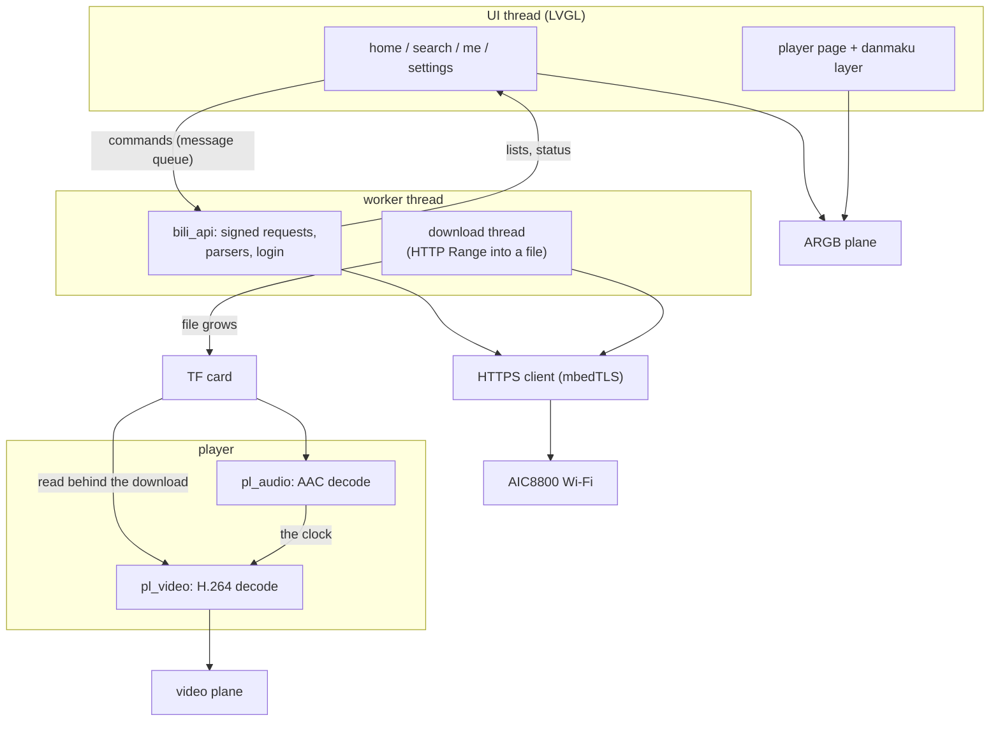
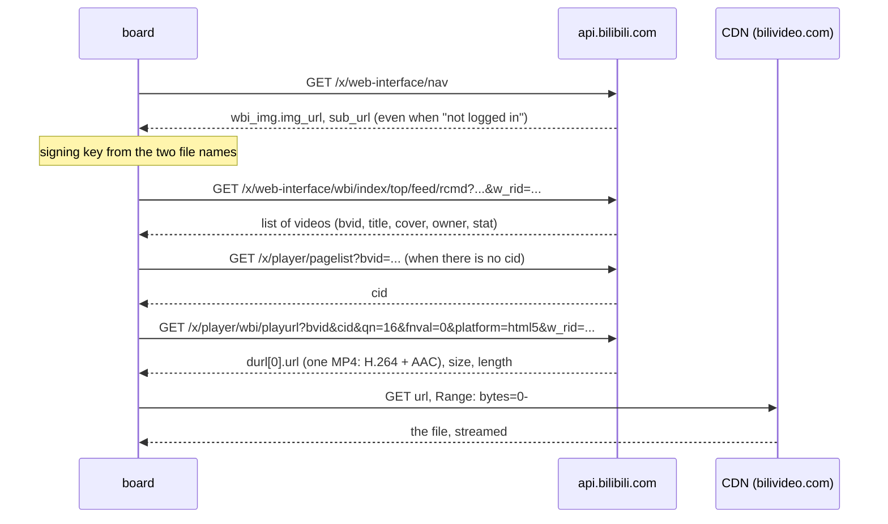

Bilibili is a client of the Bilibili video site for the YuzukiNeko: a touch user interface (LVGL, 1024×768) with cover cards, search with a pinyin input method, a player that starts while the file is still downloading, scrolling comments (danmaku), a QR code login and the Wi-Fi settings. It is an application, not a module, and it runs <strong>in place from the SPI NOR flash</strong> (XIP) like [NekoBox](nekobox.md), whose player files it is built from. The code is in `zephyr-components/bilibili-tv`.

This page explains how it is built, module by module, with the code of each one: the threads and the command queue, the HTTP and TLS client, the signed web interface, how the video stream is found and downloaded, the player, the comments, and every part of the user interface.

| Part | Files | What it does |
| --- | --- | --- |
| Commands and threads | `src/main.c`, `src/core/app.h` | the worker thread, the command queue, the lists |
| HTTP client | `src/net/http.c`, `http_parse.c` | GET with `Range`, TLS, chunked bodies, cookies |
| Web interface | `src/api/bili_api.c`, `src/net/wbi.c`, `bili_parse.c`, `src/net/json.c` | signed requests, parsers |
| Download | `src/net/download.c` | a file that grows on the card while it is played |
| Player | `src/player/` | MP4 demux, H.264 and AAC decode, the clock |
| Comments | `src/net/inflate.c`, `src/api/danmaku.c`, `src/ui/ui_danmaku.c`, `src/gfx/shift.c` | fetch, parse, draw, move |
| User interface | `src/ui/` | home, cards, covers, search, player page, account, settings |
| Account and Wi-Fi | `src/api/account.c`, `src/net/wifi.c` | QR login, join, forget |

Before you start, first complete [Setting up the development environment](../zephyr-setup-env.md) and [Getting the Zephyr source](../zephyr-get-source.md).

## Build and run

```sh
. ~/f101-zephyr/env.sh
west build -b yuzukineko -d build/bili zephyr-components/bilibili-tv
```

The image runs from the flash window, so the development flow is the one of NekoBox: write `zephyr.bin` at flash `0x80000` and run the XIP loader from RAM (see [Building and running](../zephyr-build-run.md)). This replaces NekoBox in that place; no boot stub has to be written while you develop.

```sh
xfel spinor write 0x80000 zephyr.bin
xfel write 0x20000 xip-boot_fel.bin
xfel exec 0x20000
```

What the card needs:

| File | Content |
| --- | --- |
| `/SD:/wifi.cfg` | the network name on the first line, the password on the second (the settings screen writes it too) |
| `/SD:/bilibili/` | the downloaded videos, `<BV id>.mp4`; a complete file is played again without a download |
| `/SD:/bilibili/auth.cfg` | the login, written after the QR code was confirmed |
| `/SD:/bilibili/settings.cfg` | volume and brightness |

## Overall structure



| Thread | Priority | Job |
| --- | --- | --- |
| audio (`pl_audio`) | 3 | decodes AAC, feeds the codec ring; its position is the clock of the player |
| display (`disp`) | 5 | commits the pictures to the display and waits for the flip |
| video (`pl_video`) | 6 | demuxes and decodes H.264, shows a picture when the clock reaches its time |
| user interface | 8 on the player page | LVGL, a fixed beat of 33 ms while comments run |
| download, covers | 8 and 9 | network and card |
| worker | lower | requests, parsing, login, the play sequence |

On the player page the interface runs below the video thread: at the same priority the redraws cost 2 to 10 late pictures per 5 seconds, at priority 8 it is zero or one.

## Commands and the worker thread

The user interface never waits for the network. Every action is a command in a message queue (`app_cmd()` may be called from any thread), and the worker thread takes them one by one. The commands are declared in `src/core/app.h`:

```c
enum app_cmd_type {
	CMD_REFRESH,	/**< arg: list, load its first page again */
	CMD_MORE,	/**< arg: list, append the next page */
	CMD_SEARCH,	/**< keyword in the command: a new search */
	CMD_PLAY,	/**< arg: list << 16 | index */
	CMD_STOP,	/**< back from the player */
	CMD_PAUSE,	/**< toggles */
	CMD_WIFI,	/**< join the network in ssid / psk */
	CMD_QR_START,	/**< ask for a new login code */
	CMD_QR_POLL,	/**< ask how the scan of the code is going */
	CMD_LOGOUT,	/**< forget the login */
	/* ... scan, disconnect, forget, settings, account numbers */
};
```

```c
K_MSGQ_DEFINE(cmd_q, sizeof(struct cmd), 8, 4);

void app_cmd(enum app_cmd_type type, int arg)
{
	struct cmd c = {.type = type, .arg = arg};

	if (type == CMD_STOP) {
		/* the flag is the whole command: a message left in the queue would stop the next
		 * video as soon as it opens */
		atomic_set(&stop_req, 1);
		return;
	}
	if (k_msgq_put(&cmd_q, &c, K_NO_WAIT) != 0) {
		printk("app: command queue full\n");
	}
}
```

`CMD_STOP` is special: the worker is busy inside `play()` while a video runs, so a stop cannot wait in the queue. It is a flag that the play loop and the download both look at. The worker itself is one loop:

```c
static void worker_main(void *a, void *b, void *c)
{
	struct cmd cmd;
	/* ... wait for the card, read wifi.cfg, load the login and the settings, join the network */
	for (;;) {
		k_msgq_get(&cmd_q, &cmd, K_FOREVER);
		switch (cmd.type) {
		case CMD_REFRESH:  load(cmd.arg, 1); break;
		case CMD_MORE:     /* load(list, next_page) */ break;
		case CMD_SEARCH:   /* store the keyword */ load(LIST_SEARCH, 1); break;
		case CMD_PLAY:     play(cmd.arg >> 16, cmd.arg & 0xffff); break;
		case CMD_QR_START: qr_start(); break;
		case CMD_QR_POLL:  qr_poll(); break;
		/* ... */
		}
	}
}
```

### Lists

A list is a fixed array the worker fills and the user interface reads, protected by a mutex. `gen` counts how often the list was replaced, so the interface knows when to rebuild its cards:

```c
struct vlist {
	struct bili_video v[MAX_VIDEOS];	/* MAX_VIDEOS = 100 */
	int count, next_page, pages;
	bool more, loading;
	int error;		/* what the last page request returned, 0 when it worked */
	uint32_t gen;
	char keyword[96];
};

/* the first page replaces the list, the others are appended without the videos already there */
static void list_store(enum list_id list, int page, const struct bili_video *v, int n, int pages)
{
	struct vlist *l = &lists[list];

	k_mutex_lock(&lists_lock, K_FOREVER);
	if (page == 1) {
		l->count = 0;
		l->gen++;
	}
	for (int i = 0; i < n && l->count < MAX_VIDEOS; i++) {
		bool dup = false;

		for (int j = 0; j < l->count && !dup; j++) {
			dup = strcmp(l->v[j].bvid, v[i].bvid) == 0;
		}
		if (!dup) {
			l->v[l->count++] = v[i];
		}
	}
	l->next_page = page + 1;
	l->pages = pages;
	l->more = n >= PAGE_SIZE / 2 && l->count < MAX_VIDEOS && (pages == 0 || page < pages);
	l->loading = false;
	k_mutex_unlock(&lists_lock);
}
```

`load()` picks the interface by list (`bili_api_feed`, `bili_api_popular`, `bili_api_follow`, `bili_api_search`), stores the result and puts a status text for the interface.

### From the worker to the interface

The worker never touches an LVGL object. It writes into a small block of pending state under a mutex and the UI thread takes it at the start of every round (`ui_run()` in `src/ui/ui.c`):

```c
static K_MUTEX_DEFINE(lock);
static struct {
	bool status_dirty, hot_dirty, play_dirty, pos_dirty;
	char status[128];
	/* ... trending words, title, duration, position, paused */
} pend;

void ui_set_status(const char *fmt, ...)
{
	va_list ap;

	k_mutex_lock(&lock, K_FOREVER);
	va_start(ap, fmt);
	vsnprintf(pend.status, sizeof(pend.status), fmt, ap);
	va_end(ap);
	pend.status_dirty = true;
	k_mutex_unlock(&lock);
}
```

```c
uint32_t ui_run(void)
{
	/* ... copy the dirty parts of pend under the lock, then, without it: */
	if (status_dirty) {
		ui_set_status_label(status);
	}
	if (play_dirty) {
		if (playing) {
			ui_play_set(title, dur);
			cover_pause(true);	/* the covers give their memory to the decoder */
			ui_nav(PAGE_PLAY);
		} else {
			cover_pause(false);
			ui_danmaku_set(NULL);
			ui_nav(return_page);
		}
	} else if (pos_dirty && cur == PAGE_PLAY) {
		ui_play_position(pos, paused);
		ui_play_buffered(buffered_permille);
	}
	ui_home_run(cur == PAGE_HOME);
	ui_search_run(cur == PAGE_SEARCH);
	if (cur == PAGE_PLAY && ui_danmaku_active()) {
		ui_danmaku_run(round_us);
	}
	uint32_t next = lv_timer_handler();
	/* ... */
}
```

A status text that is set twice before the interface looks at it shows only the last one, which is what a status line should do. The return value of `ui_run()` is how long the caller may sleep: on the player page with comments it is a fixed beat (`beat += 33`), not "40 ms after the work", because even steps look smooth.

## The HTTP client

`src/net/http.c` is a small HTTP/1.1 client on Zephyr sockets. It exists because the answers must be streamed: a video is megabytes, the heap is not, so the body goes to a callback as it arrives.

```c
typedef int (*http_body_fn)(void *ctx, const uint8_t *data, size_t len);

struct http_opts {
	const char *headers;	/**< extra header lines, each ending in CRLF, may be NULL */
	int64_t range_start;	/**< >= 0 asks for the bytes from this offset on */
	int timeout_ms;		/**< no data for this long ends the request, 0 is 15 s */
	int tls_verify;
};

int http_get(const char *url, const struct http_opts *opts, http_body_fn fn, void *ctx,
	     struct http_result *res);
int http_get_text(const char *url, const struct http_opts *opts, char *buf, size_t size,
		  struct http_result *res);	/* the whole body in one buffer */
```

### The connection

For `https` the socket is a native Zephyr TLS socket: the protocol is chosen when the socket is made and the host name goes in as an option:

```c
static int tcp_connect(const char *host, const char *port, int tls_native, int verify)
{
	struct zsock_addrinfo hints = {.ai_family = AF_INET, .ai_socktype = SOCK_STREAM};
	struct zsock_addrinfo *res;
	int sock, ret;

	ret = zsock_getaddrinfo(host, port, &hints, &res);
	if (ret != 0) {
		return -EHOSTUNREACH;
	}
	sock = zsock_socket(res->ai_family, res->ai_socktype, tls_native ? IPPROTO_TLS_1_2 : IPPROTO_TCP);
	if (sock < 0) {
		ret = -errno;
		zsock_freeaddrinfo(res);
		return ret;
	}
	if (tls_native) {
		int v = verify ? TLS_PEER_VERIFY_REQUIRED : TLS_PEER_VERIFY_NONE;

		zsock_setsockopt(sock, SOL_TLS, TLS_PEER_VERIFY, &v, sizeof(v));
		zsock_setsockopt(sock, SOL_TLS, TLS_HOSTNAME, host, strlen(host) + 1);
	}
	ret = zsock_connect(sock, res->ai_addr, res->ai_addrlen);
	/* ... close and report on failure */
	zsock_freeaddrinfo(res);

	return sock;
}
```

### The request

The headers are the ones a browser sends: the CDN refuses a request without the `Referer`. A `Range` header is added when the caller wants to continue a file, and the caller's own lines (the cookies) go last:

```c
ret = snprintf(req, REQ_SIZE, "GET %s HTTP/1.1\r\nHost: %s\r\n", u.path, u.host);
ret += snprintf(req + ret, REQ_SIZE - ret,
		"User-Agent: " USER_AGENT "\r\n"
		"Referer: https://www.bilibili.com/\r\nAccept: */*\r\nConnection: close\r\n");
if (opts != NULL && opts->range_start > 0) {
	ret += snprintf(req + ret, REQ_SIZE - ret, "Range: bytes=%lld-\r\n",
			(long long)opts->range_start);
}
if (opts != NULL && opts->headers != NULL) {
	ret += snprintf(req + ret, REQ_SIZE - ret, "%s", opts->headers);
}
strcpy(req + ret, "\r\n");
```

`Connection: close` keeps the client simple: every request is its own connection and the end of the body is the end of the connection or the length the server announced. The connection time, the time to the first byte and the total are measured and returned in `struct http_result` (they are what the logs print when a download is slow).

### The parser

The answer is read in blocks of `RECV_SIZE` and given to a state machine (`src/net/http_parse.c`) that knows the header, a body with a length, a body until close and chunked bodies. It is a separate file so that it can be tested on the host:

```c
enum http_parse_state {
	HP_HEADER, HP_BODY_LENGTH, HP_BODY_CLOSE,
	HP_CHUNK_SIZE, HP_CHUNK_EXT, HP_CHUNK_DATA, HP_CHUNK_CR, HP_TRAILER,
	HP_DONE,
};

/* returns 1 when the body is complete, 0 for more, negative on a malformed answer */
int http_parser_feed(struct http_parser *p, const uint8_t *data, size_t len,
		     http_body_fn fn, void *ctx);
```

The receive loop is the glue between the socket and the parser:

```c
for (;;) {
	ssize_t n = conn_recv(c, rx, RECV_SIZE);

	if (n < 0) { ret = n; break; }
	if (n == 0) { ret = http_parser_eof(p) == 1 ? 0 : -ECONNRESET; break; }
	ret = http_parser_feed(p, rx, n, gate_body, &g);	/* gate_body calls fn for 2xx only */
	if (ret == 1) { ret = 0; break; }
	if (ret < 0) { break; }
}
```

The `Set-Cookie` fields of the answer are collected into `res->set_cookie`; the login needs them.

## The signed web interface

All of it is in `src/api/bili_api.c`, with the signature in `src/net/wbi.c`, the MD5 in `src/net/md5.c`, and the parsers in `src/api/bili_parse.c`.

### The signing key

Most list and play interfaces want a signature (WBI). The key is not secret: the answer of `/x/web-interface/nav` carries two image addresses (`wbi_img.img_url` and `sub_url`) even when nobody is logged in (the answer code is `-101`, the data is still there). The 32 characters in front of the extension of each file name are joined to 64 characters and shuffled with a fixed table of 64 positions; the first 32 characters of the result are the key:

```c
static const uint8_t mixin[64] = {
	46, 47, 18, 2, 53, 8, 23, 32, 15, 50, 10, 31, 58, 3, 45, 35, 27, 43, 5, 49, 33, 9, 42, 19, 29, 28,
	14, 39, 12, 38, 41, 13, 37, 48, 7, 16, 24, 55, 40, 61, 26, 17, 0, 1, 60, 51, 30, 4, 22, 25, 54,
	21, 56, 59, 6, 63, 57, 62, 11, 36, 20, 34, 44, 52,
};

/* the 32 characters in front of the extension of the last path segment */
static int image_key(const char *url, char out[32])
{
	const char *name = strrchr(url, '/');
	const char *dot;

	name = name != NULL ? name + 1 : url;
	dot = strchr(name, '.');
	if (dot == NULL || dot - name != 32) {
		return -EINVAL;
	}
	memcpy(out, name, 32);

	return 0;
}

int wbi_make_key(const char *img_url, const char *sub_url, char key[33])
{
	char raw[64];

	if (image_key(img_url, raw) != 0 || image_key(sub_url, raw + 32) != 0) {
		return -EINVAL;
	}
	for (int i = 0; i < 32; i++) {
		key[i] = raw[mixin[i]];
	}
	key[32] = '\0';

	return 0;
}
```

```c
static int load_key(void)
{
	char *a = fetch(API "/x/web-interface/nav");
	int ret;

	if (a == NULL) {
		return -EIO;
	}
	ret = bili_parse_nav(a, wbi_key);	/* wbi_make_key() of the two addresses in the answer */
	free(a);

	return ret;
}
```

### Signing a request

`wbi_query()` takes the parameters as `name=value` strings and writes the query with its signature:

1. add `wts=<time stamp>`;
2. sort by name;
3. percent-encode the values (the characters `!'()*` are dropped first, as the server does);
4. join as `a=1&b=2`, append the key, MD5 of that text is `w_rid`;
5. return the sorted query followed by `&w_rid=<hash>`.

```c
/* order by name: the text up to the '=' */
static int name_cmp(const char *a, const char *b)
{
	for (;; a++, b++) {
		unsigned char x = *a == '=' ? 0 : *a, y = *b == '=' ? 0 : *b;

		if (x != y || x == 0) {
			return (int)x - (int)y;
		}
	}
}

/* percent encoding of everything but the unreserved characters, after the server's filter */
static int encode(const char *s, char *out, size_t size)
{
	size_t n = 0;

	for (; *s != '\0'; s++) {
		unsigned char c = *s;

		if (strchr("!'()*", c) != NULL) {
			continue;
		}
		if ((c >= '0' && c <= '9') || (c >= 'a' && c <= 'z') || (c >= 'A' && c <= 'Z') ||
		    c == '-' || c == '_' || c == '.' || c == '~') {
			out[n++] = c;
		} else {
			n += snprintf(out + n, size - n, "%%%02X", c);
		}
	}
	out[n] = '\0';

	return n;
}
```

Sorting is an insertion sort over the pointers: the lists are a handful of entries. The server does not check the time stamp, so the board, which has no network time at that point, uses a fixed base plus its uptime:

```c
static int64_t stamp(void)
{
	return 1700000000 + k_uptime_get() / 1000;
}
```

### One call, with the two kinds of retry

`call()` is the only way a signed request is made. It signs, sends, reads the `code` of the answer and recovers from the two failures the site is known for, once each:

```c
#define CODE_RISK	(-412)	/* too many requests / no browser identity */
#define CODE_SIGN_1	(-403)	/* the signature or its key is wrong */
#define CODE_SIGN_2	(-352)

static char *call(const char *path, const char *const *params, int count, int *code)
{
	bool new_key = false, new_cookie = false;

	for (;;) {
		char url[800], query[600], *a;

		*code = 0;
		if (wbi_key[0] == '\0' && load_key() != 0) {
			return NULL;
		}
		if (wbi_query(params, count, wbi_key, stamp(), query, sizeof(query)) < 0) {
			return NULL;
		}
		snprintf(url, sizeof(url), API "%s?%s", path, query);
		a = fetch(url);
		if (a == NULL) {
			return NULL;
		}
		*code = bili_parse_code(a);
		if (*code == 0) {
			return a;
		}
		free(a);
		if ((*code == CODE_SIGN_1 || *code == CODE_SIGN_2) && !new_key) {
			new_key = true;
			wbi_key[0] = '\0';		/* load the key again */
		} else if (*code == CODE_RISK && !new_cookie) {
			new_cookie = true;
			if (load_cookie() != 0) {	/* /x/frontend/finger/spi */
				return NULL;
			}
		} else {
			return NULL;
		}
	}
}
```

`load_cookie()` asks `/x/frontend/finger/spi` for two ids and keeps them as `buvid3=...; buvid4=...`. `headers()` builds the `Cookie:` line of every request from these ids and, when there is a login, the login cookies of `account.c`:

```c
static const char *headers(void)
{
	char acc[460];

	account_cookie(acc, sizeof(acc));
	if (buvid[0] == '\0' && acc[0] == '\0') {
		return NULL;
	}
	snprintf(cookie_hdr, sizeof(cookie_hdr), "Cookie: %s%s%s\r\n", buvid,
		 buvid[0] && acc[0] ? "; " : "", acc);

	return cookie_hdr;
}
```

### The interfaces

| Function | Interface |
| --- | --- |
| `bili_api_feed()` | `/x/web-interface/wbi/index/top/feed/rcmd` (personalised when logged in) |
| `bili_api_popular()` | `/x/web-interface/popular` |
| `bili_api_search()` | `/x/web-interface/wbi/search/type` |
| `bili_api_hot_words()` | `/x/web-interface/wbi/search/square` |
| `bili_api_follow()` | `/x/polymer/web-dynamic/v1/feed/all?type=video` (login needed; 512 KiB buffer, the answer for 20 posts is over 128 KiB) |
| `bili_api_stream()` | `/x/player/wbi/playurl` (after `/x/player/pagelist` when there is no `cid`) |
| `bili_api_danmaku()` | `/x/v1/dm/list.so?oid=<cid>` |
| `bili_api_qr_new()`, `bili_api_qr_poll()` | `passport.bilibili.com/x/passport-login/web/qrcode/generate` and `/poll` |
| `bili_api_user()`, `bili_api_user_stats()` | `/x/web-interface/nav`, `/x/web-interface/nav/stat` |

For example the recommendations:

```c
int bili_api_feed(int page, struct bili_video *out, int max)
{
	char ps[16], idx[24];
	const char *params[] = {ps, "fresh_type=4", idx, "web_location=1430650"};
	char *a;
	/* ps=<max>, fresh_idx=<page> ... */
	a = call("/x/web-interface/wbi/index/top/feed/rcmd", params, ARRAY_SIZE(params), &code);
	/* ... bili_parse_feed(a, out, max) */
}
```

### Reading JSON without a tree

The answers are 10 to 500 KiB of JSON and the heap is small, so `src/net/json.c` does not build a tree. A value is a pointer to its first character in the answer; nothing is copied until a string is asked for:

```c
const char *js_get(const char *obj, const char *key);	/* value of a key of an object */
const char *js_path(const char *v, const char *path);	/* "data.owner.name" */
const char *js_first(const char *arr);			/* first and next element of an array */
const char *js_next(const char *elem);
int js_str(const char *v, char *out, size_t size);	/* decodes escapes and \uXXXX to UTF-8 */
long long js_int(const char *v, long long def);
```

`js_get()` walks the keys of one object and skips the values it does not want with `js_skip()`; `js_path()` calls it once per dotted segment. The parsers in `bili_parse.c` are loops over arrays that copy out only what a card shows:

```c
int bili_parse_feed(const char *json, struct bili_video *out, int max)
{
	int n = 0;

	for (const char *it = js_first(js_path(json, "data.item")); it != NULL && n < max;
	     it = js_next(it)) {
		if (parse_video(it, &out[n]) == 0) {
			n++;
		}
	}

	return n;
}

int bili_parse_playurl(const char *json, struct bili_stream *out)
{
	const char *d = js_first(js_path(json, "data.durl"));

	if (d == NULL || js_str(js_get(d, "url"), out->url, sizeof(out->url)) <= 0) {
		return -ENOENT;
	}
	out->size = js_int(js_get(d, "size"), 0);
	out->length_ms = js_int(js_get(d, "length"), 0);
	out->quality = js_int(js_path(json, "data.quality"), 0);

	return 0;
}
```

The text must be valid JSON; every function returns NULL instead of walking past the end of a cut-off answer. The parsers have host tests with recorded answers (see the test aids below).

## Finding the video stream



```c
int bili_api_stream(const struct bili_video *v, struct bili_stream *out)
{
	char bvid[32], cid[32], qn[16];
	const char *params[] = {bvid, cid, qn, "fnval=0", "fnver=0", "fourk=0", "platform=html5",
				"high_quality=1"};
	uint64_t id = v->cid;
	char *a;
	int ret, code;

	if (id == 0) {
		ret = resolve_cid(v->bvid, &id);	/* a search result has no cid */
		if (ret != 0) {
			return ret;
		}
	}
	snprintf(bvid, sizeof(bvid), "bvid=%s", v->bvid);
	snprintf(cid, sizeof(cid), "cid=%llu", (unsigned long long)id);
	snprintf(qn, sizeof(qn), "qn=%d", QN_360P);		/* QN_360P is 16 */
	a = call("/x/player/wbi/playurl", params, ARRAY_SIZE(params), &code);
	if (a == NULL) {
		return code != 0 ? -EACCES : -EIO;
	}
	ret = bili_parse_playurl(a, out);
	out->cid = id;
	free(a);
	/* the address of the answer is used as it is, over HTTPS (CONFIG_BILI_CDN_HTTPS) */

	return ret;
}
```

- `qn=16` is 360P. A video of that quality is one MP4 file with the H.264 video and the AAC audio interleaved: `fnval=0` asks for the old `durl` format, not for the separate DASH streams. The board needs a demuxer for one file and no merging of audio and video, and the bit rate is low enough for Wi-Fi and the SD card.
- Higher qualities (720P and up) need a login with more rights and use DASH; they are not used. The login of this client only personalises the lists.
- The answer carries `durl[0].url` (a CDN address with a signature and a deadline), the size in bytes and the length in milliseconds.

## Playing while downloading

### The sequence

`play()` in `src/main.c` is the whole sequence, run by the worker thread:

```c
static void play(enum list_id list, int index)
{
	/* ... */
	ui_set_playing(v.title, 0);			/* the player page opens at once */
	for (int i = 0; i < 50 && cover_in_use() > 0; i++) {
		k_msleep(20);
	}
	cover_flush();					/* the decoder needs the memory the covers hold */

	ret = bili_api_stream(&v, &s);			/* the address of the file */
	/* the comments: nothing to wait for when they cannot be had */
	n = bili_api_danmaku(s.cid, dm);
	ui_set_danmaku(dm);

	snprintf(path, sizeof(path), CONFIG_BILI_CACHE_DIR "/%s.mp4", v.bvid);
	if (cached(path, s.size)) {
		ret = player_open(path, &info);		/* a complete file from an earlier time */
	} else {
		static struct player_growing g;

		g = (struct player_growing){.total = s.size, .avail = dl_avail};
		ret = dl_start(s.url, path, s.size, on_progress, NULL);
		ret = player_open_growing(path, &g, &info);
		prebuffer(&s, &info);			/* wait for a few seconds of the stream */
	}
	player_play();
	play_loop(&v, &info, growing);			/* until the end or a stop */
}
```

The page opens first, then the covers are thrown out, because the 640×360 decoder needs about 6 MB and the covers held them. `player_growing` is `static` because the player keeps the pointer until it is closed: a variable of an inner block would be gone by then (that was a real bug: the board froze at the first pause).

### The download thread

`src/net/download.c` downloads into a file of the card in blocks of 64 KiB. The file is written through a stage buffer, synced after every block, and the number of bytes that are in the file and in its directory entry is published for the player to read:

```c
#define STAGE_SIZE	(64 * 1024)
#define ATTEMPTS	6

static int flush(struct dl *d)
{
	ssize_t n = fs_write(d->fp, d->stage, d->used);

	if (n != (ssize_t)d->used) {
		return n < 0 ? (int)n : -EIO;
	}
	d->written += d->used;
	d->used = 0;
	if (d->synced != NULL) {
		/* a reader opens the file by its own handle: the size must be in the directory entry */
		int ret = fs_sync(d->fp);

		if (ret != 0) {
			return ret;
		}
		atomic_set(d->synced, (atomic_val_t)d->written);
	}

	return 0;
}
```

The body callback copies into the stage and flushes when it is full; it also reports progress every 250 ms and returns `-ECANCELED` when the user went back. The retry loop continues a broken transfer from the byte it has:

```c
for (attempt = 0; attempt < ATTEMPTS; attempt++) {
	struct http_opts o = {.range_start = d.done, .timeout_ms = 10000};
	struct http_result r;

	ret = http_get(url, &o, sink, &d, &r);
	/* ... flush what is staged ... */
	if (ret == 0 && (r.status >= 500 || r.status == 429) && attempt + 1 < ATTEMPTS) {
		/* the cache server is busy or has none of the file yet: a new request often works */
		k_msleep(1000 * (attempt + 1));
		continue;
	}
	if (ret == 0 && r.status / 100 != 2) {
		ret = r.status == 403 || r.status == 404 ? -EACCES : -EIO;
		break;
	}
	if (ret == 0 && d.done > 0 && o.range_start > 0 && r.status != 206) {
		ret = -EPROTO;	/* the server does not do ranges: cannot continue */
		break;
	}
	if (ret == 0 && (total == 0 || d.done >= total)) {
		break;			/* complete */
	}
	k_msleep(500);			/* the connection broke: again from d.done */
}
```

In the background form (`dl_start()`) the same `run()` is the body of a thread (priority 8) and its state is two atomics the player reads through `dl_avail()`:

```c
static atomic_t bg_synced, bg_state;	/* state: 0 running, 1 done, negative errno */

uint64_t dl_avail(void *ctx, int *state)
{
	*state = (int)atomic_get(&bg_state);

	return (uint64_t)(uint32_t)atomic_get(&bg_synced);
}
```

### Reading a file that is not complete

The player (`src/player/player.c`, built from the NekoBox player with this one addition) reads the file through one function. When a read needs bytes that are not in the file yet, it waits for the download and then opens its own handle again, because a FAT file handle keeps the size it saw when it was opened:

```c
/* waits until [off, off + len) is in the file; reopens the handle when it is older than the data */
static int pl_grow_wait(struct reader *r, uint64_t off, size_t len)
{
	uint64_t need = off + len, av;
	int st;

	for (;;) {
		av = pl_grow->avail(pl_grow->ctx, &st);
		if (st == 1) {
			av = pl_grow->total;		/* the download is complete */
		}
		if (av >= need) {
			break;
		}
		if (st < 0) {
			return -EIO;			/* the download failed */
		}
		k_msleep(20);
	}
	if (need > r->known) {
		fs_close(&r->f);
		fs_file_t_init(&r->f);
		int ret = fs_open(&r->f, pl_path, FS_O_READ);

		if (ret != 0) {
			return ret;
		}
		r->known = st == 1 ? UINT64_MAX : av;
	}

	return 0;
}

int pl_file_read(void *ctx, uint64_t off, void *buf, size_t len)
{
	struct reader *r = ctx;
	/* ... */
	if (pl_grow != NULL && !(r->win_len > 0 && off >= r->win_off && off + len <= r->win_off + r->win_len)) {
		ret = pl_grow_wait(r, off, len);	/* only when the read is not in the window */
		if (ret != 0) {
			return ret;
		}
	}
	/* ... read through a 128 KiB window (video) or a 32 KiB one (audio) */
}
```

The `moov` box of the files of this site is at the front, so the demuxer can read the track tables after the first few kilobytes. The player opens the video and the audio with a reader each; both go through `pl_file_read()`.

### Waiting for a first stock

A file that is still downloading is opened held on its first picture (`PLAYER_PAUSED`: the first picture is shown and nothing plays), and the application waits for some seconds of the stream before it starts the sound and the video with `player_play()`, so the slow start of the connection does not eat the first seconds:

```c
/* player.c, open_impl() */
pl_state = g != NULL ? PLAYER_PAUSED : PLAYER_PLAYING;
pl_req.seq = 0;
pl_req_post(0, g == NULL);
```

```c
static void prebuffer(const struct bili_stream *s, const struct player_info *info)
{
	uint64_t want, av;
	int64_t t0 = k_uptime_get();
	int state;

	if (CONFIG_BILI_PREBUFFER_SEC <= 0 || info->duration_ms == 0 || s->size == 0) {
		return;
	}
	want = s->size * (CONFIG_BILI_PREBUFFER_SEC * 1000ULL) / info->duration_ms;
	want = MIN(MAX(want, 256 * 1024ULL), s->size);
	for (;;) {
		av = dl_avail(NULL, &state);
		ui_set_status("buffering %u%%", (unsigned int)MIN(av * 100 / want, 99ULL));
		if (state != 0 || av >= want || atomic_get(&stop_req) ||
		    k_uptime_get() - t0 > CONFIG_BILI_PREBUFFER_TIMEOUT_SEC * 1000) {
			break;
		}
		k_msleep(50);
	}
}
```

`want` is `BILI_PREBUFFER_SEC` seconds (6) of the average bit rate of the file, at least 256 KiB; the wait ends at once when the download is over, failed, cancelled, or after `BILI_PREBUFFER_TIMEOUT_SEC` (20 s). The percentage is the one of the stock, not of the file: the file has megabytes and its percentage would stand at 1 or 2 for the whole wait. In `play_loop()` the message `buffering...` comes back when the picture stands for more than 1.5 seconds later on, which means the download fell behind.

### The player threads

Three threads run the player. They talk through a request that carries a sequence number; a new request (a seek, a pause) makes the running session end and the next one start at the requested position:

```c
struct request {
	uint32_t seq;
	int64_t pos_us;
	bool play;
};

bool pl_req_changed(uint32_t seq)
{
	return pl_quit || pl_req_get().seq != seq;
}
```

Pause is not "stop the clock": it is a request for a session at the current position that is not playing. That session decodes from the key frame before the position, shows the picture at the position and holds it (`held = true`); resuming is a request for a playing session at the same position. This is also why a seek and a pause cost about the same, and why the video should have a key frame every second or two.

**The clock.** The audio position is the clock of the player: the number of blocks the codec has played, times the length of a block, plus the time since the last block:

```c
int64_t pl_audio_clock_us(void)
{
	uint32_t blocks, cycle;

	if (!pl_audio_running) {
		return -1;
	}
	i2s_sunxi_codec_tx_position(pl_codec_i2s, &blocks, &cycle);

	return pl_audio_base_us + (int64_t)blocks * AAC_FRAMES * 1000000 / pl_mp4.audio.sample_rate +
	       (int64_t)k_cyc_to_us_floor64(k_cycle_get_32() - cycle);
}
```

**Waiting for a picture.** The video thread decodes, then waits until the clock reaches the time of the picture. A picture more than two frames late is not shown (`WAIT_LATE`, which the log counts as `late`):

```c
#define DROP_US		(2 * 33367)

enum wait_result pl_wait_for(uint32_t seq, int64_t pts_us, int64_t start_us, int64_t start_ms)
{
	for (;;) {
		int64_t now = pl_audio_clock_us(), diff;

		if (pl_req_changed(seq)) {
			return WAIT_ABORT;
		}
		if (now < 0) {
			/* no sound running: the wall clock from the start of the session */
			now = start_us + (k_uptime_get() - start_ms) * 1000;
		}
		diff = pts_us - now;
		if (diff < -DROP_US) {
			return WAIT_LATE;
		}
		if (diff <= LEAD_US) {
			return WAIT_ON_TIME;
		}
		k_msleep(CLAMP((int)((diff - LEAD_US) / 1000), 1, 20));
	}
}
```

**The session loop.** Each H.264 sample is read from the file (through `pl_file_read()`), converted from AVCC (length prefixed) to Annex B (start codes), and fed to the video engine. The decoder says what it needs by its return code:

```c
ret = vdec_stream_get_frame(pl_vdec_dev, stream, &frame);
if (ret == 0) {
	/* the pictures from the key frame up to the position are not shown */
	w = r->play ? pl_wait_for(r->seq, pts_us, r->pos_us, start_ms) : WAIT_ON_TIME;
	if (w == WAIT_ON_TIME) {
		k_msgq_put(&disp_q, &frame, K_FOREVER);	/* to the display thread */
		pl_pos_publish(r->seq, pts_us / 1000);
		if (!r->play) {
			held = true;			/* a paused session shows one picture and holds */
			break;
		}
	} else {
		vdec_frame_release(pl_vdec_dev, &frame);	/* late */
	}
	continue;
}
if (ret == -EBUSY) {			/* the decoder is working */
	k_msleep(2);
	continue;
}
/* -EAGAIN: it wants data */
if (pl_file_read(&pl_vfile, s.offset, raw, s.size) == 0) {
	ab_len = avcc_to_annexb(raw, s.size, ab, first || s.sync);
	ret = vdec_stream_feed(pl_vdec_dev, stream, ab + ab_used, ab_len - ab_used, pending_pts, &used);
}
```

**The display thread.** Committing a picture waits for the flip of the one before it, which would stall the decoder, so a thread of its own does it. It hands a picture back only when the next one is up, and the video thread releases it (so the decoder stays single threaded):

```c
K_MSGQ_DEFINE(disp_q, sizeof(struct vdec_frame), 1, 4);
K_MSGQ_DEFINE(done_q, sizeof(struct vdec_frame), 4, 4);

static void disp_main(void *a, void *b, void *c)
{
	struct vdec_frame f, shown = {0};

	for (;;) {
		k_msgq_get(&disp_q, &f, K_FOREVER);
		/* ... a frame without a buffer ends the session ... */
		show(&f);			/* display_sunxi_show_yuv(): returns when the picture is up */
		if (shown.priv != NULL) {
			k_msgq_put(&done_q, &shown, K_FOREVER);
		}
		shown = f;
	}
}
```

The picture goes to the video plane as NV12 with the BT.709 matrix (`display_sunxi_show_yuv()`); the video engine and the display engine read the same memory and the CPU never touches the pixels.

## The comments

### Fetch and inflate

The comments of a video are one XML file (`/x/v1/dm/list.so?oid=<cid>`) that the server sends as raw deflate. Neither is kept whole: the body goes through a streaming inflater (`src/net/inflate.c`, a deflate decoder of our own) into a streaming XML scanner (`src/api/danmaku.c`), in blocks as the TLS records arrive:

```c
/* the bytes of the answer: raw deflate as the server sends it, or the XML itself */
static int dm_body(void *ctx, const uint8_t *d, size_t n)
{
	struct dm_sink *s = ctx;
	int ret;

	if (!s->started) {
		s->started = true;
		s->plain = n > 0 && d[0] == '<';
	}
	if (s->plain) {
		return dm_parser_feed(s->parser, d, n);
	}
	ret = inflate_feed(s->inf, d, n);

	return ret < 0 ? ret : 0;	/* 1: the stream is complete, what follows is of no interest */
}
```

### The scanner and the set

The scanner is a small state machine: text outside a tag, a tag, and the text of a `<d p="...">` element. The attribute `p` is `time,mode,size,color,...`:

```c
static int tag_done(struct dm_parser *p)
{
	p->state = P_OUT;
	p->tag[p->tag_n] = '\0';
	if (strncmp(p->tag, "d p=\"", 5) == 0) {
		p->raw_n = 0;
		p->in_d = true;
		parse_p(p, p->tag + 5);			/* time, mode, colour */
	} else if (strcmp(p->tag, "/d") == 0 && p->in_d) {
		p->in_d = false;
		return add_item(p);			/* unescape the text, store it */
	}

	return 0;
}
```

The set is two arrays: items (time in milliseconds, colour, offset of the text, mode, length) and one pool for all the texts. Texts are cut on a character boundary at 90 bytes, and the set is capped (`BILI_DM_MAX_ITEMS`, `BILI_DM_POOL_KB`). After the last byte the items are sorted by time and a position is found by bisection:

```c
struct dm_item {
	uint32_t t_ms;
	uint32_t rgb;		/* 0xRRGGBB */
	uint32_t off;		/* position of the text in the pool */
	uint8_t mode;		/* 1 scroll, 4 bottom, 5 top, 6 reverse */
	uint8_t len;
};

uint32_t dm_find(const struct dm_set *set, uint32_t t_ms)
{
	uint32_t lo = 0, hi = set->count;

	while (lo < hi) {
		uint32_t mid = (lo + hi) / 2;

		if (set->items[mid].t_ms < t_ms) {
			lo = mid + 1;
		} else {
			hi = mid;
		}
	}

	return lo;
}
```

### Showing them

`ui_danmaku_run()` is called by the interface once a round. It holds a pool of `BILI_DM_ACTIVE` (20) LVGL labels over the video. A comment takes a free label; a scrolling one also needs a lane that it will not catch up with:

```c
#define LANE_H		34
#define SPEED		170		/* pixels per second */
#define GAP		28
#define TOP_ROWS	4
#define BOTTOM_ROWS	4
#define FIXED_MS	4000

/* where a scrolling comment is at the time p: all of them move at one speed */
static int32_t scroll_px(uint32_t p)
{
	return (int32_t)((uint64_t)p * SPEED / 1000);
}

static bool spawn(const struct dm_item *it, uint32_t p)
{
	/* ... */
	w = lv_text_get_width(text, it->len, ui_font_m, 0) + 16;
	if (kind == K_SCROLL) {
		for (int i = 0; i < SCROLL_ROWS; i++) {
			if (p >= scroll_free_at[i]) {	/* the lane is free again */
				row = i;
				break;
			}
		}
		if (row < 0) {
			return false;
		}
		/* the next one may enter when the tail of this one has come in, plus a gap */
		scroll_free_at[row] = p + (uint32_t)(w + GAP) * 1000 / SPEED;
		x = SCREEN_W;
		y = 4 + (TOP_ROWS + row) * LANE_H;
	} else {
		/* top and bottom: a row that is free for FIXED_MS */
	}
	/* set the text, the colour, the size and the place, show the label */
}
```

Because every scrolling comment moves at the same speed, the x of every label is a function of one number: `x = SCREEN_W + s0 - scroll_px(now)`, with `s0 = scroll_px(t0)` taken when the comment was shown. A very dark text colour is made white so it can be read over a picture (`readable()`), and the labels have a 40% black background.

The clock that drives `p` follows the position of the video but is smoothed, so the text does not move in steps when the position is reported late:

```c
if (playing) {
	int32_t err = (int32_t)(pos - now) - clk_off;

	if (clk_sync || err > CLK_SNAP_MS || err < -CLK_SNAP_MS) {
		clk_off = (int32_t)(pos - now);		/* jump: after a seek or a stall */
		clk_sync = false;
	} else {
		clk_off += err / 8;			/* otherwise follow slowly */
	}
}
p = now + clk_off;
/* never far ahead of the video (a stall), and never backwards */
```

When a round took longer than 60 ms, `density_div` becomes 2 and every second comment is left out until the rounds are fast again.

### Moving them as a picture

Moving 20 labels makes LVGL draw the old and the new place of each, 20 small redraws of text over a video. Because they all move by the same distance, `ui_danmaku.c` moves the layer instead as one picture, with the 2D accelerator, and lets LVGL draw only the strip that came in at the right. LVGL's own refresh calls `dm_strips()` at its start (`LV_EVENT_REFR_START`):

```c
static void dm_strips(lv_event_t *e)
{
	lv_display_t *d = lv_display_get_default();
	lv_area_t lanes = {0, LANES_Y, SCREEN_W - 1, LANES_Y + LANES_H - 1}, x;
	bool other = false;

	if (pend_dx == 0) {
		return;
	}
	/* is anything else going to be drawn in the lanes (a button, the message)? */
	for (uint32_t i = 0; i < d->inv_p && !other; i++) {
		other = !d->inv_area_joined[i] && lv_area_intersect(&x, &d->inv_areas[i], &lanes);
	}
	if (other) {
		n_other++;			/* then the lanes are drawn whole */
	} else if (shift_cols(0, LANES_Y, SCREEN_W, LANES_H, pend_dx, false) != 0) {
		n_failed++;
	} else {
		lanes.x1 = SCREEN_W - pend_dx;	/* only the new columns are drawn */
		n_shifted++;
	}
	lv_inv_area(d, &lanes);
	pend_dx = 0;
}
```

`shift_cols()` (`src/gfx/shift.c`) is a blit inside the frame buffer, from `x+dx` to `x`, then a fill of the columns that are left over on the right with transparent black:

```c
int shift_cols(int x, int y, int w, int h, int dx, bool sync)
{
	struct g2d_surface f, b;
	struct g2d_rect src, dst, strip;
	int ret;

	/* ... checks: ready, 0 < dx < w, inside the frame buffer, self check passed ... */
	surfaces(&f, &b);
	sys_cache_data_flush_range(fb + (size_t)y * stride, (size_t)h * stride);
	src = (struct g2d_rect){x + dx, y, w - dx, h};
	dst = (struct g2d_rect){x, y, w - dx, h};
	ret = g2d_blit(g2d, &f, &src, &f, &dst, G2D_ROTATE_0, G2D_FLAG_NO_CACHE_OPS);
	if (ret == 0) {
		strip = (struct g2d_rect){x + w - dx, y, dx, h};
		g2d_fill(g2d, &f, &strip, 0);
	}
	sys_cache_data_invd_range(fb + (size_t)y * stride, (size_t)h * stride);

	return ret;
}
```

A copy to the left inside one buffer has overlapping source and destination; the first time it is used, `cols_check()` draws a test pattern, moves it and compares, so a G2D that does not do it right turns the feature off instead of drawing garbage.

The labels themselves still have to end up at their new x for the next round, but moving a label is a style change that LVGL applies at the layout update, and that would invalidate the old and the new place again. So the move is made in a window where the invalidation is off:

```c
lv_display_t *d = lv_display_get_default();

lv_display_enable_invalidation(d, false);
for (int i = 0; i < CONFIG_BILI_DM_ACTIVE; i++) {
	if (slots[i].used && slots[i].kind == K_SCROLL) {
		lv_obj_set_x(slots[i].lbl, slots[i].x);
	}
}
lv_obj_update_layout(layer);		/* the style change is applied now, with nothing marked dirty */
lv_display_enable_invalidation(d, true);
```

## The user interface

### Fonts and colours

The screen is 1024×768. LVGL draws on the ARGB plane and the display engine blends it over the video plane. The palette is dark (`src/ui/ui_priv.h`):

```c
#define C_BG		lv_color_hex(0x0b0f14)
#define C_BAR		lv_color_hex(0x141a21)
#define C_CARD		lv_color_hex(0x1c232c)
#define C_CARD_PRESS	lv_color_hex(0x2a3643)
#define C_ACCENT	lv_color_hex(0x00a1d6)	/* the blue of the site */
#define C_TEXT		lv_color_hex(0xe8edf2)
#define C_DIM		lv_color_hex(0x8a97a6)
```

The Chinese text is Noto Sans SC (SIL OFL), cut by `tools/make_font.py` to GB2312, the kana and the punctuation (about 2.7 MB), included as a byte array and drawn by TinyTTF at three sizes, with a glyph cache of its own for each:

```c
static const uint8_t ttf[] = {
#include "font.inc"
};

static const lv_font_t *make(int px, int cache)
{
	lv_font_t *f = lv_tiny_ttf_create_data_ex(ttf, sizeof(ttf), px, LV_FONT_KERNING_NONE, cache);

	if (f == NULL) {
		return &lv_font_montserrat_20;
	}
	/* the symbols of LVGL (arrows, play, ...) are not in the font */
	f->fallback = &lv_font_montserrat_20;

	return f;
}

void ui_fonts_init(void)
{
	ui_font_s = make(18, 160);
	ui_font_m = make(22, 320);
	ui_font_l = make(28, 64);
}
```

The array lives in the flash window and is never copied to RAM. Kerning is off (`LV_TINY_TTF_CACHE_KERNING_CNT=0` from CMake): the kerning cache of TinyTTF returned entries to the glyph cache and glyphs overlapped.

### The home page

```text
+--------------------------------------------------------------+
| [logo]  [ search ...............................]  [refresh]  |  BAR_H 72
| recommend  popular  following                   me  settings |  TABS_H 52
|--------------------------------------------------------------|
| +------+ +------+ +------+ +------+                           |
| |cover | |cover | |cover | |cover |                           |
| |title | |title | |title | |title |   4 columns of 236 px     |
| |up/vw | |up/vw | |up/vw | |up/vw |                           |
| +------+ +------+ +------+ +------+                           |
+--------------------------------------------------------------+
```

`ui_home.c` has five tab buttons in one row and a panel or a grid behind each. The first three are lists, the last two are panels:

```c
#define LIST_TABS	3	/* recommend, popular, following: a card grid each */
#define TAB_ME		3	/* at the right end of the row, with the settings */
#define TAB_SETTINGS	4
#define TABS		5

static void show_tab(int t)
{
	tab = t;
	for (int i = 0; i < TABS; i++) {
		bool on = i == t;

		lv_obj_set_style_text_color(lv_obj_get_child(tab_btn[i], 0), on ? C_ACCENT : C_DIM, 0);
		lv_obj_set_style_border_width(tab_btn[i], on ? 3 : 0, 0);
		/* the grid or the panel of the tab is shown, the others hidden */
	}
}

/* ... */
lv_obj_add_flag(tab_btn[2], LV_OBJ_FLAG_HIDDEN);	/* "following": until there is a login */
```

### The card grid

`ui_card.c` builds a card as a plain LVGL object with a cover image, a duration label, the title (two lines), the number of views and the uploader. The position is computed from the index, so no layout is used:

```c
#define CARD_W		236
#define CARD_COLS	4

lv_obj_set_pos(o, (idx % CARD_COLS) * (CARD_W + MARGIN),
		  (idx / CARD_COLS) * (ui_card_height() + MARGIN));
```

The rounded top corners of the cover are not drawn by a clip (a clip makes LVGL render the object in an offscreen layer, which is slow). They are two 10×10 A8 masks in the colour of the page, laid over the corners:

```c
#define CORNER		10
static uint8_t corner_px[2][CORNER_STRIDE * CORNER] __aligned(4);

for (int y = 0; y < CORNER; y++) {
	for (int x = 0; x < CORNER; x++) {
		float dx = x + 0.5f - CORNER, dy = y + 0.5f - CORNER;
		float a = sqrtf(dx * dx + dy * dy) - CORNER + 0.5f;	/* 0 inside the circle, 1 outside */
		uint8_t v = a <= 0.0f ? 0 : (a >= 1.0f ? 255 : (uint8_t)(a * 255.0f));

		corner_px[0][y * CORNER_STRIDE + x] = v;
		corner_px[1][y * CORNER_STRIDE + CORNER - 1 - x] = v;	/* the mirror image */
	}
}
```

A list of 100 videos is 100 cards, but only the ones near the screen exist. `window_rows()` says which rows must have widgets (the screen and one card height around it); the others are deleted and built again when they come into view:

```c
static void window_rows(struct ui_grid *g, int *first, int *last)
{
	int row_h = ui_card_height() + MARGIN;
	int top = lv_obj_get_scroll_y(g->obj), vh = lv_obj_get_height(g->obj);
	int rows = (g->built + CARD_COLS - 1) / CARD_COLS;

	*first = MAX(0, (top - row_h) / row_h);
	*last = MIN(rows - 1, (top + vh + row_h) / row_h);
}
```

When the end of the list is near, `ui_grid_more()` asks the worker for the next page (`CMD_MORE`), once for each list length (`asked_at`).

### Scrolling by moving the picture

The same idea as for the comments, applied to the grid: when the finger scrolls the list by `dy` pixels, LVGL moves all the cards and would draw the whole list again. `scrolled()` instead lets the accelerator move the picture and marks only the rows that came in:

```c
static void scrolled(lv_event_t *e)
{
	struct ui_grid *g = lv_event_get_user_data(e);
	lv_display_t *d = lv_display_get_default();
	int y = lv_obj_get_scroll_y(g->obj), dy = y - g->last_scroll;

	g->last_scroll = y;
	g->covers_dirty = true;
	/* ... for a jump, a hidden list or a step as big as the list: draw everything ... */
	if (!move_pending(d, &r, dy)) {
		/* something else waits to be drawn inside the list: draw everything */
	} else {
		g->shift_dy += dy;		/* the picture is moved once per frame, at the refresh */
		if (dy > 0) {
			g->pend_bottom = MIN(h, g->pend_bottom + dy);
			g->pend_top = MAX(0, g->pend_top - dy);
		} else {
			g->pend_top = MIN(h, g->pend_top - dy);
			g->pend_bottom = MAX(0, g->pend_bottom + dy);
		}
		lv_display_enable_invalidation(d, false);	/* LVGL's own full redraw is left out */
		refresh_soon(d);
	}
}
```

At the start of the next refresh (`add_strips()`, `LV_EVENT_REFR_START`) the invalidation is switched on again, `shift_rows()` moves the picture of the list by the steps of the whole frame, and the rows that came in are marked dirty so LVGL draws only them. A cover that arrives while this goes on keeps its dirty area (`move_pending()` moves it by the same step), so it is not drawn twice. The state that LVGL sets on a list at the start and at the end of a scroll refreshes its style and used to draw the whole list; `state_guard_on/off` switch the invalidation off around it.

### Covers

A cover goes from the image server through the video engine to the screen without the CPU converting a pixel. Cards ask for a cover by its address; a pool of three threads (`BILI_COVER_THREADS`) fetches and decodes, and a cache of `BILI_COVER_CACHE` (24) pictures keeps them with reference counts:

```c
enum slot_state { SLOT_FREE, SLOT_QUEUED, SLOT_BUSY, SLOT_READY, SLOT_FAILED };

struct slot {
	enum slot_state state;
	char pic[URL_LEN];
	uint32_t *px;
	int refs;		/* cards that show it */
	uint8_t tries;		/* fetches that failed on the network */
	uint32_t used;		/* tick of the last use, for the choice of what to throw out */
};

void cover_request(const char *pic);			/* queue it if it is not there */
const uint32_t *cover_acquire(const char *pic);		/* NULL until it is ready; counts a reference */
void cover_release(const char *pic);
```

The server resizes: the request is `<address>@236w_133h_1c.jpg`, so the file is small (`JPEG_MAX` is 48 KiB). The thread that takes the newest request first (it is the one on the screen) fetches it with `http_get_text()` and decodes it:

```c
n = http_get_text(url, &(struct http_opts){.range_start = -1, .timeout_ms = 8000}, (char *)jpeg,
		  JPEG_MAX, NULL);
ret = jpeg_for_engine(jpeg, n) ? vdec_decode_image(vdec, VDEC_CODEC_JPEG, jpeg, n, VDEC_FORMAT_NV12, &f)
			       : -ENOTSUP;
if (ret == 0) {
	px = aligned_alloc(64, COVER_BYTES);
	to_xrgb(&f, px);		/* G2D: NV12 -> XRGB8888 at the size of the cover */
	vdec_frame_release(vdec, &f);
} else if (ret == -ENOTSUP) {
	px = decode_soft(jpeg, n);	/* the engine takes baseline 4:2:0 only: tjpgd for the rest */
}
```

`jpeg_for_engine()` reads the JPEG headers first and accepts only what the engine can decode (8 bit, three components, sampling 2×2/1×1/1×1, baseline); a file it would refuse is never given to it. `to_xrgb()` is one `g2d_blit()` that reads the NV12 picture, converts and scales it to the card size in one pass:

```c
struct g2d_surface src = {
	.format = G2D_PIXFMT_NV12, .width = f->width, .height = f->height,
	.plane = {(void *)f->plane[0], (void *)f->plane[1]}, .pitch = {f->stride[0], f->stride[1]},
};
struct g2d_surface dst = {
	.format = G2D_PIXFMT_XRGB8888, .width = COVER_STRIDE / 4, .height = COVER_H,
	.plane = {out}, .pitch = {COVER_STRIDE},
};
g2d_blit(g2d, &src, &sr, &dst, &dr, G2D_ROTATE_0, G2D_FLAG_YUV_FULL_RANGE);
```

The result has a row distance of 960 bytes and 64 byte alignment (with other strides LVGL drew noise). While a video plays `cover_pause(true)` stops the threads and `cover_flush()` frees the pictures, since the decoder needs the memory.

### Search

The search page is a text area, the LVGL keyboard and `lv_ime_pinyin`, which types Chinese one syllable at a time from a dictionary that the firmware supplies:

```c
kb = lv_keyboard_create(page);
ui_keyboard_style(kb);

ime = lv_ime_pinyin_create(page);
lv_ime_pinyin_set_dict(ime, (lv_pinyin_dict_t *)bili_pinyin_dict);
lv_ime_pinyin_set_keyboard(ime, kb);
```

The dictionary (`src/ui/pinyin_dict.c`) is generated by `tools/make_pinyin_dict.py`: for every toneless syllable, the characters that the font has, by falling frequency (the frequencies come from the dictionary of jieba, the syllables from pypinyin). The input method takes the first entry that starts with the typed letters, so the entries are sorted and "ni" comes before "nian". The row of trending words under the field comes from `CMD_HOT`; a tap puts the word in the field and starts the search. The results are a list like the others; the worker adds `cid` with `/x/player/pagelist` when a result is played.

### The player page

```c
/* The progress bar is also the place to seek: the finger sets the position, letting go jumps there. */
#define SEEK_MARGIN	8	/* thousandths kept back from the end of the downloaded part */

static void seek_move(void)
{
	/* lim: the position cannot go past what is downloaded */
	int v, lim = buffered >= 1000 ? 1000 : buffered - SEEK_MARGIN;
	lv_point_t p;

	lv_indev_get_point(lv_indev_active(), &p);
	v = (p.x - a.x1 - bar_x) * 1000 / bar_w;
	v = CLAMP(v, 0, MAX(lim, 0));
	drag_v = v;
	/* the time label, the bar and the knob follow the finger */
}

static void seek_event(lv_event_t *e)
{
	lv_event_code_t code = lv_event_get_code(e);

	touched();
	if (code == LV_EVENT_PRESSED) {
		dragging = true;
		seek_move();
	} else if (code == LV_EVENT_PRESSING) {
		if (dragging) {
			seek_move();
		}
	} else if ((code == LV_EVENT_RELEASED || code == LV_EVENT_PRESS_LOST) && dragging) {
		/* a finger that slides off the strip still sets the position */
		dragging = false;
		player_seek((uint32_t)((uint64_t)duration * drag_v / 1000));
	}
}
```

`buffered` is the downloaded part in thousandths: `on_progress()` of the download sets it with `ui_set_buffered()`. The progress bar draws two bars over each other, the downloaded part and the position. The icons of the buttons are drawn in `icon_draw()` on `LV_EVENT_DRAW_MAIN_END` with `lv_draw_line()`, `lv_draw_triangle()` and `lv_draw_rect()` (a triangle for play, two bars for pause, a chevron for back), since the font has no symbols.

The bars hide after four seconds without a touch:

```c
if (bars_visible && !paused && k_uptime_get() - last_touch > HIDE_MS) {
	show_bars(false);
}
```

One message pill carries everything that is said to the user. When it is visible the comments are not moved as a picture (`!ui_play_msg_visible()` in `ui_danmaku_run()`), because the pill is drawn in the same area.

### The account

The login uses the web QR code flow, and it needs no cookie to start:

```c
int bili_api_qr_new(char *url, size_t url_size, char *key, size_t key_size)
{
	char *a = fetch(PASSPORT "/x/passport-login/web/qrcode/generate");
	/* data.url (what the code shows) and data.qrcode_key */
}

int bili_api_qr_poll(const char *key, int *state)
{
	/* GET .../qrcode/poll?qrcode_key=<key> */
	ret = bili_parse_qr_poll(a, state, NULL, 0);
	if (ret == 0 && *state == 0) {
		/* the cookies are in the address of the answer, or set by the server */
		ret = account_set_from_text(a);
		if (ret != 0 && r->set_cookie[0] != '\0') {
			ret = account_set_from_text(r->set_cookie);
		}
	}
}
```

`data.code` of the poll answer is `86101` (not scanned), `86090` (scanned, waiting for the confirmation on the phone), `86038` (expired) or `0` (done). The worker maps them to a state the interface shows:

```c
static void qr_poll(void)
{
	int state = -1, ret = bili_api_qr_poll(qr_key, &state);

	switch (state) {
	case 86101: qr_set(QR_WAIT);    break;
	case 86090: qr_set(QR_SCANNED); break;
	case 0:     qr_set(QR_DONE); login_ready(); break;
	case 86038: qr_set(QR_EXPIRED); break;
	default:    qr_set(QR_ERROR);   break;
	}
}
```

The interface sends `CMD_QR_POLL` from a timer, about every two seconds. The code itself is drawn by LVGL's `lv_qrcode` in a white rounded holder. On success the answer carries `SESSDATA`, `bili_jct` and `DedeUserID`; `account.c` picks them out of the text with one scanner (`text_value()` accepts them as a query string, a cookie list or JSON), keeps them in memory and writes them to `auth.cfg`:

```c
n = snprintf(buf, sizeof(buf), "SESSDATA=%s\nbili_jct=%s\nDedeUserID=%s\n", acc.sessdata, acc.jct, acc.uid);
```

From then on `account_cookie()` adds them to the `Cookie:` line of every request (see `headers()` above). A saved login is checked at the start with `/x/web-interface/nav` and dropped when the server does not accept it (`login_check()`). After the login the recommendations are loaded again (now personal), the `following` tab appears, and the account page shows the name, the picture (`cover_load_square()`), the coins and the numbers from `/x/web-interface/nav/stat`.

### Wi-Fi

`src/net/wifi.c` keeps a small state machine over Zephyr's Wi-Fi management:

```c
enum wifi_state { WIFI_DISCONNECTED, WIFI_CONNECTING, WIFI_CONNECTED, WIFI_FAILED };

int wifi_join(const char *ssid, const char *psk, int timeout_s)
{
	struct net_if *iface = net_if_get_first_wifi();
	struct wifi_connect_req_params p = {
		.ssid = ssid, .ssid_length = strlen(ssid),
		.psk = psk, .psk_length = strlen(psk),
		.security = strlen(psk) ? WIFI_SECURITY_TYPE_PSK : WIFI_SECURITY_TYPE_NONE,
		.channel = WIFI_CHANNEL_ANY, .band = WIFI_FREQ_BAND_UNKNOWN,
	};

	if (state != WIFI_DISCONNECTED) {
		wifi_disconnect();	/* another network, or the same one again: leave it first */
	}
	k_sem_reset(&connected);
	k_sem_reset(&got_ip);
	state = WIFI_CONNECTING;
	ret = net_mgmt(NET_REQUEST_WIFI_CONNECT, iface, &p, sizeof(p));
	/* the driver reports every join, also a failed one, after at most 20 s; a request while an
	 * earlier join runs is answered with -EBUSY, so it is asked again */
	for (int i = 0; ret == -EBUSY && i < 100; i++) {
		k_msleep(500);
		k_sem_reset(&connected);
		ret = net_mgmt(NET_REQUEST_WIFI_CONNECT, iface, &p, sizeof(p));
	}
	/* wait for the association, then for the DHCP address; stop the attempts on a failure,
	 * or a network that does not answer would join later */
}
```

The two semaphores are given by a handler of the net management events (`NET_EVENT_WIFI_CONNECT_RESULT`, `NET_EVENT_IPV4_ADDR_ADD`). The settings page shows the state and the last error, scans with `NET_REQUEST_WIFI_SCAN`, and offers disconnect, reconnect and forget; forget deletes `wifi.cfg` and needs two taps within 3 seconds (the first tap changes the button text and starts the timer). Volume and brightness are two sliders: the first calls `player_set_volume()`, the second `display_set_brightness()` on the display; both are saved in `settings.cfg` by `CMD_SAVE_SETTINGS` so the card is not written at every step of a finger.

## The network on the board

Things that were found when the client ran directly, without a proxy:

- <strong>All connections are HTTPS</strong>, for the interface servers and for the CDN, with Zephyr's TLS sockets (mbedTLS). The certificates are not verified by default (`BILI_TLS_VERIFY` turns it on). Each connection takes memory: the mbedTLS heap is 256 KiB (`MBEDTLS_HEAP_SIZE`, the peak with four connections was 144 KiB) and `NET_SOCKETS_TLS_MAX_CONTEXTS` is 4 (with the default 1 the second `socket()` failed with `ENOMEM`).
- <strong>The source address bug</strong>: the network stack chose the source address of a connection by the number of leading bits that the destination shares with the subnet of an address of the interface. The loopback address 127.0.0.1 (subnet 127.0.0.0) won for every destination whose first byte is below 128, which is every Bilibili server. The SYN then went to the loopback interface and the stack answered itself with a reset: `connect()` failed with `ECONNREFUSED` after 0 to 1 ms and no frame left the board, which looked like the server refusing the board (and made a proxy look necessary). `net_if_ipv4_get_best_match()` now skips a loopback address when the destination is not a loopback one:

  ```c
  if (net_ipv4_is_addr_loopback(&ipv4->unicast[i].ipv4.address.in_addr) &&
      !net_ipv4_is_addr_loopback((struct in_addr *)dst)) {
  	continue;
  }
  ```

  The loopback interface stays: the control socket of the Wi-Fi driver uses 127.0.0.1.
- <strong>DNS</strong>: `api.bilibili.com` answers with six addresses (`DNS_RESOLVER_AI_MAX_ENTRIES=8`) and the cover threads look names up at the same time (`DNS_NUM_CONCUR_QUERIES=6`).
- <strong>Network buffers</strong> have to hold the TCP window; with too few, packets were dropped and every loss cost a retransmission time out.

## Memory

The image is about 10.4 MB of the 16 MB; the text and the read-only data (font, Wi-Fi firmware) stay in the flash window. Measured on the board:

| State | Free RAM |
| --- | --- |
| home, covers loaded | about 6 MB |
| home, covers released | about 9.5 MB |
| player open (640×360) | about 1.8 MB |

The video decoder takes its pictures from a budget (`VDEC_SUNXI_MAX_MEMORY_KB`, 6144 here; with 4300 some streams stood still at 100 to 400 ms) and `CONFIG_VDEC_SUNXI_H264_EXTRA_PICTURES` keeps spare pictures (with too few the display showed torn pictures). The LVGL code, the user interface files and the cover decoder run from RAM (`BILI_UI_RAM`): code in the flash window is slow on a cache miss.

## Test aids

- `BILI_SELFTEST` runs the interface by itself on the board: scroll rounds, searches, a Wi-Fi leave/join/forget round, playing hot videos with a pause, a resume and nine quick taps on the button. It prints `selftest: PASS (0 failures)` at the end and checks that the free memory and the LVGL heap return to the reference after each video.
- The recorder `src/debug/crumbs.c` keeps the last 256 context switches and interrupt entries in memory that a reset does not clear, and a watchdog that a thread feeds once a second resets the board when everything stops. After the reset the board waits in FEL with the memory intact; starting the loader again <strong>without a power cycle</strong> prints the ring (`S` switched in, `I` interrupt entered, `X` left, then the thread name; `N` is a note that code leaves with `bili_crumb("...")`). A freeze on pause was found this way: the last note was `r-grow` of the video thread, and the player was reading through a pointer to a variable of an inner block of `play()`.
- The host tests (`tests/host/run.sh`, a directory that is kept next to the sources and is not part of the repository) build the HTTP parser, the JSON reader, the MD5 and the signature, the parsers with recorded answers, the danmaku scanner and the inflater with the sanitizers on the build machine.

## Limits

- 360P only (one MP4 file); 720P and up are not used.
- A very large video (the 87 MB file of a popular list) does not play: the decoder runs out of memory.
- The certificates are not verified unless you turn it on.
- The danmaku are plain text in one colour per comment; only scrolling, top and bottom comments are shown.
- No commenting, liking, coining or posting; no password or SMS login.
