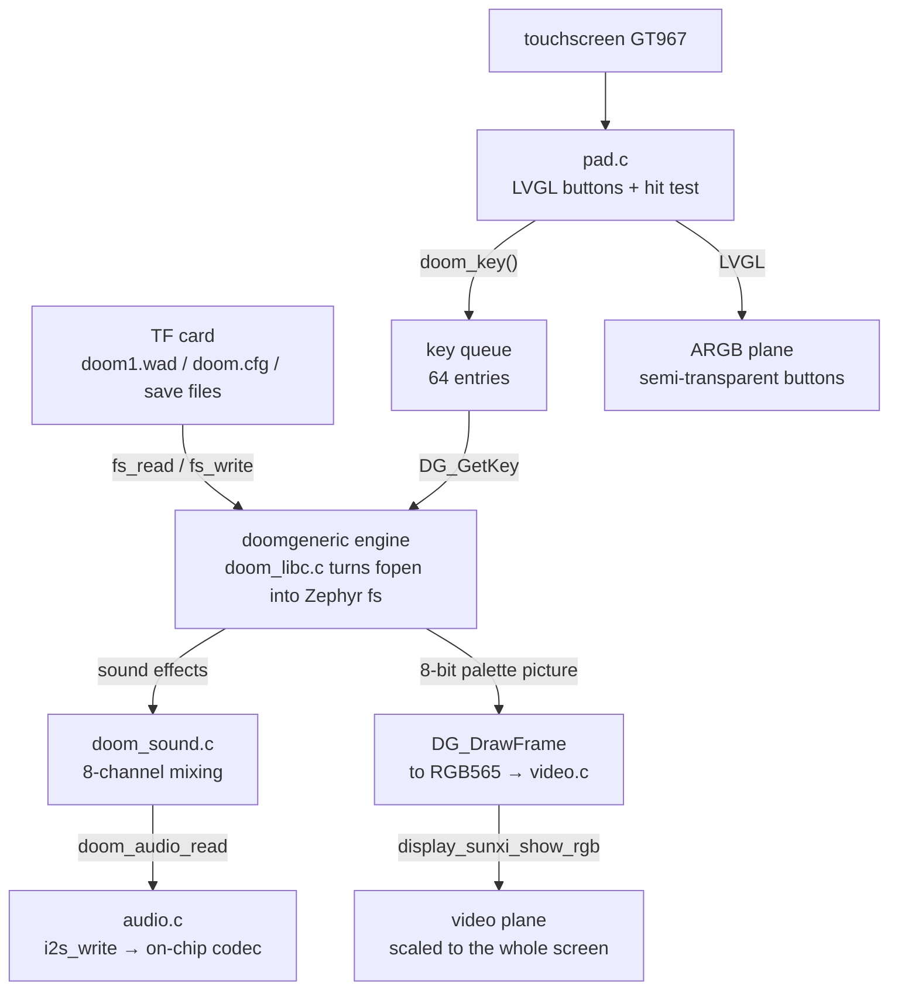
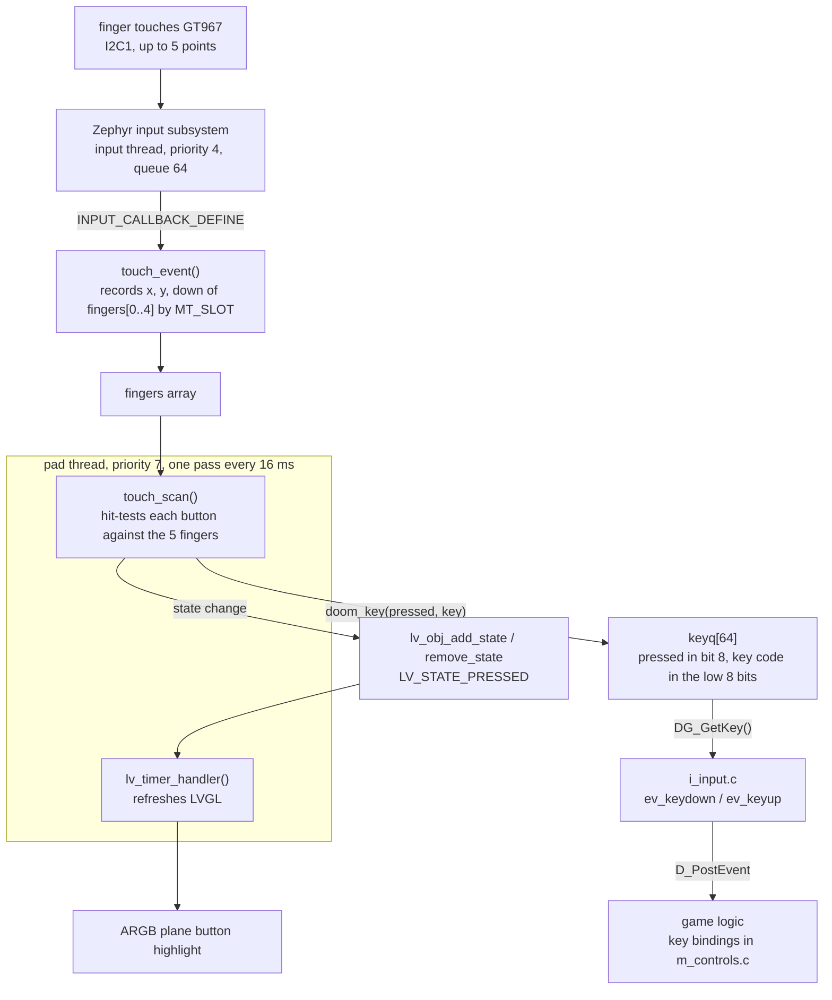

Running Doom on the board: the game engine is [doomgeneric](https://github.com/ozkl/doomgeneric) (GPL-2.0), and the platform layer, file access and sound mixing come from `zephyr-components/doom`. The example is `samples/doom_player`: it reads the WAD file from the TF card, the 320×200 picture goes to the display video plane and is scaled to the whole screen, sound effects come out of the on-chip codec, and a set of semi-transparent on-screen buttons is drawn with LVGL and operated from the touchscreen.



Before you start, complete [Setting up the development environment](../zephyr-setup-env.md) and [Getting the Zephyr source](../zephyr-get-source.md).

## Preparing the game data (WAD)

The game data lives in WAD files, which are <strong>not in the repository and you must supply yourself</strong>.

| Source | Notes |
| --- | --- |
| `doom1.wad` | id Software's shareware data, episode one. Obtain it yourself from a reliable source |
| `doom.wad`, `doom2.wad` | Data for the commercial game, from a copy you bought yourself |
| Freedoom | Free data made by the community, under a modified BSD license and freely distributable; download `freedoom1.wad` or `freedoom2.wad` from [freedoom.github.io](https://freedoom.github.io) |

### How to put it on the TF card

The example reads the card with FatFs, and the format requirements are the same as for the [MP4 player](./mp4-player.md) (FAT or exFAT, long file names supported). Copy the WAD to the <strong>root directory</strong> of the TF card:

```text
F:\
├── doom1.wad        # this file name is read by default
├── doom.cfg         # generated by the engine after it runs: keys, volume and other settings
└── .savegame\       # generated after it runs: save files
```

`main.c` first mounts the TF card at `/SD:`, then picks the WAD:

```c
static FATFS fat_fs;
static struct fs_mount_t mp = {
	.type = FS_FATFS,
	.fs_data = &fat_fs,
	.mnt_point = "/SD:",
};

static char wad_path[128];

/* the configured WAD, or else the first .wad file in the root of the card */
static int pick_wad(void)
{
	struct fs_dirent ent;
	struct fs_dir_t dir;

	strncpy(wad_path, CONFIG_SAMPLE_DOOM_WAD, sizeof(wad_path) - 1);
	if (fs_stat(wad_path, &ent) == 0) {
		return 0;
	}
	fs_dir_t_init(&dir);
	if (fs_opendir(&dir, "/SD:") != 0) {
		return -ENOENT;
	}
	wad_path[0] = '\0';
	while (fs_readdir(&dir, &ent) == 0 && ent.name[0] != '\0') {
		size_t n = strlen(ent.name);

		if (ent.type == FS_DIR_ENTRY_FILE && n > 4 &&
		    (strcmp(ent.name + n - 4, ".wad") == 0 || strcmp(ent.name + n - 4, ".WAD") == 0)) {
			snprintf(wad_path, sizeof(wad_path), "/SD:/%s", ent.name);
			break;
		}
	}
	fs_closedir(&dir);

	return wad_path[0] == '\0' ? -ENOENT : 0;
}
```

Rules:

- `CONFIG_SAMPLE_DOOM_WAD` is tried first (default `/SD:/doom1.wad`); if the file exists it is used.
- If it does not exist, the root directory is scanned and the <strong>first</strong> `.wad` or `.WAD` found is used. Subdirectories are not entered.
- If there is none, it prints `no .wad file on the card` on the serial port and exits.

File access inside the engine also goes through the Zephyr file system: `src/doom_libc.c` replaces `fopen`, `fread`, `fwrite` and the like with `fs_open`, `fs_read`, `fs_write`, and relative paths (`./doom.cfg`, `.savegame/`) land under the second argument `base_dir` of `doom_open()`; the example passes `/SD:`, so the configuration and save files are written to the root of the card.

## Building

The following commands are run in the workspace. doomgeneric is a git submodule and must be fetched before the first build, or CMake reports `doomgeneric sources missing`:

```sh
cd ~/f101-zephyr/zephyr-components/doom
git submodule update --init doomgeneric
```

Then build. The example's `CMakeLists.txt` adds `../..` (that is, the `doom` component) to `ZEPHYR_EXTRA_MODULES` itself, so it does not have to be given on the command line:

```sh
. ~/f101-zephyr/env.sh
cd ~/f101-zephyr
west build -b yuzukineko -d build/doom-app zephyr-components/doom/samples/doom_player
```

<div class="asciinema-cast" data-src="assets/casts/zephyr/apps-doom/build.cast" data-speed="6"></div>

The artifact is `build/doom-app/zephyr/zephyr.bin`, about 4.8 MB (28.89% of the RAM region used), linked at `0x40000000`.

## Running

For the download procedure see [Building and running](../zephyr-build-run.md):

```sh
xfel ddr f101-s3
xfel write 0x40000000 build/doom-app/zephyr/zephyr.bin
xfel exec 0x40000000
```

The console is UART1 (115200 8N1). Put `doom1.wad` on the TF card before starting; what follows describes, in order, what appears on the serial port and the screen.

### Output after running

<strong>1. Mount the TF card and find the WAD.</strong> `fs_mount()` mounts `/SD:`, and after `pick_wad()` has selected a WAD it prints `WAD <path>` on the serial port:

```text
WAD /SD:/doom1.wad
```

<strong>2. The engine starts, reads the WAD and writes the configuration.</strong> `doom_open()` initializes the engine; the WAD is read out through the `fopen`/`fread` that `doom_libc.c` wires to the Zephyr file system, and the configuration file is written back to the card. The serial port prints the engine's initialization stages in order, up to graphics initialization:

```text
Z_Init: Init zone memory allocation daemon. 
zone memory: 0x40566fe0, 600000 allocated for zone
M_LoadDefaults: Load system defaults.
	default file: /SD:/doom.cfg
saving config in /SD:/doom.cfg
W_Init: Init WADfiles.
 adding /SD:/doom1.wad
                            DOOM Shareware
...
S_Init: Setting up sound.
startskill 2  deathmatch: 0  startmap: 1  startepisode: 1
I_InitGraphics: DOOM screen size: w x h: 320 x 200
```

The `600000` of `zone memory` is hexadecimal, equal to 6 MiB, matching the default of `CONFIG_DOOM_ZONE_SIZE_MB`. `saving config` means `doom.cfg` was written to the root of the card.

<strong>3. On-screen buttons are initialized.</strong> After `pad_main()` has created the 12 LVGL buttons it prints a `pad:` line; when the touchscreen path (`HAS_TOUCH`) is enabled it shows `touch on`. Before that GT967 has detected 1024×768 and up to 5 touch points:

```text
[00:00:00.564,000] <inf> gt967: GT967 firmware 0x1040, 1024x768
[00:00:00.569,000] <inf> gt967: configuration 0x63: 1024 x 768, up to 5 point(s), module switch 0x04
...
R_Init: Init DOOM refresh daemon - ..pad: 12 keys, display 1024x768, touch on
```

The LVGL display resolution is 1024×768, so the `dy` mentioned later is 168.

<strong>4. The main loop and frame statistics.</strong> Every 5 seconds the main loop prints a statistics line: main-loop passes, pictures produced, audio underruns:

```text
doom: 342 passes, 342 pictures, sound underruns 0
doom: 351 passes, 351 pictures, sound underruns 0
```

About 350 passes and 350 pictures every 5 seconds, that is about 70 per second, with `sound underruns` staying at 0. The game logic is the engine's fixed 35 tics per second; the picture count here is the number of times `DG_DrawFrame()` is called in the main loop.

The screen shows the game picture with the semi-transparent on-screen buttons overlaid:


The photo shows the picture after entering a level: the Doom picture is enlarged and displayed in the middle of the panel, the status bar with ammo, health and armor is at the bottom, and the red text in the top left corner is the pickup message `PICKED UP 4 SHOTGUN SHELLS.`. The semi-transparent on-screen buttons are overlaid on the picture: ESC in the top left and ENTER in the top right, below them the strafe-left and strafe-right STR< and STR>; the direction pad in the bottom left; the two round FIRE and USE (open doors, operate) buttons on the right; and Y and N in the bottom middle.

## Picture output

The picture goes from the engine to the screen in three steps.

<strong>1. The engine produces the picture.</strong> In `CMAP256` mode the engine draws a 320×200 8-bit indexed picture, kept in `DG_ScreenBuffer`. `DG_DrawFrame()` in `src/doom_port.c` converts it to RGB565 with the engine's palette and writes it into the buffer the application supplies:

```c
void DG_DrawFrame(void)
{
	const uint8_t *src = (const uint8_t *)DG_ScreenBuffer;

	if (palette_changed) {
		for (int i = 0; i < 256; i++) {
			palette565[i] = ((colors[i].r & 0xf8) << 8) | ((colors[i].g & 0xfc) << 3) |
					(colors[i].b >> 3);
		}
		palette_changed = false;
	}
	if (out_buf == NULL) {
		return;
	}
	for (int i = 0; i < DOOM_WIDTH * DOOM_HEIGHT; i++) {
		out_buf[i] = palette565[src[i]];
	}
	drawn = 1;
}
```

The palette is recomputed only when the engine has changed it (turning red when hurt, yellow when picking things up, and so on).

<strong>2. The application rotates buffers.</strong> Every pass, the main loop of `main.c` first asks `video_acquire()` for the next buffer, has the engine draw into it, and calls `video_present()` when there is a new picture:

```c
	while (true) {
		doom_set_frame_buffer(video_acquire());
		if (doom_run_frame()) {
			video_present(DOOM_WIDTH, DOOM_HEIGHT);
			drawn++;
		}
```

`video.c` allocates 4 buffers of `320 × 200 × 2` bytes in total (`NBUF`); `video_present()` first flushes the data cache to memory and then wakes the `video` thread.

<strong>3. Send to the display.</strong> The `video` thread calls `display_sunxi_show_rgb()`, handing the RGB565 picture to the display engine's scaling video plane, which the hardware scales up to the whole screen (the board's panel is 1024×768):

```c
		img.data = buf[idx];
		img.width = ready_w;
		img.height = ready_h;
		img.stride = STRIDE;
		img.nonblock = false;
		ret = display_sunxi_show_rgb(disp, &img);
```

This call may wait for the next refresh, so it is placed in a separate thread that does not slow the engine down; the thread only displays the newest picture.

The LVGL buttons are drawn on another plane: `CONFIG_DISPLAY_SUNXI_ARGB8888=y` enables the ARGB8888 framebuffer plane, which is layered on top of the video plane, so the buttons cover the game picture semi-transparently. `prj.conf` does not set `CONFIG_DISPLAY_SUNXI_FB_WINDOW_WIDTH/HEIGHT`, so both are 0.

## Sound

Sound effects only, <strong>no music is played</strong>.

- `src/doom_sound.c` mixes the 8-bit unsigned mono sound effects from the WAD into 16-bit stereo on demand, with up to <strong>8 channels</strong> (`NUM_CHANNELS`), linear interpolation and left/right panning.
- `audio.c` starts an `audio` thread (priority 3) that takes 512 frames at a time (`BLOCK_FRAMES`), calls `doom_audio_read()` to get the mixed data, and then `i2s_write()` to send it to the codec. The codec consumes at a fixed rate, which is the source of the pacing; I2S is started only after 2 blocks (`PREFILL`) have been pre-filled into the queue.
- The output sample rate is `CONFIG_SAMPLE_DOOM_RATE`, default 48000; `main()` calls `doom_audio_init(RATE)` and then `audio_init(RATE)`.
- The volume is hard-coded in `audio.c`:

```c
	audio_codec_start_output(ctl);
	audio_codec_set_property(ctl, AUDIO_PROPERTY_OUTPUT_VOLUME, AUDIO_CHANNEL_ALL,
				 (audio_property_value_t){.vol = 150});
```

The range is 0–255; change `.vol` to make it louder or quieter. If `i2s_write()` returns `-EIO` after `I2S_TRIGGER_START`, the data has run out: one underrun is counted and the pre-fill is done again; this count is the `sound underruns` in the 5-second statistics line.

To have no sound: write `CONFIG_DOOM_SOUND=n` in `prj.conf` and the component switches to the `doom_audio_read()` in `doom_port.c` that returns silence.

## The on-screen buttons on the touchscreen

The buttons are all in `samples/doom_player/src/pad.c`; what follows covers "how the widgets are created", "how a touch becomes a key code", "how it reaches the engine" and "how to change the layout".

### Data flow



Key points:

- <strong>LVGL's pointer input is not used</strong>. An LVGL pointer device handles only one finger at a time, whereas the game needs the direction pad and fire pressed at the same time. So when there is a touchscreen, finger positions are read directly from Zephyr input events and the button widgets only display state.
- The touchscreen is the `zephyr,touch` entry of the devicetree `chosen`, which on this board is the GT967. `HAS_TOUCH` is decided with `DT_NODE_EXISTS(DT_CHOSEN(zephyr_touch))`; a board without a touchscreen takes another path, see below.

### How the LVGL widgets are created

Each button is an `lv_button` plus an `lv_label`, created by `key_add()`, positioned with `LV_ALIGN_TOP_LEFT` plus an offset:

```c
static void key_add(int x, int y, int w, int h, const char *text, unsigned char key, int radius)
{
	lv_obj_t *b = lv_button_create(lv_screen_active());
	lv_obj_t *l = lv_label_create(b);

	lv_obj_set_size(b, w, h);
	lv_obj_align(b, LV_ALIGN_TOP_LEFT, x, y);
	lv_obj_set_style_radius(b, radius, 0);
	lv_obj_set_style_bg_color(b, lv_color_white(), 0);
	lv_obj_set_style_bg_opa(b, LV_OPA_30, 0);
	lv_obj_set_style_bg_color(b, lv_color_make(255, 200, 60), LV_STATE_PRESSED);
	lv_obj_set_style_bg_opa(b, LV_OPA_70, LV_STATE_PRESSED);
	lv_obj_set_style_border_color(b, lv_color_white(), 0);
	lv_obj_set_style_border_opa(b, LV_OPA_50, 0);
	lv_obj_set_style_border_width(b, 2, 0);
	lv_obj_set_style_shadow_width(b, 0, 0);
	lv_obj_set_style_text_font(l, &lv_font_montserrat_28, 0);
	lv_obj_set_style_text_color(l, lv_color_white(), 0);
	lv_label_set_text(l, text);
	lv_obj_center(l);
#if !HAS_TOUCH
	lv_obj_add_event_cb(b, key_event, LV_EVENT_ALL, (void *)(uintptr_t)key);
#endif

	if (nkeys < MAX_KEYS) {
		pad_keys_tbl[nkeys++] = (struct pad_key){
			.obj = b, .x = x, .y = y, .w = w, .h = h, .key = key,
		};
	}
}
```

- Normally it is 30%-opaque white; when pressed (`LV_STATE_PRESSED`) it becomes 70%-opaque orange-yellow, so a press is obvious.
- `radius` controls the shape: the direction keys and function keys use a small corner radius, FIRE and USE pass `LV_RADIUS_CIRCLE` and become circles, and Y and N are pill-shaped.
- The font is `lv_font_montserrat_28` (`CONFIG_LV_FONT_MONTSERRAT_28=y` in `prj.conf`); the direction key glyphs use the LVGL built-in symbols `LV_SYMBOL_LEFT` and so on.
- Creating a button also registers an entry in `pad_keys_tbl[]` (position, size, key code), and the hit test relies on that table. The table has only `MAX_KEYS` entries; buttons beyond that <strong>are drawn but do not respond to touch</strong>.

The screen itself must first be made transparent, otherwise there is a black background behind the buttons that covers the video plane below. `pad_main()` does this at the start, then creates all 12 buttons and prints a `pad:` log line when it is done:

```c
static void pad_main(void *a, void *b, void *c)
{
	lv_obj_set_style_bg_opa(lv_screen_active(), LV_OPA_TRANSP, 0);

	/*
	 * The layout was drawn for a 1024x600 panel, the keys at the bottom stay at the bottom of
	 * a taller one. The picture is scaled to the middle.
	 */
	const int dy = lv_display_get_vertical_resolution(NULL) - 600;

	key_add(30, 330 + dy, 90, 90, LV_SYMBOL_LEFT, DOOM_KEY_LEFT, 20);
	key_add(210, 330 + dy, 90, 90, LV_SYMBOL_RIGHT, DOOM_KEY_RIGHT, 20);
	key_add(120, 240 + dy, 90, 90, LV_SYMBOL_UP, DOOM_KEY_UP, 20);
	key_add(120, 420 + dy, 90, 90, LV_SYMBOL_DOWN, DOOM_KEY_DOWN, 20);

	key_add(830, 360 + dy, 110, 110, "FIRE", DOOM_KEY_FIRE, LV_RADIUS_CIRCLE);
	key_add(700, 440 + dy, 110, 110, "USE", DOOM_KEY_USE, LV_RADIUS_CIRCLE);

	key_add(20, 20, 120, 60, "ESC", DOOM_KEY_ESCAPE, 16);
	key_add(880, 20, 120, 60, "ENTER", DOOM_KEY_ENTER, 16);
	key_add(20, 100, 120, 60, "STR<", DOOM_KEY_STRAFE_L, 16);
	key_add(880, 100, 120, 60, "STR>", DOOM_KEY_STRAFE_R, 16);
	key_add(400, 520 + dy, 100, 60, "Y", DOOM_KEY_Y, 30);
	key_add(524, 520 + dy, 100, 60, "N", DOOM_KEY_N, 30);
	printk("pad: %d keys, display %dx%d, touch %s\n", nkeys,
	       lv_display_get_horizontal_resolution(NULL), lv_display_get_vertical_resolution(NULL),
	       HAS_TOUCH ? "on" : "off");

	while (true) {
#if HAS_TOUCH
		touch_scan();
#endif
		lv_timer_handler();
		k_msleep(16);
	}
}
```

The coordinates are drawn for 1024×600; `dy` is the actual screen height minus 600, and on this board that is 1024×768, so `dy` is 168 and the lower group of buttons shifts down as a whole to sit against the bottom edge of the screen. ESC, ENTER, STR< and STR> at the top do not add `dy` and stay fixed near the top.

The thread is created by `pad_start()` (4096-byte stack, priority 7), called in `main.c` before `doom_open()`:

```c
int pad_start(void)
{
	k_tid_t tid = k_thread_create(&thread, pad_stack, STACK_SIZE, pad_main, NULL, NULL, NULL,
				      PRIORITY, 0, K_NO_WAIT);

	k_thread_name_set(tid, "pad");

	return 0;
}
```

### How a touch becomes a key code

Step one: receive input events. The GT967 driver reports by multi-touch slot (MT slot); the callback only records the coordinates and pressed state of each slot:

```c
#define TOUCH_SLOTS	5

static struct {
	int x, y;
	bool down;
} fingers[TOUCH_SLOTS];
static int cur_slot;

static void touch_event(struct input_event *evt, void *user_data)
{
	switch (evt->code) {
	case INPUT_ABS_MT_SLOT:
		cur_slot = CLAMP(evt->value, 0, TOUCH_SLOTS - 1);
		break;
	case INPUT_ABS_X:
		fingers[cur_slot].x = evt->value;
		break;
	case INPUT_ABS_Y:
		fingers[cur_slot].y = evt->value;
		break;
	case INPUT_BTN_TOUCH:
		fingers[cur_slot].down = evt->value != 0;
		break;
	}
}
INPUT_CALLBACK_DEFINE(DEVICE_DT_GET(DT_CHOSEN(zephyr_touch)), touch_event, NULL);
```

The touch coordinates are screen coordinates (1024×768), the same coordinate system as the button coordinates, so they can be compared directly. The callback runs in the input subsystem's thread; `boards/yuzukineko.conf` raises that thread's priority to 4 (higher than the pad thread's 7, and higher than the 6 of the main thread the game runs on) and increases the queue to 64, so that finger events are not lost when a game frame takes a long time:

```text
CONFIG_INPUT=y
CONFIG_INPUT_GT967_MAX_TOUCH_POINTS=5
CONFIG_INPUT_THREAD_PRIORITY_OVERRIDE=y
CONFIG_INPUT_THREAD_PRIORITY=4
CONFIG_INPUT_QUEUE_MAX_MSGS=64
```

Step two: `touch_scan()` is called by the pad thread every 16 ms and, for each button, checks whether any of the 5 fingers falls inside its rectangle (enlarged by `HIT_MARGIN` = 12 pixels on each side):

```c
static void touch_scan(void)
{
	uint32_t now = k_uptime_get_32();

	for (int k = 0; k < nkeys; k++) {
		struct pad_key *key = &pad_keys_tbl[k];
		bool pressed = false;

		for (int f = 0; f < TOUCH_SLOTS; f++) {
			if (fingers[f].down && fingers[f].x >= key->x - HIT_MARGIN &&
			    fingers[f].x < key->x + key->w + HIT_MARGIN &&
			    fingers[f].y >= key->y - HIT_MARGIN &&
			    fingers[f].y < key->y + key->h + HIT_MARGIN) {
				pressed = true;
			}
		}
		if (pressed) {
			key->hold_until = now + RELEASE_HOLD_MS;
		} else if ((int32_t)(now - key->hold_until) < 0) {
			pressed = true;
		}
		if (pressed != key->shown) {
			if (pressed) {
				lv_obj_add_state(key->obj, LV_STATE_PRESSED);
			} else {
				lv_obj_remove_state(key->obj, LV_STATE_PRESSED);
			}
			doom_key(pressed ? 1 : 0, key->key);
			key->shown = pressed;
		}
	}
}
```

A few details:

- A finger can be on several buttons at once, and each button is decided independently, so "forward + fire + turn left" can be pressed at the same time.
- A finger sliding out of one button and into another naturally releases the first and presses the second.
- <strong>A hold of `RELEASE_HOLD_MS` = 50 ms</strong>: the controller occasionally misses a frame of finger reporting (the finger is in fact still on the glass), and treating that as "release then press" would cause a jitter in the game, so the key is kept for another 50 ms after release.
- `doom_key()` is called only when the state <strong>changes</strong>, so the queue holds only the two kinds of event, "press" and "release", and is not filled once every 16 ms. At the same time `lv_obj_add_state` / `lv_obj_remove_state` update the widget appearance.

### How the key code reaches the engine

`doom_key()` puts the event into a 64-entry ring buffer, with `pressed` in bit 8 and the key code in the low 8 bits; the read and write pointers are atomic variables, so it can be called from any thread (`src/doom_port.c`):

```c
#define KEYQUEUE_SIZE 64

static uint16_t keyq[KEYQUEUE_SIZE];
static atomic_t key_w, key_r;

int DG_GetKey(int *pressed, unsigned char *key)
{
	atomic_val_t r = atomic_get(&key_r);
	uint16_t k;

	if (r == atomic_get(&key_w)) {
		return 0;
	}
	k = keyq[r % KEYQUEUE_SIZE];
	atomic_set(&key_r, r + 1);
	*pressed = k >> 8;
	*key = k & 0xff;

	return 1;
}

void doom_key(int pressed, unsigned char key)
{
	atomic_val_t w = atomic_get(&key_w);

	if (w - atomic_get(&key_r) >= KEYQUEUE_SIZE) {
		return;
	}
	keyq[w % KEYQUEUE_SIZE] = (pressed ? 0x100 : 0) | key;
	atomic_set(&key_w, w + 1);
}
```

When the queue is full, new events are dropped. During the input stage of every `doom_run_frame()` the engine keeps calling `DG_GetKey()` until it is drained (`i_input.c`), turning a press into `ev_keydown` and a release into `ev_keyup` and calling `D_PostEvent()`. The port layer does no key-code translation: `TranslateKey()` returns the value unchanged.

So the key codes are <strong>the doomgeneric engine's own key codes</strong>. `include/doom_zephyr/doom.h` gives the common ones:

| Macro | Value | Default function in the engine |
| --- | --- | --- |
| `DOOM_KEY_UP` | `0xad` | forward |
| `DOOM_KEY_DOWN` | `0xaf` | backward |
| `DOOM_KEY_LEFT` | `0xac` | turn left |
| `DOOM_KEY_RIGHT` | `0xae` | turn right |
| `DOOM_KEY_STRAFE_L` | `0xa0` | strafe left |
| `DOOM_KEY_STRAFE_R` | `0xa1` | strafe right |
| `DOOM_KEY_USE` | `0xa2` | open doors, press switches |
| `DOOM_KEY_FIRE` | `0xa3` | fire |
| `DOOM_KEY_ESCAPE` | `27` | menu, back |
| `DOOM_KEY_ENTER` | `13` | confirm in menus |
| `DOOM_KEY_TAB` | `9` | map |
| `DOOM_KEY_SHIFT` | `0x80 + 0x36` | run |
| `DOOM_KEY_CTRL` | `0x80 + 0x1d` | (the engine's right Ctrl) |
| `DOOM_KEY_ALT` | `0x80 + 0x38` | (the engine's right Alt, the strafe modifier) |
| `DOOM_KEY_Y`, `DOOM_KEY_N` | `'y'`, `'n'` | Yes / No in menus (for example the quit confirmation) |

Letter and number keys are their lowercase ASCII values (for example `'1'` to `'7'` select weapons). For other engine key codes see `doomgeneric/doomgeneric/doomkeys.h`; the default bindings are in `m_controls.c` (for example `key_fire = KEY_FIRE`).

Note: the 12 buttons the example draws by default do <strong>not</strong> include SHIFT (run), TAB (map) or weapon-switch keys. Add them yourself as described in the next section if you need them.

### Boards without a touchscreen

With `!HAS_TOUCH`, each button gets an LVGL event callback and is driven by LVGL's pointer device:

```c
#if !HAS_TOUCH
static void key_event(lv_event_t *e)
{
	unsigned char key = (unsigned char)(uintptr_t)lv_event_get_user_data(e);
	lv_event_code_t code = lv_event_get_code(e);

	if (code == LV_EVENT_PRESSED) {
		doom_key(1, key);
	} else if (code == LV_EVENT_RELEASED || code == LV_EVENT_PRESS_LOST) {
		doom_key(0, key);
	}
}
#endif
```

This path can only press one key at a time, and requires the board to configure an LVGL pointer input device itself (a mouse or trackpad, for example); the example does not configure one.

### How to change the button layout

All the changes are in `pad.c`.

<strong>1. Change position, size, text, shape.</strong> Change the arguments of `key_add(x, y, w, h, text, key code, radius)` in `pad_main()` directly. The coordinates are based on 1024×600, the lower group adds `dy` and the upper group does not.

<strong>2. Change the function a button maps to.</strong> Swap the sixth argument, for example replacing USE with space (the engine's `' '`) or changing a key to `DOOM_KEY_SHIFT` (run).

<strong>3. Add buttons.</strong> First raise `MAX_KEYS` from 12 (the current 12 fill it exactly), then add `key_add` calls in `pad_main()`. Here is an example:

```c
#define MAX_KEYS	16

	/* in pad_main(), after the other key_add calls */
	key_add(30, 520 + dy, 90, 60, "RUN", DOOM_KEY_SHIFT, 16);
	key_add(130, 520 + dy, 90, 60, "MAP", DOOM_KEY_TAB, 16);
	key_add(240, 520 + dy, 60, 60, "1", '1', 16);   /* select weapon 1 */
	key_add(310, 520 + dy, 60, 60, "2", '2', 16);   /* select weapon 2 */
```

New buttons must not overlap existing ones, or one finger will hit two keys at once.

<strong>4. Tuning the feel.</strong>

| Constant | Default | Effect |
| --- | --- | --- |
| `MAX_KEYS` | 12 | capacity of the button table, and the upper limit on buttons that can respond to touch |
| `HIT_MARGIN` | 12 | pixels by which the hit area is enlarged around a button; larger makes it easier to hit, but the areas of adjacent buttons then overlap |
| `RELEASE_HOLD_MS` | 50 | milliseconds a key stays held after the finger leaves |
| `TOUCH_SLOTS` | 5 | number of fingers handled at once; must not exceed `CONFIG_INPUT_GT967_MAX_TOUCH_POINTS` |
| `PRIORITY` | 7 | pad thread priority (a larger number is a lower priority) |

<strong>5. Removing buttons.</strong> Just delete the corresponding `key_add` line. Keyboard-type input (a USB keyboard, for example) is not wired up in the example; wiring it up also means calling `doom_key()`.

## Features and where to change them

| Feature | Location | How to change |
| --- | --- | --- |
| WAD path | `SAMPLE_DOOM_WAD` in `Kconfig`; `pick_wad()` in `main.c` | Change the option, or the search rules in the function |
| Configuration, save-file directory | `doom_open(wad_path, "/SD:")` in `main.c` | Change the second argument |
| Game memory | `CONFIG_DOOM_ZONE_SIZE_MB` (default 6) | Change the option, range 4–32; the game allocates this much from the heap at once |
| Picture buffers | `NBUF` in `video.c` (4) | Usually no need to change |
| Volume | `.vol = 150` in `audio.c` | Change the value (0–255) |
| Sound sample rate | `CONFIG_SAMPLE_DOOM_RATE` | Default 48000 |
| On-screen button layout | `pad_main()` in `pad.c` | See the previous section |
| Statistics print interval | `REPORT_MS` in `main.c` (5000) | Change the macro |

Each main-loop pass: `doom_run_frame()` has the engine process input and run the game tics that are due (if none are due it waits, and the wait calls `k_msleep()` through `DG_SleepMs()`), and then does sound and picture. The engine keeps time with `DG_GetTicksMs()` (`k_uptime_get_32()`).

## Configuration options

### Component (`zephyr-components/doom/Kconfig`)

| Option | Default | Notes |
| --- | --- | --- |
| `CONFIG_DOOM` | n | Builds the doomgeneric engine and platform layer; depends on RISCV and automatically selects `FILE_SYSTEM` |
| `CONFIG_DOOM_ZONE_SIZE_MB` | 6 | Size of the engine's memory zone in MiB, range 4–32 |
| `CONFIG_DOOM_SOUND` | y | Mixes sound effects; depends on `I2S` and `AUDIO_CODEC`; music is not played |

### Example (`samples/doom_player/Kconfig`)

| Option | Default | Notes |
| --- | --- | --- |
| `CONFIG_SAMPLE_DOOM_WAD` | `"/SD:/doom1.wad"` | WAD to load; when it is not found, falls back to the first `.wad` in the root directory |
| `CONFIG_SAMPLE_DOOM_RATE` | 48000 | Sound output sample rate |

How to change them:

```sh
west build -b yuzukineko -d build/doom-app zephyr-components/doom/samples/doom_player -- -DCONFIG_SAMPLE_DOOM_WAD='"/SD:/freedoom1.wad"'
```

### Main options in `prj.conf`

| Option | Effect |
| --- | --- |
| `CONFIG_DOOM=y` | Pulls in the Doom component |
| `CONFIG_CRC=y` | CRC library |
| `CONFIG_SDHC=y` | SD host controller driver |
| `CONFIG_DISK_ACCESS=y` | Disk access interface |
| `CONFIG_DISK_DRIVER_SDMMC=y` | Uses the SD/MMC card as a disk |
| `CONFIG_FILE_SYSTEM=y` | File-system interface |
| `CONFIG_FAT_FILESYSTEM_ELM=y` | FatFs |
| `CONFIG_FS_FATFS_EXFAT=y` | Support for exFAT cards |
| `CONFIG_FS_FATFS_LFN=y` | Long file names |
| `CONFIG_MAIN_STACK_SIZE=16384` | Main thread stack; the engine runs on the main thread |
| `CONFIG_COMMON_LIBC_MALLOC_ARENA_SIZE=-1` | Lets the libc malloc use the remaining memory; the engine's memory zone is allocated from it |
| `CONFIG_HEAP_MEM_POOL_SIZE=262144` | Kernel heap |
| `CONFIG_MAIN_THREAD_PRIORITY=6` | Main thread (game) priority |
| `CONFIG_FPU=y`, `CONFIG_FPU_SHARING=y` | Hardware floating point, shared between threads |
| `CONFIG_I2S=y`, `CONFIG_AUDIO=y`, `CONFIG_AUDIO_CODEC=y` | Sound output |
| `CONFIG_DMA=y` | DMA used by I2S |
| `CONFIG_DISPLAY=y` | Display driver |
| `CONFIG_DISPLAY_SUNXI_ARGB8888=y` | ARGB plane, the one the LVGL buttons are drawn on |
| `CONFIG_LVGL=y` | LVGL graphics library |
| `CONFIG_LV_COLOR_DEPTH_32=y` | 32-bit color depth, matching ARGB8888 |
| `CONFIG_LV_Z_MEM_POOL_SIZE=131072` | LVGL memory pool |
| `CONFIG_LV_Z_VDB_SIZE=4` | LVGL drawing buffer as a percentage of the display |
| `CONFIG_LV_FONT_MONTSERRAT_28=y` | Font used for the button text |
| `CONFIG_LV_FONT_MONTSERRAT_16=y` | Font size 16, not used directly by the button code |

The touchscreen options in `boards/yuzukineko.conf` (`CONFIG_I2C`, `CONFIG_INPUT`, `CONFIG_INPUT_GT967_MAX_TOUCH_POINTS=5` and the input thread's priority and queue length) are covered in the earlier "How a touch becomes a key code" section.

## Code structure

| File | Contents |
| --- | --- |
| `zephyr-components/doom/src/doom_port.c` | `DG_*` platform functions, key-code queue, `doom_open()` / `doom_run_frame()` |
| `zephyr-components/doom/src/doom_libc.c` | Wires `fopen` and the other file-stream functions to the Zephyr file system |
| `zephyr-components/doom/shim/` | Force-included headers that supply libc functions that are missing |
| `zephyr-components/doom/src/doom_sound.c` | Sound-effect mixing |
| `zephyr-components/doom/include/doom_zephyr/doom.h` | API and key codes exposed to applications |
| `zephyr-components/doom/doomgeneric/` | The doomgeneric engine (git submodule) |
| `samples/doom_player/src/main.c` | Mounts the TF card, picks the WAD, main loop |
| `samples/doom_player/src/video.c` | Picture-buffer rotation, sending to the video plane |
| `samples/doom_player/src/audio.c` | Audio thread, sending to the codec |
| `samples/doom_player/src/pad.c` | LVGL on-screen buttons and touch handling |

## Scope

- Sound effects only, no music.
- At most 8 sound-effect channels at once.
- The picture is fixed at 320×200 and scaled to the whole screen; changing the resolution is not supported.
- The volume is hard-coded in `audio.c`; change `.vol` when you need to adjust it.
- The only input is the touchscreen, handling at most 5 fingers at once; when you need input such as a keyboard, call `doom_key()` at the right place.
- Network play and gamepads are not supported.
- The 12 on-screen buttons by default have no run, map or weapon-switch keys; add them as described in the "How to change the button layout" section when you need them.
