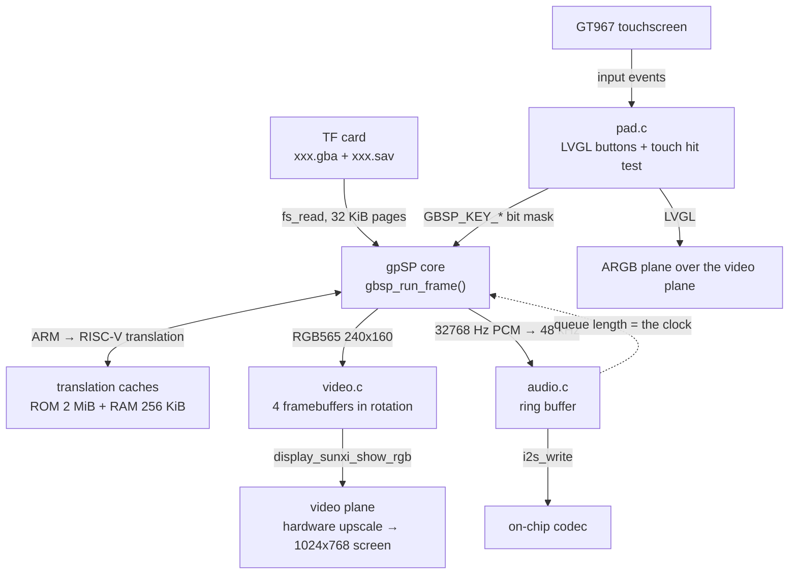
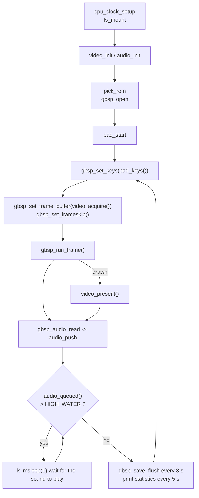

Runs Game Boy Advance games on the board with the [gpSP](https://github.com/libretro/gpsp) core and its <strong>RISC-V dynamic recompiler</strong>: the ARM code of the game is translated into RISC-V code at run time and executed natively, instead of being interpreted. The ROM is read from the TF card, the 240×160 game picture is handed to the display engine's video plane and scaled up to the whole screen, the sound goes out over I2S from the on-chip codec, and a layer of semi-transparent buttons drawn with LVGL is overlaid on the screen and operated with the touchscreen. The code is in `zephyr-components/gbsp` (GPL-2.0-or-later) and the sample is `samples/gbsp_player`.

It is the second GBA core next to [mGBA](mgba.md). The interface is the same (the `gbsp_*` functions mean what the `gba_*` functions of mGBA mean), and so are the sample options and the main loop, so the two cores can be compared on the same game, and both can be linked into one image. On the same ROM gpSP needs about 2.4 to 2.7 times less time per frame (see [Speed against mGBA](#speed-against-mgba)). Only GBA ROMs are supported; for Game Boy / Game Boy Color use mGBA.



There is no separate timer: each time the emulator finishes a frame it checks the sound queue, and if too much sound has piled up it waits with `k_msleep(1)`, so <strong>the speed of the sound output sets the game speed</strong>.

Before you start, first complete [Setting up the development environment](../zephyr-setup-env.md) and [Getting the Zephyr source](../zephyr-get-source.md).

## Preparation

<strong>You must supply the ROM yourself; neither this page nor the repository provides any game files.</strong> Use only games you legally own (for example, a file dumped from your own cartridge).

| Item | Description |
| --- | --- |
| ROM file | `.gba`. The sample's file picker also accepts `.gb` / `.gbc` names (and takes them only when there is no `.gba`), but this core cannot run Game Boy ROMs, so `gbsp_open()` fails for them |
| Where it goes | the TF card's <strong>root directory</strong> |
| Which one is chosen | `CONFIG_SAMPLE_GBA_ROM` (default `/SD:/Pokemon-FireRed.gba`); if it does not exist, the first file in the root directory whose size does not exceed `CONFIG_GBSP_MAX_ROM_SIZE_MB` (32 in the sample), `.gba` files first |
| Save file | in the same directory as the ROM, with the same base name and the extension `.sav` (`xxx.gba` → `xxx.sav`); read in at start if it exists, written every 3 seconds when the save memory has changed. It is the core's own save memory (up to 128 KiB, trailing `0xff` left out), <strong>not</strong> the file format of mGBA |
| BIOS | not needed, an open-source BIOS is built in (`core/bios/`); a `gba_bios.bin` in the root of the card is used when it is there |
| Filesystem | FAT or exFAT, with long file name support |

The core is a copy of the libretro gpSP with the RISC-V back end (`core/riscv/`), changed to build here. It is already in the repository: there is no submodule to fetch.

## Building

Run this in the workspace:

```sh
. ~/f101-zephyr/env.sh
cd ~/f101-zephyr
west build -b yuzukineko -d build/gbsp zephyr-components/gbsp/samples/gbsp_player
```

The output is `build/gbsp/zephyr/zephyr.bin`, linked at `0x40000000`. The sample's `CMakeLists.txt` brings in the component with `ZEPHYR_EXTRA_MODULES`, so nothing has to be passed on the command line. `boards/yuzukineko.conf` is merged automatically: it enables I2C and INPUT for the touchscreen (five points, with the input thread at priority 4, above the emulation thread, so fingers are not lost while a frame runs).

The sample's `prj.conf` has `CONFIG_MINIMAL_LIBC=y`, `CONFIG_CPP=y` and `CONFIG_STD_CPP17=y` (two of the core's sources are C++); your own application must set them too when it uses this module.

## Running

Download it with either method in [Building and running](../zephyr-build-run.md); the console is UART1 (PB00/PB01, 115200 8N1).

- For debugging use <strong>method one</strong>: `xfel ddr f101-s3`, `xfel write 0x40000000 build/gbsp/zephyr/zephyr.bin`, `xfel exec 0x40000000`.
- For stand-alone running use <strong>method three</strong>: `mkuf2.py app build/gbsp/zephyr/zephyr.bin -o out/gbsp.uf2`, then drag it onto the `F101BOOT` drive.

:::caution
The board has only one USB-C port, which is both the xfel download port and the UF2 drive port. Download first, then connect other devices.
:::

Insert the TF card with the ROM into the slot first, then power up and download. Operation is touchscreen-only: L and R at the top corners, the D-pad at the lower left, A and B at the lower right, SELECT and START at the bottom center. Up to five fingers are tracked, so a direction and A/B can be held together; a pressed button turns orange.

### Output after running

The serial console prints, in order: the `display_sunxi` and `gt967` lines (the panel and the touchscreen, as for the other players), `ROM <path>, save <path>`, and then one statistics line every 5 seconds:

```text
gba: <frames> frames, emulation <n> us/frame, sound <n> frames pushed, queued <n>, underruns <n>, ring empty <n>, slab full <n>, skipped <n>
```

| Field | Meaning |
| --- | --- |
| `frames` | frames emulated in these 5 seconds; full speed is about 300 |
| `emulation … us/frame` | average emulation time per frame (draw included); above 16700 µs the emulation cannot keep up with real time |
| `sound … frames pushed` | stereo frames put into the sound ring; about 240000 per 5 seconds at 48 kHz |
| `queued` | stereo frames waiting to be played |
| `underruns` | number of I2S underrun restarts; should stay 0 |
| `ring empty` | times the audio thread found less than one block in the ring |
| `slab full` | times the audio thread could not get a free block at once (normal when emulation is faster than playback) |
| `skipped` | frames whose drawing was skipped |

The lines that report a problem are `cannot mount the SD card: <err>`, `no .gba/.gb/.gbc file on the card`, `cannot start <path>: <err>` (the error of `gbsp_open()`) and `video or audio not available`. With `CONFIG_SAMPLE_GBA_CPU_MHZ` set, `cpu: <n> MHz refused` or `cpu: <n> MHz BAD` means the clock could not be raised.

Measured on the board with Pokémon FireRed (960 MHz, every frame drawn): 4 to 6 ms of emulation per frame and no sound underrun.

## Speed against mGBA

The same loop, no frame pacing, 1200 frames, CPU 960 MHz (`CONFIG_SAMPLE_GBA_BENCH`):

| ROM | mGBA | gpSP | Factor |
| --- | --- | --- | --- |
| Zelda (8 MiB) | 13166 µs per frame | 5464 µs per frame | 2.4× |
| FireRed (16 MiB; mGBA demand paged, gpSP 8 MiB in memory + file) | 14104 µs per frame | 5181 µs per frame | 2.7× |

The picture checksums of the two cores are equal in the first frames (and at frames 600 and 1200 of FireRed); they differ later in Zelda because the cores do not time every event in the same way. The slowest frame is 51 to 54 ms with gpSP (a burst of new code to translate) and 31 to 57 ms with mGBA.

## The interface: `gbsp.h`

`include/gbsp_zephyr/gbsp.h` is the whole public interface of the module. It drives <strong>one emulated console at a time</strong>; the ROM and the save file are read through the Zephyr file system, the picture is RGB565 and the sound is signed 16-bit stereo at the rate you ask for. The sample calls all of it from the main thread.

| Function | Purpose |
| --- | --- |
| `gbsp_open(rom, save, rate)` | load a ROM and start the console |
| `gbsp_close()` | write the save file and free everything |
| `gbsp_set_frame_buffer(buf)` | where the following frames are drawn |
| `gbsp_set_frameskip(skip)` | draw one frame, then skip `skip` |
| `gbsp_set_keys(keys)` | the state of the buttons |
| `gbsp_run_frame()` | emulate until the next frame is complete |
| `gbsp_frame(&w, &h)` | the last frame buffer and its size |
| `gbsp_audio_read(out, frames)` | take resampled sound out |
| `gbsp_audio_available()` | stereo frames the core holds ready |
| `gbsp_save_flush()` | write the save file if the save memory changed |
| `gbsp_get_stats(&st)` | counters for looking at slow scenes |

Constants: `GBSP_WIDTH` 240, `GBSP_HEIGHT` 160, `GBSP_FPS_X1000` 59727 (the console's 16777216 / 280896 Hz), and `GBSP_FRAME_BYTES`, the size of a frame buffer.

### `gbsp_open()`

```c
int gbsp_open(const char *rom_path, const char *save_path, unsigned int out_rate);
```

Allocates the core's memory, loads the BIOS (`/SD:/gba_bios.bin` if present, otherwise the built-in one), opens the ROM, resets the console and loads the save file. `save_path` may be `NULL` (no save). `out_rate` is the sample rate `gbsp_audio_read()` delivers (the sample uses 48000 or 44100). The ROM is read lazily: `GBSP_ROM_BUFFER_MB` of it is held in memory and the rest comes from the file in pages.

Returns 0 on success, otherwise a negative errno: the error of `fs_stat()` when the file is not there, `-EFBIG` for an empty file or one larger than `CONFIG_GBSP_MAX_ROM_SIZE_MB`, `-ENOMEM` when the core's memory cannot be allocated, `-EINVAL` when the file is not a ROM the core accepts, `-EALREADY` when a console is already open.

### `gbsp_set_frame_buffer()` and `GBSP_FRAME_BYTES`

```c
void gbsp_set_frame_buffer(uint16_t *buf);
#define GBSP_FRAME_BYTES ((GBSP_WIDTH) * ((GBSP_HEIGHT) + 1) * 2)
```

The core draws the following frames into `buf`: RGB565, 240 pixels per row (pitch 480 bytes), 160 rows. <strong>The buffer must be `GBSP_FRAME_BYTES` long</strong> (the picture plus one scratch line that the object-window pass uses); a buffer of exactly 240×160 pixels is overrun by 480 bytes. Set it before every `gbsp_run_frame()` when you rotate buffers, as the sample does.

### `gbsp_set_frameskip()`

```c
void gbsp_set_frameskip(int skip);
```

Draw one frame, then skip `skip` frames, and so on; 0 draws every frame. A skipped frame still runs the emulation and the sound but not the renderer, so it is cheaper. It changes only the picture; the sound is not affected.

### `gbsp_set_keys()`

```c
void gbsp_set_keys(uint32_t keys);
```

Sets the state of the buttons for the next frame, as an OR of `GBSP_KEY_*`:

| Bit | Button | Bit | Button |
| --- | --- | --- | --- |
| `BIT(0)` | `GBSP_KEY_A` | `BIT(5)` | `GBSP_KEY_LEFT` |
| `BIT(1)` | `GBSP_KEY_B` | `BIT(6)` | `GBSP_KEY_UP` |
| `BIT(2)` | `GBSP_KEY_SELECT` | `BIT(7)` | `GBSP_KEY_DOWN` |
| `BIT(3)` | `GBSP_KEY_START` | `BIT(8)` | `GBSP_KEY_R` |
| `BIT(4)` | `GBSP_KEY_RIGHT` | `BIT(9)` | `GBSP_KEY_L` |

The bits are those of the console's key register, so other bits are ignored. It is the state, not an event: call it every frame with all buttons that are held.

### `gbsp_run_frame()`

```c
int gbsp_run_frame(void);
```

Emulates until the next frame is complete, then converts the sound of that frame to the output rate and queues it. Returns 1 when the frame was drawn into the frame buffer and 0 when it was skipped (by `gbsp_set_frameskip()`) or no console is open. It is the call that takes the time (4 to 6 ms with FireRed) and the one that may read ROM pages from the card.

### `gbsp_frame()`

```c
const uint16_t *gbsp_frame(unsigned int *width, unsigned int *height);
```

Returns the frame buffer set last and writes the size of the picture, always 240×160 for this core. After a `gbsp_run_frame()` that returned 1 it holds the new frame.

### `gbsp_audio_read()` and `gbsp_audio_available()`

```c
size_t gbsp_audio_read(int16_t *out, size_t frames);
size_t gbsp_audio_available(void);
```

The core produces 32768 Hz sound; each `gbsp_run_frame()` converts it with a fixed-point linear resampler (16.16) to `out_rate` and puts it into an internal ring of 8192 stereo frames. `gbsp_audio_read()` copies at most `frames` stereo frames (interleaved L/R `int16_t`) out and returns how many; `gbsp_audio_available()` tells how many are waiting. Call `gbsp_audio_read()` in a loop after every frame until it returns 0, otherwise the ring fills and new sound is dropped.

### `gbsp_save_flush()`

```c
int gbsp_save_flush(void);
```

Writes the save file when the save memory has changed since the last write (it compares a CRC) and returns 1 if it wrote, 0 if there was nothing to write, no save path, or the write failed. The length written is the used part of the 128 KiB save memory rounded up to 512 bytes, trailing `0xff` left out. `gbsp_close()` calls it, but a power cut does not, so call it every few seconds as the sample does (every 3 s).

### `gbsp_get_stats()`

```c
struct gbsp_stats {
	uint32_t rom_loads;	/* pages of the ROM read from the card */
	uint32_t rom_load_us;	/* the time the emulation spent getting them */
	uint32_t rom_hits;	/* of those, served from the read-ahead buffers */
	uint32_t translations;	/* blocks of ARM or Thumb code translated */
	uint32_t rom_flushes;	/* times the ROM translation cache was emptied */
	uint32_t ram_flushes;	/* times the cache of the code that runs from RAM was emptied */
};
void gbsp_get_stats(struct gbsp_stats *st);
```

Counters since the game started; subtract two readings to see what a scene costs. `rom_loads` and `rom_load_us` show the price of ROM paging, `translations` the amount of new code, and the two flush counts whether a translation cache is too small. The benchmark prints them every 200 frames.

### A minimal player

```c
gbsp_open("/SD:/game.gba", "/SD:/game.sav", 48000);

while (1) {
	int16_t pcm[2 * 1024];
	size_t n;

	gbsp_set_keys(keys);                    /* GBSP_KEY_* of the held buttons */
	gbsp_set_frame_buffer(frame);           /* GBSP_FRAME_BYTES, 64-byte aligned */
	if (gbsp_run_frame()) {
		show(frame, 240, 160);
	}
	while ((n = gbsp_audio_read(pcm, 1024)) > 0) {
		play(pcm, n);                   /* blocks while the sound queue is full: the pacing */
	}
}
```

## Picture output path

`gbsp_run_frame()` draws into the buffer given by `video_acquire()`; if it returned 1 the main loop calls `video_present(240, 160)`, and the `video` thread hands the picture to `display_sunxi_show_rgb()`, which puts it on the display engine's scaling video plane: the hardware scales 240×160 up to the panel, and the LVGL buttons are on the ARGB plane over it. The functions of `samples/gbsp_player/src/app.h`:

| Function | Purpose |
| --- | --- |
| `video_init()` | allocates the 4 frame buffers (`GBSP_FRAME_BYTES` rounded up to 64, 64-byte aligned) and starts the `video` thread |
| `video_acquire()` | returns a buffer the emulator may draw into |
| `video_present(w, h)` | writes the buffer back from the data cache and hands it to the video thread |

Showing a picture can wait for the next refresh, and that must not hold the emulation, which is paced by the sound. So the picture goes through a hand-over of four buffers, and the `video` thread shows only the newest one. Each buffer is in exactly one state: drawn into by the emulator (`drawing`), handed over (`ready`), being shown by the video thread (`inflight`), or shown last and still scanned out (`shown`). `video_acquire()` never returns a buffer in the last three states; at 60 fps the emulator can otherwise run several frames in a row after a stall and draw into the picture that is being scanned out.

## Sound output path

`audio.c` turns the stereo frames of `gbsp_audio_read()` into I2S blocks for the on-chip codec: the main loop calls `audio_push()` and the `audio` thread (priority 3) cuts the ring into blocks and writes them with `i2s_write()`. The codec consumes at a fixed rate, so a full ring is what slows the emulation to real time.

| Constant (`audio.c`) | Value | Meaning |
| --- | --- | --- |
| `BLOCK_FRAMES` | 512 | stereo frames per block, 10.7 ms at 48 kHz |
| `SLAB_BLOCKS` | 6 | blocks given to I2S |
| `PREFILL` | 3 | blocks written before I2S is started |
| `RING_BLOCKS` | 8 | the ring holds 8 blocks |
| `HIGH_WATER` (`main.c`) | `RATE / 15` | above this many queued frames (3200 at 48 kHz, about 67 ms) the emulation waits |

An `i2s_write()` that returns `-EIO` means the stream ran dry; the thread counts an underrun, `PREPARE`s the stream and fills it again. The volume is set with the codec's `AUDIO_PROPERTY_OUTPUT_VOLUME` in `audio.c` (`.vol = 150`, range 0 to 255); for muting and per-channel volume see the [MP4 player](mp4-player.md#where-the-volume-is-adjusted).

Keeping up with the sound: when the queue falls below `SKIP_BELOW` (1500 frames) the main loop draws only one frame in four (`SKIP_COUNT` 3) until the queue has grown back above `SKIP_RESUME` (2800 frames). The gap between the two keeps it from returning to the normal rate, which a heavy scene cannot hold, as soon as the queue recovers.

## On-screen buttons

`pad.c` (215 lines) draws the ten buttons as translucent LVGL buttons on the ARGB plane and reads the touchscreen itself. LVGL's pointer input recognises only one finger at a time, whereas a game needs a direction and A/B together, so `pad.c` reads the multi-touch events of the Zephyr input subsystem (`INPUT_ABS_MT_SLOT`, `ABS_X`, `ABS_Y`, `BTN_TOUCH`) into `fingers[5]`, matches every finger against every button (with a 12 px margin) in `touch_scan()` every 16 ms, and sets the pressed state on the LVGL buttons only to show it. A button is kept pressed for 50 ms after its finger leaves, because the controller now and then reports a frame without the finger while it stays on the glass. The result is a bit mask in an `atomic_t` that the main loop reads once per frame.

| Function (`app.h`) | Purpose |
| --- | --- |
| `pad_start()` | starts the `pad` thread (priority 7): creates the buttons, then scans the touch and runs `lv_timer_handler()` every 16 ms |
| `pad_keys()` | the `GBSP_KEY_*` mask of the buttons that are pressed |

The layout was drawn for a 1024×600 panel; `dy` (the panel height minus 600) moves the buttons at the bottom down on a taller panel such as the 1024×768 one:

| Button | Position (x, y), size |
| --- | --- |
| D-pad left / right | (30, 330+dy) / (210, 330+dy), 90×90 |
| D-pad up / down | (120, 240+dy) / (120, 420+dy), 90×90 |
| A / B | (830, 360+dy) / (720, 430+dy), 100×100, round |
| L / R | (20, 20) / (864, 20), 140×70 |
| SELECT / START | (380, 520+dy) / (524, 520+dy), 120×60 |

To change the layout edit the `key_add(x, y, w, h, text, bit, radius)` calls in `pad_main()`; `MAX_KEYS` (10) is the limit. Without a `zephyr,touch` chosen node `HAS_TOUCH` is false and the buttons react to LVGL's single pointer instead.

## Threads

| Thread | Priority | Purpose |
| --- | --- | --- |
| `audio` | 3 | takes blocks from the ring and writes them to I2S |
| input (system) | 4 | touch event callback |
| `video` | 5 | `display_sunxi_show_rgb()`, may wait for the refresh |
| main (emulation) | 6 | the main loop |
| `pad` | 7 | LVGL refresh and touch scanning |
| read-ahead | 11 | only with `GBSP_ROM_PREFETCH` |

## How the core works

### Translation caches

The first time a block of ARM or Thumb code runs it is translated into RISC-V code and kept in a translation cache; later runs jump straight into it. There are two caches, `GBSP_ROM_CACHE_KB` (code that runs from the ROM, 2048 KiB) and `GBSP_RAM_CACHE_KB` (code that runs from RAM, 256 KiB). The recompiler needs the memory it writes code into to be executable (it is on the board) and the data cache written back before the code runs; the core does this in `platform_cache_sync()`, and only for the range written since the last sync. The routines between C and the translated code (`core/riscv/riscv_stubs.c`) are generated at start-up with the same emitter, so there is no assembly file.

### ROM memory

`GBSP_ROM_BUFFER_MB` (6 MiB by default) of the ROM stays in memory; the rest is read from the card in 32 KiB pages when the game touches it. A miss costs about 2 ms per page, so a scene change that needs 30 pages makes one frame of about 60 ms. That is what remains of the stutter on a 16 MiB ROM; more memory for the ROM is the only cure. Memory is tight: the core's arrays make the image about 6.1 MB, the translation caches take 1.25 MB more and the ROM buffer up to 8 MB, so with 16 MB there is nothing to spare.

## Configuration options

Module options (`zephyr-components/gbsp/Kconfig`; `CONFIG_GBSP=y` enables the module):

| Option | Default | Description |
| --- | --- | --- |
| `GBSP_DYNAREC` | y | the recompiler; off runs the interpreter |
| `GBSP_ROM_CACHE_KB` | 2048 | translation cache of ROM code |
| `GBSP_RAM_CACHE_KB` | 256 | translation cache of code that runs from RAM |
| `GBSP_ROM_BUFFER_MB` | 6 | memory for the ROM, range 1–32; the rest is read in 32 KiB pages |
| `GBSP_MAX_ROM_SIZE_MB` | 32 | largest ROM accepted, range 1–32 |
| `GBSP_OPT_LEVEL` | `-O3` | optimisation level of the core |
| `GBSP_RVV` | on when `SUN252I_F101_RVV` is on | vector version of the 4-bit tile rows (about 1% faster); the application must enable `SUN252I_F101_RVV` so the vector registers are saved on a context switch |
| `GBSP_ROM_PREFETCH` | off | background read-ahead of ROM pages, see below; thread priority `GBSP_ROM_PREFETCH_PRIORITY` (11) |

Sample options (`samples/gbsp_player/Kconfig`, shared with the mGBA sample):

| Option | Default | Description |
| --- | --- | --- |
| `SAMPLE_GBA_ROM` | `/SD:/Pokemon-FireRed.gba` | preferred ROM path |
| `SAMPLE_GBA_RATE` | 48000 | sound output rate, 48000 or 44100 |
| `SAMPLE_GBA_VIDEO_DIV` | 2 (`prj.conf` sets 1) | draw one frame in N, range 1–4; 2 is 30 fps. A skipped frame still runs emulation and sound |
| `SAMPLE_GBA_CPU_MHZ` | 0 (`prj.conf` sets 960) | CPU clock in MHz; 0 keeps the 600 MHz of the boot. `cpu_clock_setup()` raises it in 72 MHz steps and runs a checksummed memory loop after each step, going back if it fails; the voltage is not changed |
| `SAMPLE_GBA_BENCH`, `_BENCH_FRAMES`, `_BENCH_FRAMESKIP` | off, 1200, 0 | run unpaced and without display for a fixed number of frames, print the time and the picture CRC and the `gbsp_get_stats()` counters every 200 frames |
| `SAMPLE_GBA_PROFILE`, `_PROFILE_DELAY_S` | off, 4 | sample the program counter of the emulation thread and print a histogram, after the delay so you can get into the scene |
| `SAMPLE_GBA_ROM_DIAG` | off | print size, trailing padding and random-read speed of the ROMs on the card, then stop |

In your own application:

```cmake
list(APPEND ZEPHYR_EXTRA_MODULES /path/to/zephyr-components/gbsp)   # before find_package(Zephyr)
```

```ini
CONFIG_GBSP=y
CONFIG_MINIMAL_LIBC=y
CONFIG_CPP=y            # two of the sources are C++
CONFIG_STD_CPP17=y
```

The rest of the sample's `prj.conf` is the same as for the mGBA player: the TF card (`SDHC`, FAT/exFAT with long names), `FPU`, `I2S`/`AUDIO_CODEC`, `DISPLAY_SUNXI_ARGB8888` and `LVGL` with 32-bit colour for the buttons, `MAIN_STACK_SIZE=16384` (the core has a deep call chain), `COMMON_LIBC_MALLOC_ARENA_SIZE=-1` (the ROM buffer comes from the remaining memory), and the unused drivers switched off.

## Where the time goes

`CONFIG_SAMPLE_GBA_PROFILE` on Zelda (960 MHz): translated code 26%, the renderer about 40% (text background scanlines 16%, colour effect merge passes 10%, sprites 7%), the memory handlers called from translated code 7%, the rest is timers, sound and the frame loop. The core uses almost no floating point, so the FPU has nothing to speed up.

What was tried:

- `-O3` instead of `-O2`: 1.6% faster, same checksums.
- Adding `v` to `-march` alone: no change.
- Vector 4-bit tile rows drawn as colour indices (`GBSP_RVV`): same pictures, 5630 → 5578 µs per frame, about 1%.
- Vector blend/brightness merge passes: same pictures but 11% slower, because indexed loads are slow on this core. Dropped.

### Slow scenes

Looked at with the counters of `gbsp_get_stats()`, on the Kirby attract scene:

- The instruction cache used to be synchronised from the start of the translation cache after every translated block, and the cost grew with the fill of the cache. Only the newly written range is synchronised now: 99 ms → 61 ms per frame.
- A 1 MiB ROM translation cache was emptied every second frame (1360 blocks translated each time). With 2 MiB it never fills: 11 to 13 ms per frame instead of 30 to 100 ms.
- When running from the flash window (NekoBox), the frame and timer loop, the block lookup and the recompiler were still in flash, about 30% of the profile of that scene. They are copied to RAM now: 14 to 16.5 ms → 10 to 14.7 ms per frame.

### ROM read-ahead

`CONFIG_GBSP_ROM_PREFETCH` (off) starts a background thread that stages the pages after a miss (`GBSP_ROM_READAHEAD`, `GBSP_ROM_STAGE_PAGES`). On Kirby (16 MiB ROM, 5 MiB resident, 9000 frames) the frame checksums are unchanged and the average goes from 7688 to 7543 µs, but the worst frame gets worse, 50 ms → 119 ms: the page misses are mostly not sequential, and the speculative reads compete with the demanded ones for the card. It stays in the tree for cards or games with sequential access.

## Scope

- GBA ROMs only; no Game Boy / Game Boy Color (use mGBA), archives (`.zip`) are not read, subdirectories are not scanned.
- Save states, cheat codes, link cable and rumble output are not wired into the sample; the save file is the core's own format, not mGBA's.
- Pause, reset and changing the game need a restart.
- There is one kind of scaling: up to the full screen with the aspect ratio kept, done by `display_sunxi_show_rgb()`.
- The register file of the core (`reg`, `spsr`, `reg_mode`) sits in its own section on purpose: scattered through `.bss` the same code was 8% slower (data cache conflicts with the hot arrays). Keep that placement.
- Details of timing differ from mGBA, so the pictures of the two cores diverge after some time in some games.
- The code is GPL-2.0-or-later (gpSP) and the module's glue belongs to the same module, so an image that contains it is GPL.

## Troubleshooting

| Symptom | Cause and handling |
| --- | --- |
| `cannot mount the SD card` | the TF card was not mounted; check that it is seated properly and is FAT / exFAT |
| `no .gba/.gb/.gbc file on the card` | no usable file in the root directory, or all are larger than `CONFIG_GBSP_MAX_ROM_SIZE_MB` |
| `cannot start …: -22` | `gbsp_open()` refused the file (not a GBA ROM, for example a Game Boy file) |
| `cannot start …: -27` | the ROM is larger than `CONFIG_GBSP_MAX_ROM_SIZE_MB` or empty |
| `emulation` above 16700 µs | the emulation cannot keep up in that scene; the main loop skips frames to keep the sound going. Check the counters of `gbsp_get_stats()` for ROM paging or new code |
| the picture stutters at scene changes | ROM pages are read from the card in the middle of the frame; give the ROM more memory (`GBSP_ROM_BUFFER_MB`) |
| `underruns` is not 0 | an I2S underrun; the audio thread re-prepares and pre-fills |

## Code structure

| Path | Content |
| --- | --- |
| `include/gbsp_zephyr/gbsp.h` | the public interface described above |
| `src/gbsp_player.c` | the `gbsp_*` functions on top of the core: ROM and save through `fs_*`, frame buffer, frame skip, sound resampler and ring |
| `core/` | the gpSP core (libretro version); `core/riscv/` is the RISC-V back end, `core/bios/` the open-source BIOS, `core/rom_prefetch.c` the read-ahead |
| `samples/gbsp_player/src/main.c` | main loop: CPU clock, mount, choose the ROM, run the emulation, sound pacing, saving, statistics |
| `samples/gbsp_player/src/video.c` | frame buffer rotation and video plane output |
| `samples/gbsp_player/src/audio.c` | sound ring, I2S and codec |
| `samples/gbsp_player/src/pad.c` | LVGL on-screen buttons and the touch hit test |
| `samples/gbsp_player/src/profile.c` | program counter sampling for `SAMPLE_GBA_PROFILE` |

### Flow of execution

What `main()` does, in order:

1. `cpu_clock_setup()` raises the CPU clock.
2. `fs_mount()` mounts the TF card at `/SD:`; on failure it prints `cannot mount the SD card` and exits.
3. `video_init()` allocates the frame buffers and starts the `video` thread; `audio_init()` starts the `audio` thread; either one failing causes an exit.
4. `pick_rom()` chooses the ROM and the save path.
5. `gbsp_open()` loads the ROM and the save and creates the console; `pad_start()` starts the `pad` thread.
6. The main loop: `gbsp_set_keys(pad_keys())` → `gbsp_set_frame_buffer(video_acquire())` → frame skip from the sound queue → `gbsp_run_frame()` → `video_present()` if drawn → `gbsp_audio_read()` into `audio_push()` → wait while the queue is above `HIGH_WATER` → `gbsp_save_flush()` every 3 s → one statistics line every 5 s.


