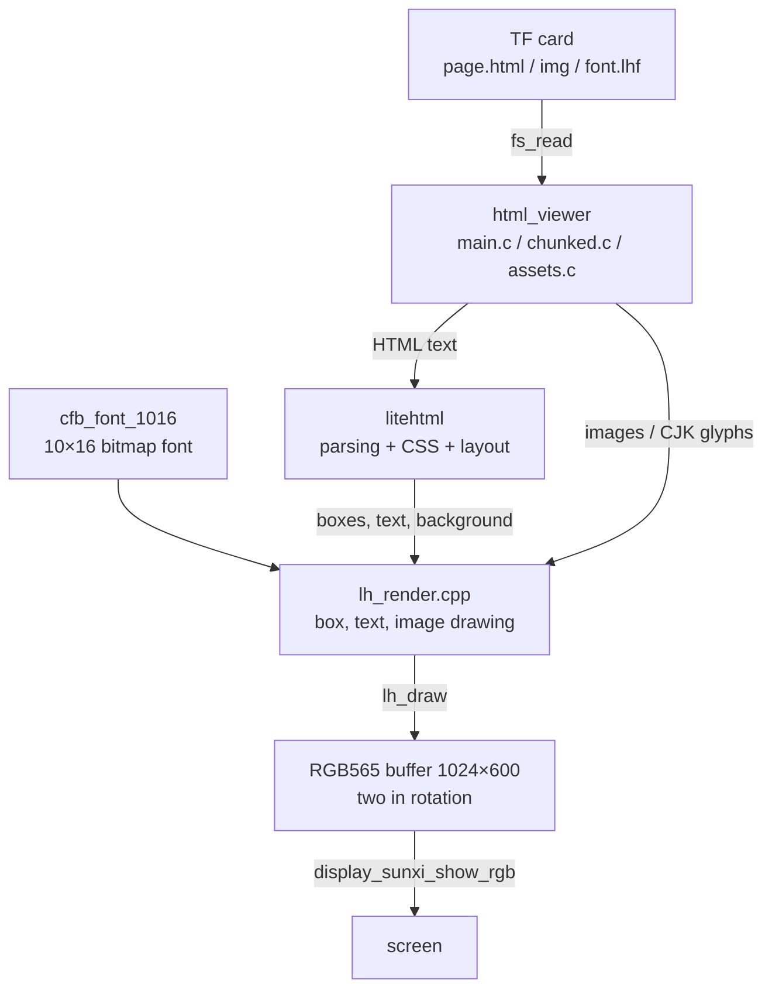
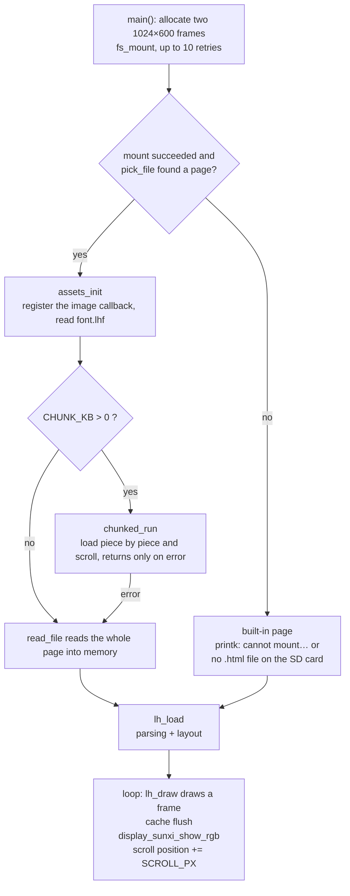

Draws HTML pages from the TF card onto the screen. [litehtml](https://github.com/litehtml/litehtml) (v0.9) parses the HTML, applies the CSS, and lays it out; the rendering layer on the board (`lh_render.cpp`) draws the laid-out boxes into an RGB565 buffer and hands it to the display engine. The component is `zephyr-components/litehtml`, and the sample is `samples/html_viewer`.

There is no browser engine: <strong>no JavaScript runs, there is no network access, and there is no touch or button input</strong>. When the page is too long it scrolls down on its own and comes back when it reaches the end.



Before you start, first complete [Setting up the development environment](../zephyr-setup-env.md) and [Getting the Zephyr source](../zephyr-get-source.md).

## Preparation

The page, images, and font all live on the TF card; the board side needs no network access.

### Page

The sample looks for a page in the following order (`pick_file()` in `main.c`, lines 77–100):

1. `CONFIG_SAMPLE_HTML_FILE`, default `/SD:/page.html`.
2. If the file above does not exist, it takes the <strong>first</strong> `.html` or `.htm` file in the card's root directory (case-insensitive; the order is the order in the directory, not necessarily alphabetical; subdirectories are not entered).
3. If there is none, it shows the built-in page compiled into the firmware.

```c
static bool pick_file(char *path, size_t size)
{
	struct fs_dirent ent;
	struct fs_dir_t dir;

	strncpy(path, CONFIG_SAMPLE_HTML_FILE, size - 1);
	path[size - 1] = '\0';
	if (fs_stat(path, &ent) == 0) {
		return true;
	}
	fs_dir_t_init(&dir);
	if (fs_opendir(&dir, "/SD:") != 0) {
		return false;
	}
	while (fs_readdir(&dir, &ent) == 0 && ent.name[0] != '\0') {
		if (ent.type == FS_DIR_ENTRY_FILE && name_is_html(ent.name)) {
			snprintk(path, size, "/SD:/%s", ent.name);
			fs_closedir(&dir);
			return true;
		}
	}
	fs_closedir(&dir);
	return false;
}
```

The component ships with a test page, `samples/html_viewer/page.html` (4.4 KB, covering text styles, color blocks, lists, tables, nested boxes, and long text). The TF card is FAT or exFAT and supports long file names. The simplest way to try it:

```sh
cp ~/f101-zephyr/zephyr-components/litehtml/samples/html_viewer/page.html /path/to/SD/page.html
```

The page is read as UTF-8. Encoding and declarations such as `<meta charset>` make no difference here: the bytes that are read are handed straight to litehtml.

### Images

`` and the CSS `background-image` both go through the same loading callback, but <strong>only the custom `.lhi` file is recognized</strong>; PNG, JPEG, GIF, WebP, and SVG are not supported for direct reference.

- Write a relative path in the page, for example ``. The path is resolved relative to <strong>the directory the page is in</strong> (`image_cb()` in `assets.c` concatenates `dir + "/" + src` and reads the file); there is no handling of URLs or `data:`.
- The `.lhi` file format: `"LHI1"`, 16-bit width, 16-bit height (little-endian), followed by width×height RGB565 pixels (little-endian). There is no alpha channel.
- A missing file, a wrong magic number, or a short length all count as "no such image": the element has no size and is not drawn. Failures are cached too, so the card is not read over and over.
- The cache holds at most 40 entries totalling 6 MiB (`CACHE_ENTRIES`, `CACHE_LIMIT`); when it overflows the least recently used are dropped.

There is no ready-made command-line conversion tool; the script below follows the same logic as `to_lhi()` and `make_font()` in `tools/scrape_page.py` (it needs Pillow, which is in Zephyr's venv):

```python
#!/usr/bin/env python3
"""用法：
  mk-lh-assets.py img  input image output.lhi [max width max height]
  mk-lh-assets.py font 字体文件 输出.lhf 页面.html
"""
import html, struct, sys
from PIL import Image, ImageDraw, ImageFont


def to_lhi(src, dst, max_w=640, max_h=360):
    img = Image.open(src)
    if img.mode in ("RGBA", "LA", "P"):          # pad transparent areas with a white background
        img = img.convert("RGBA")
        bg = Image.new("RGBA", img.size, (255, 255, 255, 255))
        bg.alpha_composite(img)
        img = bg
    img = img.convert("RGB")
    img.thumbnail((max_w, max_h), Image.LANCZOS)  # shrink only, never enlarge
    w, h = img.size
    out = bytearray(struct.pack("<4sHH", b"LHI1", w, h))
    px = img.tobytes()
    for i in range(0, len(px), 3):
        r, g, b = px[i], px[i + 1], px[i + 2]
        out += struct.pack("<H", ((r & 0xf8) << 8) | ((g & 0xfc) << 3) | (b >> 3))
    open(dst, "wb").write(out)
    print(dst, w, "x", h, len(out), "bytes")


def to_lhf(fontfile, dst, page, cell=16):
    text = html.unescape(open(page, encoding="utf-8").read())
    codes = sorted(c for c in set(map(ord, text)) if c >= 0x80 and c not in (0x200b, 0xfeff))
    font = ImageFont.truetype(fontfile, cell)
    keep, glyphs = [], []
    for c in codes:
        im = Image.new("L", (cell, cell), 0)
        ImageDraw.Draw(im).text((0, -1), chr(c), font=font, fill=255)
        if im.getbbox() is None:
            continue
        keep.append(c)
        glyphs.append(im.tobytes())
    with open(dst, "wb") as f:
        f.write(struct.pack("<4sIII", b"LHF1", len(keep), cell, 0))
        f.write(b"".join(struct.pack("<I", c) for c in keep))
        f.write(b"".join(glyphs))
    print(dst, len(keep), "glyphs")


if sys.argv[1] == "img":
    to_lhi(sys.argv[2], sys.argv[3], *map(int, sys.argv[4:6]))
else:
    to_lhf(sys.argv[2], sys.argv[3], sys.argv[4])
```

```sh
. ~/f101-zephyr/env.sh
python3 mk-lh-assets.py img photo.png SD/img/photo.lhi
```

Write `` in the page and the image is scaled to the element's size (nearest neighbour). The image is put into memory as raw RGB565; a 640×360 image takes 450 KiB, so mind the cache limit.

### Fonts and CJK characters

The text on the screen comes from two places:

| Source | Range | Description |
| --- | --- | --- |
| `cfb_font_1016` | ASCII 32–126 | the 10×16 bitmap font that comes with the Zephyr character framebuffer, compiled into the firmware |
| `font.lhf` | the characters you specify | placed in the same directory as the page; 16×16 8-bit alpha glyphs, read into memory once at startup |

The `font.lhf` format: `"LHF1"`, a 32-bit glyph count, a 32-bit cell size (16), 32 bits reserved, then a table of 32-bit code points in ascending order, and finally 16×16 bytes of alpha per glyph (rows from top to bottom). The `font` subcommand of the script above scans the page for every non-ASCII character it contains and renders them with the given font:

```sh
python3 mk-lh-assets.py font /usr/share/fonts/opentype/noto/NotoSansCJK-Regular.ttc SD/font.lhf SD/page.html
```

(Replace the font path with one that exists on your machine; for a `.ttc` collection file Pillow uses the first font by default.)

Without `font.lhf`, or when a character on the page is not in it, non-ASCII characters are drawn as `?`. <strong>The font is fixed</strong>: `font-family` has no effect, TTF/OTF/WOFF cannot be loaded, and `@font-face` is not supported.

## Building

All the commands below are run in the workspace. The component depends on the litehtml submodule, which you must fetch the first time:

```sh
cd ~/f101-zephyr/zephyr-components
git submodule update --init litehtml/litehtml
```

Without it `litehtml/litehtml` is an empty directory and CMake reports `litehtml sources missing, run: git submodule update --init`. Then build the sample:

```sh
. ~/f101-zephyr/env.sh
cd ~/f101-zephyr
west build -b yuzukineko -d build/html zephyr-components/litehtml/samples/html_viewer
```

<div class="asciinema-cast" data-src="assets/casts/zephyr/apps-html/build.cast" data-speed="6"></div>

The output is `build/html/zephyr/zephyr.bin`, linked at `0x40010000`. `prj.conf` already has `CONFIG_CPP`, `CONFIG_STD_CPP17`, and `CONFIG_LITEHTML`, so no `-D` is needed.

The sample's own `CMakeLists.txt` adds the component to the module path, so `ZEPHYR_EXTRA_MODULES` does not have to be set separately:

```cmake
list(APPEND ZEPHYR_EXTRA_MODULES ${CMAKE_CURRENT_SOURCE_DIR}/../..)

find_package(Zephyr REQUIRED HINTS $ENV{ZEPHYR_BASE})
project(html_viewer)

target_sources(app PRIVATE src/main.c src/chunked.c src/assets.c)
```

litehtml is a C++ library while the image uses a minimal C library, so the component's `CMakeLists.txt` builds it separately with `ExternalProject` (`ext/`), using only the header-only parts of libstdc++, with exceptions disabled and the standard streams (`iostream` and the like) replaced by empty stub headers; it is built into a static library and linked into the image. The few missing C library functions are in `src/litehtml_libc.c`. To use it in your own application: add the module to `ZEPHYR_EXTRA_MODULES` and write `CONFIG_CPP=y`, `CONFIG_STD_CPP17=y`, and `CONFIG_LITEHTML=y` in `prj.conf`.

## Running

### Downloading and starting

1. For the first run, leave the page out: with no `.html` file in the TF card's root directory the board shows the built-in page. To show your own page, copy `page.html` (along with `img/` and `font.lhf`) to the TF card's root directory and insert it into the board.
2. Download it with either method in [Building and running](../zephyr-build-run.md); the console is UART1 (PB00/PB01, 115200 8N1). For debugging use <strong>method one</strong>: `xfel ddr f101-s3`, `xfel write 0x40010000 build/html/zephyr/zephyr.bin`, `xfel exec 0x40010000`. Power-cycle the board before each run.

:::caution
The board has only one USB-C port, which is both the xfel download port and the UF2 drive port. Download first, then connect other devices.
:::

The picture is a 1024×600 RGB565 frame sent to the display engine's video plane with `display_sunxi_show_rgb()`; the scaling rule is the same as for a video frame: keep the aspect ratio and fill the width. The screen is 1024×768, so there are black bars at the top and bottom.

### Output after running

#### No .html on the card: the built-in page is shown

When the card is mounted and there is no `.html` file in the root directory, the serial output is:

```text
*** Booting Zephyr OS build b6f3dfe1a1f4 ***
heap: 13620 KiB free at the start
no .html file on the SD card
page: built in
page: "litehtml", 177 px high, parsed and laid out in 17 ms
heap: page and library use 2500 KiB (11120 KiB of the normal heap free)
assets: 0 KiB of images cached, 0 loaded, 0 dropped
page: drawn in 11 ms
```

The screen shows the built-in page. It is 177 px high, no taller than the screen, so it does not scroll and is redrawn once a second. If the mount fails, the line printed is `cannot mount the SD card: <error code>`; see [Troubleshooting](#troubleshooting).


The photo shows the built-in page: the title `litehtml on the F101`, and below it a bordered box reading `No page found on the SD card. Put a page.html in the root of the card.`. The picture is in the middle of the panel, with black bars above and below.

#### A page on the card: loading the page, images, CJK characters

To show your own page, put `page.html`, `font.lhf`, and `img/a.lhi` in the card's root directory and boot; the serial output is:

```text
*** Booting Zephyr OS build b6f3dfe1a1f4 ***
heap: 13620 KiB free at the start
assets: extra glyphs from /SD:/font.lhf (4 KiB)
assets: images from /SD:/img
chunked: /SD:/page.html, 35 KiB in 3 pieces of about 12 KiB, scanned in 14 ms, 1425 bytes of css
chunk 0/3: 12643 bytes, 8431 px high, loaded in 410 ms
chunked: piece 0 y 0 drawn in 37 ms
```

These lines mean, in order: `font.lhf` is read in, the image directory is registered, the page is split into 3 pieces (about 12 KiB each), and piece 0 has loaded; after that each frame takes about 37 ms. The screen shows the first screenful of the page.

#### Automatic scrolling and piece switching

When the page is taller than the screen it scrolls down automatically. `y` is printed every 60 frames, and adjacent lines differ by 120 px, that is 2 px per frame, equal to `CONFIG_SAMPLE_HTML_SCROLL_PX=2`. When the scroll nears the end of a piece, the output is:

```text
chunked: piece 0 y 7200 drawn in 39 ms
chunk 1/3: 12351 bytes, 8006 px high, loaded in 392 ms
chunked: piece 0 y 7320 drawn in 37 ms
...
chunked: piece 0 y 7920 drawn in 61 ms
chunked: piece 0 y 8040 drawn in 61 ms
chunked: piece 0 y 8160 drawn in 61 ms
chunked: piece 0 y 8280 drawn in 60 ms
chunked: piece 0 y 8400 drawn in 61 ms
chunked: piece 1 y 89 drawn in 37 ms
```

- When piece 0 scrolls past `y=7231` (less than two screens from the piece end at 8431) piece 1 is loaded in advance, taking 392 ms. The load is synchronous, so that frame stalls for about 0.4 seconds.
- Past `y=7831`, one screen before the piece end, both pieces start being drawn at once (`lh_draw_over()`) and each frame grows to about 61 ms.
- Past 8431 it switches to piece 1, `piece 1 y 89`, and the frame time returns to 37 ms.

## Rendering flow



### Main program

`main()` is at lines 350–472 of `samples/html_viewer/src/main.c`. The key points:

- The two framebuffers `fbs[2]` are 1024×600×2 bytes each, allocated from the normal heap with `aligned_alloc(64, …)` (lines 373–379). The buffer being shown on the screen is never written; the next frame is drawn into the other one, otherwise the scan-out would see a half-drawn frame.
- The card needs a moment after power-up, so the mount is tried up to 10 times, 300 ms apart (lines 381–388).
- On success it calls `assets_init(path)` and then decides whether to use piece-by-piece display based on `CONFIG_SAMPLE_HTML_CHUNK_KB` (lines 397–413):

```c
	if (mounted != 0) {
		printk("cannot mount the SD card: %d\n", mounted);
	} else if (!pick_file(path, sizeof(path))) {
		printk("no .html file on the SD card\n");
	} else {
		assets_init(path);
#if CONFIG_SAMPLE_HTML_CHUNK_KB > 0
		/* returns only when the page cannot be shown piece by piece */
		chunked_run(path, &font, disp, fbs);
		printk("chunked viewer failed, trying the page as a whole\n");
#endif
		html = read_file(path);
		if (html != NULL) {
			source = path;
		}
	}
```

- Whole-page mode: `read_file()` reads the file, `lh_load()` parses and lays it out, and then frames are drawn in an endless loop (lines 436–471). If the page is no taller than the screen, or `SCROLL_PX` is 0, it is redrawn once a second; otherwise it scrolls `CONFIG_SAMPLE_HTML_SCROLL_PX` pixels per frame, stops for 2 seconds at the bottom and scrolls back up, and stops for 2 seconds again at the top.

```c
	while (true) {
		uint16_t *fb = fbs[cur];
		struct display_sunxi_rgb img = {
			.data = fb, .width = W, .height = H, .stride = W * 2,
		};
		int max_scroll = MAX(0, height - H);
		int ret;

		t0 = k_uptime_get();
		draw_page(page, fb, scroll);
		sys_cache_data_flush_range(fb, W * H * sizeof(uint16_t));
		if (scroll == 0 || scroll >= max_scroll) {
			printk("page: drawn in %d ms\n", (int)(k_uptime_get() - t0));
		}
		/* returns when the new frame is on the screen: the other one is free again */
		ret = display_sunxi_show_rgb(disp, &img);
```

### Piece-by-piece display (the default path)

The default is `CONFIG_SAMPLE_HTML_CHUNK_KB=12`, so <strong>as long as there is a page on the card, `chunked.c` is used</strong>, even if the page is only 4 KB. What it does:

1. `lh_index_scan()` reads the file from start to end and finds the end of every child element of `<body>` as well as the positions of the `<style>` text in `<head>`.
2. Adjacent child elements are combined into a piece of about 12 KiB; only the piece on screen and the next piece are in memory, and each piece is an independent page: `<html><head><meta charset="utf-8"><style>` + all the CSS + `</style></head>` + the original `<body …>` tag + this piece's text + `</body></html>`.
3. When the scroll passes the end of a piece, the current piece is dropped and the next one is taken, while the one after that is loaded in advance. At the seam, `lh_draw_over()` draws the next piece into the lower part of the same frame.
4. At the end of the last piece it waits 2 seconds and starts again from the first piece (it does not scroll back up).

The limits of the pieces:

- The markup must be well formed, with a closing tag for every non-empty element. A direct child element of `<body>` is never split; if one child is very large, that piece is very large.
- Sibling selectors that span pieces (`+`, `~`, `:nth-child` and the like) do not take effect, because each piece is an independent page.
- Style sheets are collected only from `<style>` in `<head>` (`css[]` in `struct lh_index`, at most 16). External style sheets are not supported to begin with.

To render as a whole page only: set `CONFIG_SAMPLE_HTML_CHUNK_KB` to 0 at build time. Whole-page mode puts the entire document tree in the heap, and fails with a large page. The component also offers `LITEHTML_PAGED_HEAP` (paging on demand, with `swap.bin` on the TF card as backing store; see `samples/html_viewer/paged.conf` for the configuration).

### Rendering layer

`canvas_container` in `ext/src/lh_render.cpp` implements litehtml's `document_container` interface. The public interface is in `include/litehtml_zephyr/lh.h`:

| Function | Purpose |
| --- | --- |
| `lh_load(font, html, width, height)` | parses and lays out for the viewport width, returning a page object. `height` is used only for `vh` units and media queries |
| `lh_content_height(page)` | total height of the laid-out page (in pixels) |
| `lh_title(page)` | the text of `<title>` |
| `lh_draw(page, fb, stride, w, h, scroll_y, bg)` | clears with `bg` first, then draws one screen starting at row `scroll_y` into the RGB565 buffer |
| `lh_draw_over(…)` | does not clear; draws over (used at the piece seams) |
| `lh_set_image_loader(fn, user)` | registers the image callback, which returns RGB565 pixels |
| `lh_set_cjk_font(data, size)` | registers the contents of `font.lhf`; the data must stay valid |
| `lh_free(page)` | frees |
| `lh_index_scan(read, user, size, target, out)` | piece scanning |

`lh_load()` and `lh_draw()` are just these few lines (`lh_render.cpp` lines 567–601):

```cpp
struct lh_page *lh_load(const struct lh_font *font, const char *html, int width, int height)
{
	auto *p = new lh_page(font, width, height);

	p->doc = litehtml::document::createFromString(html, &p->container);
	if (!p->doc) {
		delete p;
		return nullptr;
	}
	p->doc->render(width);
	p->content_h = p->doc->height();
	return p;
}
```

```cpp
void lh_draw(struct lh_page *page, uint16_t *fb, int stride, int w, int h, int scroll_y, uint16_t bg)
{
	for (int y = 0; y < h; y++) {
		std::fill(fb + (size_t)y * stride, fb + (size_t)y * stride + w, bg);
	}
	page->container.begin(fb, stride, w, h);

	litehtml::position clip(0, 0, w, h);

	page->doc->draw(0, 0, -scroll_y, &clip);
}
```

How text is drawn: `create_font()` takes the CSS font size as the glyph height and scales the glyph width by the 10:16 ratio (`cell_w = size * 10 / 16`, at least 1); bold (weight ≥ 600) adds 1 to the width and paints one extra column to the right; `draw_glyph()` scales the 10×16 bitmap to the target size with nearest neighbour, and italics are offset row by row. Underline, strikethrough, and overline are drawn as plain lines.

```cpp
f->size = std::max(size, 6);
f->weight = weight;
f->italic = italic == litehtml::font_style_italic;
f->decoration = decoration;
f->cell_w = std::max(1, (f->size * font_->cell_w + font_->cell_h / 2) / font_->cell_h);
if (weight >= 600) {
	f->cell_w++;
}
```

A CJK character in `font.lhf` is scaled to `size × size`, and the letter spacing is the font size.

## Supported HTML / CSS scope

Look at it at two levels: what litehtml can lay out, and what this rendering layer can draw. Only what can be confirmed from the source is listed below.

### Supported

| Category | Details |
| --- | --- |
| HTML | gumbo parsing (an HTML5 error-tolerant parser); common tags such as headings, paragraphs, `div`, `span`, `b`, `i`, `u`, `s`, `code`, `a`, `ul`/`ol`/`li`, `table`, `img`, `br` |
| Box model | `margin`, `padding`, `border` (width and color, <strong>solid lines only</strong>), `width`/`height`, `box-sizing` |
| Layout | block, inline, `inline-block`, `float`, `position` (`relative`/`absolute`/`fixed`), `display: table` and `<table>`, `display: flex`/`inline-flex` |
| Text | `font-size`, `font-weight`, `font-style`, `text-align`, `text-decoration`, `text-transform` (ASCII letters only), `white-space`, `vertical-align`, `line-height` |
| Units | `px`, `%`, `em`, `rem`, `pt` and so on, `vw`/`vh`/`vmin`/`vmax` |
| Color | hexadecimal, `rgb()`, `rgba()`, color names; `rgba` alpha blends with the existing pixels |
| Background | `background-color`; `background-image` takes a `.lhi` and supports `repeat`/`repeat-x`/`repeat-y`, position, and size |
| List markers | bullets, hollow squares (`circle`), filled squares, and numeric numbering (`1.` style) |
| Other | `overflow` clipping (rectangular); `<style>` inline style sheets; selectors; basic conditions in `@media` such as `width`, `height`, `screen` (the viewport is fixed at 1024×600); CSS variables `var()` (litehtml handles `var(` in its `style.cpp`) |

### Not supported

| Item | Actual situation |
| --- | --- |
| JavaScript | <strong>Not supported</strong>; `<script>` is not executed |
| Link clicks, forms, input | <strong>Not supported</strong>. `on_anchor_click()` and `set_cursor()` are empty functions, and there is no input device on the board |
| External style sheets | <strong>Not supported</strong>. `import_css()` is an empty function, neither `<link rel="stylesheet">` nor `@import` is loaded, and styles must be written into `<style>` |
| Image formats | Only `.lhi`; PNG/JPEG/GIF/WebP/SVG and `data:` addresses are <strong>not supported</strong> |
| Fonts | Only the ASCII 10×16 bitmap (scaled) and the glyphs in `font.lhf`; `font-family`, `@font-face`, and TTF/WOFF are <strong>not supported</strong>, and there is no anti-aliasing |
| Gradients | <strong>Not supported</strong>; the rendering layer draws solid fills only |
| Rounded corners | <strong>Not supported</strong>; `border-radius` is ignored |
| Border styles | Dashed, dotted, double, groove and the rest are all drawn as solid lines (`draw_borders()` only tests for `none`/`hidden`) |
| `calc()` | <strong>Not supported</strong>; litehtml's `css_length.cpp` has `TODO: Make support for calc`, and a `calc(…)` is handled as the default value |
| CSS Grid | <strong>Not supported</strong>. The component's documentation states clearly that litehtml has no grid |
| Shadows, opacity properties, transforms, animations, transitions | <strong>Not supported</strong>: the rendering layer has no matching drawing and litehtml does not parse these properties either |
| Scrolling interaction | <strong>Not supported</strong>: only automatic scrolling, no manual scrolling; an element with `overflow: scroll` cannot scroll |

If the page comes from a web page it must be rewritten with `tools/scrape_page.py`; see the next section.

### Turning a web page into a page you can display

`tools/scrape_page.py URL OUTDIR [--font FONT]` fetches a web page: it strips scripts and event attributes, inlines the style sheets (`@media` is evaluated for the viewport width first, and `display:grid` becomes flex wrapping), converts images to `.lhi`, and renders the CJK characters that appear on the page into `font.lhf`. Copy all of `OUTDIR` to the TF card and display the `index.html` in it. It needs Pillow and network access. The layout is still only approximate. `tools/host_preview/host_main.cpp` is a PC build of the same rendering layer, for looking at the result without the board.

## How to change the page content

No rebuild is needed:

1. Change `page.html` on the TF card and power-cycle.
2. To add an image to the page: convert it to `.lhi`, put it in `img/`, and use ``.
3. For CJK characters on the page: regenerate `font.lhf` and put it in the same directory as the page.
4. For a larger page: keep the markup well formed (see the limits of the pieces).

The smallest page:

```html
<!DOCTYPE html>
<html>
<head>
<meta charset="utf-8">
<title>hello</title>
<style>
  body { margin: 24px; background: #f4f6fb; color: #222; }
  h1 { color: #1a4fa0; }
  .box { background: #fff; border: 2px solid #1a4fa0; padding: 12px; }
</style>
</head>
<body>
<h1>Hello</h1>
<div class="box"><p>A <b>bold</b> word.</p></div>
</body>
</html>
```

## Features and where to change them

| Feature | Location | How to change |
| --- | --- | --- |
| Page path | `pick_file()` in `main.c`, `CONFIG_SAMPLE_HTML_FILE` | change at build time, see [Configuration options](#configuration-options) |
| Scroll speed | `CONFIG_SAMPLE_HTML_SCROLL_PX` | pixels per frame; 0 turns scrolling off |
| Viewport size | there is one `#define W 1024` and `#define H 600` at the top of each of `main.c` and `chunked.c` | both files must be changed together; the width passed to `lh_load()`, the framebuffer size, and `display_sunxi_show_rgb()` all use it |
| Background color | `#define BG 0xffff` in both files | RGB565; where the page does not cover, this is the color |
| Built-in page | `builtin_page[]` in `main.c` (lines 43–49) | change the string; it is shown when no page is found |
| Font | the `font` structure in `main.c` (`cfb_font_1016`, 10×16) | replace it with another bitmap of the same format (`struct lh_font`, 20 bytes per glyph) |
| Image cache | `CACHE_ENTRIES` and `CACHE_LIMIT` in `assets.c` | change the macros |
| Piece size | `CONFIG_SAMPLE_HTML_CHUNK_KB` | 0 turns pieces off |
| Manual scrolling, paging | <strong>not implemented in the sample</strong> | you must wire up input yourself in the `main()` loop and change the `scroll` variable |

### Adding manual scrolling

The `scroll` in the sample is driven only by `SCROLL_PX`. To wire up an input device, the idea is to change the loop at the end of `main.c`: remove the automatic increment and decrement and instead change `scroll` from button or touch events, clamped to the range `0` to `max_scroll`. This applies only to whole-page mode (`CHUNK_KB=0`); in piece mode the scrolling is in the `y += CONFIG_SAMPLE_HTML_SCROLL_PX` line in `chunked.c`. It is not implemented in the sample.

### Using it in your own program

The rendering layer does not depend on the sample's file reading; all it needs is an HTML string and an RGB565 buffer:

```c
#include <litehtml_zephyr/lh.h>

extern const uint8_t cfb_font_1016[95][20];

static const struct lh_font font = {
	.glyphs = cfb_font_1016, .first = 32, .last = 126, .cell_w = 10, .cell_h = 16,
};

struct lh_page *page = lh_load(&font, "<h1>hi</h1>", 1024, 600);

lh_draw(page, fb, 1024, 1024, 600, 0, 0xffff);
/* fb is a buffer of 1024*600 uint16_t RGB565 values; call sys_cache_data_flush_range() when drawing is done */
lh_free(page);
```

## Configuration options

The sample (`samples/html_viewer/Kconfig`):

| Option | Default | Description |
| --- | --- | --- |
| `CONFIG_SAMPLE_HTML_FILE` | `"/SD:/page.html"` | the page to show; if it does not exist, the first `.html`/`.htm` in the card's root directory is used |
| `CONFIG_SAMPLE_HTML_SCROLL_PX` | `2` | pixels scrolled per frame; 0 means no scrolling |
| `CONFIG_SAMPLE_HTML_CHUNK_KB` | `12` | piece size (KiB); 0 means whole-page layout |
| `CONFIG_SAMPLE_HTML_BENCH` | off | loads every `page_*.html` on the card in turn (smallest to largest), prints the time and memory, and then goes into normal display |
| `CONFIG_SAMPLE_HTML_PAGED_MB` | `200` | virtual size of the paged heap (MiB), effective only with `LITEHTML_PAGED_HEAP` |

How to override:

```sh
west build -b yuzukineko -d build/html zephyr-components/litehtml/samples/html_viewer -- \
  -DCONFIG_SAMPLE_HTML_FILE='"/SD:/web/index.html"' -DCONFIG_SAMPLE_HTML_SCROLL_PX=4
```

The component (`zephyr-components/litehtml/Kconfig`):

| Option | Description |
| --- | --- |
| `CONFIG_LITEHTML` | builds litehtml and links it into the image; depends on `CPP` and `RISCV` |
| `CONFIG_LITEHTML_PAGED_HEAP` | the `malloc` family is served from an on-demand paged region, and swapped-out pages are written to a file on the TF card; depends on `DEMAND_PAGING`, `BACKING_STORE_SWAP`, `FILE_SYSTEM`. For usage see `samples/html_viewer/paged.conf`: `-DEXTRA_CONF_FILE=paged.conf` |

The rendering-related options in the sample's `prj.conf`:

| Option | Purpose |
| --- | --- |
| `CONFIG_CPP` | enables C++ support |
| `CONFIG_STD_CPP17` | C++17 |
| `CONFIG_LITEHTML` | enables the component |
| `CONFIG_STATIC_INIT_GNU` | runs the constructors of C++ global objects |
| `CONFIG_SDHC` | SD host controller driver |
| `CONFIG_DISK_ACCESS` | disk access layer |
| `CONFIG_DISK_DRIVER_SDMMC` | treats the SD/MMC card as a disk |
| `CONFIG_FILE_SYSTEM` | filesystem framework |
| `CONFIG_FAT_FILESYSTEM_ELM` | FatFs |
| `CONFIG_FS_FATFS_EXFAT` | supports exFAT cards |
| `CONFIG_FS_FATFS_LFN` | supports long file names |
| `CONFIG_FS_FATFS_LFN_MODE_STACK` | long file name buffers on the stack |
| `CONFIG_DISPLAY` | display driver |
| `CONFIG_CHARACTER_FRAMEBUFFER` | character framebuffer, only to get `cfb_font_1016` |
| `CONFIG_CHARACTER_FRAMEBUFFER_USE_DEFAULT_FONTS` | compiles in the default fonts |
| `CONFIG_FPU` | hardware floating point |
| `CONFIG_FPU_SHARING` | floating point shared between threads |
| `CONFIG_MAIN_STACK_SIZE=65536` | main thread stack 64 KiB; litehtml's recursive layout needs a fairly deep stack |
| `CONFIG_COMMON_LIBC_MALLOC_ARENA_SIZE=-1` | the `malloc` arena uses all the remaining memory |
| `CONFIG_HEAP_MEM_POOL_SIZE=262144` | kernel heap 256 KiB |

## Code structure

| File | Contents |
| --- | --- |
| `samples/html_viewer/src/main.c` | picks the page, reads the file, whole-page display loop, built-in page, benchmark mode |
| `samples/html_viewer/src/chunked.c` | piece-by-piece display |
| `samples/html_viewer/src/assets.c` | image cache and `font.lhf` reading |
| `ext/src/lh_render.cpp` | rendering layer: font, background, border, image, clipping |
| `ext/src/lh_index.c` | piece scanner |
| `ext/src/lh_stubs.cpp`, `ext/shim/` | standard library adaptation (no exceptions, no streams) |
| `src/litehtml_libc.c` | the missing C library functions |
| `src/litehtml_paged_heap.c` | paged heap |
| `include/litehtml_zephyr/lh.h` | public interface |
| `tools/scrape_page.py` | fetches and converts a web page |
| `tools/host_preview/` | PC preview |
| `litehtml/litehtml/` | litehtml submodule |

## Scope

- Text is the fixed 10×16 bitmap scaled, with no font selection and no anti-aliasing; non-ASCII characters need `font.lhf`, otherwise they show as `?`.
- Gradients, rounded corners, and shadows are not supported and borders are drawn as solid lines only; CSS Grid and `calc()` are not supported.
- Only `.lhi` images are recognized, and they have no alpha channel.
- JavaScript, link navigation, forms, animations, and external style sheets are not supported.
- There is no input device, so only automatic scrolling is possible; for manual scrolling see [Adding manual scrolling](#adding-manual-scrolling). When the page is no taller than the screen it does not scroll (`max_scroll` is 0, and the loop redraws once a second).
- In piece mode the scroll speed is about 33 px/s: each frame draws for 37 ms, plus the time waiting for the display and for printing. To go faster, raise `CONFIG_SAMPLE_HTML_SCROLL_PX`.
- The on-screen picture is a fixed 1024×600, and the screen is 1024×768, so there are black bars at the top and bottom.
- When the page is too large to fit in memory, pieces are required; in piece mode selectors that span pieces and rules that need the whole page do not take effect, and moving to a new piece stalls.
- A web page must first be converted with `tools/scrape_page.py`, and the converted layout is approximate.


## Troubleshooting

| Symptom | Cause and handling |
| --- | --- |
| The build reports `litehtml sources missing, run: git submodule update --init` | the submodule was not fetched: `cd zephyr-components && git submodule update --init litehtml/litehtml` |
| `display not ready` | the display device did not come up; confirm that you built for the `yuzukineko` board |
| `cannot mount the SD card: <error code>` | all 10 mount attempts failed: the card is not seated properly, or it is not FAT/exFAT |
| `no .html file on the SD card` | the card is mounted but there is no `page.html` and no other `.html`/`.htm` in the root directory, so the built-in page is shown. Copy the page to the root directory |
| A different page is shown | When there is no `page.html`, the first `.html` in the root directory is taken, in directory order, not alphabetical order. Name the page you want `page.html` |
| An image is not shown | the file is not at `<page directory>/<src>`, or it is not a `.lhi` |
| CJK characters show as `?` | there is no `font.lhf`, or this character on the page was not generated into it |
| `chunked viewer failed, trying the page as a whole` | piece scanning or loading failed (malformed markup, not enough memory, etc.), so it falls back to whole-page mode |
| `lh_load failed` | not enough memory; split the page up or use pieces |
| `no memory for the frames` | allocating the two framebuffers failed; the heap is too small |
| `show_rgb failed: <error code>` | the display driver did not accept this frame |
