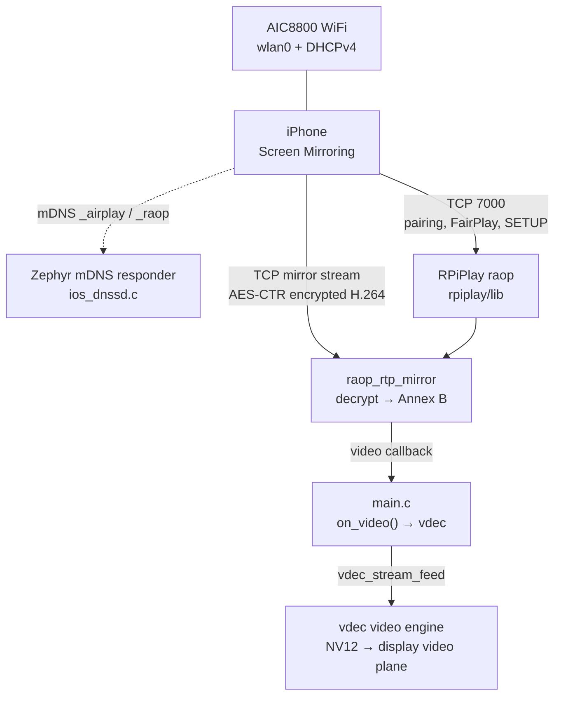
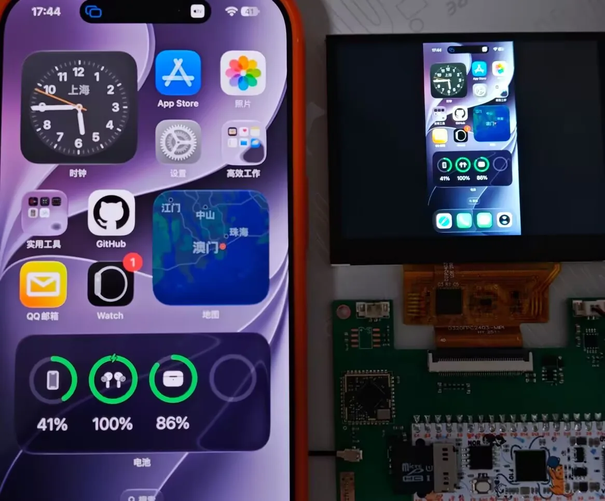
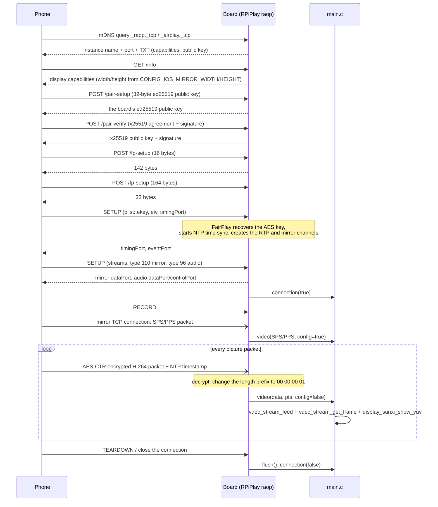
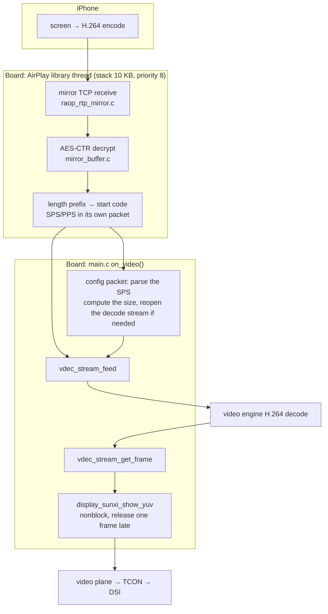

Mirror the iPhone's screen onto the board: the board joins WiFi and appears in the iPhone's "Control Center - Screen Mirroring" list as an AirPlay receiver; once the iPhone picks it, the phone encodes its screen into an H.264 stream and sends it over, and the board decodes it with the on-chip video engine and sends it straight to the display's video plane. The sample is `zephyr-components/ios-screen-mirror/samples/ios_player`.

The protocol part of the `ios-screen-mirror` component comes from [RPiPlay](https://github.com/FD-/RPiPlay) (an AirPlay mirroring receiver with the FairPlay handshake), kept as a git submodule under `rpiplay/`. The OpenSSL, Bonjour (mDNSResponder) and libplist that the original library depends on are replaced here by mbedTLS, Zephyr's own DNS-SD responder, and a very small binary plist reader/writer (`src/plist.c`).



Only the picture is mirrored. The audio in the AirPlay stream is received, but the sample's audio callback is an empty function and drops it straight away, so the board makes no sound; see [Scope](#scope).

Before you start, complete [Setting up the development environment](../zephyr-setup-env.md) and [Getting the Zephyr source](../zephyr-get-source.md).

:::caution[License: GPL-3.0]
RPiPlay is licensed GPL-3.0, so the whole `ios-screen-mirror` component is treated as GPL-3.0 (the `Kconfig` help text, `CMakeLists.txt` and the sample's source headers all say `GPL-3.0-or-later`; a few files such as `src/ios_dnssd.c` have an Apache-2.0 header, but they link into the same image as RPiPlay). Firmware that is built into an image and distributed must offer the corresponding source under GPL-3.0. If you only want screen mirroring over other protocols, leave `CONFIG_IOS_MIRROR` off and this code will not be linked in.
:::

## Preparation

### Getting the RPiPlay submodule

`rpiplay/` is a submodule; if it has not been pulled the directory is empty and the build will not find `rpiplay/lib`. Pull it inside `zephyr-components`:

```sh
cd ~/f101-zephyr/zephyr-components
git submodule update --init ios-screen-mirror/rpiplay
```

### What you need

| Item | Notes |
| --- | --- |
| Board | `yuzukineko`, with the AIC8800 WiFi module and a 1024×768 MIPI-DSI panel |
| TF card | FAT or exFAT. The sample uses it to read the WiFi configuration `/SD:/wifi.cfg`; when the card has no such file, only the SSID/password compiled in can be used |
| WiFi | A 2.4 GHz or 5 GHz WPA2-PSK (or open) network; the board and the iPhone must be on <strong>the same layer-2 network</strong>, because discovery relies on multicast mDNS |
| iPhone | An iOS device with Screen Mirroring. No app needs to be installed |

### WiFi configuration

The board's WiFi is the AIC8800; the driver and the interface are covered in [AIC8800 WIFI](../components/aic8800-wifi.md), and this section only describes how the sample uses it. The order in which the sample takes the SSID and password (`wifi_load()` at lines 105–134 of `main.c`):

1. Read `/SD:/wifi.cfg` from the TF card: <strong>the first line is the SSID, the second the password</strong>, plain text, each line ending in a newline. The SSID is at most 32 bytes and the password at most 64 bytes.
2. If the file cannot be read, or its first line is empty, use the build options `CONFIG_SAMPLE_IOS_WIFI_SSID` and `CONFIG_SAMPLE_IOS_WIFI_PSK`.
3. If neither place has an SSID: the screen shows `No WiFi: put wifi.cfg on the card` and the sample exits.

An empty password connects as an open network, otherwise as WPA2-PSK (`WIFI_SECURITY_TYPE_PSK`). WPA3 is not supported; for the reason see the AIC8800 page.

`wifi.cfg` example (two lines, with no extra blank lines or quotes):

```text
MyHomeWiFi
my-password-123
```

:::note
`wifi.cfg` has the same format as the Android screen mirroring sample (`android-screen-mirror`); that sample writes the configuration to the TF card and the iOS sample reads the same file, so the two samples can share one card.
:::

:::caution
When joining a network, the AIC8800 driver prints the SSID and password in clear text on the serial port in its `aic8800` log (`Connect Wi-Fi: …`, `SET_NETWORK 0 psk "…"`). Erase those lines before you paste the serial log to anyone.
:::

## Build

In the workspace:

```sh
. ~/f101-zephyr/env.sh
cd ~/f101-zephyr
west build -b yuzukineko -d build/ios-mirror zephyr-components/ios-screen-mirror/samples/ios_player
```

<div class="asciinema-cast" data-src="assets/casts/zephyr/apps-ios-mirror/build.cast" data-speed="6"></div>

The output is `build/ios-mirror/zephyr/zephyr.bin`, about 3.6 MB, linked at `0x40010000`, with 21.67% of RAM used. The sample's `CMakeLists.txt` adds the component (two directories up) and the sibling `aic8800` to `ZEPHYR_EXTRA_MODULES` by itself, so nothing has to be specified by hand.

The sample's `prj.conf` selects `CONFIG_MINIMAL_LIBC=y`: the AIC8800 and RPiPlay adaptation headers are written for the minimal C library, and an application using this component on its own must select it as well.

## Run

Download it with either method from [Build and run](../zephyr-build-run.md); the console is UART1 (PB00/PB01, 115200 8N1). For debugging use <strong>method one</strong>:

```sh
xfel ddr f101-s3
xfel write 0x40010000 build/ios-mirror/zephyr/zephyr.bin
xfel exec 0x40010000
```

### Output after running

#### 1. Boot and joining the WiFi

After downloading and executing, the status card `Joining the WiFi` appears in the middle of the screen. The serial port outputs, in order: display and touchscreen initialization; `ios: Joining the WiFi`; the AIC8800 identified as D80 (`chip_id=c3`) and its firmware download; the `wifi.cfg` read from the TF card and the join, with `WPA enter FHOST_WPA_STATE_CONNECTED`; the address from DHCP, printed as `ios: address …`.

#### 2. AirPlay service starts

Once the address is in, the serial port outputs `airplay: Initialized server socket(s)`, `airplay: "F101 Mirror" on port 7000`, `ios: Screen Mirroring: choose "F101 Mirror"`, and the screen card becomes `Screen Mirroring: choose "F101 Mirror"`. `ios: mDNS group joined: -120` is `EALREADY`, meaning the responder had already joined the multicast group when the interface came up; it is not a failure, see [Startup sequence](#startup-sequence).

```text
*** Booting Zephyr OS build b6f3dfe1a1f4 ***
[00:00:00.493,000] <inf> display_sunxi: 1024x768 @ 60 Hz, fb 0x40384180, video plane 0
[00:00:00.564,000] <inf> gt967: GT967 firmware 0x1040, 1024x768
ios: Joining the WiFi
[00:00:01.597,000] <inf> aic8800: aicwf chipid: USE AIC8800D80
[00:00:03.022,000] <inf> aic8800: sdio card up: 2 functions
[00:00:03.024,000] <inf> aic8800: chip_id=c3, chip_sub_id=2
[00:00:03.024,000] <inf> aic8800: ### Upload firmware, @ = 120000
[00:00:04.219,000] <inf> aic8800: aic_wifi_init ok
[00:00:04.219,000] <inf> aic8800: Connect Wi-Fi: <SSID>, <PSK>
[00:00:08.439,000] <inf> aic8800: WPA enter FHOST_WPA_STATE_CONNECTED
ios: address 192.168.x.x
ios: mDNS group joined: -120
airplay: Initialized server socket(s)
airplay: "F101 Mirror" on port 7000
ios: Screen Mirroring: choose "F101 Mirror"
```

Log excerpt; the SSID, password, MAC and IP have been replaced with placeholders (the driver prints the SSID and password in clear text on the `Connect Wi-Fi` and `SET_NETWORK` lines).


In the middle of the board screen is the status card, reading `Screen Mirroring: choose "F101 Mirror"` and waiting for the iPhone to connect.

#### 3. Discover and mirror from the iPhone

1. Connect the iPhone to <strong>the same WiFi as the board</strong> (the same subnet; the router must not have AP isolation or client isolation on, or neither multicast nor unicast will get through).
2. Pull down from the top right corner (swipe up from the bottom on models with a Home button) to open <strong>Control Center</strong>, and tap <strong>Screen Mirroring</strong>.
3. <strong>F101 Mirror</strong> appears in the list (the name is set by `CONFIG_IOS_MIRROR_NAME`); tap it.
4. The phone screen starts mirroring onto the board. Open Screen Mirroring again and tap <strong>Stop Mirroring</strong> to end it.


In the Control Center's Screen Mirroring list, `F101 Mirror` appears with the Apple TV icon; tap it to start mirroring.

#### 4. What appears on the board

After the phone has selected F101 Mirror, the serial port outputs `ios: phone connected`, `ios: stream profile …` and `ios: first picture <W>x<H>` in order, and after that one statistics line every 5 seconds; for the meaning of each line see [Console output](#console-output).

In portrait orientation the mirror stream is about 448×972 and the board screen is 1024×768, so the picture is scaled to its aspect ratio and centred, with black bars on both sides. Once the first frame is drawn the status card hides itself; when the phone stops mirroring or disconnects, the card reappears reading `Waiting for the phone`.



On the left is the iPhone, on the right the board screen: the phone is in portrait, and the picture is scaled to fit and centred with black bars on both sides.

## Protocol flow

### Discovery: mDNS / DNS-SD

The iPhone does not find the receiver by typing in an IP; it relies on Bonjour (multicast DNS-SD). All the board has to do is answer for these two service types:

| Service | Instance name | Port | Purpose |
| --- | --- | --- | --- |
| `_raop._tcp` | `<12 hex digits of the MAC>@<name>` | `CONFIG_IOS_MIRROR_PORT` | This is what iOS looks for in the Screen Mirroring list |
| `_airplay._tcp` | `<name>` | same as above | The AirPlay service itself |

`src/ios_dnssd.c` defines these two records statically with Zephyr's `STRUCT_SECTION_ITERABLE(dns_sd_rec, …)`, and the name and TXT data are filled in at run time by `airplay_start()`. The TXT of the two records carries the device capabilities: `et` (encryption type), `cn` (audio codecs), `ft`/`features` (feature bits), `pk` (public key), `deviceid` (MAC) and so on, all taken from RPiPlay and written in `rpiplay/lib/dnssdint.h`.

### Connecting: pairing, FairPlay, SETUP

After the iPhone selects the board it sends HTTP/RTSP requests to the board's TCP port, and `raop.c` dispatches them to handler functions by method and path:



Key points:

- `/pair-setup` and `/pair-verify` use ed25519 and x25519 (`src/ed25519_ops.c`, `src/ios_crypto.c`, based on mbedTLS and an ed25519 implementation).
- `/fp-setup` is the FairPlay handshake (`rpiplay/lib/playfair/`, the playfair implementation inside RPiPlay). Its job is to let the board recover the AES key from `ekey`, after which the picture data can be decrypted.
- The mirrored picture data travels on its own TCP connection (the `dataPort` with `type=110` in SETUP), and each packet is encrypted with AES-CTR; the key is derived with SHA-512 from the FairPlay result, the x25519 shared secret and the `streamConnectionID` (`mirror_buffer.c`).
- Timestamps: `raop_ntp.c` synchronizes time with the phone on the `timingPort`, and `raop_rtp_mirror.c` converts the NTP timestamp in the packet into the board's local time and hands it to the callback as `pts`.

### Data flow: from the phone's pixels to the screen



The interface from the AirPlay library to the application is just the callbacks in `include/ios_zephyr/airplay.h`, see [Interface](#interface).

## Features and where to change them

| Feature | Location | How to change it |
| --- | --- | --- |
| Read the WiFi configuration | `wifi_load()` at lines 105–134 of `main.c` | Change the `wifi.cfg` path or format |
| Join WiFi, wait for an address | `wifi_join()` at lines 136–168 of `main.c` | Change the timeout (30 seconds) or the security type |
| Status card | `ui_build()`, `status()` at lines 40–75 of `main.c` | Change the text, size, colour |
| Decode stream parameters | `stream_open()` at lines 195–207 of `main.c` | Change `buffer_size`, `holding_frames` |
| One packet of picture data arrives | `on_video()` at lines 359–435 of `main.c` | Decoding, display, statistics |
| The phone connects or leaves | `on_connection()` at lines 437–447 of `main.c` | Close the decode stream and show the waiting text on disconnect |
| The phone stops mirroring | `on_flush()` at lines 449–455 of `main.c` | Close the decode stream |
| Start AirPlay | `airplay_start()`, lines 494–500 of `main.c` | Change the name and the port |
| Advertised screen size | the `1920`/`1080` that `CMakeLists.txt` substitutes into `raop_handlers.h` | Change `CONFIG_IOS_MIRROR_WIDTH/HEIGHT` |
| Audio | `audio_process()` at lines 20–23 of `src/airplay.c` | Currently an empty function, see [Scope](#scope) |

### Startup sequence

`main()` (lines 457–511 of `main.c`) in order:

1. `ui_build()` builds the status card; check that the video engine, the display and the WiFi interface (`net_if_get_first_wifi()`) are ready.
2. Call `fs_mount()` up to 5 times to mount the TF card (one second apart); a failure is only printed and does not exit, because the SSID from the build options can still be used.
3. `wifi_join()`: read the configuration, `NET_REQUEST_WIFI_CONNECT`, and wait for the connection result (30 seconds) and the IPv4 address (30 seconds).
4. Join the mDNS multicast group `224.0.0.251` by hand with `net_ipv4_igmp_join()`. The mDNS responder joins the group when the interface goes up, but in this sample the interface comes up before the responder starts, so this is done once more here; when the group has already been joined it returns `-EALREADY` (-120), which is where the `mDNS group joined: -120` in the log comes from.
5. Fill the MAC of the WiFi interface into `cfg.hw_addr` and call `airplay_start(&cfg)`.
6. Change the card text to `Screen Mirroring: choose "<name>"` and then loop calling `lv_timer_handler()` to refresh the status card.

```c
memcpy(cfg.hw_addr, net_if_get_link_addr(iface)->addr, sizeof(cfg.hw_addr));
ret = airplay_start(&cfg);
if (ret != 0) {
    printk("ios: cannot start AirPlay: %d\n", ret);
    status("Cannot start AirPlay");
    return 0;
}
```

### Receiving a picture: on_video()

Each time the AirPlay thread decodes one H.264 packet it calls `on_video()` (lines 359–435 of `main.c`), which under one mutex:

- `config == true`: this packet is SPS/PPS. `read_sps()` parses the SPS for the width and height and estimates the memory the decoder needs as `width × height × 3/2 × (2 + HOLD_FRAMES)`; if that exceeds `CONFIG_VDEC_SUNXI_MAX_MEMORY_KB - 512` KB it closes the decode stream and the screen shows `Unsupported resolution WxH`; if not, it closes the old stream (the size may have changed) and calls `stream_open()` again.
- Otherwise feed the data with `vdec_stream_feed()`; if it will not take it (`-EAGAIN`), call `drain()` first to pull frames and retry.
- `drain()` (lines 222–259) takes out each frame and shows it with `display_sunxi_show_yuv()` (`nonblock = true`, `bt709 = true`); the frame before last is released one frame later, so that a frame still being scanned out is not overwritten. When the first frame is shown the status card is hidden.
- Print one statistics line every 5 seconds.

Note: the picture is <strong>displayed as soon as it is decoded</strong>; the sample does not use `pts` to wait for a time (it hands `pts` to the decoder unchanged), so there is no audio/video synchronization and no dropped-frame logic, and the latency depends on the decode speed.

## Configuration options

### Component (`ios-screen-mirror/Kconfig`)

| Option | Default | Notes |
| --- | --- | --- |
| `CONFIG_IOS_MIRROR` | n | Turn on the iOS screen mirroring component. Depends on networking, TCP and UDP, and automatically selects the mDNS responder, DNS-SD and mbedTLS (SHA-512, AES CTR/CBC) |
| `CONFIG_IOS_MIRROR_NAME` | `"F101 Mirror"` | The name shown in the Screen Mirroring list |
| `CONFIG_IOS_MIRROR_PORT` | 7000 | TCP port of the AirPlay server, 0 for any free port |
| `CONFIG_IOS_MIRROR_WIDTH` | 1920 | Display width advertised to the phone (pixels); the phone decides the stream size from it, substituted into RPiPlay's `raop_handlers.h` at build time |
| `CONFIG_IOS_MIRROR_HEIGHT` | 1080 | Display height advertised to the phone |
| `CONFIG_IOS_MIRROR_THREAD_STACK` | 10240 | Stack in bytes for each AirPlay library thread; the busiest HTTP/RTSP thread uses about 6 KB |
| `CONFIG_IOS_MIRROR_THREAD_PRIORITY` | 8 | Priority of the AirPlay library threads |

### Sample (`samples/ios_player/Kconfig`)

| Option | Default | Notes |
| --- | --- | --- |
| `CONFIG_SAMPLE_IOS_WIFI_SSID` | `""` | SSID used when there is no `/SD:/wifi.cfg` |
| `CONFIG_SAMPLE_IOS_WIFI_PSK` | `""` | WPA2 password used when there is no `/SD:/wifi.cfg` |
| `CONFIG_SAMPLE_IOS_HOLD_FRAMES` | 4 | Frames the decoder keeps in addition to the two working frames. Each frame is about 650 KB with a portrait stream; too few and the decoder has no frame available and stalls, and a value of 2 deadlocks |

Example, putting the SSID and name into the build:

```sh
west build -b yuzukineko -d build/ios-mirror zephyr-components/ios-screen-mirror/samples/ios_player -- \
  -DCONFIG_SAMPLE_IOS_WIFI_SSID='"MyHomeWiFi"' \
  -DCONFIG_SAMPLE_IOS_WIFI_PSK='"my-password-123"' -DCONFIG_IOS_MIRROR_NAME='"Board A"'
```

### Options in `prj.conf` related to screen mirroring

| Option | Effect |
| --- | --- |
| `CONFIG_AIC8800` | WiFi driver, see [AIC8800 WIFI](../components/aic8800-wifi.md) |
| `CONFIG_WIFI`, `CONFIG_NET_L2_WIFI_MGMT` | Zephyr WiFi management interface, used by the sample to start the connection |
| `CONFIG_NET_DHCPV4` | Get an address |
| `CONFIG_NET_IPV4_IGMP` | Join the mDNS multicast group `224.0.0.251` |
| `CONFIG_NET_IPV6=n` | IPv4 only |
| `CONFIG_NET_HOSTNAME="f101-mirror"` | Hostname, used by the mDNS responder for the `.local` name |
| `CONFIG_MDNS_RESOLVER_BUF_SIZE=1024` | mDNS packet buffer |
| `CONFIG_NET_PKT_RX_COUNT=64`, `CONFIG_NET_BUF_RX_COUNT=128` and so on | The network buffers the video stream needs; the default pools are too small |
| `CONFIG_NET_TCP_MAX_RECV_WINDOW_SIZE=32768` | TCP receive window |
| `CONFIG_NET_CONTEXT_REUSEADDR`, `CONFIG_NET_CONTEXT_REUSEPORT` | Socket reuse, used when the AirPlay library listens again |
| `CONFIG_DYNAMIC_THREAD*` | The AirPlay library creates threads at run time, with the stacks taken from the heap |
| `CONFIG_VDEC` | Video engine driver |
| `CONFIG_DISPLAY_SUNXI_ARGB8888`, `CONFIG_LVGL`, `CONFIG_LV_COLOR_DEPTH_32` | The status card is drawn on the ARGB plane, above the video plane |
| `CONFIG_FAT_FILESYSTEM_ELM`, `CONFIG_FS_FATFS_EXFAT`, `CONFIG_FS_FATFS_LFN` | Read `wifi.cfg` from the TF card |
| `CONFIG_HEAP_MEM_POOL_SIZE=262144` | Heap |
| `CONFIG_FPU`, `CONFIG_FPU_SHARING` | Hardware floating point |

`boards/yuzukineko.conf` and `boards/yuzukineko.overlay` enable the GT967 touchscreen and register it as LVGL's pointer input; `main.c` does not handle touch, and the status card is only used for display.

## Code layout

| File | Content |
| --- | --- |
| `samples/ios_player/src/main.c` | Sample: WiFi, status card, decoding and display |
| `include/ios_zephyr/airplay.h`, `src/airplay.c` | The interface to the application: `airplay_start()`, `airplay_stop()`, turning RPiPlay's callbacks into application callbacks |
| `src/ios_dnssd.c` | Implements RPiPlay's `dnssd_*` interface with Zephyr's DNS-SD responder |
| `src/ios_crypto.c`, `src/ed25519_ops.c` | Implements the AES-CTR/CBC, x25519, ed25519 and SHA-512 that RPiPlay needs, with mbedTLS |
| `src/plist.c`, `include/plist/plist.h` | A small binary plist reader/writer, replacing libplist |
| `src/ios_posix.c`, `shim/` | POSIX adaptation: threads, `gettimeofday`, `clock_gettime`, `sscanf`, socket wrappers, missing headers |
| `rpiplay/lib/` | RPiPlay: `raop` (RTSP/HTTP server), `raop_rtp_mirror` (mirror data stream), `raop_ntp`, `pairing`, `playfair` (FairPlay) |

## Interface

`include/ios_zephyr/airplay.h`:

```c
struct airplay_config {
	/** Name in the Screen Mirroring list */
	const char *name;
	/** Address that identifies the receiver (the MAC of the network interface) */
	uint8_t hw_addr[6];
	/** TCP port, 0 for any free one */
	uint16_t port;
	/**
	 * One piece of the H.264 stream, Annex B; config is set for the SPS/PPS (a new one means
	 * the picture size may have changed). Called from the connection thread: do not block.
	 */
	void (*video)(const uint8_t *data, size_t size, uint64_t pts_us, bool config, void *arg);
	/** An iPhone connected (true) or went away (false) */
	void (*connection)(bool up, void *arg);
	/** The phone stopped mirroring: the picture should go */
	void (*flush)(void *arg);
	void *arg;
};

/** Starts the server and registers the services; 0 or a negative errno */
int airplay_start(const struct airplay_config *cfg);

void airplay_stop(void);
```

| Item | Notes |
| --- | --- |
| `video` | Called on the connection thread; do not block for long. When `config` is true the packet is SPS/PPS; `pts_us` is the timestamp in microseconds converted to the board's local time |
| `connection` | The phone connected (`true`) or left (`false`) |
| `flush` | The phone stopped mirroring; the application should take the picture down |
| `airplay_start()` | Returns 0 or a negative errno: `-EALREADY` already started; `-ENOMEM` allocation failed; `-EIO` listening failed |

There is no audio callback: `src/airplay.c` sets RPiPlay's `audio_process` to an empty function.

## Console output

Below are the formats of the outputs, from `main.c` and `src/airplay.c`:

| Output | Meaning |
| --- | --- |
| `ios: Joining the WiFi` | Starting to join WiFi |
| `ios: address <IP>` | Got a DHCP address |
| `airplay: "<name>" on port <port>` | AirPlay service started |
| `ios: phone connected` / `ios: phone disconnected` | The phone connected, left |
| `ios: stream profile <p> level <l>, <n> reference frames, <W>x<H>` | SPS received, the stream parameters parsed out |
| `ios: <W>x<H> does not fit the decoder (<N> KB)` | The stream is too big for the decoder |
| `ios: first picture <W>x<H>` | The first frame was drawn |
| `ios: <n> packets (<n>/s), <n> shown, <n> KB/s, decode <n> ms per <n> ms` | One statistics line every 5 seconds: packets, frames shown, bit rate, decode time |
| `ios: decoder has no free picture buffer` | The decoder has no free picture buffer; printed at most once a second |
| `ios: decoder not taking data (...)` | The decoder has not taken data for a long time |
| `ios: feed error <error code>` | Feeding data failed |

## Scope

- <strong>Picture only, no sound</strong>; if you need sound, hook up I2S/codec in `audio_process()`. `audio_process()` in `src/airplay.c` is an empty function; the AirPlay audio data is received and dropped straight away, and the board does not play it.
- <strong>The resolution is limited by the decoder's memory</strong>. The `Kconfig` says as much: a portrait phone stream (about 448×972) is fine, while 1920×1080 landscape is rejected and the screen shows `Unsupported resolution`. The criterion is that `width × height × 3/2 × (2 + HOLD_FRAMES)` does not exceed `CONFIG_VDEC_SUNXI_MAX_MEMORY_KB - 512` KB (that option is currently 8192).
- <strong>No audio/video synchronization and no timestamp scheduling</strong>: the picture is displayed as soon as it is decoded.
- <strong>No touch feedback</strong>: the iPhone picture can only be watched, not tapped on the board.
- <strong>IPv4 only</strong>, discovery relies on multicast mDNS, and the phone and board must be on the same layer-2 network.
- <strong>One phone</strong>: the sample has only one decode stream and display path, so two phones at the same time are not supported.
- <strong>WPA3 is not supported</strong> (a limitation of the AIC8800, see [AIC8800 WIFI](../components/aic8800-wifi.md)).
- <strong>Phone compatibility</strong>: the protocol part follows RPiPlay's implementation (pretending to be an `AppleTV2,1`, `srcvers` 220.68).
- <strong>License</strong>: GPL-3.0, see the top of the page.

## Troubleshooting

| Observation | Cause and handling |
| --- | --- |
| The build reports that files under `rpiplay/lib` are missing | The submodule was not pulled, see [Getting the RPiPlay submodule](#getting-the-rpiplay-submodule) |
| The screen shows `No WiFi: put wifi.cfg on the card` | There is no `wifi.cfg` on the card and no `CONFIG_SAMPLE_IOS_WIFI_SSID` was set. Format: first line the SSID, second line the password |
| `Cannot join the WiFi` | Wrong password, weak signal, the AP offering only WPA3, or no address within 30 seconds |
| `Cannot start AirPlay` | Listening on the port failed (the port is in use) or out of memory; the serial port has `ios: cannot start AirPlay: <error code>` |
| F101 Mirror is not in the phone's Screen Mirroring list | The phone and the board are not on the same subnet; the router has client isolation or multicast filtering on; the board's mDNS did not join the multicast group |
| The connection fails after selecting it | Check the serial port for error lines starting with `airplay:`; make sure it is iOS Screen Mirroring and not "mirror video" |
| `Unsupported resolution WxH` | The stream is too big for the decoder; use the phone in portrait, or lower `CONFIG_SAMPLE_IOS_HOLD_FRAMES` (too small a value deadlocks; below 4 is not recommended) |
| `ios: decoder has no free picture buffer` keeps appearing | The decoder's frame buffers are exhausted; raise `CONFIG_SAMPLE_IOS_HOLD_FRAMES` (with enough `CONFIG_VDEC_SUNXI_MAX_MEMORY_KB` as well) |
