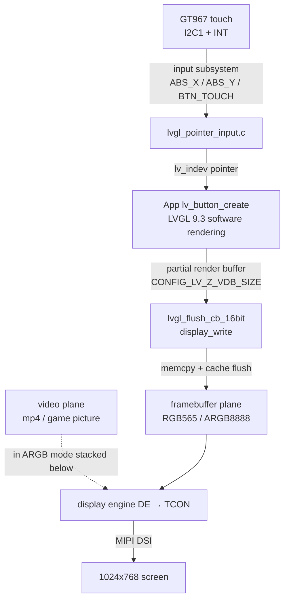
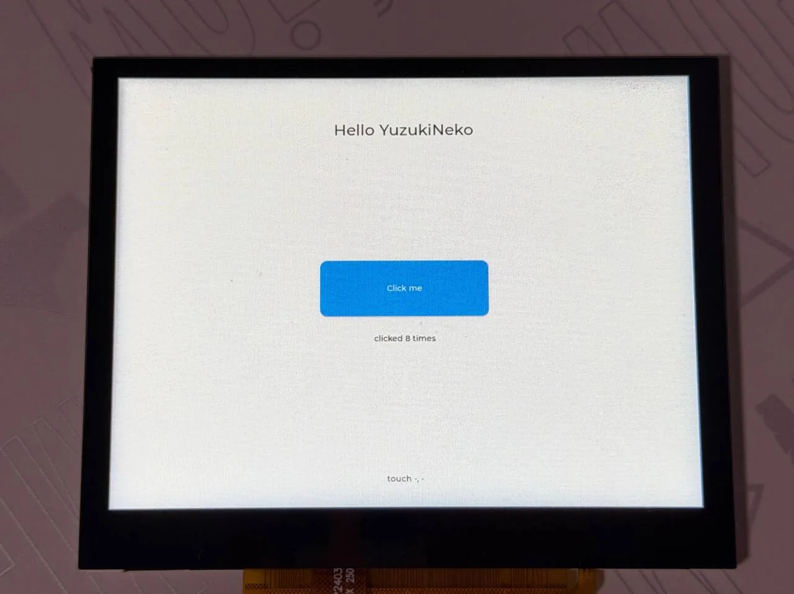
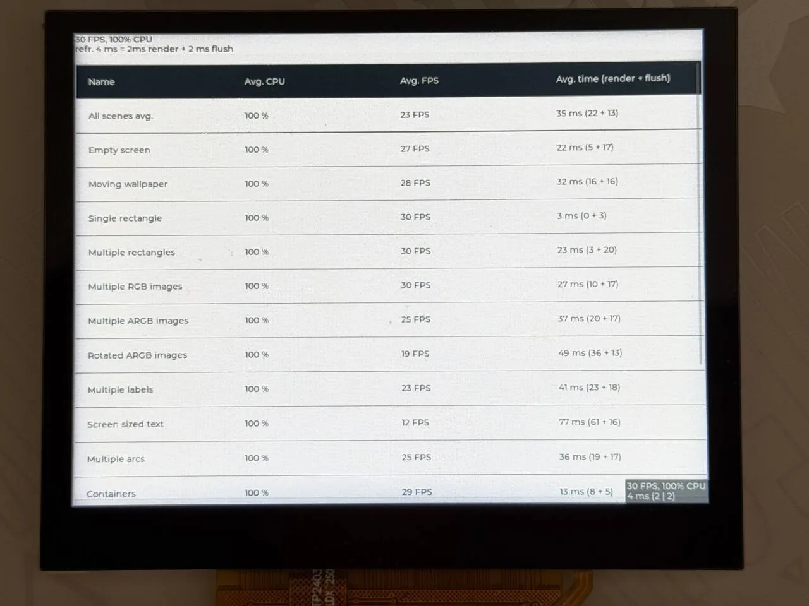
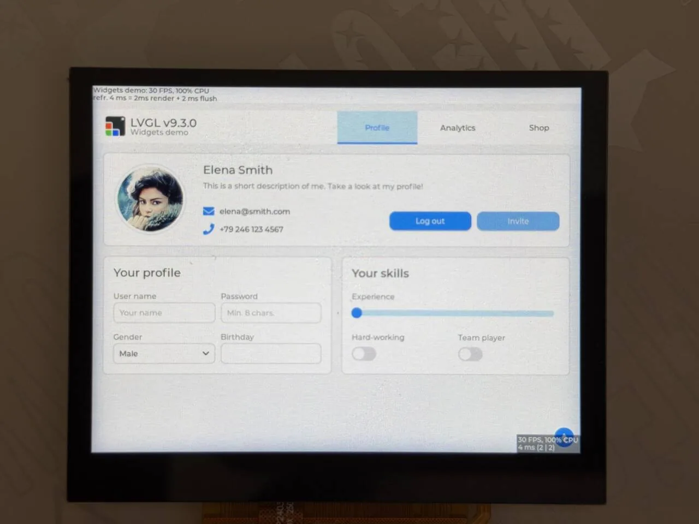

LVGL is an embedded graphics library: widgets (buttons, labels, sliders, charts, …), styles, animations, and touch events all come ready-made. On the F101 with Zephyr, LVGL is built into the application as a west module (`modules/lib/gui/lvgl`, version 9.3.0), drawing to the screen through the standard display interface and reading the touchscreen through the standard input subsystem. No `zephyr-components` and no external assets are needed.



This page covers, in order: preparation, building and running the hello program, running the official demos on the board, then how LVGL connects to the display and touch, the complete code of a minimal UI, and the recommended Kconfig. Every running step states what appears on the serial port and on the screen.

Before you start, first complete [Setting up the development environment](../zephyr-setup-env.md) and [Getting the Zephyr source](../zephyr-get-source.md).

## Preparation

| Item | Description |
| --- | --- |
| LVGL source | fetched with Zephyr's west manifest, in `~/f101-zephyr/modules/lib/gui/lvgl`, version 9.3.0. The Zephyr-side glue is in `zephyr/modules/lvgl/` |
| Screen | the 1024×768 MIPI DSI panel of the `yuzukineko` carrier board; in the devicetree it is `chosen { zephyr,display = &display; }`, see [Display](../drivers/display.md) |
| Touch | the GT967 touch controller on the carrier board, at 0x5d on `i2c1`; in the devicetree it is the `touch` node, see [I2C](../drivers/i2c.md). It runs without touch too, you just cannot tap the widgets |
| Assets | not needed. The fonts and icons are compiled into LVGL, and the demo images are compiled into the demo |
| External hardware | only a board that can display. The official demo's music player makes no sound; it is only a UI |
| hello program | `examples/lvgl_hello/`, source in [Creating a minimal UI](#creating-a-minimal-ui) below |

:::note
The commands and logs in this page are for the `yuzukineko` board (carrier board, DSI panel). `f101_evb` is a 1024×600 RGB panel with no GT967.
:::

## Building

Run this in the workspace:


```sh
. ~/f101-zephyr/env.sh
cd ~/f101-zephyr
west build -b yuzukineko -d build/lvgl-hello examples/lvgl_hello
```

<div class="asciinema-cast" data-src="assets/casts/zephyr/apps-lvgl/build.cast" data-speed="6"></div>

The output is `build/lvgl-hello/zephyr/zephyr.bin`, about 2.7 MB (2733692 bytes), linked at `0x40000000`, like any other Zephyr program. The 1.5 MiB framebuffer and the 64 KiB LVGL memory pool are static arrays and make up most of it.

## Running

Download and run it with xfel (see [Building and running](../zephyr-build-run.md)); the console is UART1 (115200 8N1).

### 1. Starting the hello program

The commands:

```sh
xfel ddr f101-s3
xfel write 0x40000000 build/lvgl-hello/zephyr/zephyr.bin
xfel exec 0x40000000
```

The output after running, on the serial port:

```text
[00:00:00.000,000] <inf> usb_phy_sunxi: ready
[00:00:00.000,000] <inf> g2d_sunxi: module clock 300000000 Hz (PLL_PERI_2X 1200000000 Hz / 4)
[00:00:00.000,000] <inf> g2d_sunxi: ready, queue depth 8
[00:00:00.000,000] <inf> display: core: soc sun252iw2, board devicetree
[00:00:00.000,000] <inf> display: core: bound tcon-top@5460000 (tcon-top)
[00:00:00.000,000] <inf> display: de-rcq: rcq0: 41 blocks, 7112 bytes of shadow registers
[00:00:00.000,000] <inf> display: de: sun252iw2-de: 3 channel(s), 12 plane(s), 1 display(s)
[00:00:00.000,000] <inf> display: core: bound display-engine@5000000 (display-engine)
[00:00:00.000,000] <inf> display: tcon: tcon-lcd@5461000 attached to disp0
[00:00:00.000,000] <inf> display: core: bound tcon-lcd@5461000 (tcon-lcd)
[00:00:00.000,000] <inf> display: core: bound phy@5451000 (combo-dphy)
[00:00:00.000,000] <inf> display: core: bound backlight-dsi (pwm-backlight)
[00:00:00.000,000] <inf> display: dsi: device attached: 4 lane(s), format 0, flags 0xd
[00:00:00.000,000] <inf> display: core: bound panel-dsi (panel-dsi)
[00:00:00.000,000] <inf> display: core: bound dsi@5450000 (mipi-dsi)
[00:00:00.000,000] <inf> display: core: disp0 -> dsi@5450000 -> panel-dsi: 1024x768@59.918Hz
[00:00:00.002,000] <inf> display: dphy: D-PHY 4 lane(s), HS clock 324000000 Hz
*** Booting Zephyr OS build b6f3dfe1a1f4 ***
lvgl hello: 1024 x 768
[00:00:00.493,000] <inf> display_sunxi: 1024x768 @ 60 Hz, fb 0x4007e200, video plane 0
[00:00:00.564,000] <inf> gt967: GT967 firmware 0x1040, 1024x768
[00:00:00.569,000] <inf> gt967: configuration 0x63: 1024 x 768, up to 5 point(s), module switch 0x04
[00:00:00.575,000] <inf> gt967: configuration updated: 1024x768, 1 point(s)
```

- `lvgl hello: 1024 x 768` is printed by `main()`; LVGL's display was created at 1024×768.
- `display_sunxi: 1024x768 @ 60 Hz, fb 0x4007e200` is the display driver, and `fb` is the framebuffer address.
- The three `gt967:` lines are the touch driver: it reads the firmware version, and the configuration, originally up to 5 points, is changed by the driver to 1 point per `CONFIG_INPUT_GT967_MAX_TOUCH_POINTS=1`.



The screen shows the title `Hello YuzukiNeko`, a blue `Click me` button in the middle, the click count `clicked 8 times` below the button, and a line of small text at the bottom showing the touch coordinates (`touch -, -` when there is no touch).

### 2. Tapping the button

Tap the "Click me" button in the middle of the screen with your finger. Each tap increments "clicked N times" on the screen and adds a `button clicked` line on the serial port:

```text
button clicked, count 1
button clicked, count 2
button clicked, count 3
button clicked, count 4
button clicked, count 5
```

This chain is the GT967 interrupt, an I2C coordinate read, an input event, `lvgl_pointer`, LVGL hitting the button, `LV_EVENT_CLICKED`, and `btn_cb()`. Tapping empty space updates the "touch X, Y" label with the coordinates.

### 3. Looking at the raw touch events

To see the raw touch coordinates, add `-DCONFIG_INPUT_LOG_LEVEL_DBG=y` to the build command and rebuild (this is for debugging; the build command above does not include it), then download and run again. The driver prints a line on each press and release:

```text
[00:00:00.493,000] <inf> display_sunxi: 1024x768 @ 60 Hz, fb 0x4007e440, video plane 0
[00:00:00.564,000] <inf> gt967: GT967 firmware 0x1040, 1024x768
[00:00:00.570,000] <inf> gt967: configuration 0x63: 1024 x 768, up to 5 point(s), module switch 0x04
[00:00:00.575,000] <inf> gt967: configuration updated: 1024x768, 1 point(s)
[00:00:01.018,000] <dbg> gt967: gt967_work_handler: down id 0 at 7,752
[00:00:01.041,000] <dbg> gt967: gt967_work_handler: up id 0
[00:00:01.154,000] <dbg> gt967: gt967_work_handler: down id 0 at 11,564
[00:00:01.178,000] <dbg> gt967: gt967_work_handler: up id 0
```

- `down id 0 at X,Y` is a press and its coordinates, and `up id 0` is a release.
- This log is the output without touching the screen: about 0.44 seconds after bootup the driver reported two short touches of about 23 ms each, at coordinates (7, 752) and (11, 564), both at the far-left edge of the screen and outside the button (the button is in a 300×100 area in the middle of the screen); no further touch events appeared after that.
- The driver (`gt967_work_handler()` in `input_gt967.c`) turns the state the controller reports into input events as-is.

### 4. Running the benchmark

The benchmark prints its summary table through the LVGL log. In `lvgl_log()` in `zephyr/modules/lvgl/lvgl.c`, for `LV_LOG_LEVEL_USER` the `[User] ` prefix is skipped only when the message starts with `[`; the bare message printed by `LV_LOG()` is printed as-is:

```c
	case LV_LOG_LEVEL_USER:
		/*
		 * LV_LOG_USER() comes with the "[User] " prefix, LV_LOG() (the benchmark demo
		 * prints its table with it) is the bare message.
		 */
		LOG_INF("%s", buf[0] == '[' ? buf + (sizeof("[User] ") - 1) : buf);
		break;
```

Under `samples/modules/lvgl/demos/boards/` the demo has `yuzukineko.conf` and `yuzukineko.overlay`, which Zephyr merges automatically when building for the `yuzukineko` board:


```text
# yuzukineko: 1024x768 MIPI DSI panel, RGB565 frame buffer, GT967 touch panel
CONFIG_INPUT=y
CONFIG_LV_COLOR_DEPTH_16=y
CONFIG_LV_Z_MEM_POOL_SIZE=262144
CONFIG_LV_Z_VDB_SIZE=10
CONFIG_MAIN_STACK_SIZE=8192

# the benchmark prints its summary table through the LVGL log, and the CPU column needs the load
CONFIG_LV_USE_LOG=y
CONFIG_LV_LOG_LEVEL_USER=y
CONFIG_CPU_LOAD=y
```

```c
/* LVGL reads the GT967 touch panel as a pointer */
/ {
	lvgl_pointer {
		compatible = "zephyr,lvgl-pointer-input";
		input = <&touch>;
	};
};
```

Select a demo with `CONFIG_LV_Z_DEMO_*`; to select the benchmark:

```sh
. ~/f101-zephyr/env.sh
cd ~/f101-zephyr
west build -b yuzukineko -d build/lvgl-bench zephyr/samples/modules/lvgl/demos -- -DCONFIG_LV_Z_DEMO_BENCHMARK=y
xfel ddr f101-s3
xfel write 0x40000000 build/lvgl-bench/zephyr/zephyr.bin
xfel exec 0x40000000
```

The available demos are:

The benchmark runs through all the scenes in turn by itself, and after about 70 seconds the serial port prints the summary table (times in milliseconds; Avg. time is render plus flush):


```text
[00:00:00.564,000] <inf> gt967: GT967 firmware 0x1040, 1024x768
[00:00:00.569,000] <inf> gt967: configuration 0x63: 1024 x 768, up to 1 point(s), module switch 0x04
*** Booting Zephyr OS build b6f3dfe1a1f4 ***
Heap at 0x40266fb0 contains 32767 units in 15 buckets

  bucket#    min units        total      largest      largest
             threshold       chunks      (units)      (bytes)
  -----------------------------------------------------------
        0            1            1            1            8
        1            2            1            2           16
       14        16384            1        31770       254160

254184 free bytes, 7872 allocated bytes, overhead = 84 bytes (0.0%)
[00:01:09.822,000] <inf> lvgl: Benchmark Summary (9.3.0 )
[00:01:09.822,000] <inf> lvgl: Name, Avg. CPU, Avg. FPS, Avg. time, render time, flush time
[00:01:09.823,000] <inf> lvgl: Empty screen, 72%, 27, 21, 5, 16
[00:01:09.823,000] <inf> lvgl: Moving wallpaper, 97%, 29, 32, 16, 16
[00:01:09.824,000] <inf> lvgl: Single rectangle, 11%, 30, 2, 0, 2
[00:01:09.824,000] <inf> lvgl: Multiple rectangles, 76%, 29, 24, 3, 21
[00:01:09.825,000] <inf> lvgl: Multiple RGB images, 87%, 29, 26, 10, 16
[00:01:09.826,000] <inf> lvgl: Multiple ARGB images, 100%, 25, 36, 20, 16
[00:01:09.827,000] <inf> lvgl: Rotated ARGB images, 100%, 19, 49, 36, 13
[00:01:09.828,000] <inf> lvgl: Multiple labels, 100%, 23, 41, 23, 18
[00:01:09.829,000] <inf> lvgl: Screen sized text, 100%, 12, 78, 62, 16
[00:01:09.830,000] <inf> lvgl: Multiple arcs, 99%, 25, 35, 19, 16
[00:01:09.831,000] <inf> lvgl: Containers, 44%, 30, 12, 8, 4
[00:01:09.832,000] <inf> lvgl: Containers with overlay, 91%, 19, 47, 33, 14
[00:01:09.834,000] <inf> lvgl: Containers with opa, 57%, 29, 16, 12, 4
[00:01:09.835,000] <inf> lvgl: Containers with opa_layer, 94%, 21, 43, 37, 6
[00:01:09.837,000] <inf> lvgl: Containers with scrolling, 100%, 17, 53, 37, 16
[00:01:09.839,000] <inf> lvgl: Widgets demo, 74%, 18, 45, 35, 10
[00:01:09.839,000] <inf> lvgl: All scenes avg.,81%, 23, 34, 22, 12
```

The table in the log (the FPS ceiling is 30, from the 33 milliseconds of `LV_DEF_REFR_PERIOD`):

- The "flush" column is the time taken by `display_write()`. For scenes that redraw the whole screen it holds steady at 16 to 21 milliseconds: 1024×768 RGB565 is 1.5 MiB, a copy plus cache write-back of about 90 MB/s. Scenes that change only a small area (Single rectangle 2 milliseconds, Containers 4 milliseconds) are much lower.
- The "render" column is the time taken by software rendering. Solid fills are almost 0; rotated images (Rotated ARGB images, 36 milliseconds), full-screen text (Screen sized text, 62 milliseconds), and layer opacity (Containers with opa_layer, 37 milliseconds) are much slower, because there is no G2D or vector acceleration.
- The summary line: 23 FPS on average, 34 milliseconds per frame, of which render is 22 and flush is 12, with average CPU usage of 81%.
- The CPU column has values (11% to 100%) because the demo's configuration enables `CONFIG_CPU_LOAD`.



The first row of the summary table is the average over all scenes, and each row after that is one scene's CPU usage, frame rate, and time per frame (render + flush). The small labels in the top-left and bottom-right corners are LVGL's performance monitor, showing the current frame rate and CPU usage.

### 5. Running the widgets demo

```sh
west build -b yuzukineko -d build/lvgl-widgets zephyr/samples/modules/lvgl/demos -- -DCONFIG_LV_Z_DEMO_WIDGETS=y
xfel ddr f101-s3
xfel write 0x40000000 build/lvgl-widgets/zephyr/zephyr.bin
xfel exec 0x40000000
```

The output after running, on the serial port (the last part is the LVGL memory pool usage the demo prints by calling `lvgl_print_heap_info()`):

```text
[00:00:00.493,000] <inf> display_sunxi: 1024x768 @ 60 Hz, fb 0x400b8400, video plane 0
[00:00:00.564,000] <inf> gt967: GT967 firmware 0x1040, 1024x768
[00:00:00.570,000] <inf> gt967: configuration 0x63: 1024 x 768, up to 1 point(s), module switch 0x04
*** Booting Zephyr OS build b6f3dfe1a1f4 ***
Heap at 0x4023e568 contains 32767 units in 15 buckets

  bucket#    min units        total      largest      largest
             threshold       chunks      (units)      (bytes)
  -----------------------------------------------------------
        0            1           22            1            8
        2            4            1            4           32
       14        16384            1        26946       215568

215776 free bytes, 46280 allocated bytes, overhead = 84 bytes (0.0%)
```

The memory pool is 262144 bytes; after the demo draws its first screen 46280 bytes are used and 215776 bytes are free.


The screen shows the LVGL v9.3.0 widgets demo: the tabs Profile, Analytics, and Shop at the top, and below them an avatar with personal details, a text field, a drop-down, a slider, and a switch. The performance monitor is in the top-left and bottom-right corners.

### 6. Other samples

| Sample | Command | Description |
| --- | --- | --- |
| `samples/subsys/display/lvgl` | `west build -b yuzukineko -d build/lvgl-sub zephyr/samples/subsys/display/lvgl` | the sample's `boards/` has `yuzukineko.conf` and `yuzukineko.overlay` |
| `samples/modules/lvgl/screen_transparency` | `west build -b yuzukineko -d build/lvgl-trans zephyr/samples/modules/lvgl/screen_transparency` | the sample requires a display that supports ARGB8888; its `boards/yuzukineko.conf` enables `CONFIG_DISPLAY_SUNXI_ARGB8888` |
| `samples/modules/lvgl/multi_display` | - | not applicable: it needs a `zephyr,displays` node in the devicetree, and the board has only one display |
| `samples/modules/lvgl/accelerometer_chart` | - | not applicable: it needs an `accel0` alias, and the board has no accelerometer |

## How LVGL connects to the display

### Data flow

LVGL itself does not touch the hardware. On the Zephyr side, `zephyr/modules/lvgl/lvgl.c` does these things during system startup (`LV_Z_AUTO_INIT`, on by default):

1. it takes `zephyr,display` from `chosen` and reads `display_get_capabilities()` to get the resolution and pixel format;
2. `lv_display_create()` creates an LVGL display whose resolution is the framebuffer resolution the display device reports;
3. it picks the flush callback by pixel format: `PIXEL_FORMAT_RGB_565` uses `lvgl_flush_cb_16bit`, `PIXEL_FORMAT_ARGB_8888` uses `lvgl_flush_cb_32bit`;
4. it allocates the render buffer (covered below) and sets partial render mode;
5. it registers an input device for every `zephyr,lvgl-*-input` node in the devicetree.

The corresponding code (`zephyr/modules/lvgl/lvgl_display.c`, the RGB565 and ARGB8888 branches of `set_lvgl_rendering_cb()`):

```c
case PIXEL_FORMAT_ARGB_8888:
	lv_display_set_color_format(display, LV_COLOR_FORMAT_ARGB8888);
	lv_display_set_flush_cb(display, lvgl_flush_cb_32bit);
	lv_display_add_event_cb(display, lvgl_rounder_cb, LV_EVENT_INVALIDATE_AREA,
				display);
	break;
...
case PIXEL_FORMAT_RGB_565:
case PIXEL_FORMAT_BGR_565:
	lv_display_set_color_format(display, LV_COLOR_FORMAT_RGB565);
	lv_display_set_flush_cb(display, lvgl_flush_cb_16bit);
```

The application only has to do two things: draw the UI, and call `lv_timer_handler()` periodically. It redraws the dirty areas, calls the flush callback once for each block it finishes, and the flush callback ends up in `display_write()`.

`display_write()` in the F101 display driver (`drivers/display/sunxi/display_sunxi.c`) `memcpy`s this block to the corresponding place in the framebuffer and then does a data cache write-back (`sys_cache_data_flush_range`); the display engine scans this memory at the refresh rate on its own:

```c
for (row = 0; row < desc->height; row++) {
	dst = sunxi_fb + (size_t)(y + row) * data->stride +
			(size_t)x * SUNXI_BPP;
	memcpy(dst, src + row * src_pitch, row_bytes);
	sys_cache_data_flush_range(dst, row_bytes);
}
```

So every pixel exists twice in memory: one copy in the LVGL render buffer (temporary) and one in the framebuffer (long-lived). This is the standard approach of Zephyr's LVGL glue; on the F101 there is no mode that renders directly into the framebuffer.

### Display buffers: how to choose

Two areas of memory must be kept apart:

| Memory | Who allocates it | Size | Options that control it |
| --- | --- | --- | --- |
| Framebuffer | the display driver, a static array (it can be changed to runtime allocation) | width × height × bytes per pixel. For 1024×768, RGB565 is 1.5 MiB and ARGB8888 is 3 MiB | `CONFIG_DISPLAY_SUNXI_RGB565` / `ARGB8888`, `CONFIG_DISPLAY_SUNXI_FB_DIV`, `CONFIG_DISPLAY_SUNXI_FB_ALLOC` |
| LVGL render buffer | `modules/lvgl/lvgl.c`, a static array by default | screen pixels × `LV_Z_VDB_SIZE`% × bytes per pixel. 10% of 1024×768 RGB565 is about 157 KiB | `CONFIG_LV_Z_VDB_SIZE`, `CONFIG_LV_Z_DOUBLE_VDB`, `CONFIG_LV_Z_FULL_REFRESH`, `CONFIG_LV_Z_BUFFER_ALLOC_*` |

LVGL's render mode is fixed here at partial rendering (`LV_DISPLAY_RENDER_MODE_PARTIAL`); only with `CONFIG_LV_Z_FULL_REFRESH` does it become full-screen rendering. Three common combinations:

| Combination | Configuration | Characteristics |
| --- | --- | --- |
| Default, partial rendering | `LV_Z_VDB_SIZE=10` | the render buffer is small (about 157 KiB) and only the dirty areas are drawn, copied block by block. A static UI costs almost nothing; a full-screen animation is drawn in about 10 blocks. Recommended |
| Double buffering | plus `LV_Z_DOUBLE_VDB=y` and `LV_Z_FLUSH_THREAD=y` | one buffer is being rendered while the other is being copied. On the F101 the flush is just one `memcpy`, so the gain is limited and it is not the default |
| Full-screen rendering | `LV_Z_FULL_REFRESH=y` (`LV_Z_VDB_SIZE` automatically becomes 100) | the render buffer is as large as the framebuffer (1.5 MiB) and the whole screen is copied every time. Suits cases that need the whole frame to be consistent, at a greater cost in memory and time |

`LV_Z_FLUSH_THREAD` is off by default: the flush is done right there in the thread that calls `lv_timer_handler()`. When it is on, an extra thread calls `display_write()` specifically, with stack and priority set by `LV_Z_FLUSH_THREAD_STACK_SIZE` and `LV_Z_FLUSH_THREAD_PRIORITY`.

The driver has no double buffering and does not wait for vertical sync: `display_write()` changes the memory that is being scanned, so fast scrolling can tear.

### Two pixel formats: RGB565 and ARGB8888

This is the most important item when choosing a configuration:

| | RGB565 | ARGB8888 |
| --- | --- | --- |
| Display option | `CONFIG_DISPLAY_SUNXI_RGB565=y` (default) | `CONFIG_DISPLAY_SUNXI_ARGB8888=y` |
| LVGL option | `CONFIG_LV_COLOR_DEPTH_16=y` (LVGL default) | `CONFIG_LV_COLOR_DEPTH_32=y` |
| Framebuffer (1024×768) | 1.5 MiB | 3 MiB |
| Alpha | opaque, covering every layer below | the framebuffer plane blends with the video plane below per-pixel alpha |
| Use | a standalone UI application | a UI overlaid on video: the [MP4 player](mp4-player.md)'s statistics panel, the on-screen buttons of nes / doom / mgba |

The two options must go together: the LVGL render buffer size is computed from `LV_Z_BITS_PER_PIXEL` (which follows `LV_COLOR_DEPTH`), while the flush callback copies according to the format the display device reports. If the two bit depths do not match, the buffer size and the copied row width do not line up.

In ARGB mode the screen background must be set transparent so the video plane shows through:

```c
lv_obj_set_style_bg_opa(lv_screen_active(), LV_OPA_TRANSP, 0);
```

nes's `pad.c` does exactly this: a transparent background and buttons that are white at 30% opacity. To cover only one corner, use `CONFIG_DISPLAY_SUNXI_FB_WINDOW_WIDTH/HEIGHT` to limit the framebuffer plane to the top-left corner; each refresh then reads much less memory and leaves bandwidth for the video plane, which is what the MP4 player does with 400×400.

### Acceleration: G2D and RVV

<strong>On the F101, LVGL is entirely software-rendered (`LV_USE_DRAW_SW`); neither G2D nor RVV is connected.</strong>

- G2D: the F101 has a [G2D](../drivers/g2d.md) 2D accelerator and Zephyr has a driver for it, but LVGL 9.3 has no matching draw unit. `LV_USE_DRAW_G2D` is NXP's G2D, which is not the same thing as the F101's, and cannot be enabled. The fills, blends, and image scaling LVGL draws are never handed to G2D.
- RVV: the [RISC-V vector extension](../zephyr-riscv-vector.md) can be enabled with `CONFIG_SUN252I_F101_RVV=y`, and nes's configuration does so. But LVGL's assembly acceleration option `LV_USE_DRAW_SW_ASM` has only four values, `NONE`, `NEON`, `HELIUM`, and `CUSTOM`, and no RVV implementation; only `CUSTOM` lets you supply assembly yourself, so if you need vector blend functions you write them yourself.
- Render parallelism: `CONFIG_LV_Z_USE_OSAL` lets LVGL render with multiple threads; it is off by default.

No acceleration means the fills, blends, and text are all computed pixel by pixel by the C907 core. The frame rates in the benchmark below reflect this.

## How LVGL connects to the touchscreen

The whole touch chain is standard Zephyr parts, with no F101-specific code:

1. The GT967 driver (`drivers/input/input_gt967.c`, `CONFIG_INPUT_GT967`, on by default when the devicetree has a `goodix,gt967` node) reads the coordinates over I2C after an interrupt on the INT pin, reports `INPUT_ABS_X` and `INPUT_ABS_Y` with `input_touchscreen_report_pos()`, and reports `INPUT_BTN_TOUCH` with `input_report_key()`.
2. A `zephyr,lvgl-pointer-input` node is added to the devicetree, with its `input` property pointing at the touch node.
3. LVGL's glue (`zephyr/modules/lvgl/input/lvgl_pointer_input.c`) listens for events from this input device, converts the coordinates for the display orientation and clamps them to the screen, and puts them in a message queue; LVGL takes them out in `lv_timer_handler()` and treats them as a pointer device (`LV_INDEV_TYPE_POINTER`).

The board devicetree has no such node, so each application must add its own overlay (`boards/yuzukineko.overlay`):

```c
/* LVGL reads the GT967 touch panel as a pointer */
/ {
	lvgl_pointer {
		compatible = "zephyr,lvgl-pointer-input";
		input = <&touch>;
	};
};
```

At the same time, enable `CONFIG_INPUT=y` in `prj.conf`. `CONFIG_LV_Z_POINTER_INPUT` is `y` by default, and takes effect as long as the devicetree has this node.

The binding has three more properties, for when the touch orientation and the screen orientation do not match; they are written inside the `lvgl_pointer` node:

| Property | Purpose |
| --- | --- |
| `swap-xy` | swaps X and Y |
| `invert-x` | inverts the X direction |
| `invert-y` | inverts the Y direction |

The GT967's resolution is set in `yuzukineko.dts` as `screen-width = <1024>; screen-height = <768>;`, which matches the panel, so these three properties are not needed.

Limits:

- LVGL's pointer device has <strong>only one finger</strong>. The GT967 driver reports only one point by default too (`CONFIG_INPUT_GT967_MAX_TOUCH_POINTS=1`), and LVGL does not support multi-touch. For multiple points (game buttons, say) you must read `input` events yourself as nes's `pad.c` does and raise `CONFIG_INPUT_GT967_MAX_TOUCH_POINTS` to 5.
- The touch driver's INT and RST are on PD2 and PD3, multiplexed in the same group as the LCD pins; check them when switching to another panel.

## Creating a minimal UI

Here is a complete hello program: a title, a button, a click counter, and a label showing the touch coordinates. The directory structure:

```text
examples/lvgl_hello/
├── CMakeLists.txt
├── prj.conf
├── boards/
│   └── yuzukineko.overlay
└── src/
    └── main.c
```

It goes under `~/f101-zephyr/examples/`, together with the demos from the [Drivers](../drivers/display.md) chapter.

`CMakeLists.txt`:

```cmake
cmake_minimum_required(VERSION 3.20.0)
find_package(Zephyr REQUIRED HINTS $ENV{ZEPHYR_BASE})
project(lvgl_hello)

target_sources(app PRIVATE src/main.c)
```

`prj.conf`; the meaning of each line is in [Configuration options](#configuration-options) below:

```text
CONFIG_DISPLAY=y
CONFIG_DISPLAY_SUNXI_RGB565=y
CONFIG_INPUT=y

CONFIG_LVGL=y
CONFIG_LV_COLOR_DEPTH_16=y
CONFIG_LV_Z_MEM_POOL_SIZE=65536
CONFIG_LV_Z_VDB_SIZE=10
CONFIG_LV_FONT_MONTSERRAT_14=y
CONFIG_LV_FONT_MONTSERRAT_28=y
CONFIG_LV_USE_LABEL=y
CONFIG_LV_USE_BUTTON=y
CONFIG_LV_USE_SLIDER=y
CONFIG_LV_Z_SHELL=n

CONFIG_MAIN_STACK_SIZE=8192
CONFIG_PRINTK=y
CONFIG_LOG_PRINTK=n
CONFIG_SHELL=n
CONFIG_DEVMEM_SHELL=n
```

`boards/yuzukineko.overlay`: as in the previous section, wires the GT967 up as an LVGL pointer device.

`src/main.c`:

```c
#include <stdio.h>
#include <zephyr/kernel.h>
#include <zephyr/device.h>
#include <zephyr/devicetree.h>
#include <zephyr/drivers/display.h>
#include <lvgl.h>

static lv_obj_t *count_label;
static lv_obj_t *touch_label;
static uint32_t clicks;

static void btn_cb(lv_event_t *e)
{
	char text[32];

	ARG_UNUSED(e);
	snprintf(text, sizeof(text), "clicked %u times", ++clicks);
	lv_label_set_text(count_label, text);
	printk("button clicked, count %u\n", clicks);
}

static void screen_cb(lv_event_t *e)
{
	lv_indev_t *indev = lv_indev_active();
	lv_point_t p;
	char text[32];

	if (indev == NULL) {
		return;
	}
	lv_indev_get_point(indev, &p);
	snprintf(text, sizeof(text), "touch %d, %d", (int)p.x, (int)p.y);
	lv_label_set_text(touch_label, text);
}

int main(void)
{
	const struct device *disp = DEVICE_DT_GET(DT_CHOSEN(zephyr_display));
	lv_obj_t *scr = lv_screen_active();
	lv_obj_t *title, *btn, *btn_label;

	if (!device_is_ready(disp)) {
		printk("display not ready\n");
		return 0;
	}

	title = lv_label_create(scr);
	lv_obj_set_style_text_font(title, &lv_font_montserrat_28, 0);
	lv_label_set_text(title, "Hello YuzukiNeko");
	lv_obj_align(title, LV_ALIGN_TOP_MID, 0, 80);

	btn = lv_button_create(scr);
	lv_obj_set_size(btn, 300, 100);
	lv_obj_align(btn, LV_ALIGN_CENTER, 0, 0);
	lv_obj_add_event_cb(btn, btn_cb, LV_EVENT_CLICKED, NULL);
	btn_label = lv_label_create(btn);
	lv_label_set_text(btn_label, "Click me");
	lv_obj_center(btn_label);

	count_label = lv_label_create(scr);
	lv_label_set_text(count_label, "clicked 0 times");
	lv_obj_align(count_label, LV_ALIGN_CENTER, 0, 90);

	touch_label = lv_label_create(scr);
	lv_label_set_text(touch_label, "touch -, -");
	lv_obj_align(touch_label, LV_ALIGN_BOTTOM_MID, 0, -40);
	lv_obj_add_event_cb(scr, screen_cb, LV_EVENT_PRESSING, NULL);

	lv_timer_handler();
	display_blanking_off(disp);
	printk("lvgl hello: %d x %d\n", (int)lv_display_get_horizontal_resolution(NULL),
	       (int)lv_display_get_vertical_resolution(NULL));

	while (1) {
		uint32_t next = lv_timer_handler();

		k_msleep(MIN(next, 1000U));
	}
	return 0;
}
```

Key points (line numbers refer to the file above):

- Lines 38–45: take the display device from `chosen` and exit if it is not ready. LVGL is already initialized at startup (`LV_Z_AUTO_INIT`), so `main()` does not need to call `lv_init()` or `lv_display_create()`.
- Lines 47–67: create the widgets. `lv_screen_active()` is the current screen, and every widget hangs below it or below one of its children. `lv_obj_align()` aligns relative to the parent.
- Line 55: `lv_obj_add_event_cb(btn, btn_cb, LV_EVENT_CLICKED, NULL)` registers the click callback. The click event is the end of the touch chain: GT967 → input → `lvgl_pointer` → LVGL pointer → hits the button → `LV_EVENT_CLICKED`.
- Line 67: it listens for `LV_EVENT_PRESSING` on the screen itself and reads the coordinates from `lv_indev_active()`. Events are sent only to the widget being pressed, so this callback is <strong>not</strong> called when you press the button; the coordinates are updated only when you press empty space.
- Lines 69–70: render once and then call `display_blanking_off()`, to avoid a flash of old content when the screen comes on. The official demo uses the same order.
- Lines 74–78: the main loop. `lv_timer_handler()` returns the number of milliseconds until the next call, and it sleeps that long (at most 1 second). Animations and events are driven by it, so do not starve it.

Fonts: using `lv_font_montserrat_28` requires `CONFIG_LV_FONT_MONTSERRAT_28=y`; the build fails without it. The Montserrat fonts bundled with LVGL contain only ASCII and a few symbols, and <strong>no Chinese</strong>. To display Chinese you must generate a C font file with LVGL's font converter and add it to the project.


## Configuration options

The main LVGL-related options in `prj.conf`, one per row:

| Option | Default | Description |
| --- | --- | --- |
| `CONFIG_LVGL` | n | enables LVGL |
| `CONFIG_DISPLAY` | n | display subsystem; a prerequisite for LVGL |
| `CONFIG_INPUT` | n | input subsystem; needed for touch |
| `CONFIG_LV_Z_MEM_POOL_SIZE` | 2048 | LVGL's own memory pool; every widget, style, and image cache is allocated from it. hello uses 65536, and the 1024×768 widgets / benchmark use 262144. When the pool is full LVGL crashes or draws nothing |
| `CONFIG_LV_Z_MEM_POOL_SYS_HEAP` | y (default) | the pool uses a private sys_heap; it can be changed to `LV_Z_MEM_POOL_HEAP_LIB_C` to use the C library heap |
| `CONFIG_LV_Z_VDB_SIZE` | 10 | render buffer as a percentage of the screen (1–100). 10% of 1024×768 RGB565 is about 157 KiB |
| `CONFIG_LV_Z_DOUBLE_VDB` | n | use two render buffers |
| `CONFIG_LV_Z_FULL_REFRESH` | n | full-screen rendering; `LV_Z_VDB_SIZE` becomes 100 |
| `CONFIG_LV_Z_BUFFER_ALLOC_STATIC` | y (default) | the render buffer is a static array; `LV_Z_BUFFER_ALLOC_DYNAMIC` allocates it from the LVGL memory pool at runtime |
| `CONFIG_LV_Z_FLUSH_THREAD` | n | calls `display_write()` from a separate thread |
| `CONFIG_LV_Z_AUTO_INIT` | y | initializes LVGL automatically at startup |
| `CONFIG_LV_COLOR_DEPTH_16` / `_32` | 16 | color depth; must match the display driver's pixel format |
| `CONFIG_DISPLAY_SUNXI_RGB565` / `ARGB8888` | RGB565 | the display driver's pixel format |
| `CONFIG_DISPLAY_SUNXI_FB_WINDOW_WIDTH` / `HEIGHT` | 0 | shows only a window at the top-left of the framebuffer (0 is the whole screen); used when overlaying on video |
| `CONFIG_DISPLAY_SUNXI_FB_DIV` | 1 | the framebuffer is reduced by 1/N in each direction and enlarged by the display engine; saves memory but blurs the UI |
| `CONFIG_DISPLAY_SUNXI_FB_ALLOC` | n | allocates the framebuffer at runtime; requires `COMMON_LIBC_MALLOC_ARENA_SIZE` to be non-zero |
| `CONFIG_LV_FONT_MONTSERRAT_<size>` | all n (the default font is below) | which font sizes to enable; enable the ones you use |
| `CONFIG_LV_USE_<widget>` | varies | enables the widgets you use, such as `LV_USE_CHART` and `LV_USE_SLIDER`. A widget that is not enabled has no functions |
| `CONFIG_LV_Z_POINTER_INPUT` | y | pointer input; takes effect only when the devicetree has a `zephyr,lvgl-pointer-input` node |
| `CONFIG_LV_Z_POINTER_INPUT_MSGQ_COUNT` | 10 | pointer event queue length |
| `CONFIG_INPUT_GT967_MAX_TOUCH_POINTS` | 1 | how many points the touch driver reports at once; LVGL uses only one |
| `CONFIG_LV_USE_LOG` | n | enables the LVGL log |
| `CONFIG_LV_Z_SHELL` | per sample | LVGL's shell commands; requires `CONFIG_SHELL=y` |
| `CONFIG_MAIN_STACK_SIZE` | 1024 | main thread stack. LVGL renders in the thread that calls `lv_timer_handler()`, so give it enough stack; hello uses 8192 |
| `CONFIG_HEAP_MEM_POOL_SIZE` | board 262144 | kernel heap. The display driver's command queue is allocated from it; do not shrink it |

About `LV_FONT_MONTSERRAT_<size>`: LVGL's own default font is Montserrat 14, and it must be enabled explicitly in Zephyr's Kconfig. When you use `lv_obj_set_style_text_font()` to specify another size, the matching font must be enabled, otherwise the build reports an unresolved symbol.

### Recommended configurations

| Scenario | Configuration |
| --- | --- |
| Standalone UI application (what hello does) | RGB565, `LV_COLOR_DEPTH_16`, `LV_Z_MEM_POOL_SIZE` from 65536, `LV_Z_VDB_SIZE=10`, main thread stack 8192 |
| Complex UI, official demos | as above, `LV_Z_MEM_POOL_SIZE=262144` |
| Overlaid on video (mp4, nes, doom, mgba) | `DISPLAY_SUNXI_ARGB8888`, `LV_COLOR_DEPTH_32`, `LV_Z_VDB_SIZE=4`, `FB_WINDOW_*` limited to the area of the UI, `LV_Z_MEM_POOL_SIZE=131072` |

The last row comes straight from these players' `prj.conf`. `LV_Z_VDB_SIZE=4` is because ARGB is 4 bytes per pixel, so the buffer is smaller.

How to size the memory pool: start generous, then after running on the board look at the `free bytes / allocated bytes` that LVGL prints at startup (`lvgl_print_heap_info()`, which the demo calls), and shrink it if there is too much free. At benchmark startup it is 254184 bytes free and 7872 bytes allocated, and it grows with the scenes after that.

## Code locations

| File | Contents |
| --- | --- |
| `zephyr/modules/lvgl/lvgl.c` | LVGL initialization: take the display, create the render buffer, register input |
| `zephyr/modules/lvgl/lvgl_display.c` | flush callback selection, flush thread |
| `zephyr/modules/lvgl/lvgl_display_16bit.c`, `lvgl_display_32bit.c` | the RGB565 and ARGB8888 flush callbacks, ending in `display_write()` |
| `zephyr/modules/lvgl/lvgl_mem.c` | LVGL memory pool |
| `zephyr/modules/lvgl/input/lvgl_pointer_input.c` | touch (pointer) input |
| `zephyr/modules/lvgl/Kconfig`, `Kconfig.memory`, `Kconfig.input` | all the `LV_Z_*` options above |
| `drivers/display/sunxi/display_sunxi.c` | display driver: `display_write()` copies to the framebuffer |
| `drivers/input/input_gt967.c` | GT967 touch driver |
| `samples/modules/lvgl/demos/` | the Zephyr wrapper for the official demos |
| `modules/lib/gui/lvgl/` | LVGL itself (9.3.0) |
| `examples/lvgl_hello/` | the hello program from this page |
| `samples/drivers/vdec/h264_player/src/overlay.c` | overlay usage: the MP4 player's statistics panel, a line chart |
| `zephyr-components/nes/samples/nes_player/src/pad.c` | overlay usage: on-screen buttons |

## Scope

- G2D and RVV: LVGL is entirely software-rendered. LVGL 9.3 has no draw unit for the F101 G2D; when you need vector acceleration, set `LV_USE_DRAW_SW_ASM` to `CUSTOM` and supply the assembly yourself.
- Touch: LVGL's pointer has only one finger. For multiple points (game buttons, say), read `input` events yourself as nes's `pad.c` does and raise `CONFIG_INPUT_GT967_MAX_TOUCH_POINTS` to 5.
- Display: the board has only one display; multiple displays are not supported.
- Pixel format: chosen at build time with `CONFIG_DISPLAY_SUNXI_RGB565` or `ARGB8888`; it cannot be switched at runtime, and it cannot be rotated.
- Refresh: the driver has no double buffering and no vertical sync, so fast scrolling can tear.
- Fonts: the bundled fonts contain no Chinese; when you need Chinese, generate a C font file with LVGL's font converter and add it to the project.
