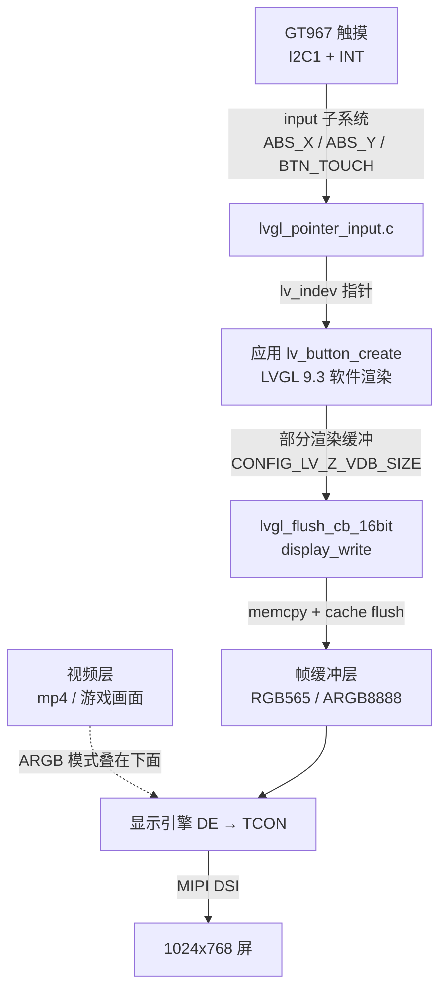
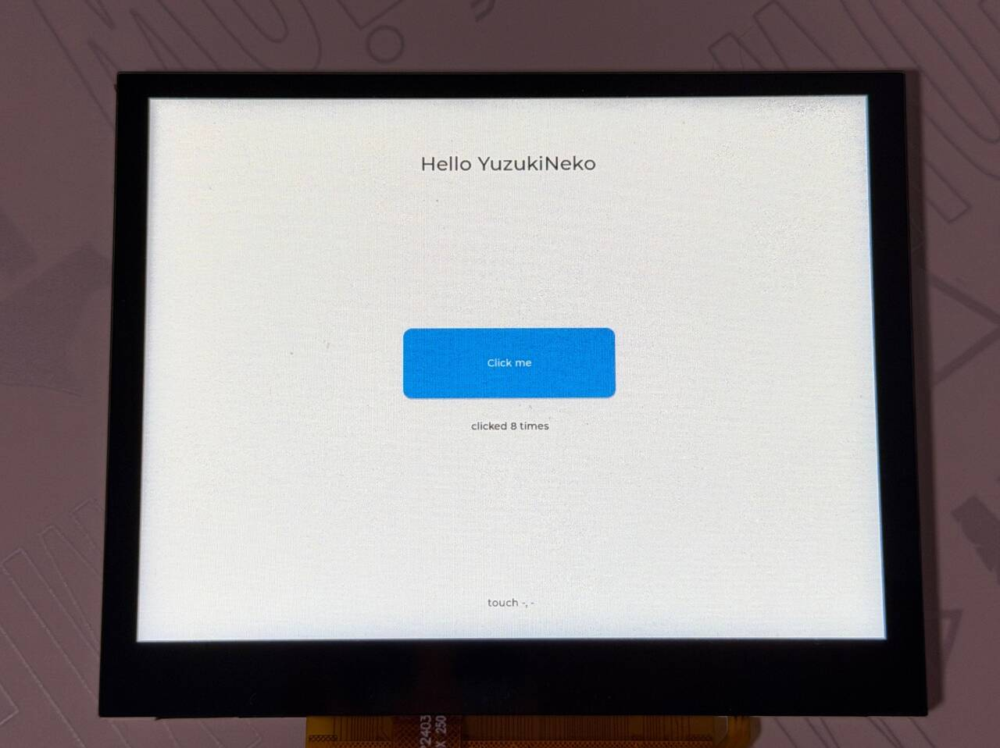
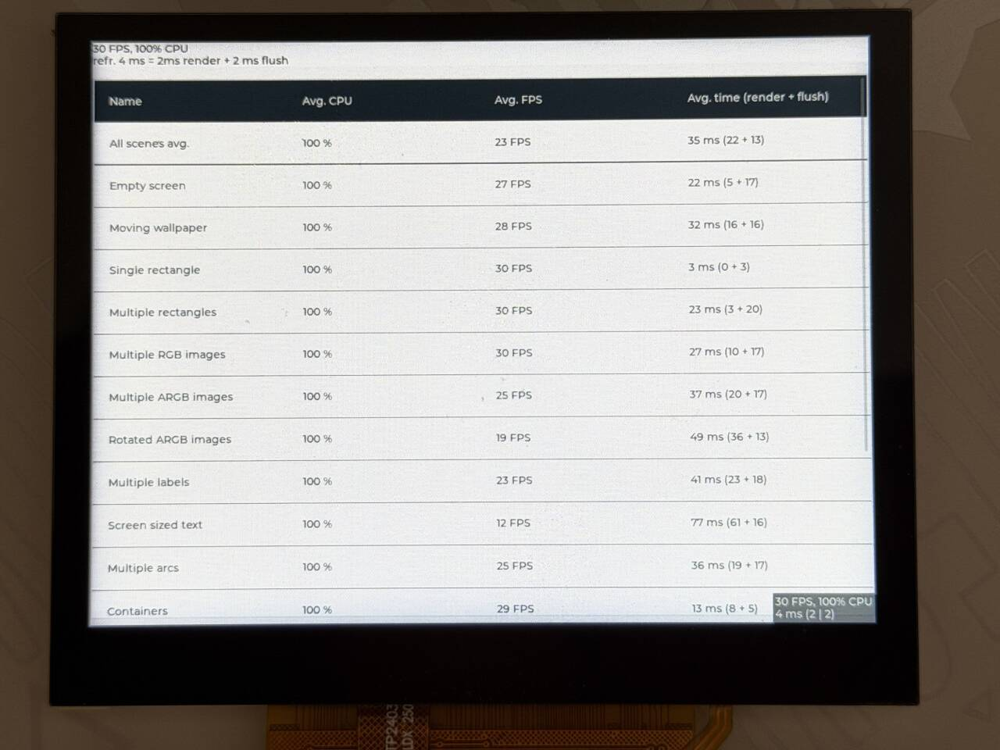

LVGL 是一个嵌入式图形库：控件（按钮、标签、滑条、图表……）、样式、动画、触摸事件都有现成的。在 F101 的 Zephyr 上，LVGL 作为 west 模块（`modules/lib/gui/lvgl`，版本 9.3.0）编进应用，通过标准的显示接口画到屏幕上，通过标准的输入子系统读触摸屏。不需要 `zephyr-components`，也不需要外部素材。



本文依次讲：准备、编译和运行 hello 程序，在板子上跑官方 demo，然后是 LVGL 怎么接到显示和触摸、最小界面的完整代码，以及推荐的 Kconfig。每个运行步骤都写明串口和屏幕上会出现什么。

开始前请先完成 [配置开发环境](../zephyr-setup-env.md) 和 [获取 Zephyr 代码](../zephyr-get-source.md)。

## 准备

| 项 | 说明 |
| --- | --- |
| LVGL 源码 | 随 Zephyr 的 west manifest 拉下来，在 `~/f101-zephyr/modules/lib/gui/lvgl`，版本 9.3.0。Zephyr 一侧的粘合层在 `zephyr/modules/lvgl/` |
| 屏幕 | `yuzukineko` 载板的 1024×768 MIPI DSI 屏，设备树里是 `chosen { zephyr,display = &display; }`，见 [显示](../drivers/display.md) |
| 触摸 | 载板上的 GT967 触摸控制器，在 `i2c1` 的 0x5d，设备树里是 `touch` 节点，见 [I2C](../drivers/i2c.md)。没有触摸也能跑，只是点不了控件 |
| 素材 | 不需要。字体、图标都编进了 LVGL；demo 的图片也编在 demo 里 |
| 外部硬件 | 只要板子能显示。官方 demo 的音乐播放器不会出声，它只是个界面 |
| hello 程序 | `examples/lvgl_hello/`，源码见下面的 [新建一个最小的 UI](#新建一个最小的-ui) |

:::note
本文的命令和日志都是 `yuzukineko` 板（载板，DSI 屏）。`f101_evb` 是 1024×600 的 RGB 屏，没有 GT967。
:::

## 编译

在工作区里执行：


```sh
. ~/f101-zephyr/env.sh
cd ~/f101-zephyr
west build -b yuzukineko -d build/lvgl-hello examples/lvgl_hello
```

<div class="asciinema-cast" data-src="assets/casts/zephyr/apps-lvgl/build.cast" data-speed="6"></div>

产物是 `build/lvgl-hello/zephyr/zephyr.bin`，约 2.7 MB（2733692 字节），链接地址 `0x40010000`，和其他 Zephyr 程序一样。其中帧缓冲 1.5 MiB 和 LVGL 内存池 64 KiB 是静态数组，占了大头。

## 运行

用 xfel 下载运行（见 [编译与运行](../zephyr-build-run.md)），控制台是 UART1（115200 8N1）。

### 1. 启动 hello 程序

命令：

```sh
xfel ddr f101-s3
xfel write 0x40010000 build/lvgl-hello/zephyr/zephyr.bin
xfel exec 0x40010000
```

运行后的输出，串口：

```text
[00:00:00.000,000] <inf> usb_phy_sunxi: ready
[00:00:00.000,000] <inf> g2d_sunxi: module clock 300000000 Hz (PLL_PERI_2X 1200000000 Hz / 4)
[00:00:00.000,000] <inf> g2d_sunxi: ready, queue depth 8
[00:00:00.000,000] <inf> display: core: soc sun252iw2, board devicetree
[00:00:00.000,000] <inf> display: core: bound tcon-top@5460000 (tcon-top)
[00:00:00.000,000] <inf> display: de-rcq: rcq0: 41 blocks, 7112 bytes of shadow registers
[00:00:00.000,000] <inf> display: de: sun252iw2-de: 3 channel(s), 12 plane(s), 1 display(s)
[00:00:00.000,000] <inf> display: core: bound display-engine@5000000 (display-engine)
[00:00:00.000,000] <inf> display: tcon: tcon-lcd@5461000 attached to disp0
[00:00:00.000,000] <inf> display: core: bound tcon-lcd@5461000 (tcon-lcd)
[00:00:00.000,000] <inf> display: core: bound phy@5451000 (combo-dphy)
[00:00:00.000,000] <inf> display: core: bound backlight-dsi (pwm-backlight)
[00:00:00.000,000] <inf> display: dsi: device attached: 4 lane(s), format 0, flags 0xd
[00:00:00.000,000] <inf> display: core: bound panel-dsi (panel-dsi)
[00:00:00.000,000] <inf> display: core: bound dsi@5450000 (mipi-dsi)
[00:00:00.000,000] <inf> display: core: disp0 -> dsi@5450000 -> panel-dsi: 1024x768@59.918Hz
[00:00:00.002,000] <inf> display: dphy: D-PHY 4 lane(s), HS clock 324000000 Hz
*** Booting Zephyr OS build b6f3dfe1a1f4 ***
lvgl hello: 1024 x 768
[00:00:00.493,000] <inf> display_sunxi: 1024x768 @ 60 Hz, fb 0x4007e200, video plane 0
[00:00:00.564,000] <inf> gt967: GT967 firmware 0x1040, 1024x768
[00:00:00.569,000] <inf> gt967: configuration 0x63: 1024 x 768, up to 5 point(s), module switch 0x04
[00:00:00.575,000] <inf> gt967: configuration updated: 1024x768, 1 point(s)
```

- `lvgl hello: 1024 x 768` 是 `main()` 打印的，LVGL 的显示建在了 1024×768 上。
- `display_sunxi: 1024x768 @ 60 Hz, fb 0x4007e200` 是显示驱动，`fb` 是帧缓冲地址。
- 三行 `gt967:` 是触摸驱动：读到固件版本，配置原来是最多 5 点，驱动按 `CONFIG_INPUT_GT967_MAX_TOUCH_POINTS=1` 改成了 1 点。



屏幕上是标题 `Hello YuzukiNeko`，中间一个蓝色的 `Click me` 按钮，按钮下面是点击次数 `clicked 8 times`，底部一行小字显示触摸坐标（没有触摸时是 `touch -, -`）。

### 2. 点击按钮

用手指点屏幕中央的 “Click me” 按钮。每点一次，屏幕上的 “clicked N times” 加一，串口多一行 `button clicked`：

```text
button clicked, count 1
button clicked, count 2
button clicked, count 3
button clicked, count 4
button clicked, count 5
```

这条链是 GT967 中断、I2C 读坐标、input 事件、`lvgl_pointer`、LVGL 命中按钮、`LV_EVENT_CLICKED`、`btn_cb()`。按在空白处时，“touch X, Y” 标签更新坐标。

### 3. 查看触摸的原始事件

需要看触摸的原始坐标时，在编译命令后加 `-DCONFIG_INPUT_LOG_LEVEL_DBG=y` 重新编译（调试用，上面的编译命令不含它），重新下载运行。驱动在每次按下和抬起时打印一行：

```text
[00:00:00.493,000] <inf> display_sunxi: 1024x768 @ 60 Hz, fb 0x4007e440, video plane 0
[00:00:00.564,000] <inf> gt967: GT967 firmware 0x1040, 1024x768
[00:00:00.570,000] <inf> gt967: configuration 0x63: 1024 x 768, up to 5 point(s), module switch 0x04
[00:00:00.575,000] <inf> gt967: configuration updated: 1024x768, 1 point(s)
[00:00:01.018,000] <dbg> gt967: gt967_work_handler: down id 0 at 7,752
[00:00:01.041,000] <dbg> gt967: gt967_work_handler: up id 0
[00:00:01.154,000] <dbg> gt967: gt967_work_handler: down id 0 at 11,564
[00:00:01.178,000] <dbg> gt967: gt967_work_handler: up id 0
```

- `down id 0 at X,Y` 是按下和坐标，`up id 0` 是抬起。
- 这段日志是不碰屏幕时的输出：启动后约 0.44 秒，驱动报告了两次各约 23 毫秒的短触摸，坐标是 (7, 752) 和 (11, 564)，都在屏幕最左边缘，不在按钮范围内（按钮在屏幕中央 300×100 的区域），之后没有再出现触摸事件。
- 驱动（`input_gt967.c` 的 `gt967_work_handler()`）按控制器报告的状态原样转成输入事件。

### 4. 运行 benchmark

benchmark 通过 LVGL 日志打印汇总表。`zephyr/modules/lvgl/lvgl.c` 的 `lvgl_log()` 对 `LV_LOG_LEVEL_USER` 只在消息以 `[` 开头时才跳过 `[User] ` 前缀，`LV_LOG()` 输出的裸消息原样打印：

```c
	case LV_LOG_LEVEL_USER:
		/*
		 * LV_LOG_USER() comes with the "[User] " prefix, LV_LOG() (the benchmark demo
		 * prints its table with it) is the bare message.
		 */
		LOG_INF("%s", buf[0] == '[' ? buf + (sizeof("[User] ") - 1) : buf);
		break;
```

demo 的 `samples/modules/lvgl/demos/boards/` 下有 `yuzukineko.conf` 和 `yuzukineko.overlay`，Zephyr 编译 `yuzukineko` 板时会自动合并它们：


```text
# yuzukineko: 1024x768 MIPI DSI panel, RGB565 frame buffer, GT967 touch panel
CONFIG_INPUT=y
CONFIG_LV_COLOR_DEPTH_16=y
CONFIG_LV_Z_MEM_POOL_SIZE=262144
CONFIG_LV_Z_VDB_SIZE=10
CONFIG_MAIN_STACK_SIZE=8192

# the benchmark prints its summary table through the LVGL log, and the CPU column needs the load
CONFIG_LV_USE_LOG=y
CONFIG_LV_LOG_LEVEL_USER=y
CONFIG_CPU_LOAD=y
```

```c
/* LVGL reads the GT967 touch panel as a pointer */
/ {
	lvgl_pointer {
		compatible = "zephyr,lvgl-pointer-input";
		input = <&touch>;
	};
};
```

选 demo 用 `CONFIG_LV_Z_DEMO_*`，选 benchmark：

```sh
. ~/f101-zephyr/env.sh
cd ~/f101-zephyr
west build -b yuzukineko -d build/lvgl-bench zephyr/samples/modules/lvgl/demos -- -DCONFIG_LV_Z_DEMO_BENCHMARK=y
xfel ddr f101-s3
xfel write 0x40010000 build/lvgl-bench/zephyr/zephyr.bin
xfel exec 0x40010000
```

可选的 demo 有：

benchmark 自己依次跑完所有场景，约 70 秒后串口输出汇总表（时间单位毫秒，Avg. time 是渲染加刷新）：


```text
[00:00:00.564,000] <inf> gt967: GT967 firmware 0x1040, 1024x768
[00:00:00.569,000] <inf> gt967: configuration 0x63: 1024 x 768, up to 1 point(s), module switch 0x04
*** Booting Zephyr OS build b6f3dfe1a1f4 ***
Heap at 0x40266fb0 contains 32767 units in 15 buckets

  bucket#    min units        total      largest      largest
             threshold       chunks      (units)      (bytes)
  -----------------------------------------------------------
        0            1            1            1            8
        1            2            1            2           16
       14        16384            1        31770       254160

254184 free bytes, 7872 allocated bytes, overhead = 84 bytes (0.0%)
[00:01:09.822,000] <inf> lvgl: Benchmark Summary (9.3.0 )
[00:01:09.822,000] <inf> lvgl: Name, Avg. CPU, Avg. FPS, Avg. time, render time, flush time
[00:01:09.823,000] <inf> lvgl: Empty screen, 72%, 27, 21, 5, 16
[00:01:09.823,000] <inf> lvgl: Moving wallpaper, 97%, 29, 32, 16, 16
[00:01:09.824,000] <inf> lvgl: Single rectangle, 11%, 30, 2, 0, 2
[00:01:09.824,000] <inf> lvgl: Multiple rectangles, 76%, 29, 24, 3, 21
[00:01:09.825,000] <inf> lvgl: Multiple RGB images, 87%, 29, 26, 10, 16
[00:01:09.826,000] <inf> lvgl: Multiple ARGB images, 100%, 25, 36, 20, 16
[00:01:09.827,000] <inf> lvgl: Rotated ARGB images, 100%, 19, 49, 36, 13
[00:01:09.828,000] <inf> lvgl: Multiple labels, 100%, 23, 41, 23, 18
[00:01:09.829,000] <inf> lvgl: Screen sized text, 100%, 12, 78, 62, 16
[00:01:09.830,000] <inf> lvgl: Multiple arcs, 99%, 25, 35, 19, 16
[00:01:09.831,000] <inf> lvgl: Containers, 44%, 30, 12, 8, 4
[00:01:09.832,000] <inf> lvgl: Containers with overlay, 91%, 19, 47, 33, 14
[00:01:09.834,000] <inf> lvgl: Containers with opa, 57%, 29, 16, 12, 4
[00:01:09.835,000] <inf> lvgl: Containers with opa_layer, 94%, 21, 43, 37, 6
[00:01:09.837,000] <inf> lvgl: Containers with scrolling, 100%, 17, 53, 37, 16
[00:01:09.839,000] <inf> lvgl: Widgets demo, 74%, 18, 45, 35, 10
[00:01:09.839,000] <inf> lvgl: All scenes avg.,81%, 23, 34, 22, 12
```

日志里的表（FPS 的上限是 30，来自 `LV_DEF_REFR_PERIOD` 的 33 毫秒）：

- “刷新”一列是 `display_write()` 的耗时。整屏重画的场景稳定在 16 到 21 毫秒：1024×768 RGB565 是 1.5 MiB，约 90 MB/s 的拷贝加缓存回写。只改一小块的场景（Single rectangle 2 毫秒，Containers 4 毫秒）就小得多。
- “渲染”一列是软件渲染的耗时。纯色填充几乎为 0，旋转图像（Rotated ARGB images，36 毫秒）、整屏文字（Screen sized text，62 毫秒）、图层透明度（Containers with opa_layer，37 毫秒）慢得多，因为没有 G2D 或向量加速。
- 汇总行：平均 23 FPS，每帧 34 毫秒，其中渲染 22、刷新 12，平均 CPU 占用 81%。
- CPU 一列有数值（11% 到 100%），因为 demo 的配置打开了 `CONFIG_CPU_LOAD`。



汇总表第一行是所有场景的平均，后面每行是一个场景的 CPU 占用、帧率和每帧耗时（渲染 + 刷新）。左上角和右下角的小标签是 LVGL 的性能监视器，显示当前帧率和 CPU 占用。

### 5. 运行 widgets demo

```sh
west build -b yuzukineko -d build/lvgl-widgets zephyr/samples/modules/lvgl/demos -- -DCONFIG_LV_Z_DEMO_WIDGETS=y
xfel ddr f101-s3
xfel write 0x40010000 build/lvgl-widgets/zephyr/zephyr.bin
xfel exec 0x40010000
```

运行后的输出，串口（最后一段是 demo 调 `lvgl_print_heap_info()` 打印的 LVGL 内存池使用情况）：

```text
[00:00:00.493,000] <inf> display_sunxi: 1024x768 @ 60 Hz, fb 0x400b8400, video plane 0
[00:00:00.564,000] <inf> gt967: GT967 firmware 0x1040, 1024x768
[00:00:00.570,000] <inf> gt967: configuration 0x63: 1024 x 768, up to 1 point(s), module switch 0x04
*** Booting Zephyr OS build b6f3dfe1a1f4 ***
Heap at 0x4023e568 contains 32767 units in 15 buckets

  bucket#    min units        total      largest      largest
             threshold       chunks      (units)      (bytes)
  -----------------------------------------------------------
        0            1           22            1            8
        2            4            1            4           32
       14        16384            1        26946       215568

215776 free bytes, 46280 allocated bytes, overhead = 84 bytes (0.0%)
```

内存池 262144 字节，demo 画出第一屏后用掉 46280 字节，空闲 215776 字节。


屏幕上是 LVGL v9.3.0 的 widgets demo：顶部是 Profile、Analytics、Shop 三个选项卡，下面是头像和个人信息、输入框、下拉框、滑条和开关。左上角和右下角是性能监视器。

### 6. 其他 sample

| sample | 命令 | 说明 |
| --- | --- | --- |
| `samples/subsys/display/lvgl` | `west build -b yuzukineko -d build/lvgl-sub zephyr/samples/subsys/display/lvgl` | 该 sample 的 `boards/` 下有 `yuzukineko.conf` 和 `yuzukineko.overlay` |
| `samples/modules/lvgl/screen_transparency` | `west build -b yuzukineko -d build/lvgl-trans zephyr/samples/modules/lvgl/screen_transparency` | sample 要求显示支持 ARGB8888，它的 `boards/yuzukineko.conf` 里打开了 `CONFIG_DISPLAY_SUNXI_ARGB8888` |
| `samples/modules/lvgl/multi_display` | - | 不适用：需要设备树里有 `zephyr,displays` 节点，板子只有一个显示 |
| `samples/modules/lvgl/accelerometer_chart` | - | 不适用：需要 `accel0` 别名，板子上没有加速度计 |

## LVGL 怎么接到显示

### 数据流

LVGL 自己不碰硬件。Zephyr 一侧的 `zephyr/modules/lvgl/lvgl.c` 在系统启动阶段（`LV_Z_AUTO_INIT`，默认打开）做这几件事：

1. 取 `chosen` 里的 `zephyr,display`，读 `display_get_capabilities()` 得到分辨率和像素格式；
2. `lv_display_create()` 建一个 LVGL 显示，分辨率就是显示设备报的帧缓冲分辨率；
3. 按像素格式选刷新回调：`PIXEL_FORMAT_RGB_565` 用 `lvgl_flush_cb_16bit`，`PIXEL_FORMAT_ARGB_8888` 用 `lvgl_flush_cb_32bit`；
4. 分配渲染缓冲（下面讲），设成部分渲染模式；
5. 为设备树里每个 `zephyr,lvgl-*-input` 节点注册一个输入设备。

对应的代码（`zephyr/modules/lvgl/lvgl_display.c`，`set_lvgl_rendering_cb()` 的 RGB565 / ARGB8888 两个分支）：

```c
case PIXEL_FORMAT_ARGB_8888:
	lv_display_set_color_format(display, LV_COLOR_FORMAT_ARGB8888);
	lv_display_set_flush_cb(display, lvgl_flush_cb_32bit);
	lv_display_add_event_cb(display, lvgl_rounder_cb, LV_EVENT_INVALIDATE_AREA,
				display);
	break;
...
case PIXEL_FORMAT_RGB_565:
case PIXEL_FORMAT_BGR_565:
	lv_display_set_color_format(display, LV_COLOR_FORMAT_RGB565);
	lv_display_set_flush_cb(display, lvgl_flush_cb_16bit);
```

应用要做的只有两件事：画界面、周期性地调 `lv_timer_handler()`。它负责重画脏区域，每画完一块就调一次刷新回调，刷新回调最终走到 `display_write()`。

F101 的显示驱动（`drivers/display/sunxi/display_sunxi.c`）的 `display_write()` 把这一块 `memcpy` 到帧缓冲对应的位置，再做一次数据缓存回写（`sys_cache_data_flush_range`），显示引擎自己按刷新率扫描这块内存：

```c
for (row = 0; row < desc->height; row++) {
	dst = sunxi_fb + (size_t)(y + row) * data->stride +
			(size_t)x * SUNXI_BPP;
	memcpy(dst, src + row * src_pitch, row_bytes);
	sys_cache_data_flush_range(dst, row_bytes);
}
```

所以每个像素在内存里有两份：LVGL 渲染缓冲里一份（临时），帧缓冲里一份（长期）。这是 Zephyr 的 LVGL 粘合层的标准做法，F101 上没有直接渲染到帧缓冲的模式。

### 显示缓冲：怎么选

两处内存要分清：

| 内存 | 谁分配 | 大小 | 控制它的选项 |
| --- | --- | --- | --- |
| 帧缓冲 | 显示驱动，静态数组（也可以改成运行时分配） | 宽 × 高 × 每像素字节数。1024×768 RGB565 是 1.5 MiB，ARGB8888 是 3 MiB | `CONFIG_DISPLAY_SUNXI_RGB565` / `ARGB8888`、`CONFIG_DISPLAY_SUNXI_FB_DIV`、`CONFIG_DISPLAY_SUNXI_FB_ALLOC` |
| LVGL 渲染缓冲 | `modules/lvgl/lvgl.c`，默认静态数组 | 屏幕像素数 × `LV_Z_VDB_SIZE`% × 每像素字节数。10% 的 1024×768 RGB565 约 157 KiB | `CONFIG_LV_Z_VDB_SIZE`、`CONFIG_LV_Z_DOUBLE_VDB`、`CONFIG_LV_Z_FULL_REFRESH`、`CONFIG_LV_Z_BUFFER_ALLOC_*` |

LVGL 的渲染模式在这里固定为部分渲染（`LV_DISPLAY_RENDER_MODE_PARTIAL`），打开 `CONFIG_LV_Z_FULL_REFRESH` 才改成整屏渲染。三种常用搭配：

| 搭配 | 配置 | 特点 |
| --- | --- | --- |
| 默认，部分渲染 | `LV_Z_VDB_SIZE=10` | 渲染缓冲小（约 157 KiB），每次只画脏区域一块块拷。静止的界面几乎不花时间；全屏动画要分约 10 块画。推荐 |
| 双缓冲 | 再加 `LV_Z_DOUBLE_VDB=y` 和 `LV_Z_FLUSH_THREAD=y` | 一块在渲染，另一块在拷。F101 上刷新只是一次 `memcpy`，收益有限，不作为默认 |
| 整屏渲染 | `LV_Z_FULL_REFRESH=y`（`LV_Z_VDB_SIZE` 自动变成 100） | 渲染缓冲和帧缓冲一样大（1.5 MiB），每次都整屏拷。适合想要整帧一致的场合，内存和时间都更大 |

`LV_Z_FLUSH_THREAD` 默认关闭：刷新在调 `lv_timer_handler()` 的那个线程里直接做完。它打开后会多一个线程专门调 `display_write()`，栈和优先级由 `LV_Z_FLUSH_THREAD_STACK_SIZE`、`LV_Z_FLUSH_THREAD_PRIORITY` 设。

驱动没有双缓冲，也不等垂直同步：`display_write()` 直接改正在被扫描的内存，快速滚动时有撕裂的可能。

### 两种像素格式：RGB565 和 ARGB8888

这是选配置时最重要的一项：

| | RGB565 | ARGB8888 |
| --- | --- | --- |
| 显示选项 | `CONFIG_DISPLAY_SUNXI_RGB565=y`（默认） | `CONFIG_DISPLAY_SUNXI_ARGB8888=y` |
| LVGL 选项 | `CONFIG_LV_COLOR_DEPTH_16=y`（LVGL 默认） | `CONFIG_LV_COLOR_DEPTH_32=y` |
| 帧缓冲（1024×768） | 1.5 MiB | 3 MiB |
| 透明度 | 不透明，盖住下面所有图层 | 帧缓冲层按每个像素的 alpha 和下面的视频层混合 |
| 用途 | 独立的界面应用 | 叠在视频上的界面：[MP4 播放器](mp4-player.md) 的统计面板、nes / doom / mgba 的屏幕按键 |

两个选项必须成对：LVGL 渲染缓冲的大小按 `LV_Z_BITS_PER_PIXEL`（跟着 `LV_COLOR_DEPTH` 走）算，而刷新回调按显示设备报告的格式拷贝。两边位数不一致时缓冲大小和拷贝的行宽对不上。

ARGB 模式下，屏幕背景要设成透明才能透出视频层：

```c
lv_obj_set_style_bg_opa(lv_screen_active(), LV_OPA_TRANSP, 0);
```

nes 的 `pad.c` 就是这么做的：背景透明，按键是 30% 不透明度的白色按钮。想只覆盖一个角落时用 `CONFIG_DISPLAY_SUNXI_FB_WINDOW_WIDTH/HEIGHT` 把帧缓冲层限制在左上角，显示引擎每次刷新少读很多内存，给视频层留出带宽，MP4 播放器就是 400×400。

### 加速：G2D 和 RVV

<strong>LVGL 在 F101 上全部是软件渲染（`LV_USE_DRAW_SW`），G2D 和 RVV 都没有接。</strong>

- G2D：F101 有 [G2D](../drivers/g2d.md) 2D 加速器，Zephyr 里也有它的驱动，但 LVGL 9.3 里没有对应的绘制单元。`LV_USE_DRAW_G2D` 是 NXP 的 G2D，和 F101 的不是一回事，不能打开。LVGL 绘制的填充、混合、图像缩放都不会交给 G2D。
- RVV：[RISC-V 向量扩展](../zephyr-riscv-vector.md)可以用 `CONFIG_SUN252I_F101_RVV=y` 打开，nes 的配置里就打开了。但 LVGL 的汇编加速选项 `LV_USE_DRAW_SW_ASM` 只有 `NONE`、`NEON`、`HELIUM`、`CUSTOM` 四种，没有 RVV 的实现；只有 `CUSTOM` 可以自己提供汇编，需要向量版混合函数时自己写。
- 渲染并行：`CONFIG_LV_Z_USE_OSAL` 可以让 LVGL 用多个线程渲染，默认不打开。

没有加速意味着：填充、混合和文字都由 C907 内核一个像素一个像素算。下面 benchmark 的帧率就是这个情况。

## LVGL 怎么接到触摸

触摸这条链全部是 Zephyr 标准件，没有 F101 专用的代码：

1. GT967 驱动（`drivers/input/input_gt967.c`，`CONFIG_INPUT_GT967`，设备树里有 `goodix,gt967` 节点时默认打开）在 INT 引脚中断后通过 I2C 读坐标，用 `input_touchscreen_report_pos()` 报告 `INPUT_ABS_X`、`INPUT_ABS_Y`，再用 `input_report_key()` 报告 `INPUT_BTN_TOUCH`。
2. 设备树里加一个 `zephyr,lvgl-pointer-input` 节点，`input` 属性指向触摸节点。
3. LVGL 的粘合层（`zephyr/modules/lvgl/input/lvgl_pointer_input.c`）监听这个输入设备的事件，把坐标按显示的方向转换、限制在屏幕范围内，放进消息队列，LVGL 在 `lv_timer_handler()` 里取出来，当作一个指针设备（`LV_INDEV_TYPE_POINTER`）。

板级设备树没有这个节点，每个应用要自己加一个 overlay（`boards/yuzukineko.overlay`）：

```c
/* LVGL reads the GT967 touch panel as a pointer */
/ {
	lvgl_pointer {
		compatible = "zephyr,lvgl-pointer-input";
		input = <&touch>;
	};
};
```

同时在 `prj.conf` 里打开 `CONFIG_INPUT=y`。`CONFIG_LV_Z_POINTER_INPUT` 默认是 `y`，只要设备树里有这个节点就会生效。

绑定里还有三个属性，用来处理触摸方向和屏幕方向不一致的情况，用法是写在 `lvgl_pointer` 节点里：

| 属性 | 作用 |
| --- | --- |
| `swap-xy` | 交换 X、Y |
| `invert-x` | X 方向取反 |
| `invert-y` | Y 方向取反 |

GT967 的分辨率在 `yuzukineko.dts` 里是 `screen-width = <1024>; screen-height = <768>;`，和屏一致，所以不需要这三个属性。

限制：

- LVGL 的指针设备<strong>只有一个手指</strong>。GT967 驱动默认也只报一个点（`CONFIG_INPUT_GT967_MAX_TOUCH_POINTS=1`），多点触摸 LVGL 不支持。要多点（比如游戏按键）要像 nes 的 `pad.c` 那样自己读 `input` 事件，把 `CONFIG_INPUT_GT967_MAX_TOUCH_POINTS` 调到 5。
- 触摸驱动的 INT 和 RST 在 PD2、PD3，与 LCD 的引脚复用同一组，换成别的屏时要核对。

## 新建一个最小的 UI

下面是一个完整的 hello 程序：标题、一个按钮、一个点击计数、一个显示触摸坐标的标签。目录结构：

```text
examples/lvgl_hello/
├── CMakeLists.txt
├── prj.conf
├── boards/
│   └── yuzukineko.overlay
└── src/
    └── main.c
```

放在 `~/f101-zephyr/examples/` 下，和 [驱动](../drivers/display.md) 一章的演示在一起。

`CMakeLists.txt`：

```cmake
cmake_minimum_required(VERSION 3.20.0)
find_package(Zephyr REQUIRED HINTS $ENV{ZEPHYR_BASE})
project(lvgl_hello)

target_sources(app PRIVATE src/main.c)
```

`prj.conf`，每一行的含义见后面的 [配置选项](#配置选项)：

```text
CONFIG_DISPLAY=y
CONFIG_DISPLAY_SUNXI_RGB565=y
CONFIG_INPUT=y

CONFIG_LVGL=y
CONFIG_LV_COLOR_DEPTH_16=y
CONFIG_LV_Z_MEM_POOL_SIZE=65536
CONFIG_LV_Z_VDB_SIZE=10
CONFIG_LV_FONT_MONTSERRAT_14=y
CONFIG_LV_FONT_MONTSERRAT_28=y
CONFIG_LV_USE_LABEL=y
CONFIG_LV_USE_BUTTON=y
CONFIG_LV_USE_SLIDER=y
CONFIG_LV_Z_SHELL=n

CONFIG_MAIN_STACK_SIZE=8192
CONFIG_PRINTK=y
CONFIG_LOG_PRINTK=n
CONFIG_SHELL=n
CONFIG_DEVMEM_SHELL=n
```

`boards/yuzukineko.overlay`：同上一节，把 GT967 接成 LVGL 的指针设备。

`src/main.c`：

```c
#include <stdio.h>
#include <zephyr/kernel.h>
#include <zephyr/device.h>
#include <zephyr/devicetree.h>
#include <zephyr/drivers/display.h>
#include <lvgl.h>

static lv_obj_t *count_label;
static lv_obj_t *touch_label;
static uint32_t clicks;

static void btn_cb(lv_event_t *e)
{
	char text[32];

	ARG_UNUSED(e);
	snprintf(text, sizeof(text), "clicked %u times", ++clicks);
	lv_label_set_text(count_label, text);
	printk("button clicked, count %u\n", clicks);
}

static void screen_cb(lv_event_t *e)
{
	lv_indev_t *indev = lv_indev_active();
	lv_point_t p;
	char text[32];

	if (indev == NULL) {
		return;
	}
	lv_indev_get_point(indev, &p);
	snprintf(text, sizeof(text), "touch %d, %d", (int)p.x, (int)p.y);
	lv_label_set_text(touch_label, text);
}

int main(void)
{
	const struct device *disp = DEVICE_DT_GET(DT_CHOSEN(zephyr_display));
	lv_obj_t *scr = lv_screen_active();
	lv_obj_t *title, *btn, *btn_label;

	if (!device_is_ready(disp)) {
		printk("display not ready\n");
		return 0;
	}

	title = lv_label_create(scr);
	lv_obj_set_style_text_font(title, &lv_font_montserrat_28, 0);
	lv_label_set_text(title, "Hello YuzukiNeko");
	lv_obj_align(title, LV_ALIGN_TOP_MID, 0, 80);

	btn = lv_button_create(scr);
	lv_obj_set_size(btn, 300, 100);
	lv_obj_align(btn, LV_ALIGN_CENTER, 0, 0);
	lv_obj_add_event_cb(btn, btn_cb, LV_EVENT_CLICKED, NULL);
	btn_label = lv_label_create(btn);
	lv_label_set_text(btn_label, "Click me");
	lv_obj_center(btn_label);

	count_label = lv_label_create(scr);
	lv_label_set_text(count_label, "clicked 0 times");
	lv_obj_align(count_label, LV_ALIGN_CENTER, 0, 90);

	touch_label = lv_label_create(scr);
	lv_label_set_text(touch_label, "touch -, -");
	lv_obj_align(touch_label, LV_ALIGN_BOTTOM_MID, 0, -40);
	lv_obj_add_event_cb(scr, screen_cb, LV_EVENT_PRESSING, NULL);

	lv_timer_handler();
	display_blanking_off(disp);
	printk("lvgl hello: %d x %d\n", (int)lv_display_get_horizontal_resolution(NULL),
	       (int)lv_display_get_vertical_resolution(NULL));

	while (1) {
		uint32_t next = lv_timer_handler();

		k_msleep(MIN(next, 1000U));
	}
	return 0;
}
```

关键点（行号以上面的文件为准）：

- 38–45 行：取 `chosen` 里的显示设备，没准备好就退出。LVGL 自己在启动时已经初始化（`LV_Z_AUTO_INIT`），所以 `main()` 里不用调 `lv_init()`，也不用调 `lv_display_create()`。
- 47–67 行：创建控件。`lv_screen_active()` 是当前屏幕，所有控件都挂在它下面或它的子控件下面。`lv_obj_align()` 相对父控件对齐。
- 55 行：`lv_obj_add_event_cb(btn, btn_cb, LV_EVENT_CLICKED, NULL)` 注册点击回调。点击事件是触摸链的终点：GT967 → input → `lvgl_pointer` → LVGL 指针 → 命中按钮 → `LV_EVENT_CLICKED`。
- 67 行：在屏幕本身上监听 `LV_EVENT_PRESSING`，读 `lv_indev_active()` 的坐标。事件只发给被按住的控件，按在按钮上时这个回调<strong>不会</strong>被调，只有按在空白处才更新坐标。
- 69–70 行：先渲染一次再 `display_blanking_off()`，避免开屏时闪一下旧内容。官方 demo 也是这个顺序。
- 74–78 行：主循环。`lv_timer_handler()` 返回距离下一次需要调用的毫秒数，睡这么久（最长 1 秒）。动画和事件都靠它驱动，不要把它饿死。

字体：`lv_font_montserrat_28` 要用到，必须有 `CONFIG_LV_FONT_MONTSERRAT_28=y`，没打开就编译不过。LVGL 自带的 Montserrat 字体只含 ASCII 和少量符号，<strong>不含中文</strong>。要显示中文需要自己用 LVGL 的字体转换工具生成 C 字体文件加进工程。


## 配置选项

`prj.conf` 里和 LVGL 有关的主要选项，每行一个：

| 选项 | 默认 | 说明 |
| --- | --- | --- |
| `CONFIG_LVGL` | n | 打开 LVGL |
| `CONFIG_DISPLAY` | n | 显示子系统，LVGL 的前提 |
| `CONFIG_INPUT` | n | 输入子系统，触摸要用 |
| `CONFIG_LV_Z_MEM_POOL_SIZE` | 2048 | LVGL 自己的内存池，所有控件、样式、图像缓存从这里分。hello 用 65536，1024×768 的 widgets / benchmark 用 262144。池满了 LVGL 会死机或画不出东西 |
| `CONFIG_LV_Z_MEM_POOL_SYS_HEAP` | y（默认） | 内存池用一块私有的 sys_heap；可以改成 `LV_Z_MEM_POOL_HEAP_LIB_C` 用 C 库的堆 |
| `CONFIG_LV_Z_VDB_SIZE` | 10 | 渲染缓冲占屏幕的百分比（1–100）。10% 的 1024×768 RGB565 约 157 KiB |
| `CONFIG_LV_Z_DOUBLE_VDB` | n | 用两块渲染缓冲 |
| `CONFIG_LV_Z_FULL_REFRESH` | n | 整屏渲染，`LV_Z_VDB_SIZE` 变成 100 |
| `CONFIG_LV_Z_BUFFER_ALLOC_STATIC` | y（默认） | 渲染缓冲用静态数组；`LV_Z_BUFFER_ALLOC_DYNAMIC` 在运行时从 LVGL 内存池分 |
| `CONFIG_LV_Z_FLUSH_THREAD` | n | 用单独线程调 `display_write()` |
| `CONFIG_LV_Z_AUTO_INIT` | y | 启动时自动初始化 LVGL |
| `CONFIG_LV_COLOR_DEPTH_16` / `_32` | 16 | 颜色深度，必须和显示驱动的像素格式一致 |
| `CONFIG_DISPLAY_SUNXI_RGB565` / `ARGB8888` | RGB565 | 显示驱动的像素格式 |
| `CONFIG_DISPLAY_SUNXI_FB_WINDOW_WIDTH` / `HEIGHT` | 0 | 只显示帧缓冲左上角的一个窗口（0 是整屏），叠在视频上时用 |
| `CONFIG_DISPLAY_SUNXI_FB_DIV` | 1 | 帧缓冲每个方向缩小 1/N，由显示引擎放大，省内存但界面变糊 |
| `CONFIG_DISPLAY_SUNXI_FB_ALLOC` | n | 帧缓冲运行时分配，需要 `COMMON_LIBC_MALLOC_ARENA_SIZE` 不为 0 |
| `CONFIG_LV_FONT_MONTSERRAT_<size>` | 全部 n（默认字体见下） | 打开哪些字号的字体，用到哪个开哪个 |
| `CONFIG_LV_USE_<控件>` | 各不相同 | 打开用到的控件，如 `LV_USE_CHART`、`LV_USE_SLIDER`。没打开的控件函数不存在 |
| `CONFIG_LV_Z_POINTER_INPUT` | y | 指针输入，设备树里有 `zephyr,lvgl-pointer-input` 节点才生效 |
| `CONFIG_LV_Z_POINTER_INPUT_MSGQ_COUNT` | 10 | 指针事件队列长度 |
| `CONFIG_INPUT_GT967_MAX_TOUCH_POINTS` | 1 | 触摸驱动一次报告几个点，LVGL 只用一个 |
| `CONFIG_LV_USE_LOG` | n | 打开 LVGL 日志 |
| `CONFIG_LV_Z_SHELL` | 按 sample | LVGL 的 shell 命令，需要 `CONFIG_SHELL=y` |
| `CONFIG_MAIN_STACK_SIZE` | 1024 | 主线程栈。LVGL 渲染在调用 `lv_timer_handler()` 的线程里，栈要给够，hello 用 8192 |
| `CONFIG_HEAP_MEM_POOL_SIZE` | 板级 262144 | 内核堆。显示驱动的命令队列从这里分，不要改小 |

关于 `LV_FONT_MONTSERRAT_<size>`：LVGL 自己的默认字体是 Montserrat 14，Zephyr 的 Kconfig 里要显式打开。用 `lv_obj_set_style_text_font()` 指定其他字号时，对应字体必须打开，否则编译报找不到符号。

### 推荐配置

| 场景 | 配置 |
| --- | --- |
| 独立界面应用（hello 的做法） | RGB565，`LV_COLOR_DEPTH_16`，`LV_Z_MEM_POOL_SIZE` 65536 起，`LV_Z_VDB_SIZE=10`，主线程栈 8192 |
| 复杂界面、官方 demo | 同上，`LV_Z_MEM_POOL_SIZE=262144` |
| 叠在视频上（mp4、nes、doom、mgba） | `DISPLAY_SUNXI_ARGB8888`，`LV_COLOR_DEPTH_32`，`LV_Z_VDB_SIZE=4`，`FB_WINDOW_*` 限制到界面所在的范围，`LV_Z_MEM_POOL_SIZE=131072` |

最后一行直接来自这几个播放器的 `prj.conf`。`LV_Z_VDB_SIZE=4` 是因为 ARGB 每个像素 4 字节，缓冲小一些。

内存池大小怎么定：先给大一点，上板后看 LVGL 启动时（`lvgl_print_heap_info()`，demo 里会调用）打印的 `free bytes / allocated bytes`，空闲过多就改小。benchmark 启动时是 254184 字节空闲、7872 字节已分配，之后随场景增长。

## 代码位置

| 文件 | 内容 |
| --- | --- |
| `zephyr/modules/lvgl/lvgl.c` | LVGL 初始化：取显示、建渲染缓冲、注册输入 |
| `zephyr/modules/lvgl/lvgl_display.c` | 刷新回调选择、刷新线程 |
| `zephyr/modules/lvgl/lvgl_display_16bit.c`、`lvgl_display_32bit.c` | RGB565、ARGB8888 的刷新回调，最后调 `display_write()` |
| `zephyr/modules/lvgl/lvgl_mem.c` | LVGL 内存池 |
| `zephyr/modules/lvgl/input/lvgl_pointer_input.c` | 触摸（指针）输入 |
| `zephyr/modules/lvgl/Kconfig`、`Kconfig.memory`、`Kconfig.input` | 上面所有 `LV_Z_*` 选项 |
| `drivers/display/sunxi/display_sunxi.c` | 显示驱动：`display_write()` 拷贝到帧缓冲 |
| `drivers/input/input_gt967.c` | GT967 触摸驱动 |
| `samples/modules/lvgl/demos/` | 官方 demo 的 Zephyr 外壳 |
| `modules/lib/gui/lvgl/` | LVGL 本体（9.3.0） |
| `examples/lvgl_hello/` | 本文的 hello 程序 |
| `samples/drivers/vdec/h264_player/src/overlay.c` | 叠加层用法：MP4 播放器的统计面板，折线图 |
| `zephyr-components/nes/samples/nes_player/src/pad.c` | 叠加层用法：屏幕按键 |

## 功能范围

- G2D 和 RVV：LVGL 全部软件渲染。LVGL 9.3 没有对应 F101 G2D 的绘制单元；需要向量加速时，把 `LV_USE_DRAW_SW_ASM` 选成 `CUSTOM` 自己提供汇编。
- 触摸：LVGL 的指针只有一个手指。要多点（比如游戏按键），像 nes 的 `pad.c` 那样自己读 `input` 事件，并把 `CONFIG_INPUT_GT967_MAX_TOUCH_POINTS` 调到 5。
- 显示：板子只有一个显示，不支持多显示。
- 像素格式：编译时用 `CONFIG_DISPLAY_SUNXI_RGB565` 或 `ARGB8888` 选定，不能在运行时切换，也不能旋转。
- 刷新：驱动没有双缓冲和垂直同步，快速滚动可能撕裂。
- 字体：自带字体不含中文，需要中文时用 LVGL 的字体转换工具生成 C 字体文件加进工程。
