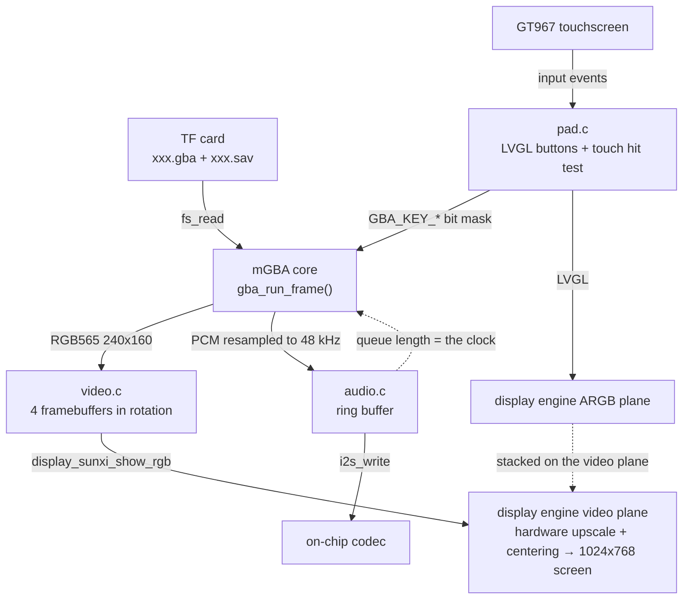
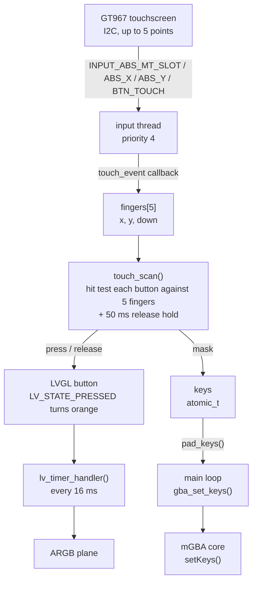
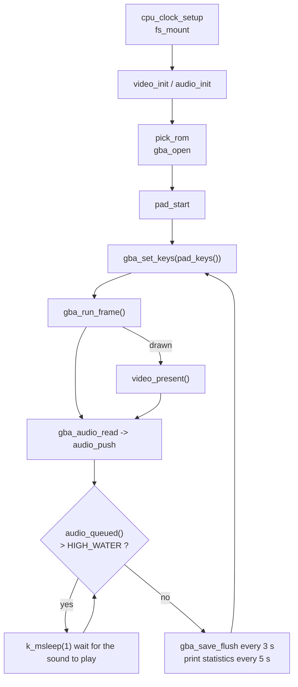

Runs Game Boy Advance games on the board (Game Boy / Game Boy Color work too): the emulator core is [mGBA](https://github.com/mgba-emu/mgba) and the ROM is read from the TF card; the 240×160 game picture is handed to the display engine's video plane and scaled up to the whole screen; the sound goes out over I2S from the on-chip codec; and a layer of semi-transparent buttons drawn with LVGL is overlaid on the screen and operated with the touchscreen. The sample is `zephyr-components/mgba/samples/gba_player`; mGBA itself is a git submodule in the component (MPL-2.0), and no BIOS file is needed.



There is no separate timer: each time the emulator finishes a frame it checks the sound queue, and if too much sound has piled up it waits with `k_msleep(1)`, so <strong>the speed of the sound output sets the game speed</strong>.

Before you start, first complete [Setting up the development environment](../zephyr-setup-env.md) and [Getting the Zephyr source](../zephyr-get-source.md).

## Preparation

### ROM and TF card

<strong>You must supply the ROM yourself; neither this page nor the repository provides any game files.</strong> Use only games you legally own (for example, a file dumped from your own cartridge).

| Item | Description |
| --- | --- |
| ROM file | `.gba` (GBA), `.gb`, `.gbc` (Game Boy / Color); the extension is recognized in either case (`.gba` or `.GBA`), and the core is chosen by the extension |
| Where it goes | the TF card's <strong>root directory</strong> |
| Which one is chosen | it first looks for `CONFIG_SAMPLE_GBA_ROM` (default `/SD:/game.gba`); if it does not exist it takes the first file in the root directory whose size does not exceed `CONFIG_MGBA_MAX_ROM_SIZE_MB` (set to 10 MiB in the sample), preferring `.gba` and then `.gb` / `.gbc` |
| Save file | in the same directory as the ROM, with the same base file name and the extension `.sav` (`xxx.gba` corresponds to `xxx.sav`); if the file exists it is read in, and it is written back every 3 seconds whenever the game's save data has changed |
| BIOS | <strong>not needed</strong>; mGBA's built-in replacement BIOS is used, and loading a real BIOS from a file is <strong>not supported</strong> |
| Filesystem | FAT or exFAT, with long file name support |

The ROM is read into memory in one piece, so its size is limited by `CONFIG_MGBA_MAX_ROM_SIZE_MB`. A ROM larger than 10 MiB (up to 32 MiB) needs on-demand paging: add `-DEXTRA_CONF_FILE=…/paged.conf` at build time so the ROM is a file mapping and a page is read from the card only when it is used; see [Configuration options](#configuration-options). `paged.conf` does not change how the ROM is chosen; it is still `game.gba` or the first file in the root directory.

### Fetching the mGBA submodule

mGBA itself is a git submodule in the component and must be fetched before the first build:

```sh
cd ~/f101-zephyr/zephyr-components/mgba
git submodule update --init mgba
```

## Building

Run this in the workspace:

```sh
. ~/f101-zephyr/env.sh
cd ~/f101-zephyr
west build -b yuzukineko -d build/mgba zephyr-components/mgba/samples/gba_player
```

<div class="asciinema-cast" data-src="assets/casts/zephyr/apps-mgba/build.cast" data-speed="6"></div>

The output is `build/mgba/zephyr/zephyr.bin`, about 4.98 MB, linked at `0x40000000`.

The sample's `prj.conf` has `CONFIG_MINIMAL_LIBC=y`: the headers in `shim/` are written for Zephyr's minimal C library, and your own application must select it too when it uses this module.

The sample's `CMakeLists.txt` brings in the component module two directories up with `ZEPHYR_EXTRA_MODULES`, so it does not have to be specified separately:

```cmake
# the mGBA module is two directories up
list(APPEND ZEPHYR_EXTRA_MODULES ${CMAKE_CURRENT_SOURCE_DIR}/../..)
```

## Running

Download it with either method in [Building and running](../zephyr-build-run.md); the console is UART1 (115200 8N1).

- For debugging use <strong>method one</strong>: `xfel ddr f101-s3`, `xfel write 0x40000000 build/mgba/zephyr/zephyr.bin`, `xfel exec 0x40000000`.
- For stand-alone running use <strong>method three</strong>: `mkuf2.py app build/mgba/zephyr/zephyr.bin -o out/mgba.uf2`, then drag it onto the `F101BOOT` drive.

:::caution
The board has only one USB-C port, which is both the xfel download port and the UF2 drive port. Download first, then connect other devices.
:::

Insert the TF card with the ROM into the slot first, then power up and download.

### Output after running

The serial console prints the following in order (the TF card holds an 8 MiB `.gba`, and the file name in the log is written as `game`; after that, one line of statistics every 5 seconds):

```text
*** Booting Zephyr OS build b6f3dfe1a1f4 ***
[00:00:00.493,000] <inf> display_sunxi: 1024x768 @ 60 Hz, fb 0x4011c180, video plane 0
[00:00:00.564,000] <inf> gt967: GT967 firmware 0x1040, 1024x768
[00:00:00.569,000] <inf> gt967: configuration 0x63: 1024 x 768, up to 5 point(s), module switch 0x04
ROM /SD:/game.gba, save /SD:/game.sav
[00:00:02.252,000] <inf> gba: ROM /SD:/game.gba, 8388608 bytes
gba: 306 frames, emulation 4224 us/frame, sound 244898 frames pushed, queued 2722, underruns 0, ring empty 36, slab full 462, skipped 157
gba: 300 frames, emulation 11407 us/frame, sound 241097 frames pushed, queued 3179, underruns 0, ring empty 36, slab full 932, skipped 150
```

### Display and touchscreen initialization

`display_sunxi` reports `1024x768 @ 60 Hz`, which means the video plane is available; `gt967` reports the firmware version and `up to 5 point(s)`, which means the touchscreen can recognize 5 fingers at once.

### TF card and ROM reading

The console prints `ROM /SD:/game.gba, save /SD:/game.sav`, followed by `gba: ROM …, 8388608 bytes`: the TF card is mounted, the ROM is chosen and read into memory in one piece. The game picture then appears on the screen, with the semi-transparent buttons overlaid on it.

### Emulation speed and sound queue

After that there is one line of statistics every 5 seconds. In 5 seconds it emulates about 300 frames (about 60 fps) and pushes about 240000 stereo frames into the sound buffer (48 kHz × 5 seconds), and `underruns` is 0. The `emulation` figure varies with the game scene; the two 5-second windows are 4224 μs and 11407 μs, both within the 16700 μs frame time.

The meaning of each field:

| Field | Meaning |
| --- | --- |
| `frames` | frames emulated in these 5 seconds; full speed is about 300 |
| `emulation … us/frame` | average emulation time per frame; above 16700 μs it cannot keep up with real time |
| `sound … frames pushed` | stereo frames pushed into the sound ring buffer |
| `queued` | frames currently waiting to be played in the buffer |
| `underruns` | number of I2S underrun restarts |
| `ring empty` | times the sound thread found fewer than one block in the ring buffer |
| `slab full` | times the sound thread could not get a free block (it appears when emulation is faster than playback, which is normal) |
| `skipped` | frames whose drawing was skipped; by default one frame is drawn every two |

### The picture on the screen

The game picture is scaled up and shown in the middle of the panel, with the semi-transparent on-screen buttons overlaid on it; when a finger holds a button, that button turns orange.


The photo shows the selection screen of The Legend of Zelda: A Link to the Past & Four Swords. Button positions: L and R at the top-left and top-right, the D-pad at the lower left, A and B at the lower right, and SELECT and START at the bottom center.

## Scaling and output path

### Picture

The picture is RGB565 all the way, with no CPU scaling; the upscaling is left to the display engine's video plane:

1. The core draws a frame into the buffer `video_acquire()` supplies, 240×160×2 bytes.
2. `video_present()` flushes the buffer's data cache back to memory and wakes the `video` thread.
3. The `video` thread calls `display_sunxi_show_rgb()`; the video plane reads directly from this memory and upscales in hardware.
4. At the same time, LVGL's ARGB plane draws above the video plane, so the on-screen buttons do not consume the game picture's bandwidth.

`video.c` uses 4 buffers (`NBUF 4`) in rotation: while the core draws the next frame, the video plane is still scanning the previous one, so it cannot write the same buffer. `video_present()` puts only the index of the latest frame into `ready_idx`, and the core is not blocked while the `video` thread waits for the display (which may mean waiting for the next refresh); if it cannot keep up, the old picture is simply overwritten by the new one.

`video.c` lines 45–66:

```c
static void video_main(void *a, void *b, void *c)
{
	bool warned = false;

	while (true) {
		struct display_sunxi_rgb img = {.width = 0};
		int idx, ret;

		k_sem_take(&frame_sem, K_FOREVER);
		idx = atomic_get(&ready_idx);
		img.data = buf[idx];
		img.width = ready_w;
		img.height = ready_h;
		img.stride = STRIDE;
		img.nonblock = false;
		ret = display_sunxi_show_rgb(disp, &img);
		if (ret != 0 && !warned) {
			printk("video: show_rgb failed: %d\n", ret);
			warned = true;
		}
	}
}
```

### Scaling rule

The scaling is in `display_sunxi_show_rgb()` in the driver `zephyr/drivers/display/sunxi/display_sunxi.c`: <strong>keep the aspect ratio and scale to just fit the whole screen</strong>, centered, with even width and height.

```c
if ((uint64_t)data->width * img->height <= (uint64_t)data->height * img->width) {
	dw = data->width;
	dh = (uint64_t)img->height * data->width / img->width;
} else {
	dh = data->height;
	dw = (uint64_t)img->width * data->height / img->height;
}
dw &= ~1U;
dh &= ~1U;
```

The target screen is 1024×768:

| Game | Source picture | After scaling | Position |
| --- | --- | --- | --- |
| GBA | 240×160 | 1024×682 | fills the width, centered vertically, with black bars of about 43 pixels at the top and bottom |
| Game Boy / Color | 160×144 | 853×768 | fills the height, centered horizontally, with black bars at the left and right |

The source picture size comes from the `width` and `height` returned by `gba_frame()` (the core reports them itself) and is not hard-coded. The upscaling is linear interpolation; integer scaling (pixel art) and filters are not supported, and the scaling mode cannot be selected in the application.

### Frame skipping

By default one frame is drawn every two (`CONFIG_SAMPLE_GBA_VIDEO_DIV=2`, about 30 fps). A skipped frame runs only the emulation and the sound, not the renderer, which leaves time for heavy scenes. There is a second layer in the main loop: when the sound queue drops below `SKIP_BELOW` (1500 frames) it goes into "catch-up" and draws at least one frame in four, until the queue climbs back to `SKIP_RESUME` (2800 frames). `main.c` lines 311–329:

```c
while (true) {
	uint32_t c0 = k_cycle_get_32();
	size_t n;

	gba_set_keys(pad_keys());
	gba_set_frame_buffer(video_acquire());
	/* behind the sound: draw less until it has caught up */
	{
		size_t queued = audio_queued();

		if (queued < SKIP_BELOW) {
			catching_up = true;
		} else if (queued > SKIP_RESUME) {
			catching_up = false;
		}
		gba_set_frameskip(catching_up ? MAX(SKIP_COUNT, SKIP_BASE) : SKIP_BASE);
	}
	drawn = gba_run_frame();

	...
}
```

## Sound

The sample rate of the sound the core produces is decided by the game; `resample()` in `gba_player.c` (lines 142–174) converts it to the output sample rate (`CONFIG_SAMPLE_GBA_RATE`, default 48000, also settable to 44100) with 16.16 fixed-point linear interpolation, and outputs 16-bit signed stereo.

The main loop puts the PCM into the ring buffer in `audio.c`; the `audio` thread cuts it into 512-frame blocks and hands them to I2S for playback, and the on-chip codec outputs to the headphones and the amplifier. The codec volume is set in `audio.c` lines 59–62:

```c
audio_codec_start_output(ctl);
/* small speaker: digital volume raised from the default */
audio_codec_set_property(ctl, AUDIO_PROPERTY_OUTPUT_VOLUME, AUDIO_CHANNEL_ALL,
				(audio_property_value_t){.vol = 150});
```

`.vol` ranges from 0 to 255. To change the volume, change this number; for muting and for setting the left and right channels separately see the [MP4 player](mp4-player.md#where-the-volume-is-adjusted); the two applications use the same codec interface.

A few constants in `audio.c` decide the buffer sizes:

| Constant | Value | Meaning |
| --- | --- | --- |
| `BLOCK_FRAMES` | 512 | stereo frames per block, about 10.7 ms at 48 kHz |
| `SLAB_BLOCKS` | 6 | number of memory blocks given to I2S |
| `PREFILL` | 3 | send 3 blocks before starting I2S |
| `RING_BLOCKS` | 8 | the ring buffer holds 8 blocks |
| `HIGH_WATER` (`main.c`) | `RATE / 15` | above this many queued frames (3200 at 48 kHz, about 67 ms) the emulation waits |

An I2S write returning `-EIO` means the stream broke; `audio_main()` `PREPARE`s again and pre-fills again, and that is where `underruns` in the statistics line comes from.

## On-screen buttons: UI and event implementation

The on-screen buttons are implemented in `src/pad.c`, a single file of 215 lines. Two points stand out in the design:

- <strong>The picture uses LVGL, but touch does not use LVGL's input.</strong> LVGL's pointer input recognizes only one finger at a time, whereas playing a game needs a direction and A/B pressed at once. So `pad.c` reads the Zephyr input subsystem's multi-touch events directly and works out which button each finger lands on itself; the LVGL buttons are only for display.
- <strong>The button state is a bit mask</strong> (`GBA_KEY_*`); the touch thread writes it and the emulation thread reads it once per frame.



### Creating the widgets

Each button is an `lv_button` with an `lv_label` inside it (the D-pad uses LVGL's built-in symbols, the rest use text). `key_add()` does two things at once: it creates the button and sets the styles, and it records its position and key bit in the `pad_keys_tbl` array, which the touch hit test uses. `pad.c` lines 140–167:

```c
static void key_add(int x, int y, int w, int h, const char *text, uint32_t bit, int radius)
{
	lv_obj_t *b = lv_button_create(lv_screen_active());
	lv_obj_t *l = lv_label_create(b);

	lv_obj_set_size(b, w, h);
	lv_obj_align(b, LV_ALIGN_TOP_LEFT, x, y);
	lv_obj_set_style_radius(b, radius, 0);
	lv_obj_set_style_bg_color(b, lv_color_white(), 0);
	lv_obj_set_style_bg_opa(b, LV_OPA_30, 0);
	lv_obj_set_style_bg_color(b, lv_color_make(255, 200, 60), LV_STATE_PRESSED);
	lv_obj_set_style_bg_opa(b, LV_OPA_70, LV_STATE_PRESSED);
	lv_obj_set_style_border_color(b, lv_color_white(), 0);
	lv_obj_set_style_border_opa(b, LV_OPA_50, 0);
	lv_obj_set_style_border_width(b, 2, 0);
	lv_obj_set_style_shadow_width(b, 0, 0);
	lv_obj_set_style_text_font(l, &lv_font_montserrat_28, 0);
	lv_obj_set_style_text_color(l, lv_color_white(), 0);
	lv_label_set_text(l, text);
	lv_obj_center(l);
	lv_obj_add_event_cb(b, key_event, LV_EVENT_ALL, (void *)(uintptr_t)bit);

	if (nkeys < MAX_KEYS) {
		pad_keys_tbl[nkeys++] = (struct pad_key){
			.obj = b, .x = x, .y = y, .w = w, .h = h, .bit = bit,
		};
	}
}
```

- Arguments: the position `x, y` (relative to the top-left corner of the screen), the size `w, h`, the displayed text `text`, the corresponding GBA key bit `bit`, and the corner radius `radius` (`LV_RADIUS_CIRCLE` is a circle).
- Style: normally white at 30% opacity with a white border at 50% opacity, letting the game picture behind show through; in the pressed state (`LV_STATE_PRESSED`) it becomes orange `(255, 200, 60)` at 70% opacity.
- There are at most `MAX_KEYS` (10) keys, exactly the 10 keys of a GBA; adding more requires raising this macro first.
- The font is `lv_font_montserrat_28`, so `prj.conf` enables `CONFIG_LV_FONT_MONTSERRAT_28=y`; symbols such as `LV_SYMBOL_LEFT` are in this font too.

The screen background must be transparent, otherwise it would cover the video plane. This is the first line of `pad_main()`:

```c
lv_obj_set_style_bg_opa(lv_screen_active(), LV_OPA_TRANSP, 0);
```

### LVGL's own events

The button also carries a `key_event` callback, which handles the press and release events LVGL produces itself (when LVGL pointer input is connected, for example). It responds to only three events: `LV_EVENT_PRESSED` sets the bit, `LV_EVENT_RELEASED` and `LV_EVENT_PRESS_LOST` clear it, and every other event (drawing, style changes, `PRESSING` and so on, which keep arriving while the button is held) is ignored. `pad.c` lines 122–138:

```c
static void key_event(lv_event_t *e)
{
	uint32_t bit = (uint32_t)(uintptr_t)lv_event_get_user_data(e);

	/* only these events change a key: drawing and style events arrive while it is held */
	switch (lv_event_get_code(e)) {
	case LV_EVENT_PRESSED:
		atomic_or(&keys, bit);
		break;
	case LV_EVENT_RELEASED:
	case LV_EVENT_PRESS_LOST:
		atomic_and(&keys, ~bit);
		break;
	default:
		break;
	}
}
```

The sample does not configure an LVGL pointer input device, so this callback is never triggered in the sample; with a touchscreen, `keys` is overwritten wholesale every 16 ms by the result of `touch_scan()`.

### Touch events to GBA key bits

The touchscreen is `zephyr,touch` in the devicetree's `chosen` (on `yuzukineko` it is the GT967, on I2C1). `pad.c` registers a callback with `INPUT_CALLBACK_DEFINE`, and every touch event that comes in reaches it. The event sequence for multi-touch is "select the slot first, then give that slot's coordinates and press state", so the callback keeps the current slot in `cur_slot`. Lines 54–80:

```c
#define TOUCH_SLOTS	5

static struct {
	int x, y;
	bool down;
} fingers[TOUCH_SLOTS];
static int cur_slot;

static void touch_event(struct input_event *evt, void *user_data)
{
	switch (evt->code) {
	case INPUT_ABS_MT_SLOT:
		cur_slot = CLAMP(evt->value, 0, TOUCH_SLOTS - 1);
		break;
	case INPUT_ABS_X:
		fingers[cur_slot].x = evt->value;
		break;
	case INPUT_ABS_Y:
		fingers[cur_slot].y = evt->value;
		break;
	case INPUT_BTN_TOUCH:
		fingers[cur_slot].down = evt->value != 0;
		break;
	}
}
INPUT_CALLBACK_DEFINE(DEVICE_DT_GET(DT_CHOSEN(zephyr_touch)), touch_event, NULL);
```

The touchscreen coordinates are 1024×768 and map one to one onto screen pixels (`screen-width = <1024>`, `screen-height = <768>` in the devicetree), so no conversion is needed and they are compared directly with the button rectangles.

`touch_scan()` then checks each button against the 5 fingers one by one (lines 83–119):

```c
static uint32_t touch_scan(void)
{
	uint32_t mask = 0;
	uint32_t now = k_uptime_get_32();

	for (int k = 0; k < nkeys; k++) {
		struct pad_key *key = &pad_keys_tbl[k];
		bool pressed = false;

		for (int f = 0; f < TOUCH_SLOTS; f++) {
			if (fingers[f].down && fingers[f].x >= key->x - HIT_MARGIN &&
			    fingers[f].x < key->x + key->w + HIT_MARGIN &&
			    fingers[f].y >= key->y - HIT_MARGIN &&
			    fingers[f].y < key->y + key->h + HIT_MARGIN) {
				pressed = true;
			}
		}
		if (pressed) {
			key->hold_until = now + RELEASE_HOLD_MS;
		} else if ((int32_t)(now - key->hold_until) < 0) {
			pressed = true;
		}
		if (pressed) {
			mask |= key->bit;
		}
		if (pressed != key->shown) {
			if (pressed) {
				lv_obj_add_state(key->obj, LV_STATE_PRESSED);
			} else {
				lv_obj_remove_state(key->obj, LV_STATE_PRESSED);
			}
			key->shown = pressed;
		}
	}

	return mask;
}
```

- <strong>Hit area</strong>: the button rectangle is expanded by `HIT_MARGIN` (12 pixels) on each of the four sides, so the hit areas of adjacent buttons (between the D-pad keys, say) overlap and a finger in the gap may press two buttons at once, which is useful for diagonal input.
- <strong>Release hold</strong>: the touch controller occasionally reports one frame of no finger while the finger is actually still on the glass, which would count as a release and a re-press. So the key is held for `RELEASE_HOLD_MS` (50 ms) after the finger leaves.
- <strong>Synchronized display</strong>: when a key's state changes, `LV_STATE_PRESSED` is added to or removed from the LVGL button at the same time, and the button changes color. LVGL itself does not know about fingers; the colors are driven entirely from here.
- The return value is the bit mask of all the keys that are pressed.

The key bit values come from `include/mgba_zephyr/gba.h` and match the bit order of the GBA hardware's `KEYINPUT` register:

| Key | Macro | Bit |
| --- | --- | --- |
| A | `GBA_KEY_A` | `BIT(0)` |
| B | `GBA_KEY_B` | `BIT(1)` |
| SELECT | `GBA_KEY_SELECT` | `BIT(2)` |
| START | `GBA_KEY_START` | `BIT(3)` |
| Right | `GBA_KEY_RIGHT` | `BIT(4)` |
| Left | `GBA_KEY_LEFT` | `BIT(5)` |
| Up | `GBA_KEY_UP` | `BIT(6)` |
| Down | `GBA_KEY_DOWN` | `BIT(7)` |
| R | `GBA_KEY_R` | `BIT(8)` |
| L | `GBA_KEY_L` | `BIT(9)` |

### Threads and state passing

`pad_start()` starts a thread named `pad` (priority 7, 4096-byte stack); in `pad_main()` the buttons are created first, then it enters a loop: every 16 ms it scans the touch, writes `keys`, and calls `lv_timer_handler()` once to let LVGL refresh. Lines 193–199:

```c
while (true) {
#if HAS_TOUCH
	atomic_set(&keys, touch_scan());
#endif
	lv_timer_handler();
	k_msleep(16);
}
```

The emulation thread (the one `main()` runs in) calls `pad_keys()` at the start of each frame to take `keys` and passes it to the core with `gba_set_keys()`. `keys` is an `atomic_t`, so no locking is needed between the two threads.

Input events are handled in Zephyr's input thread, whose priority `boards/yuzukineko.conf` raises to 4, higher than the emulation thread (the main thread, priority 6) and the `pad` thread (7), so fingers are not lost even when a frame takes long to emulate:

```ini
CONFIG_INPUT=y
CONFIG_INPUT_GT967_MAX_TOUCH_POINTS=5
CONFIG_INPUT_THREAD_PRIORITY_OVERRIDE=y
CONFIG_INPUT_THREAD_PRIORITY=4
CONFIG_INPUT_QUEUE_MAX_MSGS=64
```

### Default layout

The layout is drawn for a 1024×600 screen, and `dy = screen height - 600` moves the lower buttons down, so on a taller screen the D-pad and buttons still sit against the bottom edge. The `yuzukineko` screen is 768 high, so `dy = 168`. `pad_main()` lines 177–191:

```c
const int dy = lv_display_get_vertical_resolution(NULL) - 600;

key_add(30, 330 + dy, 90, 90, LV_SYMBOL_LEFT, GBA_KEY_LEFT, 20);
key_add(210, 330 + dy, 90, 90, LV_SYMBOL_RIGHT, GBA_KEY_RIGHT, 20);
key_add(120, 240 + dy, 90, 90, LV_SYMBOL_UP, GBA_KEY_UP, 20);
key_add(120, 420 + dy, 90, 90, LV_SYMBOL_DOWN, GBA_KEY_DOWN, 20);

key_add(830, 360 + dy, 100, 100, "A", GBA_KEY_A, LV_RADIUS_CIRCLE);
key_add(720, 430 + dy, 100, 100, "B", GBA_KEY_B, LV_RADIUS_CIRCLE);

key_add(20, 20, 140, 70, "L", GBA_KEY_L, 16);
key_add(864, 20, 140, 70, "R", GBA_KEY_R, 16);

key_add(380, 520 + dy, 120, 60, "SELECT", GBA_KEY_SELECT, 30);
key_add(524, 520 + dy, 120, 60, "START", GBA_KEY_START, 30);
```

The actual coordinates on the 768-high screen (`x, y, width × height`):

| Key | Position | Size |
| --- | --- | --- |
| Left | 30, 498 | 90 × 90 |
| Right | 210, 498 | 90 × 90 |
| Up | 120, 408 | 90 × 90 |
| Down | 120, 588 | 90 × 90 |
| A | 830, 528 | 100 × 100 (circle) |
| B | 720, 598 | 100 × 100 (circle) |
| L | 20, 20 | 140 × 70 |
| R | 864, 20 | 140 × 70 |
| SELECT | 380, 688 | 120 × 60 |
| START | 524, 688 | 120 × 60 |

The buttons are stacked on the picture: after scaling, the picture fills the width of 1024 (see [Scaling rule](#scaling-rule)).

### How to change the layout

| What you want to change | Where to change it |
| --- | --- |
| Move or enlarge a button | the matching `key_add(x, y, w, h, …)` line in `pad_main()` in `pad.c`; the coordinates are screen pixels with the origin at the top-left corner |
| Change the text on a button | the `text` argument of `key_add()`; the D-pad uses `LV_SYMBOL_*`, and ordinary text must use characters the font contains |
| Change the color or opacity | the `lv_obj_set_style_bg_*` lines in `key_add()`. Normally white at `LV_OPA_30`, pressed orange at `LV_OPA_70` |
| Change the font size | `lv_font_montserrat_28`; switch to `lv_font_montserrat_16` and the like, enabling the matching `CONFIG_LV_FONT_MONTSERRAT_*` in `prj.conf` at the same time |
| Switch to a Game Boy layout (no L, R) | delete the `L` and `R` `key_add` lines; `gba_set_keys()` works for the GB core too, and extra bits are ignored |
| Add a button | raise `MAX_KEYS` first, then `key_add(…, GBA_KEY_xxx, …)` |
| Make touch easier to hit or less prone to mis-taps | `HIT_MARGIN` (the hit area expansion, 12 pixels by default) |
| Adjust the release hold time | `RELEASE_HOLD_MS` (50 ms by default) |
| No on-screen buttons | delete `pad_start()` in `main.c` (line 271); `pad_keys()` is then always 0 and the game receives no input at all |

Example of adding a button: adding a "fast-forward" button to the left of START that accelerates while held (this only demonstrates how to add a button; the sample itself has no fast-forward) requires a matching key bit in `gba.h`, and a GBA has only the 10 keys in the table above, so an extra key must be interpreted by you in `main()`.

### Limits

- <strong>Touchscreen only</strong>. On a board without `zephyr,touch`, `HAS_TOUCH` is 0 and the buttons can only be driven by LVGL's pointer input, but the sample does not configure LVGL pointer input, so there is no usable input on such a board. Physical buttons, gamepads, and USB keyboards are not supported.
- There is no pause, fast-forward, save state, cheat codes, or menu. The only saves are the game's own battery saves (`.sav`).

## Features and where to change them

| Feature | Location | How to change |
| --- | --- | --- |
| Choose the ROM | `main.c` `pick_rom()` (line 122), `CONFIG_SAMPLE_GBA_ROM` | specify the path at build time, or name the file `game.gba` |
| Save file name | at the end of `pick_rom()`, the ROM extension is replaced by `.sav` | change the concatenation rule |
| Save write-back interval | `main.c` `SAVE_MS` (3000 ms) | change the macro |
| Sound output sample rate | `CONFIG_SAMPLE_GBA_RATE` | 48000 or 44100 |
| Volume | `.vol` in `audio.c` lines 60–62 | 0–255 |
| Picture frame rate | `CONFIG_SAMPLE_GBA_VIDEO_DIV` | 1 draws every frame, 2 is 30 fps, the maximum is 4 |
| Catch-up thresholds | `SKIP_BELOW`, `SKIP_RESUME`, `SKIP_COUNT` in `main.c` | change the macros |
| On-screen buttons | `pad.c` | see the previous section |
| Scaling | the display driver `display_sunxi_show_rgb()` | change it in the driver; there is no option in the application |
| CPU clock | `main.c` `cpu_clock_setup()` + `CONFIG_SAMPLE_GBA_CPU_MHZ` | see the configuration options |

`cpu_clock_setup()` raises the CPU clock toward the target in 72 MHz steps, self-testing with a checked loop after each step; if the self-test fails it falls back to the previous frequency, and the voltage is not changed. The sample sets 1008 MHz, and if the raise does not succeed the log prints `cpu: … MHz refused` or `cpu: … MHz BAD`.

## Configuration options

Sample options (`samples/gba_player/Kconfig`):

| Option | Default | Description |
| --- | --- | --- |
| `CONFIG_SAMPLE_GBA_ROM` | `"/SD:/game.gba"` | preferred ROM path; if it does not exist, the first suitable file in the root directory is used |
| `CONFIG_SAMPLE_GBA_RATE` | 48000 | sound output sample rate, 48000 or 44100 |
| `CONFIG_SAMPLE_GBA_VIDEO_DIV` | 2 | draw one frame every N frames, range 1–4 |
| `CONFIG_SAMPLE_GBA_CPU_MHZ` | 0 (set to 1008 in `prj.conf`) | CPU clock; 0 means keep the value the bootloader set |
| `CONFIG_SAMPLE_GBA_BENCH` | off | runs a fixed number of frames without pacing or display, printing the elapsed time |
| `CONFIG_SAMPLE_GBA_BENCH_FRAMESKIP` | 0 | frames skipped between two drawn frames in the benchmark |
| `CONFIG_SAMPLE_GBA_BENCH_FRAMES` | 1200 | number of frames for the benchmark; prints a picture CRC every 200 frames |
| `CONFIG_SAMPLE_GBA_ROM_DIAG` | off | prints each ROM's size, trailing padding, and random-read speed on the card, then stops |
| `CONFIG_SAMPLE_GBA_PROFILE` | off | samples the emulation thread's PC and prints a histogram |
| `CONFIG_SAMPLE_GBA_HOT_RAM` | off | for an XIP image, places the emulator and sample code in RAM to run from there |

Module options (`zephyr-components/mgba/Kconfig`):

| Option | Default | Description |
| --- | --- | --- |
| `CONFIG_MGBA` | off (on in the sample) | builds the mGBA core; RISC-V only |
| `CONFIG_MGBA_RVV` | on when `SUN252I_F101_RVV` is enabled | uses the vector extension to accelerate copies, fills, and the background renderer, with output identical to the scalar version |
| `CONFIG_MGBA_ROM_DEMAND_PAGED` | off | the ROM becomes an on-demand paged file mapping; needs the MMU and `DEMAND_PAGING` |
| `CONFIG_MGBA_MAX_ROM_SIZE_MB` | 32 (set to 10 in the sample) | maximum size of a ROM read into memory in one piece, range 1–32 |

The main playback-related options in `prj.conf` and `boards/yuzukineko.conf`:

| Option | Purpose |
| --- | --- |
| `CONFIG_SDHC`, `CONFIG_DISK_DRIVER_SDMMC` | the TF card |
| `CONFIG_FAT_FILESYSTEM_ELM`, `CONFIG_FS_FATFS_EXFAT`, `CONFIG_FS_FATFS_LFN` | FAT / exFAT and long file names |
| `CONFIG_FPU`, `CONFIG_FPU_SHARING` | hardware floating point, shared between threads |
| `CONFIG_I2S`, `CONFIG_AUDIO`, `CONFIG_AUDIO_CODEC` | sound output and volume |
| `CONFIG_DISPLAY`, `CONFIG_DISPLAY_SUNXI_ARGB8888` | display; the ARGB overlay plane holds the on-screen buttons |
| `CONFIG_LVGL`, `CONFIG_LV_COLOR_DEPTH_32` | LVGL, with a 32-bit color depth to support alpha |
| `CONFIG_LV_Z_MEM_POOL_SIZE=131072` | LVGL memory pool 128 KiB |
| `CONFIG_LV_Z_VDB_SIZE=4` | LVGL draw buffer, 4% of the screen |
| `CONFIG_LV_FONT_MONTSERRAT_16`, `CONFIG_LV_FONT_MONTSERRAT_28` | the fonts used for the button text |
| `CONFIG_INPUT`, `CONFIG_I2C` | the touchscreen controller is on I2C |
| `CONFIG_INPUT_GT967_MAX_TOUCH_POINTS=5` | recognizes 5 fingers at once |
| `CONFIG_INPUT_THREAD_PRIORITY=4` | input thread priority, higher than the emulation thread |
| `CONFIG_INPUT_QUEUE_MAX_MSGS=64` | input queue depth |
| `CONFIG_MAIN_STACK_SIZE=16384` | main thread stack; the core has a deep call chain |
| `CONFIG_HEAP_MEM_POOL_SIZE=262144` | kernel heap |
| `CONFIG_COMMON_LIBC_MALLOC_ARENA_SIZE=-1` | the C library malloc uses all the remaining memory; the ROM buffer is allocated from it |
| `CONFIG_SUN252I_F101_RVV=y` | the kernel supports saving the vector registers |
| `CONFIG_VDEC=n`, `CONFIG_G2D=n` and so on | unused drivers are turned off |

## Scope

- Only bare ROM files are recognized; archives (`.zip`, `.7z`) are not supported. The file goes in the TF card's root directory, and subdirectories are not scanned.
- A ROM read in one piece is at most 10 MiB (the sample's setting); a larger ROM uses on-demand paging, see [Configuration options](#configuration-options).
- An external BIOS, save states, cheat codes, link cable, infrared, and the solar sensor are not supported.
- Switching games, pause, fast-forward, and reset are not supported at runtime; changing games requires a restart.
- There is only one kind of scaling: scale up to full screen keeping the aspect ratio; for integer scaling or filters, change the display driver.
- When `emulation … us/frame` in the statistics line is above 16700 the emulation cannot keep up with real time; the main loop catches up by skipping frames, the picture frame rate drops, and keeping the sound uninterrupted takes priority.

## Troubleshooting

| Symptom | Cause and handling |
| --- | --- |
| The log prints `cannot mount the SD card` | the TF card was not mounted; check that it is seated properly and is FAT / exFAT |
| The log prints `no .gba/.gb/.gbc file on the card` | there is no usable ROM in the root directory; put the file in the TF card's root directory, no larger than `CONFIG_MGBA_MAX_ROM_SIZE_MB` |
| `emulation` in the statistics line is above 16700 μs | the emulation cannot keep up with real time and the main loop skips frames automatically; `CONFIG_SAMPLE_GBA_VIDEO_DIV` can be raised |
| `underruns` is not 0 | an I2S underrun; `audio_main()` re-prepares and pre-fills |

## Code structure

| File | Contents |
| --- | --- |
| `zephyr-components/mgba/include/mgba_zephyr/gba.h` | public interface: `gba_open()`, `gba_run_frame()`, `gba_audio_read()`, `gba_set_keys()`, `gba_save_flush()`, and `GBA_KEY_*` |
| `zephyr-components/mgba/src/gba_player.c` | wraps the mGBA core in the interface above: reads the ROM and save file, resamples the sound, frame buffers |
| `zephyr-components/mgba/src/gba_memory.c`, `src/renderers/` | modified versions of mGBA files (MPL-2.0): on-demand paging, vector renderers |
| `zephyr-components/mgba/src/mgba_libc.c`, `shim/` | supplies the C library functions and headers that are missing |
| `samples/gba_player/src/main.c` | main loop: choose the ROM, run the emulation, sound pacing, saving |
| `samples/gba_player/src/video.c` | framebuffer rotation and video plane output |
| `samples/gba_player/src/audio.c` | sound ring buffer, I2S, and codec |
| `samples/gba_player/src/pad.c` | LVGL on-screen buttons and the touch hit test |

### Flow of execution

What `main()` does, in order:

1. `cpu_clock_setup()` raises the CPU clock.
2. `fs_mount()` mounts the TF card at `/SD:`; on failure it prints `cannot mount the SD card` and exits.
3. `video_init()` allocates the 4 framebuffers and starts the `video` thread; `audio_init()` starts the `audio` thread; either one failing causes an exit.
4. `pick_rom()` chooses the ROM and decides the save path; if none is found it prints `no .gba/.gb/.gbc file on the card` and exits.
5. `gba_open()` reads in the ROM and the save file and creates the core; `pad_start()` starts the `pad` thread.
6. It enters the main loop: take the keys → set the frame buffer and frame skip → `gba_run_frame()` → hand the picture to `video_present()` → put the sound into the ring buffer → wait when the sound queue is full → save every 3 seconds → print one line of statistics every 5 seconds.



Threads and priorities (a smaller number is higher priority):

| Thread | Priority | Purpose |
| --- | --- | --- |
| `audio` | 3 | takes blocks from the ring buffer and sends them to I2S |
| input (system) | 4 | touch event callback |
| `video` | 5 | calls `display_sunxi_show_rgb()`, possibly waiting for the next refresh |
| main (emulation) | 6 | the main loop |
| `pad` | 7 | LVGL refresh and touch scanning |
