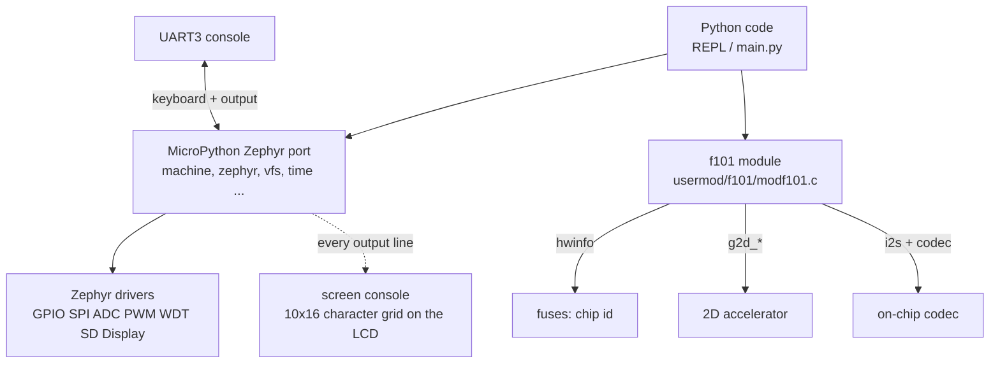

Runs [MicroPython](https://micropython.org/) on the board: a Python REPL on the console, `machine` access to the pins and peripherals, the TF card mounted as a file system, the LCD, and an extra module `f101` for the hardware MicroPython has no generic binding for (the chip id, the 2D accelerator and audio output). The application is the <strong>unmodified MicroPython Zephyr port</strong> (a git submodule, MIT); `zephyr-components/micropython` adds the board configuration, the Zephyr module glue and the `f101` module. It is built for the `yuzukineko` board and the REPL is on the console, UART1 (PB0/PB1), 115200.



Before you start, first complete [Setting up the development environment](../zephyr-setup-env.md) and [Getting the Zephyr source](../zephyr-get-source.md).

## What works

The table was verified on the F101 EVB before the application was moved to `yuzukineko`; it has been built for `yuzukineko` but not run there again. The entries that differ between the boards are marked.

| MicroPython | Hardware |
| --- | --- |
| `machine.Pin(('gpiod', 5), Pin.OUT)` | GPIO banks `gpioa` to `gpiof` |
| `machine.SPI('spi0')` | SPI0 |
| `machine.ADC(('adc', n))` | GPADC; channels 0 to 3 are declared in `conf/f101.overlay` |
| `machine.PWM(('pwm', 2), freq=..., duty_ns=...)` | PWM0-2 on PD22, the backlight output of the panel (the EVB had `pwm_bl` on PB0 to PB3 instead) |
| `machine.WDT(timeout=...)`, `machine.reset()` | watchdog; the reset is the watchdog too (about 1 s) |
| `zephyr.DiskAccess`, `/sd` | the TF card, mounted by `_boot.py`, FAT |
| `zephyr.Display(0)` | the LCD, RGB565 1024×768: `write(buf, x, y, w, h)`, `as_framebuf()` |
| `f101.unique_id()` | the 128-bit chip id |
| `f101.g2d_fill / g2d_blit / g2d_blend` | the 2D accelerator on `bytearray` surfaces |
| `f101.Audio(rate)` | on-chip codec output |

I2C is not on the list: `i2c1` is the touch panel and `i2c0` is off. Enable a controller and its `pinctrl` in your own overlay.

## Preparation

A TF card is only needed for `/sd`. It is mounted by the port's `_boot.py` at start (FAT) and becomes the current directory, and `/sd/lib` is added to `sys.path`; a `main.py` on the card is run at start as in the standard Zephyr port.

The build needs the submodules:

```sh
git submodule update --init
git -C zephyr-components/micropython/micropython submodule update --init --depth 1 \
	lib/oofatfs lib/littlefs lib/micropython-lib
```

## Building

```sh
. ./env.sh
zephyr-components/micropython/build.sh [build/upy] [-DCONFIG_MICROPY_HEAP_SIZE=...]
```

`build.sh` configures the build with the cross toolchain and then builds with `CROSS_COMPILE` <strong>unset</strong>: the build also compiles `mpy-cross` for the host, and with `CROSS_COMPILE` set it would be built for RISC-V and fail to link. Behind it is this `west` call, with the application `micropython/ports/zephyr`:

```sh
west build -b yuzukineko -d build/upy --cmake-only micropython/ports/zephyr -- \
	-DZEPHYR_EXTRA_MODULES=<this directory> \
	-DEXTRA_CONF_FILE=conf/f101.conf \
	-DEXTRA_DTC_OVERLAY_FILE=conf/f101.overlay \
	-DUSER_C_MODULES=usermod/f101/micropython.cmake
```

The image goes to `0x40000000` like the other samples. Extra arguments after the build directory are passed to CMake.

| File | Content |
| --- | --- |
| `conf/f101.conf` | `MICROPY_HEAP_SIZE` 1 MiB, kernel heap 256 KiB, main stack 8 KiB, networking/shell/log off, `SDHC`/`DISK_ACCESS` for `/sd`, `I2S`/`AUDIO`/`AUDIO_CODEC` for `f101.Audio`, `HWINFO` for `f101.unique_id()` |
| `conf/f101.overlay` | `watchdog0` alias for `machine.WDT`, and the four ADC channels (12 bits, gain 1, internal reference) listed in `zephyr,user` `io-channels`, in that order, as `ADC(0)` to `ADC(3)` |
| `shim/` | `alloca.h`, `math.h`, `unistd.h` that the minimal C library lacks |
| `src/f101_libc.c` | `__errno()` for the toolchain's libm; the module links `-lm` |
| `src/screen_console.c` | the console on the LCD, see below |
| `usermod/f101/` | the `f101` module |

## Running

Download it with either method in [Building and running](../zephyr-build-run.md); the REPL is on the console, UART1 (115200). For debugging use method one: `xfel ddr f101-s3`, `xfel write 0x40000000 build/upy/zephyr/zephyr.bin`, `xfel exec 0x40000000`.

```text
>>> import f101
>>> f101.unique_id().hex()
'…'
>>> from machine import Pin
>>> led = Pin(('gpiod', 5), Pin.OUT)
>>> led.toggle()
```

:::caution
The board has only one USB-C port, which is both the xfel download port and the UF2 drive port. Download first, then connect other devices.
:::

### The screen console

With `CONFIG_F101_MICROPY_SCREEN_CONSOLE` (default y when a display exists) everything MicroPython prints is also drawn into a character grid on the frame buffer plane: 10×16 pixel cells, green on black, at most 128 columns and 40 rows, with the usual cursor handling and the common `ESC [` sequences. The UART stays the keyboard and still gets all the output. It is done by wrapping the port's `mp_hal_stdout_tx_strn()` at link time (`-Wl,--wrap=mp_hal_stdout_tx_strn`).

## The `machine` and `zephyr` modules

These are the modules of the standard MicroPython Zephyr port; the names of devices are the Zephyr device names, so a pin is `(bank_label, number)`. The ones verified here:

```python
from machine import Pin, SPI, ADC, PWM, WDT
import machine, zephyr

Pin(('gpiod', 5), Pin.OUT).value(1)              # GPIO, banks gpioa .. gpiof
spi = SPI('spi0')                                # SPI0
adc = ADC(('adc', 0)); adc.read_u16()            # GPADC channels 0..3 of the overlay
pwm = PWM(('pwm', 2), freq=1000, duty_ns=500_000)   # PWM0-2 on PD22, use duty_ns
wdt = WDT(timeout=2000)                          # watchdog
machine.reset()                                  # watchdog reset, about 1 s
```

`machine.PWM(..., duty_u16=...)` overflows 32 bits for periods above about 130 µs (the port multiplies `duty_u16` by the period), so use `duty_ns`.

`zephyr.Display(0)` is the LCD (RGB565, 1024×768). `write(buf, x, y, w, h)` draws a rectangle from a buffer; `as_framebuf()` returns a `framebuf`-compatible object. The MicroPython heap (1 MiB) cannot hold a full 1024×768 RGB565 frame (1.5 MB), so draw in bands.

## The `f101` module

The module is `usermod/f101/modf101.c`. Everything that depends on a device is compiled only if the node is enabled in the device tree (`g2d`, `audio_codec` and `codec_analog`), so a build without them simply has no such names. Errors from the drivers are raised as `OSError(errno)`.

### `f101.unique_id()`

```python
f101.unique_id() -> bytes
```

The 128-bit chip id (16 bytes, fuse words 0 to 3), the same on every read and every boot of one chip. Raises `OSError` if the id cannot be read.

### 2D accelerator

The surfaces are plain buffers (`bytearray`, `memoryview` or any object with the buffer protocol) holding packed pixels of one plane; planar formats (NV12, I420, YUYV) are refused with `ValueError`. Because the accelerator reads and writes memory directly, the buffers have to be in 1:1 memory, which all RAM is in this configuration (the kernel runs without the MMU). A buffer shorter than `width * height * bytes-per-pixel` raises `ValueError("buffer too small")`. A rectangle is a tuple `(x, y, w, h)`; `None` means the whole surface.

Pixel formats (constants of the module): `ARGB8888`, `ABGR8888`, `RGBA8888`, `BGRA8888`, `XRGB8888`, `XBGR8888`, `RGB888`, `BGR888`, `RGB565`, `BGR565`. Flip flags: `FLIP_H`, `FLIP_V`.

```python
f101.g2d_fill(dst, width, height, format, color, rect=None)
```

Fills `rect` of `dst` with `color`, an ARGB8888 value (`0xAARRGGBB`), whatever the format of `dst` is; the accelerator converts it.

```python
f101.g2d_blit(src, sw, sh, sfmt, dst, dw, dh, dfmt,
              src_rect=None, dst_rect=None, rotate=0, flags=0)
```

Copies `src_rect` to `dst_rect`, converting the format. The sizes of the two rectangles select the scaling; `rotate` is 0, 90, 180 or 270 degrees (for 90 and 270 the destination size is the rotated source size); `flags` is `FLIP_H`, `FLIP_V` or both. Rotation is applied first, then the flip.

```python
f101.g2d_blend(fg, fw, fh, ffmt, dst, dw, dh, dfmt, alpha=255, fg_rect=None, dst_rect=None)
```

Composes `fg` over `dst` in place (source-over). With `alpha` below 255 it multiplies the pixel alpha of the foreground.

```python
W, H = 64, 64
a = bytearray(W * H * 4); b = bytearray(W * H * 4)
f101.g2d_fill(a, W, H, f101.ARGB8888, 0xFF0000FF)                 # opaque blue
f101.g2d_fill(b, W, H, f101.ARGB8888, 0x80FF0000, (0, 0, 32, 64)) # half-transparent red, left half
f101.g2d_blend(b, W, H, f101.ARGB8888, a, W, H, f101.ARGB8888)
```

### `f101.Audio`

```python
a = f101.Audio(rate=48000)
```

Opens the on-chip codec for output: 16-bit stereo I2S, `rate` between 8000 and 48000 (use 48000 or 44100). Only one `Audio` object can be open (`OSError(EBUSY)` otherwise). The output is written in 20 ms blocks (6 blocks in the pool, 3 written before the stream starts).

| Method | Purpose |
| --- | --- |
| `write(buf)` | queue S16LE stereo frames (4 bytes per frame); returns the number of bytes when everything is queued, so it blocks while the pool is full. A short last block is padded with silence |
| `tone(hz, ms, amp=12000)` | play a sine burst of `hz` for `ms` milliseconds, blocking; `hz` must be between 1 and rate/2 |
| `volume(v)` | output volume 0 to 255 (`AUDIO_PROPERTY_OUTPUT_VOLUME`) |
| `close()` | let the queued blocks play, stop the output and release it (also done by `__del__`) |

```python
a = f101.Audio(48000)
a.volume(150)
a.tone(440, 500)
a.close()
```

44.1 kHz and 48 kHz cannot be mixed in one boot (one audio PLL serves one family of rates): the first rate used wins until the next reset.

## Limits and notes

- The MicroPython heap is a static `CONFIG_MICROPY_HEAP_SIZE` array (1 MiB here) that is padded into the flat image, so a bigger heap makes the xfel download slower.
- The panel backlight is driven by the display driver on PWM0-2; using `PWM(('pwm', 2), ...)` from Python changes the same output.
- Networking is switched off in `conf/f101.conf`; the Kconfig warnings about NET symbols at configure time are the board defaults being overridden.
- The G2D calls are synchronous: they return when the accelerator is done or raise `OSError`.
- The screen console is a convenience mirror; the REPL itself runs on the UART.

## Code structure

| Path | Content |
| --- | --- |
| `micropython/` | the unmodified MicroPython (git submodule); the application is `micropython/ports/zephyr` |
| `build.sh` | configure + build as described above |
| `conf/f101.conf`, `conf/f101.overlay` | board configuration |
| `usermod/f101/modf101.c` | the `f101` module (`unique_id`, `g2d_*`, `Audio`) |
| `usermod/f101/micropython.cmake` | `USER_C_MODULES` entry |
| `src/`, `shim/` | libc gaps and the screen console |
| `CMakeLists.txt`, `Kconfig`, `zephyr/module.yml` | the Zephyr module glue, `F101_MICROPY_SCREEN_CONSOLE` |
