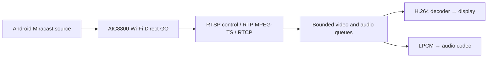

The Miracast receiver accepts **Wireless display / Screen mirroring** from an Android phone with Miracast support. It uses AIC8800 Wi-Fi Direct, the F101 H.264 decoder, the display video plane and the audio codec. No phone application or ADB debugging is required. Phones offering only Google Cast cannot send this protocol; the manufacturer's menu name alone does not establish support.

## Versions and verification

The receiver and NekoBox integration exist in the 4.2.2 component baseline and the separate 4.5 branch. Choose matching branches using the [version guide](../zephyr-4-5.md). Host protocol, P2P-control and NekoBox lifecycle tests passed; the 4.5 sample built in RAM and XIP configurations. Android discovery, negotiation, visible video, audible sound, reconnect and extended playback still require a physical phone test.

## Connect from NekoBox

1. Open **Miracast** on the [NekoBox](nekobox.md) home screen. Receiving starts automatically.
2. Open the phone's **Wireless display / Screen mirroring** menu and select **NekoBox Miracast**.
3. Use the page's stop/retry controls if necessary. Leaving the page stops the receiver and restores normal Wi-Fi and previously enabled DLNA services.

Miracast owns the radio while active. It cannot share an active STA connection or DLNA receiver. It needs no TF card. The waiting receiver repeatedly opens its WPS push-button pairing window, so start it when intending to connect a phone.

| NekoBox setting | Default | Purpose |
| --- | --- | --- |
| `CONFIG_NEKOBOX_FEATURE_MIRACAST` | `y` | Receiver, home tile and page; setting it to `n` removes the feature |
| `CONFIG_NEKOBOX_MIRACAST_NAME` | `NekoBox Miracast` | Name, 1–32 printable ASCII bytes |

## Build a standalone receiver

Activate the environment for your selected version. The default sample runs from RAM:

```sh
west build -b yuzukineko -d build/miracast zephyr-components/miracast/samples/receiver
```

For XIP, use a separate output directory:

```sh
west build -b yuzukineko -d build/miracast-xip zephyr-components/miracast/samples/receiver -- \
  -DEXTRA_CONF_FILE=xip.conf -DDTC_OVERLAY_FILE=boards/yuzukineko_xip.overlay
```

For 4.5, put these outputs under `build/zephyr-4.5.0/`. Follow [Build and run](../zephyr-build-run.md) for the appropriate image type: the XIP application belongs at NOR `0x80000`, and a current FEL loader runs from RAM `0x20000`. Preserve the NOR boot area and sampling parameters.

Wait for `Miracast: discoverable`, then select **YuzukiNeko Miracast** on the phone. The sample reports session state and decoded frame counts on the serial console. Disconnecting the phone removes the group and prepares the receiver again.

| Sample setting | Default | Purpose |
| --- | --- | --- |
| `CONFIG_SAMPLE_WFD_NAME` | `YuzukiNeko Miracast` | Advertised name, 1–32 printable ASCII bytes |
| `CONFIG_SAMPLE_WFD_720P` | `n` | Also offer 1280×720p30; requires additional decoder memory and throughput |
| `CONFIG_SAMPLE_WFD_PEER` | empty | For transport testing over an existing link; skips P2P setup |

The mandatory offer is 640×480p60, constrained-baseline H.264 level 3.1 and LPCM 48 kHz, 16-bit stereo. The negotiated timing does not guarantee that the board delivers every frame at that rate.

## Protocol and application interface



The core covers RTSP M1–M7, PAUSE/resume, TEARDOWN, keepalive and IDR requests; RTP payload type 33 carries MPEG-TS with PAT/PMT, PES and PTS parsing. RTCP receiver reports and BYE are supported. Loss or discontinuity triggers recovery; media is checked against the configured source and negotiated ports.

Add `miracast/` to `ZEPHYR_EXTRA_MODULES`, enable `CONFIG_MIRACAST`, and include `<miracast/miracast.h>`. `miracast_receiver_start()` is asynchronous; call start/stop from an application thread, outside callbacks. Callback buffers are borrowed until return, so copy them into bounded queues for decoding. For the F101 player, enable `CONFIG_MIRACAST_PLAYER`, include `<miracast/player.h>`, start the player, and pass `miracast_player_media` to the receiver. Stop the receiver before stopping the player. NekoBox keeps UI/player ownership on the UI thread.

HDCP/protected content, UIBC/touch return, TCP-interleaved media, RTP FEC, packet reordering, simultaneous STA/GO and P2P group-client operation are not implemented. The sample offers LPCM; optional AAC handling in the core requires an application decoder.

## Host checks

```sh
sh zephyr-components/miracast/tests/host/run.sh
sh zephyr-components/aic8800/tests/p2p/run.sh
sh zephyr-components/nekobox/tests/miracast/run.sh
```

These require GCC, Python 3 and FFmpeg with libx264. ASan/UBSan checks cover fragmented RTSP and transport streams, malformed packets, media limits, loss recovery, RTCP, keepalive, repeated socket cleanup and application lifecycle. The P2P test stubs the radio; it does not verify Wi-Fi discovery on a phone.
